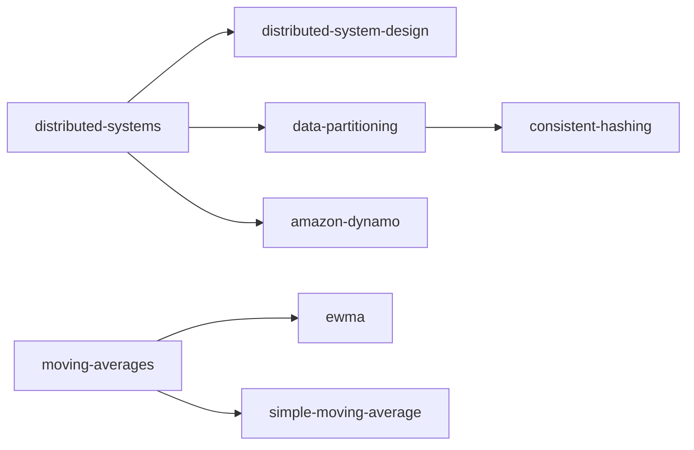

# Index of this wiki

<!-- sllmwiki:generated: rewritten by wiki-check.py --fix -->

The topics this wiki covers. Each opens a page with its narratives, sources and who to ask.

- [distributed-systems](sllmwiki/tags/distributed-systems.md): Systems of independent networked computers that coordinate by passing messages to appear as one system (2 narratives)
  - [distributed-system-design](sllmwiki/tags/distributed-system-design.md): Design tenets and principles for building distributed systems: failure, consistency, scalability, idempotency, backpressure (2 narratives)
  - [data-partitioning](sllmwiki/tags/data-partitioning.md): Splitting a dataset across nodes by key: hash, range and directory partitioning, and rebalancing
    - [consistent-hashing](sllmwiki/tags/consistent-hashing.md): Consistent hashing and its alternatives: the hash ring, virtual nodes, rendezvous, jump and Maglev hashing, bounded loads
  - [amazon-dynamo](sllmwiki/tags/amazon-dynamo.md): Amazon's Dynamo key-value store and Amazon DynamoDB: partitioning, replication and how the design evolved
- [moving-averages](sllmwiki/tags/moving-averages.md): Moving averages for smoothing a series of measurements over time (1 narrative)
  - [ewma](sllmwiki/tags/ewma.md): The exponentially weighted moving average: its recurrence, smoothing factor, and uses in software (2 narratives)
  - [simple-moving-average](sllmwiki/tags/simple-moving-average.md): Simple and weighted windowed moving averages, the alternatives to an EWMA (2 narratives)
