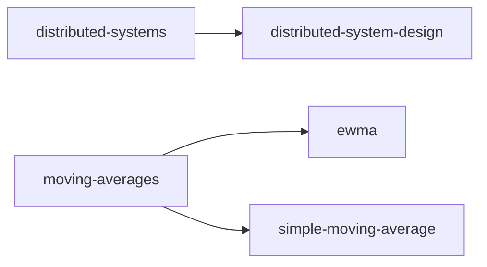

# Index of this wiki

<!-- sllmwiki:generated: rewritten by wiki-check.py --fix -->

The topics this wiki covers. Each opens a page with its narratives, sources and who to ask.

- [distributed-systems](sllmwiki/tags/distributed-systems.md): Systems of independent networked computers that coordinate by passing messages to appear as one system (1 narrative)
  - [distributed-system-design](sllmwiki/tags/distributed-system-design.md): Design tenets and principles for building distributed systems: failure, consistency, scalability, idempotency, backpressure (1 narrative)
- [moving-averages](sllmwiki/tags/moving-averages.md): Moving averages for smoothing a series of measurements over time
  - [ewma](sllmwiki/tags/ewma.md): The exponentially weighted moving average: its recurrence, smoothing factor, and uses in software
  - [simple-moving-average](sllmwiki/tags/simple-moving-average.md): Simple and weighted windowed moving averages, the alternatives to an EWMA
