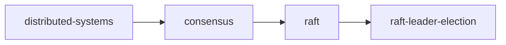

# Index of this wiki

<!-- sllmwiki:generated: rewritten by wiki-check.py --fix -->

The topics this wiki covers. Each opens a page with its narratives, sources and who to ask.

- [distributed-systems](sllmwiki/tags/distributed-systems.md): Systems of networked machines that coordinate to act as one
  - [consensus](sllmwiki/tags/consensus.md): Algorithms that get a group of servers to agree on values despite failures
    - [raft](sllmwiki/tags/raft.md): The Raft consensus algorithm for managing a replicated log
      - [raft-leader-election](sllmwiki/tags/raft-leader-election.md): How Raft servers elect a leader: terms, timeouts, votes and the election restriction
