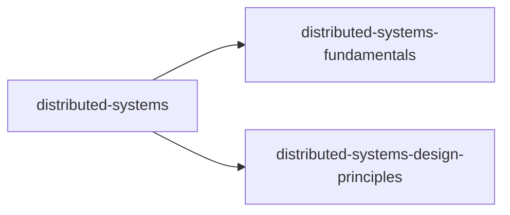

# Index of this wiki

<!-- sllmwiki:generated: rewritten by wiki-check.py --fix -->

The topics this wiki covers. Each opens a page with its narratives, sources and who to ask.

- [distributed-systems](sllmwiki/tags/distributed-systems.md): Systems of networked computers that coordinate to act as one
  - [distributed-systems-fundamentals](sllmwiki/tags/distributed-systems-fundamentals.md): What a distributed system is: definitions, characteristics, and why build one
  - [distributed-systems-design-principles](sllmwiki/tags/distributed-systems-design-principles.md): Common design tenets: fallacies, CAP and consistency trade-offs, fault tolerance, idempotency, scalability
