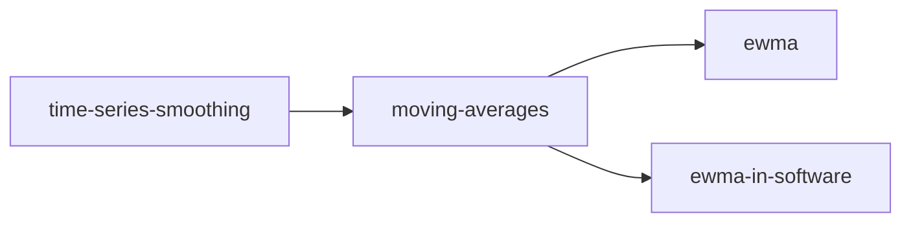

# Index of this wiki

<!-- sllmwiki:generated: rewritten by wiki-check.py --fix -->

The topics this wiki covers. Each opens a page with its narratives, sources and who to ask.

- [time-series-smoothing](sllmwiki/tags/time-series-smoothing.md): Smoothing noisy sequences of measurements over time
  - [moving-averages](sllmwiki/tags/moving-averages.md): Moving averages in general: simple, weighted, cumulative and exponential, and how they compare
    - [ewma](sllmwiki/tags/ewma.md): The exponentially weighted moving average: its recurrence, smoothing factor, bias and memory
    - [ewma-in-software](sllmwiki/tags/ewma-in-software.md): Using EWMAs in software: load averages, RTT estimation, latency and rate metrics
