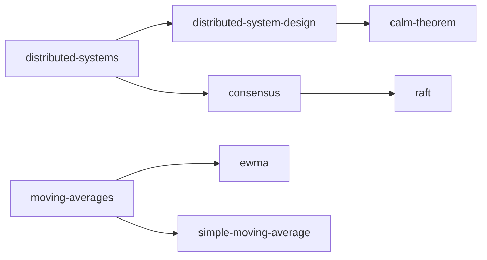

# Index of this wiki

<!-- sllmwiki:generated: rewritten by wiki-check.py --fix -->

The topics this wiki covers. Each opens a page with its narratives, sources and who to ask.

- [distributed-systems](tags/distributed-systems.md): Systems of independent networked computers that coordinate by passing messages to appear as one system (2 narratives)
  - [distributed-system-design](tags/distributed-system-design.md): Design tenets and principles for building distributed systems: failure, consistency, scalability, idempotency, backpressure (3 narratives)
    - [calm-theorem](tags/calm-theorem.md): The CALM theorem: consistency as logical monotonicity, which distributed programs need no coordination (2 narratives)
  - [consensus](tags/consensus.md): Consensus: getting a group of servers to agree on values despite failures, the core of replicated state machines
    - [raft](tags/raft.md): The Raft consensus algorithm: leader election, log replication and safety for a replicated log (1 narrative)
- [moving-averages](tags/moving-averages.md): Moving averages for smoothing a series of measurements over time (1 narrative)
  - [ewma](tags/ewma.md): The exponentially weighted moving average: its recurrence, smoothing factor, and uses in software (2 narratives)
  - [simple-moving-average](tags/simple-moving-average.md): Simple and weighted windowed moving averages, the alternatives to an EWMA (2 narratives)
