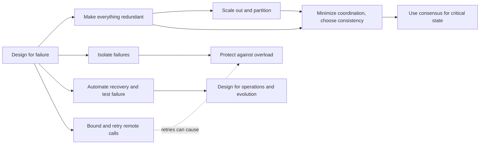

# What are the common design tenets and principles for distributed systems?

## 1. Abstract

No source gives one canonical list, but the official design principles from Microsoft and AWS, Google's SRE book and Amazon's engineering articles agree on a core of ten. They all start from one assumption: in a distributed system, failures are inevitable, so a design must tolerate them rather than hope to avoid them. From it follow the structural tenets: make everything redundant, so no single part's failure stops the system; scale out with many small, interchangeable parts and partition data and work around any one resource's limits; isolate failures so one bad request or customer can't take down everyone. Two tenets govern shared state: minimize coordination and choose deliberately between consistency and availability when the network partitions, and when processes must agree on critical state, such as who the leader is, use a proven consensus system rather than ad hoc heartbeats. Two govern calls between parts: bound every remote call with a timeout or deadline and retry with care, and protect each part from overload by shedding load and degrading gracefully. Operational tenets complete the set: automate recovery and test failure, and design for operations and evolution. The fallacies of distributed computing, such as "the network is reliable", list the assumptions these tenets guard against.

## 2. Terminology

| Term | Definition |
|---|---|
| **Single point of failure** | A component whose failure alone takes the system down |
| **Replica** | One of several copies of a component or of data, kept so that others can carry on if it fails |
| **Partition (network)** | A break in communication that splits a system's nodes into groups that can't reach each other |
| **Partitioning (data)** | Splitting data or work into parts, each handled by its own resources; also called sharding |
| **CAP** | Consistency, availability, partition tolerance: during a network partition a shared-data system can't keep both consistency and availability |
| **Eventual consistency** | If no new updates are made, all replicas eventually return the last value written |
| **Quorum** | The number of replicas that must take part in an operation for it to succeed, usually a majority |
| **Consensus** | Agreement among a group of processes on a value, despite an unreliable network |
| **Blast radius** | How much of a system, or how many of its customers, one failure affects |
| **Bulkhead** | A partition of resources so that a failure in one part can't exhaust the others |
| **Circuit breaker** | A client-side switch that stops calls to a dependency once errors pass a threshold |
| **Idempotent** | An operation that has the same effect however many times it is repeated |
| **Backoff** | Waiting longer between successive retries |
| **Jitter** | Randomness added to delays so many clients don't act at the same moment |
| **Deadline** | The absolute time by which a request must finish, passed along to every call it makes |
| **Load shedding** | Rejecting some requests on purpose as a server nears overload, so it keeps serving the rest |
| **Graceful degradation** | Serving cheaper, lower-quality results under overload instead of failing |
| **SLO** | Service level objective: a target for a service's reliability or performance |
| **[sllmwiki_reasoning]** | The narrative's own reasoning: a conclusion, comparison or reconstruction no cited source states. |
| **[sllmwiki_gap]** | Something the question needs that the sources don't answer. |

## 3. Scope

[sllmwiki_reasoning] This survey covers the tenets for designing systems whose parts run on networked machines and must act as one: how they survive failures, scale, share state and stay operable. It leaves out the algorithms themselves, such as Paxos or a particular replication scheme, and security, which the sources treat as its own subject. The items were chosen as those the most authoritative sources state as principles, Microsoft's and AWS's official design principles, plus tenets an A source puts first: consensus for critical state (Google SRE), managing partitions (Brewer), and overload protection (Google SRE). Tactics such as circuit breakers and jitter are named inside the item they serve.

[sllmwiki_reasoning] These tenets are design guidance, not theorems: CAP, the FLP result and the quorum arithmetic are the proven limits behind them. The vendors' lists also mix general tenets with platform advice, such as using managed services or an identity service, which this survey leaves out.

[sllmwiki_gap] The end-to-end argument (Saltzer, Reed and Clark, 1984), a classic principle for placing functions such as reliable delivery at the endpoints of a system, is recorded only as a link, so this survey doesn't cover it from a saved source.

## 4. At a glance

| Item | In one line | Sources |
|---|---|---|
| Design for failure | Failures are inevitable; design to tolerate them | [\[1\]](../sources/azure-cloud-design-principles.md#core-principles) [\[2\]](../sources/builders-library-timeouts-retries-backoff.md#failures-happen) [\[3\]](../sources/fallacies-of-distributed-computing.md#the-fallacies) |
| Make everything redundant | No single point of failure; replicate parts and data | [\[1\]](../sources/azure-cloud-design-principles.md#core-principles) [\[4\]](../sources/aws-reliability-pillar-design-principles.md#design-principles) [\[5\]](../sources/sre-book-distributed-consensus.md#number-of-replicas) |
| Scale out and partition | Many small parts; split data and work around limits | [\[1\]](../sources/azure-cloud-design-principles.md#core-principles) [\[4\]](../sources/aws-reliability-pillar-design-principles.md#design-principles) |
| Isolate failures | Contain each failure's blast radius | [\[1\]](../sources/azure-cloud-design-principles.md#core-principles) [\[6\]](../sources/builders-library-shuffle-sharding.md#what-is-shuffle-sharding) |
| Minimize coordination, choose consistency deliberately | Decouple; trade consistency for availability per operation | [\[1\]](../sources/azure-cloud-design-principles.md#core-principles) [\[7\]](../sources/cap-twelve-years-later-brewer.md#why-2-of-3-is-missleading) [\[8\]](../sources/eventually-consistent-vogels.md#eventually-consistent---revisited) |
| Use consensus for critical state | Agree on leaders, locks and membership with proven protocols | [\[9\]](../sources/sre-book-distributed-consensus.md#managing-critical-state-distributed-consensus-for-reliability) |
| Bound and retry remote calls carefully | Timeouts, deadlines, limited retries with backoff and jitter, idempotency | [\[10\]](../sources/builders-library-timeouts-retries-backoff.md#retries-and-backoff) [\[11\]](../sources/sre-book-addressing-cascading-failures.md#retries) |
| Protect against overload | Shed load and degrade gracefully before crashing | [\[12\]](../sources/sre-book-addressing-cascading-failures.md#preventing-server-overload) [\[13\]](../sources/sre-book-addressing-cascading-failures.md#load-shedding-and-graceful-degradation) |
| Automate recovery and test failure | Recover automatically; prove it by breaking things | [\[4\]](../sources/aws-reliability-pillar-design-principles.md#design-principles) [\[14\]](../sources/sre-book-addressing-cascading-failures.md#test-until-failure-and-beyond) |
| Design for operations and evolution | Observable, automated, loosely coupled, versioned | [\[15\]](../sources/azure-cloud-design-principles.md#operational-principles) [\[16\]](../sources/azure-cloud-design-principles.md#strategic-principles) |

## 5. The main items

### 5.1 Design for failure

**What:** Microsoft puts it plainly: "In distributed systems, failures are inevitable." [\[1\]](../sources/azure-cloud-design-principles.md#core-principles) Amazon designs systems to tolerate failure and to avoid magnifying a small percentage of failures into a complete outage, because no system can be built that never fails. [\[2\]](../sources/builders-library-timeouts-retries-backoff.md#failures-happen) **Why:** at large scale, events with a low probability are guaranteed to happen and must be accounted for in the design up front. [\[8\]](../sources/eventually-consistent-vogels.md#eventually-consistent---revisited) **Example:** the fallacies of distributed computing, such as "the network is reliable" and "latency is zero", are the assumptions this tenet corrects [\[3\]](../sources/fallacies-of-distributed-computing.md#the-fallacies); an application that assumes a reliable network may wait forever for a reply during an outage. [\[17\]](../sources/fallacies-of-distributed-computing.md#the-effects-of-the-fallacies) **Deeper:** what are the fallacies of distributed computing, and what does each break?

### 5.2 Make everything redundant

**What:** build redundancy in to avoid single points of failure: load balancers, multiple instances, database replicas, and multi-zone or multi-region deployments, at the level the business needs. [\[1\]](../sources/azure-cloud-design-principles.md#core-principles) **Why:** when one large resource is replaced by several small ones, a single failure has less impact and requests don't share a common point of failure. [\[4\]](../sources/aws-reliability-pillar-design-principles.md#design-principles) **Example:** a consensus system of 2f+1 replicas tolerates f failures, so Google recommends five replicas rather than three, to survive an unplanned failure during maintenance. [\[5\]](../sources/sre-book-distributed-consensus.md#number-of-replicas) **Deeper:** how many replicas does a system need, and where should they go?

### 5.3 Scale out and partition

**What:** scale horizontally by adding or removing instances as demand changes, avoiding session stickiness, and partition data horizontally, vertically or functionally to work around database, network and compute limits, with partition keys that avoid hotspots. [\[1\]](../sources/azure-cloud-design-principles.md#core-principles) **Why:** resource saturation is a common cause of failure, so monitor demand and add or remove resources automatically instead of guessing capacity. [\[4\]](../sources/aws-reliability-pillar-design-principles.md#design-principles) **Example:** autoscaling on live metrics handles variable load. [\[1\]](../sources/azure-cloud-design-principles.md#core-principles) **Deeper:** how do you choose a partition key?

### 5.4 Isolate failures

**What:** contain a failure so it doesn't spread; Microsoft names bulkheads and circuit breakers as ways to isolate failures. [\[1\]](../sources/azure-cloud-design-principles.md#core-principles) **Why:** when every worker serves every request, a poisonous request or a flood of requests can cascade through all of them, and the whole service goes down. [\[6\]](../sources/builders-library-shuffle-sharding.md#what-is-shuffle-sharding) **Example:** Amazon's shuffle sharding gives each customer its own combination of workers; with eight workers in pairs there are 28 combinations, so one customer's problem reaches about 1/28 of customers instead of all of them. [\[6\]](../sources/builders-library-shuffle-sharding.md#what-is-shuffle-sharding) Route 53 extends this so each domain gets a unique shard. [\[18\]](../sources/builders-library-shuffle-sharding.md#amazon-route-53-and-shuffle-sharding) **Deeper:** how do sharding, cells and shuffle sharding limit blast radius?

### 5.5 Minimize coordination, choose consistency deliberately

**What:** decouple components, communicate asynchronously and accept eventual consistency where appropriate. [\[1\]](../sources/azure-cloud-design-principles.md#core-principles) During a network partition a system must choose between consistency and availability, but Brewer argues the "2 of 3" view misleads: partitions are rare, the choice can differ per operation, data or user, and the properties are matters of degree. [\[7\]](../sources/cap-twelve-years-later-brewer.md#why-2-of-3-is-missleading) He recommends managing partitions explicitly: detect them, enter a partition mode that may limit some operations, and recover afterwards. [\[19\]](../sources/cap-twelve-years-later-brewer.md#managing-partitions) **Why:** choosing availability has a hidden cost, since designers must then know and restore every invariant. [\[20\]](../sources/cap-twelve-years-later-brewer.md#cap-confusion) **Example:** with N replicas, W write acknowledgements and R replicas read, W+R>N guarantees strong consistency; Amazon's shopping cart instead keeps both sides of a partition writable and merges the carts afterwards. [\[8\]](../sources/eventually-consistent-vogels.md#eventually-consistent---revisited) **Deeper:** how do the CAP theorem and consistency models constrain replicated data?

### 5.6 Use consensus for critical state

**What:** whenever you see leader election, critical shared state or distributed locking, use distributed consensus systems that have been formally proven and thoroughly tested. [\[9\]](../sources/sre-book-distributed-consensus.md#managing-critical-state-distributed-consensus-for-reliability) **Why:** many problems, including leader election, group membership, locking and reliable queuing, are versions of consensus, and ad hoc solutions such as heartbeats and gossip "will always have reliability problems in practice". [\[21\]](../sources/sre-book-distributed-consensus.md#case-study-3-faulty-group-membership-algorithms) **Example:** a pair of file servers that use heartbeat timeouts to elect a leader can, on a slow network, end with both active or both down, corrupting or losing data. [\[22\]](../sources/sre-book-distributed-consensus.md#case-study-1-the-split-brain-problem) [sllmwiki_reasoning] Only one source read here names this as a principle, though it is consistent with Brewer's treatment of partitions. **Deeper:** how do Paxos and Raft reach consensus?

### 5.7 Bound and retry remote calls carefully

**What:** set a timeout on every remote call, chosen from the downstream service's latency percentiles. [\[23\]](../sources/builders-library-timeouts-retries-backoff.md#timeouts) Retry transient failures with capped exponential backoff and a limit on attempts, at one layer of the stack only, and retry calls with side effects only when the API is idempotent. [\[10\]](../sources/builders-library-timeouts-retries-backoff.md#retries-and-backoff) Add jitter to retries and to periodic work. [\[24\]](../sources/builders-library-timeouts-retries-backoff.md#jitter) **Why:** retries are "selfish": under overload they add load and can delay recovery. [\[10\]](../sources/builders-library-timeouts-retries-backoff.md#retries-and-backoff) **Example:** if the database, backend, frontend and browser layers each make up to four attempts, one user action can cause 64 attempts on an overloaded database; Google adds retry budgets and deadlines propagated through the whole call tree. [\[11\]](../sources/sre-book-addressing-cascading-failures.md#retries) [\[25\]](../sources/sre-book-addressing-cascading-failures.md#deadline-propagation) **Deeper:** how should timeouts, retries and backoff be set?

### 5.8 Protect against overload

**What:** Google ranks the strategies: load test to find capacity limits and how the server fails, serve degraded results, make servers reject requests early and cheaply when overloaded, rate-limit at higher layers, and plan capacity. [\[12\]](../sources/sre-book-addressing-cascading-failures.md#preventing-server-overload) **Why:** overload is the most common cause of cascading failures, where one overloaded replica fails and pushes its load onto the rest. [\[26\]](../sources/sre-book-addressing-cascading-failures.md#server-overload) **Example:** load shedding returns an error to requests beyond a set number in flight, and graceful degradation might search only a cached subset of data. [\[13\]](../sources/sre-book-addressing-cascading-failures.md#load-shedding-and-graceful-degradation) Past the breaking point, some user-visible errors are better than trying to serve every request. [\[27\]](../sources/sre-book-addressing-cascading-failures.md#closing-remarks) **Deeper:** how do load shedding, backpressure and graceful degradation prevent cascading failures?

### 5.9 Automate recovery and test failure

**What:** monitor key performance indicators that measure business value and run automated recovery when a threshold is breached; test recovery procedures by simulating failures before they happen. [\[4\]](../sources/aws-reliability-pillar-design-principles.md#design-principles) **Why:** failure modes are hard to predict from first principles, so test components until they break: a well-designed one rejects a few requests and survives. [\[14\]](../sources/sre-book-addressing-cascading-failures.md#test-until-failure-and-beyond) **Example:** Microsoft recommends failure mode analysis during design, rating each failure mode by risk and impact. [\[16\]](../sources/azure-cloud-design-principles.md#strategic-principles) **Deeper:** how is chaos engineering practised?

### 5.10 Design for operations and evolution

**What:** give operators comprehensive logging, distributed tracing, standard metrics and automated management. [\[15\]](../sources/azure-cloud-design-principles.md#operational-principles) Design for change with loose coupling, encapsulated domain knowledge, asynchronous messaging and versioned APIs, and ground decisions in business requirements such as recovery time objectives and SLOs. [\[16\]](../sources/azure-cloud-design-principles.md#strategic-principles) **Why:** all successful applications change over time. [\[16\]](../sources/azure-cloud-design-principles.md#strategic-principles) **Example:** make infrastructure changes through automation that is itself tracked and reviewed. [\[4\]](../sources/aws-reliability-pillar-design-principles.md#design-principles) **Deeper:** how is a distributed system observed in production?

## 6. How they relate

[sllmwiki_reasoning] Design for failure is the root: every other item is a way to tolerate a part that fails or a network that misbehaves. Redundancy and scale-out support each other, since many small replicas both scale and survive the loss of one; but replicas raise the question of keeping them consistent, which is where minimizing coordination and choosing consistency deliberately come in, and consensus is the answer for the small amount of state that must stay strictly consistent. Isolation and overload protection overlap: both stop one failure from spreading. Remote-call discipline pulls against overload protection, because retries that help with transient failures amplify an overload, which is why both Amazon and Google bound them. Testing and automation make the other items real, and operability and evolution keep them true as the system changes.

## 7. Applying them

[sllmwiki_reasoning] A newcomer can learn the items in the order above, and ask of any design:

- What happens when each component, or the network between two of them, fails? Is there a single point of failure?
- How many customers does one bad request, host or zone affect?
- Which data must be strictly consistent, and which can be eventually consistent? What does the system do during a partition?
- Does every remote call have a timeout, and is there at most one layer of retries, with backoff and jitter?
- What does each server do when it's sent more load than it can handle?
- Has recovery been tested, and can operators see what is happening?

## 8. Where to go next

- What are the fallacies of distributed computing, and what does each break?
- How many replicas does a system need, and where should they go?
- How do you choose a partition key?
- How do sharding, cells and shuffle sharding limit blast radius?
- How do the CAP theorem and consistency models constrain replicated data?
- How do Paxos and Raft reach consensus?
- How should timeouts, retries and backoff be set?
- How do load shedding, backpressure and graceful degradation prevent cascading failures?
- How is chaos engineering practised?
- How is a distributed system observed in production?
- What is the end-to-end argument, and how does it apply today?

## 9. References

### 9.1 Sources read

- [azure-cloud-design-principles](../sources/azure-cloud-design-principles.md): the core, operational and strategic principles
- [aws-reliability-pillar-design-principles](../sources/aws-reliability-pillar-design-principles.md): automated recovery, recovery testing, horizontal scale, capacity, automated change
- [builders-library-timeouts-retries-backoff](../sources/builders-library-timeouts-retries-backoff.md): failure as a given, timeouts, retries, backoff, jitter, idempotency
- [cap-twelve-years-later-brewer](../sources/cap-twelve-years-later-brewer.md): the consistency and availability trade-off and managing partitions
- [fallacies-of-distributed-computing](../sources/fallacies-of-distributed-computing.md): the assumptions the tenets guard against
- [eventually-consistent-vogels](../sources/eventually-consistent-vogels.md): designing for rare events at scale, consistency models, N/W/R quorums
- [sre-book-addressing-cascading-failures](../sources/sre-book-addressing-cascading-failures.md): overload, load shedding, graceful degradation, retries, deadlines, testing
- [sre-book-distributed-consensus](../sources/sre-book-distributed-consensus.md): consensus for critical state, the failures of ad hoc methods, replica counts
- [builders-library-shuffle-sharding](../sources/builders-library-shuffle-sharding.md): isolating workloads to limit blast radius

### 9.2 Citations

1. [azure-cloud-design-principles: Core principles](../sources/azure-cloud-design-principles.md#core-principles)
2. [builders-library-timeouts-retries-backoff: Failures Happen](../sources/builders-library-timeouts-retries-backoff.md#failures-happen)
3. [fallacies-of-distributed-computing: The fallacies](../sources/fallacies-of-distributed-computing.md#the-fallacies)
4. [aws-reliability-pillar-design-principles: Design principles](../sources/aws-reliability-pillar-design-principles.md#design-principles)
5. [sre-book-distributed-consensus: Number of Replicas](../sources/sre-book-distributed-consensus.md#number-of-replicas)
6. [builders-library-shuffle-sharding: What is shuffle sharding?](../sources/builders-library-shuffle-sharding.md#what-is-shuffle-sharding)
7. [cap-twelve-years-later-brewer: Why "2 of 3" is missleading](../sources/cap-twelve-years-later-brewer.md#why-2-of-3-is-missleading)
8. [eventually-consistent-vogels: Eventually Consistent - Revisited](../sources/eventually-consistent-vogels.md#eventually-consistent---revisited)
9. [sre-book-distributed-consensus: Managing Critical State: Distributed Consensus for Reliability](../sources/sre-book-distributed-consensus.md#managing-critical-state-distributed-consensus-for-reliability)
10. [builders-library-timeouts-retries-backoff: Retries and backoff](../sources/builders-library-timeouts-retries-backoff.md#retries-and-backoff)
11. [sre-book-addressing-cascading-failures: Retries](../sources/sre-book-addressing-cascading-failures.md#retries)
12. [sre-book-addressing-cascading-failures: Preventing Server Overload](../sources/sre-book-addressing-cascading-failures.md#preventing-server-overload)
13. [sre-book-addressing-cascading-failures: Load Shedding and Graceful Degradation](../sources/sre-book-addressing-cascading-failures.md#load-shedding-and-graceful-degradation)
14. [sre-book-addressing-cascading-failures: Test Until Failure and Beyond](../sources/sre-book-addressing-cascading-failures.md#test-until-failure-and-beyond)
15. [azure-cloud-design-principles: Operational principles](../sources/azure-cloud-design-principles.md#operational-principles)
16. [azure-cloud-design-principles: Strategic principles](../sources/azure-cloud-design-principles.md#strategic-principles)
17. [fallacies-of-distributed-computing: The effects of the fallacies](../sources/fallacies-of-distributed-computing.md#the-effects-of-the-fallacies)
18. [builders-library-shuffle-sharding: Amazon Route 53 and shuffle sharding](../sources/builders-library-shuffle-sharding.md#amazon-route-53-and-shuffle-sharding)
19. [cap-twelve-years-later-brewer: Managing partitions](../sources/cap-twelve-years-later-brewer.md#managing-partitions)
20. [cap-twelve-years-later-brewer: Cap confusion](../sources/cap-twelve-years-later-brewer.md#cap-confusion)
21. [sre-book-distributed-consensus: Case Study 3: Faulty Group-Membership Algorithms](../sources/sre-book-distributed-consensus.md#case-study-3-faulty-group-membership-algorithms)
22. [sre-book-distributed-consensus: Case Study 1: The Split-Brain Problem](../sources/sre-book-distributed-consensus.md#case-study-1-the-split-brain-problem)
23. [builders-library-timeouts-retries-backoff: Timeouts](../sources/builders-library-timeouts-retries-backoff.md#timeouts)
24. [builders-library-timeouts-retries-backoff: Jitter](../sources/builders-library-timeouts-retries-backoff.md#jitter)
25. [sre-book-addressing-cascading-failures: Deadline propagation](../sources/sre-book-addressing-cascading-failures.md#deadline-propagation)
26. [sre-book-addressing-cascading-failures: Server Overload](../sources/sre-book-addressing-cascading-failures.md#server-overload)
27. [sre-book-addressing-cascading-failures: Closing Remarks](../sources/sre-book-addressing-cascading-failures.md#closing-remarks)

## 10. Metadata

- **Version:** 2.0
- **Template:** survey
- **Model:** claude-opus-5-5
- **Created:** 2026-10-20
- **Last modified:** 2026-10-20
- **History:**
  - 2.0 (2026-10-20): Rewritten as a survey of ten tenets, with four more sources: Google SRE on cascading failures and on consensus, Vogels on eventual consistency, and Amazon on shuffle sharding.
  - 1.0 (2026-10-20): First version.
- **Reading plan:**
  1. `fallacies-of-distributed-computing`, in full: medium relevance, authority C, 2026-10-20
  2. `eventually-consistent-vogels`, in full: medium relevance, authority A, 2008-12-19
  3. `cap-twelve-years-later-brewer`, in full: medium relevance, authority A, 2012-05-30
  4. `sre-book-addressing-cascading-failures`, in full: medium relevance, authority A, 2016-04-16
  5. `sre-book-distributed-consensus`, in full: medium relevance, authority A, 2016-04-16
  6. `builders-library-shuffle-sharding`, in full: medium relevance, authority A, 2019-12-05
  7. `builders-library-timeouts-retries-backoff`, in full: medium relevance, authority A, 2026-10-20
  8. `azure-cloud-design-principles`, in full: high relevance, authority A, 2026-10-20
  9. `aws-reliability-pillar-design-principles`, in full: high relevance, authority A, 2026-10-20
  10. `end-to-end-arguments-saltzer`, not read: a link, no saved copy
