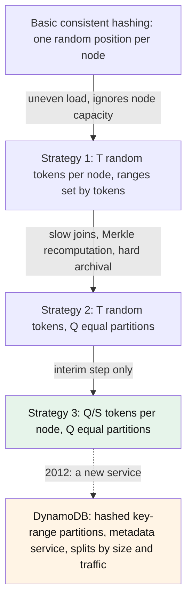

# How did Amazon's Dynamo use consistent hashing, and what did DynamoDB keep of it?

## 1. Abstract

Engineers who choose a partitioning scheme for a large key-value store can learn from Amazon, which built one on a consistent hashing ring and then built its successor differently. Dynamo (2007) placed keys and replicas on a ring with virtual nodes, and its random tokens tangled partitioning with placement until Amazon moved to fixed, equal-sized partitions assigned to nodes. DynamoDB (2012) still hashes each partition key, but stores contiguous key-range partitions found through a metadata service and splits them by size and traffic. Its paper never describes a ring for table data.

**Key takeaways:**

- Dynamo's ring gave decentralized, incremental scaling for a few hundred nodes.
- Random tokens made joins slow and repair costly; fixed partitions fixed that.
- Separating how data is partitioned from where partitions live was the lasting lesson.
- DynamoDB kept the hash, dropped the ring, and moved partitions by traffic, not by token.

## 2. Terminology

| Term | Definition |
|---|---|
| **Token** | A position on Dynamo's ring owned by a node; a node owns several, its virtual nodes. |
| **Preference list** | The distinct nodes responsible for a key, in ring order. |
| **N, R, W** | Replicas per key, and how many must answer a read or a write. |
| **Partition** | In DynamoDB, a contiguous range of hashed keys, stored and replicated as a unit. |
| **Q, S, T** | In Dynamo's evaluation: the number of fixed partitions, of nodes, and of tokens per node. |
| **[→]** | Our own reasoning, after a statement or on a section's heading: a conclusion, comparison or example no cited source states. |
| **[?]** | A gap: something the question needs that the saved sources don't answer. |

## 3. Context

Dynamo was Amazon's highly available key-value store, built for services such as the shopping cart, which served tens of millions of requests, and over 3 million checkouts, in a single day [\[1\]](../sources/amazon-dynamo-decandia-dynamo-sosp2007.md#page-2). Objects were usually under 1 MB, each service ran its own instance, and the design targeted up to hundreds of storage hosts [\[1\]](../sources/amazon-dynamo-decandia-dynamo-sosp2007.md#page-2). Services set latency targets at the 99.9th percentile, such as 300 ms [\[2\]](../sources/amazon-dynamo-decandia-dynamo-sosp2007.md#page-3).

Its successor, Amazon DynamoDB, launched in 2012 as a fully managed, multi-tenant service that partitions and re-partitions tables automatically [\[3\]](../sources/amazon-dynamo-elhemali-dynamodb-atc2022.md#introduction). Both systems are described by the people who built them: the 2007 Dynamo paper, the 2022 DynamoDB paper and AWS's developer guide. No independent account was saved, so the case rests on Amazon's own records [→].

## 4. The problem

Dynamo had to grow one storage host at a time, treat every node alike, avoid central coordination, and give each node work in proportion to its capacity [\[4\]](../sources/amazon-dynamo-decandia-dynamo-sosp2007.md#page-4). Two obvious approaches fail these constraints [→]. Hashing keys modulo the number of nodes remaps almost everything on each new host, against incremental growth [\[5\]](../sources/data-partitioning-cassandra-dynamo-architecture.md#consistent-hashing-using-a-token-ring). A central directory of key ranges would break symmetry and decentralization, and Dynamo also rejected multi-hop routing such as Chord's, because each hop adds latency variance; it wanted every node to route a request directly, a zero-hop DHT [\[6\]](../sources/amazon-dynamo-decandia-dynamo-sosp2007.md#page-5).

## 5. What happened

*Figure 5-1: The partitioning schemes Dynamo went through, the one it settled on (green), and DynamoDB's later design (orange).*

1. **The ring.** Dynamo hashed each key with MD5 to a 128-bit position on a ring and stored it at the first node clockwise [\[6\]](../sources/amazon-dynamo-decandia-dynamo-sosp2007.md#page-5). The key's coordinator replicated it to the next `N−1` nodes clockwise, and the preference list skipped positions so that it held only distinct physical nodes [\[7\]](../sources/amazon-dynamo-decandia-dynamo-sosp2007.md#page-6). The common configuration was `(N, R, W) = (3, 2, 2)` [\[8\]](../sources/amazon-dynamo-decandia-dynamo-sosp2007.md#page-11).
2. **Virtual nodes.** Random single positions gave non-uniform data and load and ignored differences between machines, so each node got several tokens; a failed node's load then dispersed over the others, and capacity could set a node's token count [\[7\]](../sources/amazon-dynamo-decandia-dynamo-sosp2007.md#page-6).
3. **Membership.** Tokens were chosen when a node first started, and the token map spread by gossip, so each node knew who owned every range [\[9\]](../sources/amazon-dynamo-decandia-dynamo-sosp2007.md#page-8), [\[10\]](../sources/amazon-dynamo-decandia-dynamo-sosp2007.md#page-9). Nodes were added and removed only by an explicit command, since most outages were transient [\[9\]](../sources/amazon-dynamo-decandia-dynamo-sosp2007.md#page-8).
4. **Strategy 1 in production.** T random tokens per node, with ranges set by token values [\[11\]](../sources/amazon-dynamo-decandia-dynamo-sosp2007.md#page-12). A joining node had to "steal" its ranges from nodes that scanned their stores at low priority, which in busy season took almost a day; every join or leave changed many ranges and forced Merkle trees to be recomputed; and archiving the key space was hard [\[11\]](../sources/amazon-dynamo-decandia-dynamo-sosp2007.md#page-12).
5. **Strategies 2 and 3.** The hash space was cut into Q equal partitions, with tokens used only to map partitions to nodes; Strategy 3 then gave each node Q/S tokens [\[11\]](../sources/amazon-dynamo-decandia-dynamo-sosp2007.md#page-12). Strategy 2 was a brief interim step in the migration from 1 to 3 [\[12\]](../sources/amazon-dynamo-decandia-dynamo-sosp2007.md#page-13).
6. **DynamoDB.** Its partition key goes through an internal hash function, whose output, with any sort key, decides where an item is stored [\[13\]](../sources/amazon-dynamo-elhemali-dynamodb-atc2022.md#architecture), [\[14\]](../sources/amazon-dynamo-aws-dynamodb-partitions.md#data-distribution-partition-key). Each partition holds a disjoint, contiguous range of the table's keys, replicated across Availability Zones by a Multi-Paxos group [\[13\]](../sources/amazon-dynamo-elhemali-dynamodb-atc2022.md#architecture). Request routers find a key's partition through routing metadata: each table's partitions, their key ranges and their storage nodes [\[15\]](../sources/amazon-dynamo-elhemali-dynamodb-atc2022.md#metadata-availability). Partitions split when they fill or need more throughput [\[16\]](../sources/amazon-dynamo-aws-dynamodb-partitions.md#partitions-and-data-distribution-in-dynamodb), [\[17\]](../sources/amazon-dynamo-elhemali-dynamodb-atc2022.md#journey-from-provisioned-to-on-demand). The only hash ring the paper mentions holds its admission-control servers, not table data [\[18\]](../sources/amazon-dynamo-elhemali-dynamodb-atc2022.md#global-admission-control).

## 6. Why

**Why the ring worked for Dynamo.** Consistent hashing gave incremental scalability, the property Dynamo's partitioning needed [\[6\]](../sources/amazon-dynamo-decandia-dynamo-sosp2007.md#page-5): a node's arrival or departure affects only its immediate neighbors [\[7\]](../sources/amazon-dynamo-decandia-dynamo-sosp2007.md#page-6). Because every node held the whole token map, any node could route any request in one hop, with no central registry [\[6\]](../sources/amazon-dynamo-decandia-dynamo-sosp2007.md#page-5).

**Why random tokens hurt.** With Strategy 1, a token decided both which keys formed a range and which node held them; the paper names this the fundamental issue: partitioning and placement "are intertwined" [\[11\]](../sources/amazon-dynamo-decandia-dynamo-sosp2007.md#page-12). Adding a node to absorb load therefore changed the partitioning itself, and that drove the scans, the Merkle recomputation and the archival pain [\[11\]](../sources/amazon-dynamo-decandia-dynamo-sosp2007.md#page-12).

**Why fixed partitions fixed it.** With Q fixed partitions, a join moves whole partitions instead of carving new ranges, so partitions travel as files and the key space can be archived partition by partition [\[12\]](../sources/amazon-dynamo-decandia-dynamo-sosp2007.md#page-13), and the per-range Merkle trees no longer need recomputing on every join [\[9\]](../sources/amazon-dynamo-decandia-dynamo-sosp2007.md#page-8). What it gave up: changing membership now needed coordination to keep the assignment's properties [\[12\]](../sources/amazon-dynamo-decandia-dynamo-sosp2007.md#page-13).

**Why DynamoDB went further.** The paper explains its changes by other forces: Dynamo was single-tenant, each team ran its own installation, and that operational burden blocked adoption [\[19\]](../sources/amazon-dynamo-elhemali-dynamodb-atc2022.md#history). A managed multi-tenant service has to reshape partitions to fit customers' traffic: hot partitions and throughput diluted by splits caused throttling [\[17\]](../sources/amazon-dynamo-elhemali-dynamodb-atc2022.md#journey-from-provisioned-to-on-demand). Splitting at a key the traffic has shown to be a good split point, as DynamoDB does [\[20\]](../sources/amazon-dynamo-elhemali-dynamodb-atc2022.md#splitting-for-consumption), needs partitions with movable boundaries and a directory of them, which a ring of hashed tokens does not give [→]. The DynamoDB paper does not itself say why the ring was dropped [?].

## 7. The ideas at work

### 7.1 Consistent hashing

A mapping that moves only the keys it must when nodes change, as [What is consistent hashing?](what-is-consistent-hashing.md) defines it. It explains step 1: Dynamo could add hosts one at a time without remapping the store [→].

### 7.2 Virtual nodes and token allocation

Many tokens per node even out arcs, and how tokens are chosen sets the cost of membership changes; [How does a consistent hashing ring work?](how-does-a-consistent-hashing-ring-work-and-what-are-its-weaknesses-and-tuning-knobs.md) covers both. They explain steps 2 to 5: random tokens balanced load but made each join a repartitioning [→].

### 7.3 Separating partitioning from placement

Decide the units of data once, then map units to nodes separately. It explains the move to Strategy 3, and DynamoDB's partitions with a metadata map, where moving a partition never changes what it contains [→].

## 8. Outcome

Over 24 hours of a live system, the share of nodes more than 15% off the average load was as high as 20% at low traffic and close to 10% at high traffic [\[8\]](../sources/amazon-dynamo-decandia-dynamo-sosp2007.md#page-11). Compared at equal metadata size, with 30 nodes and N = 3, Strategy 3 had the best load-balancing efficiency and Strategy 2 the worst [\[11\]](../sources/amazon-dynamo-decandia-dynamo-sosp2007.md#page-12), [\[12\]](../sources/amazon-dynamo-decandia-dynamo-sosp2007.md#page-13); Strategy 3 also shrank each node's membership data by three orders of magnitude [\[12\]](../sources/amazon-dynamo-decandia-dynamo-sosp2007.md#page-13). Dynamo answered 99.9995% of requests without timing out, with no data loss reported [\[21\]](../sources/amazon-dynamo-decandia-dynamo-sosp2007.md#page-14). Full membership at each node worked for a couple of hundred nodes, and the paper expected tens of thousands to need more [\[21\]](../sources/amazon-dynamo-decandia-dynamo-sosp2007.md#page-14).

In DynamoDB, adaptive capacity eliminated over 99.99% of the throttling caused by skewed access [\[22\]](../sources/amazon-dynamo-elhemali-dynamodb-atc2022.md#adaptive-capacity), and its routers' metadata cache hit about 99.75% of lookups, though cold starts caused spikes in metadata traffic [\[15\]](../sources/amazon-dynamo-elhemali-dynamodb-atc2022.md#metadata-availability). DynamoDB "shared most of the name of the previous Dynamo system but little of its architecture" [\[19\]](../sources/amazon-dynamo-elhemali-dynamodb-atc2022.md#history).

## 9. Lessons [→]

- **Decide partitioning separately from placement.** This is Dynamo's own diagnosis, given under Why. It holds whenever moving data is expensive: scans, repair trees, backups. It matters less for a cache, where a moved key costs only a miss.
- **A ring suits a symmetric, self-managed cluster of moderate size.** Dynamo ran on hundreds of nodes, each holding the full map. Past that, or when a service must rebalance by observed traffic, a directory of ranges is the simpler tool, as DynamoDB shows.
- **Balance keys and traffic separately.** Equal key ranges gave even load only for unskewed access; DynamoDB needed traffic-driven splits and admission control on top.
- **What would have changed the outcome:** starting Dynamo with fixed, equal-sized partitions would have avoided the day-long bootstraps and the Merkle recomputation that Strategy 1 caused.

## 10. Where to go next

- How does DynamoDB's global admission control share throughput among partitions?
- How do Dynamo's sloppy quorums and hinted handoff keep writes available?

## 11. References

### 11.1 Sources read

- [amazon-dynamo-decandia-dynamo-sosp2007](../sources/amazon-dynamo-decandia-dynamo-sosp2007.md): Dynamo's ring, virtual nodes, partitioning strategies and results
- [amazon-dynamo-elhemali-dynamodb-atc2022](../sources/amazon-dynamo-elhemali-dynamodb-atc2022.md): DynamoDB's partitions, metadata, splits and lineage
- [amazon-dynamo-aws-dynamodb-partitions](../sources/amazon-dynamo-aws-dynamodb-partitions.md): DynamoDB's official partitioning docs
- [data-partitioning-cassandra-dynamo-architecture](../sources/data-partitioning-cassandra-dynamo-architecture.md): why modulo hashing fails

### 11.2 Citations

1. [amazon-dynamo-decandia-dynamo-sosp2007: Page 2](../sources/amazon-dynamo-decandia-dynamo-sosp2007.md#page-2)
2. [amazon-dynamo-decandia-dynamo-sosp2007: Page 3](../sources/amazon-dynamo-decandia-dynamo-sosp2007.md#page-3)
3. [amazon-dynamo-elhemali-dynamodb-atc2022: Introduction](../sources/amazon-dynamo-elhemali-dynamodb-atc2022.md#introduction)
4. [amazon-dynamo-decandia-dynamo-sosp2007: Page 4](../sources/amazon-dynamo-decandia-dynamo-sosp2007.md#page-4)
5. [data-partitioning-cassandra-dynamo-architecture: Consistent Hashing using a Token Ring](../sources/data-partitioning-cassandra-dynamo-architecture.md#consistent-hashing-using-a-token-ring)
6. [amazon-dynamo-decandia-dynamo-sosp2007: Page 5](../sources/amazon-dynamo-decandia-dynamo-sosp2007.md#page-5)
7. [amazon-dynamo-decandia-dynamo-sosp2007: Page 6](../sources/amazon-dynamo-decandia-dynamo-sosp2007.md#page-6)
8. [amazon-dynamo-decandia-dynamo-sosp2007: Page 11](../sources/amazon-dynamo-decandia-dynamo-sosp2007.md#page-11)
9. [amazon-dynamo-decandia-dynamo-sosp2007: Page 8](../sources/amazon-dynamo-decandia-dynamo-sosp2007.md#page-8)
10. [amazon-dynamo-decandia-dynamo-sosp2007: Page 9](../sources/amazon-dynamo-decandia-dynamo-sosp2007.md#page-9)
11. [amazon-dynamo-decandia-dynamo-sosp2007: Page 12](../sources/amazon-dynamo-decandia-dynamo-sosp2007.md#page-12)
12. [amazon-dynamo-decandia-dynamo-sosp2007: Page 13](../sources/amazon-dynamo-decandia-dynamo-sosp2007.md#page-13)
13. [amazon-dynamo-elhemali-dynamodb-atc2022: Architecture](../sources/amazon-dynamo-elhemali-dynamodb-atc2022.md#architecture)
14. [amazon-dynamo-aws-dynamodb-partitions: Data distribution: Partition key](../sources/amazon-dynamo-aws-dynamodb-partitions.md#data-distribution-partition-key)
15. [amazon-dynamo-elhemali-dynamodb-atc2022: Metadata availability](../sources/amazon-dynamo-elhemali-dynamodb-atc2022.md#metadata-availability)
16. [amazon-dynamo-aws-dynamodb-partitions: Partitions and data distribution in DynamoDB](../sources/amazon-dynamo-aws-dynamodb-partitions.md#partitions-and-data-distribution-in-dynamodb)
17. [amazon-dynamo-elhemali-dynamodb-atc2022: Journey from provisioned to on-demand](../sources/amazon-dynamo-elhemali-dynamodb-atc2022.md#journey-from-provisioned-to-on-demand)
18. [amazon-dynamo-elhemali-dynamodb-atc2022: Global admission control](../sources/amazon-dynamo-elhemali-dynamodb-atc2022.md#global-admission-control)
19. [amazon-dynamo-elhemali-dynamodb-atc2022: History](../sources/amazon-dynamo-elhemali-dynamodb-atc2022.md#history)
20. [amazon-dynamo-elhemali-dynamodb-atc2022: Splitting for consumption](../sources/amazon-dynamo-elhemali-dynamodb-atc2022.md#splitting-for-consumption)
21. [amazon-dynamo-decandia-dynamo-sosp2007: Page 14](../sources/amazon-dynamo-decandia-dynamo-sosp2007.md#page-14)
22. [amazon-dynamo-elhemali-dynamodb-atc2022: Adaptive capacity](../sources/amazon-dynamo-elhemali-dynamodb-atc2022.md#adaptive-capacity)

## 12. Metadata

- **Version:** 1.1
- **Template:** case_study
- **Model:** claude-opus-5-5
- **Created:** 2026-10-23
- **Last modified:** 2026-10-23
- **History:**
  - 1.1 (2026-10-23): Lint: the load-imbalance measurement is no longer attributed to Strategy 1; (3,2,2) is the common configuration, not most services'
  - 1.0 (2026-10-23): First version.
- **Reading plan:**
  1. `how-do-the-ways-of-hashing-keys-to-servers-compare`, in full: existing narrative, background
  2. `data-partitioning-cassandra-dynamo-architecture`, in full: medium relevance, authority A, undated
  3. `amazon-dynamo-aws-dynamodb-partitions`, in full: high relevance, authority A, undated
  4. `amazon-dynamo-decandia-dynamo-sosp2007`, in full: high relevance, authority A, 2007-10-14
  5. `amazon-dynamo-elhemali-dynamodb-atc2022`, in full: high relevance, authority A, 2022-07-11
  6. `what-is-consistent-hashing`, in full: existing narrative, high relevance: built on
  7. `how-does-a-consistent-hashing-ring-work-and-what-are-its-weaknesses-and-tuning-knobs`, in full: existing narrative, high relevance: built on
  8. `consistent-hashing-wikipedia`, abstract only: low relevance
  9. `consistent-hashing-wikipedia-rendezvous-hashing`, abstract only: low relevance
  10. `consistent-hashing-lamping-veach-jump-hash`, abstract only: low relevance
  11. `consistent-hashing-mirrokni-bounded-loads`, abstract only: low relevance
  12. `consistent-hashing-eisenbud-maglev`, abstract only: low relevance
  13. `consistent-hashing-stoica-chord`, abstract only: low relevance
  14. `consistent-hashing-karger-stoc1997`, abstract only: low relevance
  15. `consistent-hashing-gryski-algorithmic-tradeoffs`, not read: a link, no saved copy
