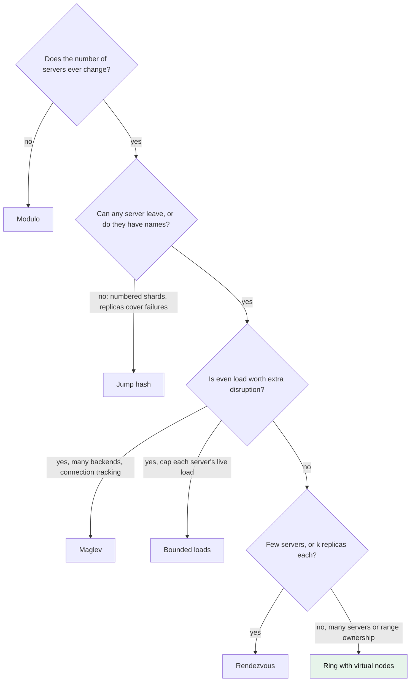

# How do the ways of hashing keys to servers compare: modulo, ring, rendezvous, jump, Maglev and bounded loads?

## 1. Abstract

Anyone who spreads keys over servers must pick a hashing scheme, which decides how many keys move when servers change, how even the load is, and what a lookup costs. Plain modulo is simplest but remaps almost everything on a resize. The ring with virtual nodes and rendezvous hashing move few keys and allow any server to leave. Jump hash balances almost perfectly with no memory, but only for numbered shards. Maglev trades a little extra disruption for near-perfect balance. Bounded loads caps every server's load.

**Key takeaways:**

- Servers come and go in any order? Ring or rendezvous; numbered shards that only grow? Jump.
- The ring's balance depends on its points per server: 1000 still leave 1% of servers 8% off average.
- Rendezvous needs no state but scores every server on each lookup.
- When balance matters more than minimal disruption, use Maglev, or bounded loads.

## 2. Terminology

| Term | Definition |
|---|---|
| **Disruption** | The share of keys whose server changes when the set of servers changes. |
| **Virtual node** | One of several points on a ring belonging to the same server. |
| **Standard error** | Here, the standard deviation of the servers' key shares divided by their mean, `σ/μ`; lower is more even. |
| **HRW** | Highest random weight, another name for rendezvous hashing. |
| **[→]** | Our own reasoning, after a statement or on a section's heading: a conclusion, comparison or example no cited source states. |
| **[?]** | A gap: something the question needs that the saved sources don't answer. |

## 3. The choices

The choice comes up whenever a cache tier, a store or a load balancer sends each key or connection to one of a changing set of servers [→]. [What is consistent hashing?](what-is-consistent-hashing.md) defines the property most candidates share: a change moves only the keys it must.

**The base scenario [→].** A team runs a session cache on 10 servers with arbitrary host names. Clients compute each session's server themselves. Servers fail now and then, any one of them, and the team will soon grow to 12.

### 3.1 Modulo hashing

The server is `hash(key) mod n`. It is balanced and costs one division, but it is not consistent: going from 10 to 12 servers changes `h mod 10` into `h mod 12`, which means the data would need to be "completely rearranged", when moving 1/6 of it would be enough [\[1\]](../sources/consistent-hashing-lamping-veach-jump-hash.md#page-1). **It wins** when the number of servers never changes, or a full reshuffle is cheap [→].

### 3.2 Ring with virtual nodes

Each server is hashed to many points on a circle, and a key goes to the first point clockwise; this is the scheme of Karger et al. [\[2\]](../sources/consistent-hashing-lamping-veach-jump-hash.md#page-2). Unlike modulo hashing, it moves only the keys in the arcs a new server takes over, or that a leaving server gives up, about `K/N` of `K` keys [\[3\]](../sources/consistent-hashing-wikipedia.md#complexity). Its subtle difference from rendezvous hashing: a removed server's keys go only to the servers whose points follow its points, as many as it has points [\[4\]](../sources/consistent-hashing-wikipedia-rendezvous-hashing.md#comparison-with-consistent-hashing). **It wins** in the base scenario as stated: servers have names, any of them can fail, and lookups are a binary search over stored points [→]. [How does a consistent hashing ring work?](how-does-a-consistent-hashing-ring-work-and-what-are-its-weaknesses-and-tuning-knobs.md) covers its mechanism.

### 3.3 Rendezvous (HRW) hashing

Each key scores every server with `h(key, server)` and goes to the highest score; for `k` replicas, it goes to the `k` highest [\[5\]](../sources/consistent-hashing-wikipedia-rendezvous-hashing.md#algorithm). It needs no precomputed tokens, and a removed server's keys spread uniformly over all the others [\[6\]](../sources/consistent-hashing-wikipedia-rendezvous-hashing.md#advantages-of-rendezvous-hashing-over-consistent-hashing). The ring is in fact a special case of it [\[7\]](../sources/consistent-hashing-wikipedia-rendezvous-hashing.md#consistent-hashing-is-a-special-case-of-rendezvous-hashing). Its cost is `O(n)` hashes per lookup [\[8\]](../sources/consistent-hashing-wikipedia-rendezvous-hashing.md#implementation). **It wins** when the team wants each session on its top 2 servers, with no ring to keep in sync and a few dozen servers make `n` hashes cheap [→].

### 3.4 Jump consistent hash

A few lines of code, with no stored state, compute a bucket number in `[0, n)` from a 64-bit key [\[2\]](../sources/consistent-hashing-lamping-veach-jump-hash.md#page-2). When `n` grows by one, each key stays with probability `n/(n+1)` and otherwise jumps to the new bucket [\[9\]](../sources/consistent-hashing-lamping-veach-jump-hash.md#page-3). Unlike the ring and rendezvous hashing, its buckets must be numbered sequentially, so it can only add or remove the last one and cannot take arbitrary server names [\[1\]](../sources/consistent-hashing-lamping-veach-jump-hash.md#page-1), [\[2\]](../sources/consistent-hashing-lamping-veach-jump-hash.md#page-2). **It wins** when the sessions become a store of numbered shards, each with replicas, so a server's death never removes a shard and only capacity changes move data [\[9\]](../sources/consistent-hashing-lamping-veach-jump-hash.md#page-3).

### 3.5 Maglev hashing

Each backend gets a pseudo-random preference list of positions in a lookup table of prime size `M`, and backends take turns filling their most-preferred empty positions; the table then maps a connection's hash to a backend [\[10\]](../sources/consistent-hashing-eisenbud-maglev.md#page-7). Its difference from the ring and rendezvous hashing is its priority: those put minimal disruption ahead of even load, and Maglev does the reverse [\[10\]](../sources/consistent-hashing-eisenbud-maglev.md#page-7). **It wins** when the clients become a software network load balancer spreading connections over hundreds of backends, where overloaded backends would force overprovisioning and connection tracking absorbs the extra disruption [\[10\]](../sources/consistent-hashing-eisenbud-maglev.md#page-7), [\[11\]](../sources/consistent-hashing-eisenbud-maglev.md#page-13).

### 3.6 Consistent hashing with bounded loads

The ring without virtual nodes, but every server has a capacity of about `(1+ε)` times the average load; a key that hits a full server is forwarded clockwise to the next one with room [\[12\]](../sources/consistent-hashing-mirrokni-bounded-loads.md#12-our-algorithmic-solution-respecting-bin-capacities-via-forwarding). Plain ring and rendezvous hashing balance no better than a random assignment [\[13\]](../sources/consistent-hashing-mirrokni-bounded-loads.md#1-introduction); bounded loads caps the maximum, at the price of more keys moving as `ε` shrinks [\[14\]](../sources/consistent-hashing-mirrokni-bounded-loads.md#13-our-results-theoretical-and-empirical). **It wins** when the load being balanced is live requests, not stored keys, and a server over its share hurts: Vimeo used it with `1+ε = 1.25` [\[14\]](../sources/consistent-hashing-mirrokni-bounded-loads.md#13-our-results-theoretical-and-empirical).

Multi-probe consistent hashing, which looks up several hashes of a key on a ring with one point per server, is a candidate the saved sources don't describe [?].

## 4. When to choose which [→]

*Figure 4-1: The questions that decide the choice; the green candidate is the default for the base scenario.*

- **Modulo** only for a fixed set of servers; switch the first time a resize is planned (see Disruption).
- **Ring with virtual nodes** when servers have names and leave in any order and there are too many for `n` hashes per lookup; switch when its imbalance or point memory hurts (see Balance and Memory).
- **Rendezvous** when servers are few or each key needs its top `k`; switch to the skeleton variant or the ring when lookups slow down (see Lookup cost).
- **Jump** for numbered shards with replicas; never for a cache tier where any server can vanish (see Arbitrary removal).
- **Maglev** for connection load balancing across many backends; pair it with connection tracking (see Disruption).
- **Bounded loads** when live load must stay within `(1+ε)` of average (see Balance).

## 5. At a glance

| Dimension | Modulo | Ring + virtual nodes | Rendezvous | Jump | Maglev | Bounded loads |
|---|---|---|---|---|---|---|
| Disruption on a change | nearly all keys [\[1\]](../sources/consistent-hashing-lamping-veach-jump-hash.md#page-1) | about `K/N`, from neighbors [\[3\]](../sources/consistent-hashing-wikipedia.md#complexity) | a removed server's keys, spread over all [\[6\]](../sources/consistent-hashing-wikipedia-rendezvous-hashing.md#advantages-of-rendezvous-hashing-over-consistent-hashing) | `1/(n+1)`, from every bucket [\[15\]](../sources/consistent-hashing-lamping-veach-jump-hash.md#page-7) | minimal plus a few more, rising with concurrent failures [\[16\]](../sources/consistent-hashing-eisenbud-maglev.md#page-12) | within a factor of the minimum, set by `ε` [\[14\]](../sources/consistent-hashing-mirrokni-bounded-loads.md#13-our-results-theoretical-and-empirical) |
| Balance | even [→] | σ/μ 3.2% at 1000 points per server [\[2\]](../sources/consistent-hashing-lamping-veach-jump-hash.md#page-2) | uniform over servers [\[6\]](../sources/consistent-hashing-wikipedia-rendezvous-hashing.md#advantages-of-rendezvous-hashing-over-consistent-hashing) | σ/μ about 10⁻⁸ [\[17\]](../sources/consistent-hashing-lamping-veach-jump-hash.md#page-6) | shares differ by at most one entry [\[10\]](../sources/consistent-hashing-eisenbud-maglev.md#page-7) | max load ≤ `(1+ε)` × average [\[18\]](../sources/consistent-hashing-mirrokni-bounded-loads.md#7-simulation-results) |
| Memory | none [→] | 46 MB as a tree for 1000 servers × 1000 points [\[19\]](../sources/consistent-hashing-lamping-veach-jump-hash.md#page-8) | no tokens [\[6\]](../sources/consistent-hashing-wikipedia-rendezvous-hashing.md#advantages-of-rendezvous-hashing-over-consistent-hashing) | a few registers [\[2\]](../sources/consistent-hashing-lamping-veach-jump-hash.md#page-2) | a table of `M` > 100 × N entries [\[10\]](../sources/consistent-hashing-eisenbud-maglev.md#page-7) | the ring plus per-server counts [\[20\]](../sources/consistent-hashing-mirrokni-bounded-loads.md#5-computing-moves-when-the-system-is-updated) |
| Lookup cost | one division [→] | binary search, `O(log N)` [\[3\]](../sources/consistent-hashing-wikipedia.md#complexity) | `n` hashes [\[8\]](../sources/consistent-hashing-wikipedia-rendezvous-hashing.md#implementation) | under `ln n + 1` loop steps [\[17\]](../sources/consistent-hashing-lamping-veach-jump-hash.md#page-6) | one table entry [→] | a ring lookup, then a short forward walk [\[14\]](../sources/consistent-hashing-mirrokni-bounded-loads.md#13-our-results-theoretical-and-empirical) |
| Arbitrary removal, names | no [→] | yes [\[9\]](../sources/consistent-hashing-lamping-veach-jump-hash.md#page-3) | yes [\[9\]](../sources/consistent-hashing-lamping-veach-jump-hash.md#page-3) | no [\[1\]](../sources/consistent-hashing-lamping-veach-jump-hash.md#page-1) | yes [\[10\]](../sources/consistent-hashing-eisenbud-maglev.md#page-7) | yes, any order [\[13\]](../sources/consistent-hashing-mirrokni-bounded-loads.md#1-introduction) |
| Weights | no [→] | points per server [\[21\]](../sources/consistent-hashing-wikipedia.md#variance-reduction) | weighted scores [\[22\]](../sources/consistent-hashing-wikipedia-rendezvous-hashing.md#weighted-variations) | not covered [?] | turn frequency [\[10\]](../sources/consistent-hashing-eisenbud-maglev.md#page-7) | not covered [?] |

## 6. Dimensions to think through

### 6.1 Disruption on a change

In a cache every moved key is a miss, in a store a copy [→]. The ring moves about `K/N` keys, but only from the neighbors of the new points: with 10 points per server, at most 10 servers give up data, so a hot server may not be relieved [\[15\]](../sources/consistent-hashing-lamping-veach-jump-hash.md#page-7). Jump hash takes an equal share from every bucket [\[15\]](../sources/consistent-hashing-lamping-veach-jump-hash.md#page-7), and rendezvous spreads a removed server's keys over all the others [\[6\]](../sources/consistent-hashing-wikipedia-rendezvous-hashing.md#advantages-of-rendezvous-hashing-over-consistent-hashing). Maglev accepts more: when backends fail, entries of the surviving backends change too, a share that grows with concurrent failures and shrinks with a larger table [\[16\]](../sources/consistent-hashing-eisenbud-maglev.md#page-12).

### 6.2 Balance

The most loaded server sets the capacity everyone pays for [→]. The ring's balance depends on its points per server: at 10 points, 1% of servers get under 0.37 or over 1.98 times the average, and even at 1000 points, 1% are at least 8% off [\[17\]](../sources/consistent-hashing-lamping-veach-jump-hash.md#page-6), [\[15\]](../sources/consistent-hashing-lamping-veach-jump-hash.md#page-7). In Maglev's tests with 1000 backends, the ring and rendezvous needed 29.7% and 49.5% overprovisioning with a 65537-entry table, while Maglev's balance was almost perfect [\[16\]](../sources/consistent-hashing-eisenbud-maglev.md#page-12). All of these balance keys; bounded loads alone caps each server [\[13\]](../sources/consistent-hashing-mirrokni-bounded-loads.md#1-introduction), which limits live load under skew when the balls are requests [→].

### 6.3 Memory

The ring stores every point, and clients must hold it locally or pay extra network hops: 1000 points for each of 1000 servers take 46 MB as a balanced tree, 7.6 MB as a sorted array [\[19\]](../sources/consistent-hashing-lamping-veach-jump-hash.md#page-8). Jump and rendezvous store nothing per lookup beyond the server list [\[2\]](../sources/consistent-hashing-lamping-veach-jump-hash.md#page-2), [\[6\]](../sources/consistent-hashing-wikipedia-rendezvous-hashing.md#advantages-of-rendezvous-hashing-over-consistent-hashing). Maglev keeps a table of over 100 × N entries [\[10\]](../sources/consistent-hashing-eisenbud-maglev.md#page-7), built in 1.8 ms at 65537 entries [\[16\]](../sources/consistent-hashing-eisenbud-maglev.md#page-12).

### 6.4 Lookup cost

Lookup cost matters when it runs per request or per packet [→]. At 1000 points per server, jump hash is 3-4 times faster than the ring for up to 1000 buckets [\[23\]](../sources/consistent-hashing-lamping-veach-jump-hash.md#page-9). Rendezvous costs `n` hashes, and a skeleton of virtual clusters brings it to `O(log n)` at some cost in uniformity [\[6\]](../sources/consistent-hashing-wikipedia-rendezvous-hashing.md#advantages-of-rendezvous-hashing-over-consistent-hashing).

### 6.5 Arbitrary removal, names

A cache tier loses arbitrary servers; a replicated store can keep its shard numbers dense, because server death does not reallocate data [\[9\]](../sources/consistent-hashing-lamping-veach-jump-hash.md#page-3). Only jump hash and modulo require dense numbering [\[1\]](../sources/consistent-hashing-lamping-veach-jump-hash.md#page-1).

### 6.6 Weights

Mixed hardware needs shares proportional to capacity [→]. The ring and rendezvous express weight with more points or copies, which cannot express a non-integer weight without many virtual nodes [\[22\]](../sources/consistent-hashing-wikipedia-rendezvous-hashing.md#weighted-variations); a weighted rendezvous score fixes it [\[24\]](../sources/consistent-hashing-wikipedia-rendezvous-hashing.md#weighted-rendezvous-hash).

## 7. Where to go next

- [How does a consistent hashing ring work, and what are its weaknesses and tuning knobs?](how-does-a-consistent-hashing-ring-work-and-what-are-its-weaknesses-and-tuning-knobs.md)
- [How did Amazon's Dynamo use consistent hashing, and what did DynamoDB keep of it?](how-did-amazons-dynamo-use-consistent-hashing-and-what-did-dynamodb-keep-of-it.md)

## 8. References

### 8.1 Sources read

- [consistent-hashing-lamping-veach-jump-hash](../sources/consistent-hashing-lamping-veach-jump-hash.md): jump hash, and measured ring balance, memory and speed
- [consistent-hashing-wikipedia-rendezvous-hashing](../sources/consistent-hashing-wikipedia-rendezvous-hashing.md): rendezvous hashing, its comparison with the ring, weights
- [consistent-hashing-eisenbud-maglev](../sources/consistent-hashing-eisenbud-maglev.md): Maglev hashing, measured against the ring and rendezvous
- [consistent-hashing-mirrokni-bounded-loads](../sources/consistent-hashing-mirrokni-bounded-loads.md): consistent hashing with bounded loads
- [consistent-hashing-wikipedia](../sources/consistent-hashing-wikipedia.md): complexity and virtual-node weights
- [consistent-hashing-karger-stoc1997](../sources/consistent-hashing-karger-stoc1997.md): the ring's original definition, for context

### 8.2 Citations

1. [consistent-hashing-lamping-veach-jump-hash: Page 1](../sources/consistent-hashing-lamping-veach-jump-hash.md#page-1)
2. [consistent-hashing-lamping-veach-jump-hash: Page 2](../sources/consistent-hashing-lamping-veach-jump-hash.md#page-2)
3. [consistent-hashing-wikipedia: Complexity](../sources/consistent-hashing-wikipedia.md#complexity)
4. [consistent-hashing-wikipedia-rendezvous-hashing: Comparison with consistent hashing](../sources/consistent-hashing-wikipedia-rendezvous-hashing.md#comparison-with-consistent-hashing)
5. [consistent-hashing-wikipedia-rendezvous-hashing: Algorithm](../sources/consistent-hashing-wikipedia-rendezvous-hashing.md#algorithm)
6. [consistent-hashing-wikipedia-rendezvous-hashing: Advantages of Rendezvous hashing over consistent hashing](../sources/consistent-hashing-wikipedia-rendezvous-hashing.md#advantages-of-rendezvous-hashing-over-consistent-hashing)
7. [consistent-hashing-wikipedia-rendezvous-hashing: Consistent hashing is a special case of Rendezvous hashing](../sources/consistent-hashing-wikipedia-rendezvous-hashing.md#consistent-hashing-is-a-special-case-of-rendezvous-hashing)
8. [consistent-hashing-wikipedia-rendezvous-hashing: Implementation](../sources/consistent-hashing-wikipedia-rendezvous-hashing.md#implementation)
9. [consistent-hashing-lamping-veach-jump-hash: Page 3](../sources/consistent-hashing-lamping-veach-jump-hash.md#page-3)
10. [consistent-hashing-eisenbud-maglev: Page 7](../sources/consistent-hashing-eisenbud-maglev.md#page-7)
11. [consistent-hashing-eisenbud-maglev: Page 13](../sources/consistent-hashing-eisenbud-maglev.md#page-13)
12. [consistent-hashing-mirrokni-bounded-loads: 1.2 Our algorithmic solution: Respecting bin capacities via forwarding.](../sources/consistent-hashing-mirrokni-bounded-loads.md#12-our-algorithmic-solution-respecting-bin-capacities-via-forwarding)
13. [consistent-hashing-mirrokni-bounded-loads: 1 Introduction](../sources/consistent-hashing-mirrokni-bounded-loads.md#1-introduction)
14. [consistent-hashing-mirrokni-bounded-loads: 1.3 Our Results: Theoretical and Empirical](../sources/consistent-hashing-mirrokni-bounded-loads.md#13-our-results-theoretical-and-empirical)
15. [consistent-hashing-lamping-veach-jump-hash: Page 7](../sources/consistent-hashing-lamping-veach-jump-hash.md#page-7)
16. [consistent-hashing-eisenbud-maglev: Page 12](../sources/consistent-hashing-eisenbud-maglev.md#page-12)
17. [consistent-hashing-lamping-veach-jump-hash: Page 6](../sources/consistent-hashing-lamping-veach-jump-hash.md#page-6)
18. [consistent-hashing-mirrokni-bounded-loads: 7 Simulation Results](../sources/consistent-hashing-mirrokni-bounded-loads.md#7-simulation-results)
19. [consistent-hashing-lamping-veach-jump-hash: Page 8](../sources/consistent-hashing-lamping-veach-jump-hash.md#page-8)
20. [consistent-hashing-mirrokni-bounded-loads: 5 Computing moves when the system is updated](../sources/consistent-hashing-mirrokni-bounded-loads.md#5-computing-moves-when-the-system-is-updated)
21. [consistent-hashing-wikipedia: Variance reduction](../sources/consistent-hashing-wikipedia.md#variance-reduction)
22. [consistent-hashing-wikipedia-rendezvous-hashing: Weighted variations](../sources/consistent-hashing-wikipedia-rendezvous-hashing.md#weighted-variations)
23. [consistent-hashing-lamping-veach-jump-hash: Page 9](../sources/consistent-hashing-lamping-veach-jump-hash.md#page-9)
24. [consistent-hashing-wikipedia-rendezvous-hashing: Weighted rendezvous hash](../sources/consistent-hashing-wikipedia-rendezvous-hashing.md#weighted-rendezvous-hash)

## 9. Metadata

- **Version:** 1.1
- **Template:** comparison
- **Model:** claude-opus-5-5
- **Created:** 2026-10-23
- **Last modified:** 2026-10-23
- **History:**
  - 1.1 (2026-10-23): Lint: the bounded-loads balance claim narrowed and marked; weights sentence repaired; Maglev's memory stated in Memory; ring and Dynamo narratives linked
  - 1.0 (2026-10-23): First version.
- **Reading plan:**
  1. `consistent-hashing-wikipedia`, in full: medium relevance, authority C, undated
  2. `consistent-hashing-karger-stoc1997`, in full: medium relevance, authority A, 1997-05-04
  3. `consistent-hashing-wikipedia-rendezvous-hashing`, in full: high relevance, authority C, undated
  4. `consistent-hashing-lamping-veach-jump-hash`, in full: high relevance, authority A, 2014-06-09
  5. `consistent-hashing-eisenbud-maglev`, in full: high relevance, authority A, 2016-03-16
  6. `consistent-hashing-mirrokni-bounded-loads`, in full: high relevance, authority A, 2016-08-03
  7. `what-is-consistent-hashing`, in full: existing narrative, high relevance: built on
  8. `consistent-hashing-stoica-chord`, abstract only: low relevance
  9. `data-partitioning-cassandra-dynamo-architecture`, abstract only: low relevance
  10. `amazon-dynamo-decandia-dynamo-sosp2007`, abstract only: low relevance
  11. `amazon-dynamo-elhemali-dynamodb-atc2022`, abstract only: low relevance
  12. `amazon-dynamo-aws-dynamodb-partitions`, abstract only: low relevance
  13. `consistent-hashing-gryski-algorithmic-tradeoffs`, not read: a link, no saved copy
