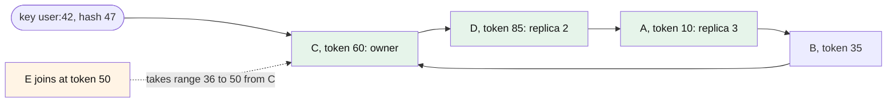

# How does a consistent hashing ring work, and what are its weaknesses and tuning knobs?

## 1. Abstract

Engineers running a store or cache on a consistent hashing ring need to know how it places keys and replicas, how it handles joins and failures, and where it breaks. The ring hashes nodes and keys into one circular space; each key belongs to the first node clockwise, and its replicas to the next distinct nodes. A join or a leave moves only the keys of the affected arc. Its weak points are uneven arcs, hot keys, memory for many tokens and slower repair. Its main knob is the number of tokens per node.

**Key takeaways:**

- Owner of a key: the first token at or after its hash, wrapping around.
- Replicas: keep walking clockwise, skipping tokens of nodes already chosen.
- One token per node is badly balanced; virtual nodes fix it at a cost.
- More tokens: better balance, but more failure combinations and slower repair.

## 2. Terminology

| Term | Definition |
|---|---|
| **Token** | A position on the ring owned by a node; a node may own several. |
| **Virtual node (vnode)** | One token of a physical node, treated as a separate point on the ring. |
| **Token range** | The arc of hash values between a token and the one before it; its keys belong to that token's node. |
| **RF** | Replication factor: how many distinct nodes store each key. |
| **Preference list** | The ordered list of distinct nodes responsible for a key. |
| **[→]** | Our own reasoning, after a statement or on a section's heading: a conclusion, comparison or example no cited source states. |
| **[?]** | A gap: something the question needs that the saved sources don't answer. |

## 3. Background

The ring is the classic construction of consistent hashing, a mapping of keys to nodes that moves as few keys as possible when the set of nodes changes; [What is consistent hashing?](what-is-consistent-hashing.md) defines it, and [How do the ways of hashing keys to servers compare?](how-do-the-ways-of-hashing-keys-to-servers-compare.md) weighs it against rendezvous, jump and Maglev hashing. Production stores built on it include Amazon's Dynamo, which partitions and replicates data with consistent hashing [\[1\]](../sources/amazon-dynamo-decandia-dynamo-sosp2007.md#page-1), and Cassandra, which follows Dynamo's design [\[2\]](../sources/data-partitioning-cassandra-dynamo-architecture.md#dynamo).

**The running example [→].** A key-value store keeps user profiles on four nodes, A to D, each profile on three of them (RF = 3). Traffic grows and the team adds a fifth node, E. With `hash(key) mod 4`, going to 5 nodes would invalidate almost all of the mappings [\[3\]](../sources/data-partitioning-cassandra-dynamo-architecture.md#consistent-hashing-using-a-token-ring), and almost every profile would have to be copied. The team needs a placement in which adding E moves only what E takes over, and in which any node can fail without losing a profile.

To follow the mechanism, you need one assumption: each node knows the full list of tokens and who owns them. Dynamo spreads this map by gossip, so each node can route a request directly, as a zero-hop lookup [\[4\]](../sources/amazon-dynamo-decandia-dynamo-sosp2007.md#page-5), [\[5\]](../sources/amazon-dynamo-decandia-dynamo-sosp2007.md#page-8).

## 4. The core idea

Bend the hash output range into a circle. Hash each node to one or more points on it, its tokens, and hash each key to a point too. A key belongs to the first node you meet walking clockwise from it, and its replicas to the next distinct nodes you meet [\[4\]](../sources/amazon-dynamo-decandia-dynamo-sosp2007.md#page-5), [\[6\]](../sources/amazon-dynamo-decandia-dynamo-sosp2007.md#page-6). A node that joins takes over part of one arc; a node that leaves hands its arc to the next node; nothing else moves [\[6\]](../sources/amazon-dynamo-decandia-dynamo-sosp2007.md#page-6).

With `h` the hash function and `T` the sorted set of tokens, the owner of key `k` is the node of the first token at or after the key's hash, wrapping to the smallest token past the top [\[7\]](../sources/consistent-hashing-wikipedia.md#implementation):

```math
\mathrm{owner}(k) = \mathrm{node}\left(\min\{\, t \in T : t \ge h(k) \,\}\right)
```



*Figure 4-1: The running example on a ring of positions 0-99: user:42 hashes to 47, so C owns it and D and A hold its replicas (green); E (orange) joins at 50 and takes over only the range from 36 to 50.*

## 5. How does it work?

The diagram's steps, worked on the running example with one token per node at positions 10 (A), 35 (B), 60 (C) and 85 (D) on a ring of 0-99 [→].

1. **Place the tokens.** Each node's identifier is hashed to a position: Chord hashes a node's IP address with SHA-1 [\[8\]](../sources/consistent-hashing-stoica-chord.md#page-3), Dynamo picks random positions for a node's tokens [\[4\]](../sources/amazon-dynamo-decandia-dynamo-sosp2007.md#page-5), [\[5\]](../sources/amazon-dynamo-decandia-dynamo-sosp2007.md#page-8). The tokens form a sorted map; a balanced search tree supports inserts and deletes [\[7\]](../sources/consistent-hashing-wikipedia.md#implementation).
2. **Find the owner.** Hash the key, Dynamo with MD5 to 128 bits [\[4\]](../sources/amazon-dynamo-decandia-dynamo-sosp2007.md#page-5), then binary-search the map for the first token at or after it, in `O(log N)` [\[9\]](../sources/consistent-hashing-wikipedia.md#basic-technique). `user:42` hashes to 47; the first token at or after 47 is 60, so C owns it [→].
3. **Walk to the replicas.** Keep walking clockwise until RF distinct nodes are found [\[3\]](../sources/data-partitioning-cassandra-dynamo-architecture.md#consistent-hashing-using-a-token-ring); Dynamo stores a key on its coordinator and the `N−1` clockwise successors [\[6\]](../sources/amazon-dynamo-decandia-dynamo-sosp2007.md#page-6). For `user:42` that is C, D, A [→]. All keys in the range from 36 to 60 share this replica set, which is why ranges, not keys, are the unit of placement [\[3\]](../sources/data-partitioning-cassandra-dynamo-architecture.md#consistent-hashing-using-a-token-ring).
4. **Join.** A new node takes over the keys between its predecessor's token and its own, all from its successor [\[7\]](../sources/consistent-hashing-wikipedia.md#implementation). E joins at 50, so the range from 36 to 50 moves from C to E: `user:42` is now on E, C and D, and A drops its copy [→]. In Dynamo, the nodes that lose ranges transfer them to the new node after a confirmation [\[10\]](../sources/amazon-dynamo-decandia-dynamo-sosp2007.md#page-9).
5. **Leave or fail.** A node that leaves hands all its keys to its successor, and no other assignment changes [\[8\]](../sources/consistent-hashing-stoica-chord.md#page-3). A client that decides a node is down just removes it from its view [\[11\]](../sources/consistent-hashing-karger-stoc1997.md#page-9). Dynamo treats an outage as temporary: a healthy node further along the ring takes the writes with a hint and hands them back on recovery, and only an operator's explicit command changes membership [\[5\]](../sources/amazon-dynamo-decandia-dynamo-sosp2007.md#page-8).

The lookup, in pseudocode, after the steps above:

```text
replicas(key, RF):
    p = hash(key)
    i = index of first token >= p in sorted tokens, or 0 if none   # wrap around
    nodes = []
    while len(nodes) < RF:
        n = owner(tokens[i])
        if n not in nodes: nodes.append(n)                         # skip repeated nodes
        i = (i + 1) mod len(tokens)
    return nodes
```

## 6. Variants

**Virtual nodes.** Each physical node owns many tokens instead of one [\[6\]](../sources/amazon-dynamo-decandia-dynamo-sosp2007.md#page-6). This is the form almost every production ring uses, and the running example needs it: with four nodes at one token each, there is no position for E that leaves the ring balanced [\[12\]](../sources/data-partitioning-cassandra-dynamo-architecture.md#multiple-tokens-per-physical-node-vnodes). With many tokens, E takes roughly equal data from every node; a failed node's load spreads over many survivors; and a bigger machine can own more tokens [\[6\]](../sources/amazon-dynamo-decandia-dynamo-sosp2007.md#page-6), [\[12\]](../sources/data-partitioning-cassandra-dynamo-architecture.md#multiple-tokens-per-physical-node-vnodes). The replica walk must then skip tokens of nodes already chosen, so that the list holds only distinct physical nodes [\[6\]](../sources/amazon-dynamo-decandia-dynamo-sosp2007.md#page-6), [\[13\]](../sources/data-partitioning-cassandra-dynamo-architecture.md#multi-master-replication-versioned-data-and-tunable-consistency).

**Bounded loads.** Keep the plain ring, but give each node a capacity of about `(1+ε)` times the average and forward a key that finds its node full to the next node with room [\[14\]](../sources/consistent-hashing-mirrokni-bounded-loads.md#12-our-algorithmic-solution-respecting-bin-capacities-via-forwarding). It suits balancing live requests, not stored data [→].

## 7. Design decisions and trade-offs

**Tokens per node.** The main knob. Karger et al. give each bucket about `log C` points, for `C` an upper bound on the number of buckets [\[15\]](../sources/consistent-hashing-karger-stoc1997.md#page-6). Chord's authors estimate that 32 virtual nodes per physical node would give good balance at internet scale [\[16\]](../sources/consistent-hashing-stoica-chord.md#page-4). Measured on random rings, 10 points per bucket leave 1% of buckets below 0.37 or above 1.98 times the average share, 100 points narrow that to 0.76-1.28, and 1000 points to 0.92-1.09 [\[17\]](../sources/consistent-hashing-lamping-veach-jump-hash.md#page-6). Cassandra 2.x needed 256 random tokens per node for balance; its later deterministic allocator balances the ring with far fewer [\[12\]](../sources/data-partitioning-cassandra-dynamo-architecture.md#multiple-tokens-per-physical-node-vnodes). Rule of thumb: start with the fewest tokens your token allocator needs to keep the most loaded node within your headroom; with random tokens that means hundreds [→]. Too few overloads some nodes; too many costs memory, repair time and availability (see Limitations).

**How tokens are chosen.** Random tokens tie partitioning to placement: in Dynamo, every join had to scan other nodes to carve out its ranges, which took almost a day in the busy season, and Merkle trees over the ranges had to be recomputed [\[18\]](../sources/amazon-dynamo-decandia-dynamo-sosp2007.md#page-12). Dynamo's fix was to split the ring into fixed, equal-sized partitions and move whole partitions between nodes, which gave the best balance it measured and membership data three orders of magnitude smaller [\[18\]](../sources/amazon-dynamo-decandia-dynamo-sosp2007.md#page-12), [\[19\]](../sources/amazon-dynamo-decandia-dynamo-sosp2007.md#page-13). The price is coordination on every membership change [\[19\]](../sources/amazon-dynamo-decandia-dynamo-sosp2007.md#page-13).

**Who knows the ring.** A full map at every node routes in one hop, but each node gossips the full routing table, which works for a couple of hundred nodes and gets hard at tens of thousands [\[20\]](../sources/amazon-dynamo-decandia-dynamo-sosp2007.md#page-14). Chord keeps only a small finger table at each node and pays with lookups that take several hops [\[21\]](../sources/consistent-hashing-stoica-chord.md#page-1), [\[16\]](../sources/consistent-hashing-stoica-chord.md#page-4). For a store of tens of nodes like the running example, the full map is the simpler choice [→].

## 8. Limitations and failure modes

**Uneven arcs.** Random token positions give non-uniform data and load, and the basic ring ignores differences between machines [\[6\]](../sources/amazon-dynamo-decandia-dynamo-sosp2007.md#page-6). Without virtual nodes, Chord's simulation had nodes storing no keys at all and one node holding 457 [\[22\]](../sources/consistent-hashing-stoica-chord.md#page-8); on a ring with one point per node, the most loaded node is about `Θ(log n)` times the average, and a typical key sits on a node with almost twice the average load [\[23\]](../sources/consistent-hashing-mirrokni-bounded-loads.md#11-background-consistent-hashing). Adding virtual nodes as an indirection layer improves this significantly, at the cost of routing state per virtual node [\[24\]](../sources/consistent-hashing-stoica-chord.md#page-9).

**Hot keys.** The ring balances keys, not requests: a node that owns a hot key stays hot, and Dynamo's load balance held only as long as the key access distribution was not highly skewed [\[25\]](../sources/amazon-dynamo-decandia-dynamo-sosp2007.md#page-11). A new node does not necessarily relieve a hot node, because it takes data only from the neighbors of its tokens [\[26\]](../sources/consistent-hashing-lamping-veach-jump-hash.md#page-7). Remedies include placing a hot key on several consecutive nodes [\[27\]](../sources/consistent-hashing-wikipedia.md#practical-extensions) and bounded loads (see Variants).

**The cost of many tokens.** Every token adds up to `2 × (RF − 1)` ring neighbors, so more combinations of node failures make some range unavailable; repair runs once per range and slows down [\[12\]](../sources/data-partitioning-cassandra-dynamo-architecture.md#multiple-tokens-per-physical-node-vnodes). Token maps take memory at every client, 46 MB as a tree for 1000 nodes of 1000 points [\[28\]](../sources/consistent-hashing-lamping-veach-jump-hash.md#page-8).

## 9. Misconceptions

- **Wrong: consistent hashing evens out load.** It evens out key counts, and only with enough tokens; see Uneven arcs and Hot keys [→].
- **Wrong: RF consecutive tokens are RF replicas.** With virtual nodes, consecutive tokens can belong to the same node; the walk must skip them [\[6\]](../sources/amazon-dynamo-decandia-dynamo-sosp2007.md#page-6).
- **Wrong: a failed node should leave the ring at once.** Removing it moves data on every transient outage; Dynamo and Cassandra change membership only on explicit command [\[5\]](../sources/amazon-dynamo-decandia-dynamo-sosp2007.md#page-8), [\[29\]](../sources/data-partitioning-cassandra-dynamo-architecture.md#ring-membership-and-failure-detection).

## 10. Where to go next

- How did Amazon's Dynamo use consistent hashing, and what did DynamoDB keep of it?
- How does Chord route a lookup without a full ring map at each node?

## 11. References

### 11.1 Sources read

- [amazon-dynamo-decandia-dynamo-sosp2007](../sources/amazon-dynamo-decandia-dynamo-sosp2007.md): the ring, replicas, virtual nodes and partitioning strategies in production
- [data-partitioning-cassandra-dynamo-architecture](../sources/data-partitioning-cassandra-dynamo-architecture.md): replica walk, vnode benefits and costs, token allocation
- [consistent-hashing-stoica-chord](../sources/consistent-hashing-stoica-chord.md): identifier circle, joins and leaves, load experiments
- [consistent-hashing-karger-stoc1997](../sources/consistent-hashing-karger-stoc1997.md): points per bucket, failure as a view change
- [consistent-hashing-wikipedia](../sources/consistent-hashing-wikipedia.md): implementation over a search tree, hot-key extensions
- [consistent-hashing-lamping-veach-jump-hash](../sources/consistent-hashing-lamping-veach-jump-hash.md): measured balance and memory of the ring
- [consistent-hashing-mirrokni-bounded-loads](../sources/consistent-hashing-mirrokni-bounded-loads.md): load of a plain ring, bounded loads

### 11.2 Citations

1. [amazon-dynamo-decandia-dynamo-sosp2007: Page 1](../sources/amazon-dynamo-decandia-dynamo-sosp2007.md#page-1)
2. [data-partitioning-cassandra-dynamo-architecture: Dynamo](../sources/data-partitioning-cassandra-dynamo-architecture.md#dynamo)
3. [data-partitioning-cassandra-dynamo-architecture: Consistent Hashing using a Token Ring](../sources/data-partitioning-cassandra-dynamo-architecture.md#consistent-hashing-using-a-token-ring)
4. [amazon-dynamo-decandia-dynamo-sosp2007: Page 5](../sources/amazon-dynamo-decandia-dynamo-sosp2007.md#page-5)
5. [amazon-dynamo-decandia-dynamo-sosp2007: Page 8](../sources/amazon-dynamo-decandia-dynamo-sosp2007.md#page-8)
6. [amazon-dynamo-decandia-dynamo-sosp2007: Page 6](../sources/amazon-dynamo-decandia-dynamo-sosp2007.md#page-6)
7. [consistent-hashing-wikipedia: Implementation](../sources/consistent-hashing-wikipedia.md#implementation)
8. [consistent-hashing-stoica-chord: Page 3](../sources/consistent-hashing-stoica-chord.md#page-3)
9. [consistent-hashing-wikipedia: Basic technique](../sources/consistent-hashing-wikipedia.md#basic-technique)
10. [amazon-dynamo-decandia-dynamo-sosp2007: Page 9](../sources/amazon-dynamo-decandia-dynamo-sosp2007.md#page-9)
11. [consistent-hashing-karger-stoc1997: Page 9](../sources/consistent-hashing-karger-stoc1997.md#page-9)
12. [data-partitioning-cassandra-dynamo-architecture: Multiple Tokens per Physical Node (vnodes)](../sources/data-partitioning-cassandra-dynamo-architecture.md#multiple-tokens-per-physical-node-vnodes)
13. [data-partitioning-cassandra-dynamo-architecture: Multi-master Replication: Versioned Data and Tunable Consistency](../sources/data-partitioning-cassandra-dynamo-architecture.md#multi-master-replication-versioned-data-and-tunable-consistency)
14. [consistent-hashing-mirrokni-bounded-loads: 1.2 Our algorithmic solution: Respecting bin capacities via forwarding.](../sources/consistent-hashing-mirrokni-bounded-loads.md#12-our-algorithmic-solution-respecting-bin-capacities-via-forwarding)
15. [consistent-hashing-karger-stoc1997: Page 6](../sources/consistent-hashing-karger-stoc1997.md#page-6)
16. [consistent-hashing-stoica-chord: Page 4](../sources/consistent-hashing-stoica-chord.md#page-4)
17. [consistent-hashing-lamping-veach-jump-hash: Page 6](../sources/consistent-hashing-lamping-veach-jump-hash.md#page-6)
18. [amazon-dynamo-decandia-dynamo-sosp2007: Page 12](../sources/amazon-dynamo-decandia-dynamo-sosp2007.md#page-12)
19. [amazon-dynamo-decandia-dynamo-sosp2007: Page 13](../sources/amazon-dynamo-decandia-dynamo-sosp2007.md#page-13)
20. [amazon-dynamo-decandia-dynamo-sosp2007: Page 14](../sources/amazon-dynamo-decandia-dynamo-sosp2007.md#page-14)
21. [consistent-hashing-stoica-chord: Page 1](../sources/consistent-hashing-stoica-chord.md#page-1)
22. [consistent-hashing-stoica-chord: Page 8](../sources/consistent-hashing-stoica-chord.md#page-8)
23. [consistent-hashing-mirrokni-bounded-loads: 1.1 Background: Consistent hashing](../sources/consistent-hashing-mirrokni-bounded-loads.md#11-background-consistent-hashing)
24. [consistent-hashing-stoica-chord: Page 9](../sources/consistent-hashing-stoica-chord.md#page-9)
25. [amazon-dynamo-decandia-dynamo-sosp2007: Page 11](../sources/amazon-dynamo-decandia-dynamo-sosp2007.md#page-11)
26. [consistent-hashing-lamping-veach-jump-hash: Page 7](../sources/consistent-hashing-lamping-veach-jump-hash.md#page-7)
27. [consistent-hashing-wikipedia: Practical extensions](../sources/consistent-hashing-wikipedia.md#practical-extensions)
28. [consistent-hashing-lamping-veach-jump-hash: Page 8](../sources/consistent-hashing-lamping-veach-jump-hash.md#page-8)
29. [data-partitioning-cassandra-dynamo-architecture: Ring Membership and Failure Detection](../sources/data-partitioning-cassandra-dynamo-architecture.md#ring-membership-and-failure-detection)


## 12. Metadata

- **Version:** 1.0
- **Template:** technical_brief_overview
- **Model:** claude-opus-5-5
- **Created:** 2026-10-23
- **Last modified:** 2026-10-23
- **History:**
  - 1.0 (2026-10-23): First version.
- **Reading plan:**
  1. `what-are-the-common-design-tenets-and-principles-for-distributed-systems`, in full: existing narrative, background
  2. `what-is-a-distributed-system`, in full: existing narrative, background
  3. `consistent-hashing-wikipedia`, in full: medium relevance, authority C, undated
  4. `consistent-hashing-lamping-veach-jump-hash`, in full: medium relevance, authority A, 2014-06-09
  5. `consistent-hashing-mirrokni-bounded-loads`, in full: medium relevance, authority A, 2016-08-03
  6. `data-partitioning-cassandra-dynamo-architecture`, in full: high relevance, authority A, undated
  7. `consistent-hashing-karger-stoc1997`, in full: high relevance, authority A, 1997-05-04
  8. `consistent-hashing-stoica-chord`, in full: high relevance, authority A, 2001-08-27
  9. `amazon-dynamo-decandia-dynamo-sosp2007`, in full: high relevance, authority A, 2007-10-14
  10. `what-is-consistent-hashing`, in full: existing narrative, high relevance: built on
  11. `how-do-the-ways-of-hashing-keys-to-servers-compare`, in full: existing narrative, high relevance: built on
  12. `consistent-hashing-wikipedia-rendezvous-hashing`, abstract only: low relevance
  13. `consistent-hashing-eisenbud-maglev`, abstract only: low relevance
  14. `distributed-systems-van-steen-tanenbaum-brief-intro`, abstract only: low relevance
  15. `distributed-system-design-wikipedia-fallacies`, abstract only: low relevance
  16. `distributed-system-design-hamilton-internet-scale-services`, abstract only: low relevance
  17. `distributed-system-design-aws-timeouts-retries-backoff`, abstract only: low relevance
  18. `distributed-system-design-aws-challenges-distributed-systems`, abstract only: low relevance
  19. `distributed-system-design-google-sre-cascading-failures`, abstract only: low relevance
  20. `distributed-system-design-aws-well-architected-reliability-principles`, abstract only: low relevance
  21. `ewma-linkerd-beyond-round-robin`, abstract only: low relevance
  22. `distributed-system-design-azure-design-principles`, abstract only: low relevance
  23. `distributed-system-design-brewer-cap-twelve-years-later`, abstract only: low relevance
  24. `distributed-system-design-ongaro-raft-consensus`, abstract only: low relevance
  25. `distributed-system-design-lamport-time-clocks`, abstract only: low relevance
  26. `distributed-system-design-saltzer-end-to-end-arguments`, abstract only: low relevance
  27. `consistent-hashing-gryski-algorithmic-tradeoffs`, not read: a link, no saved copy
  28. `distributed-system-design-waldo-note-on-distributed-computing`, not read: a link, no saved copy
