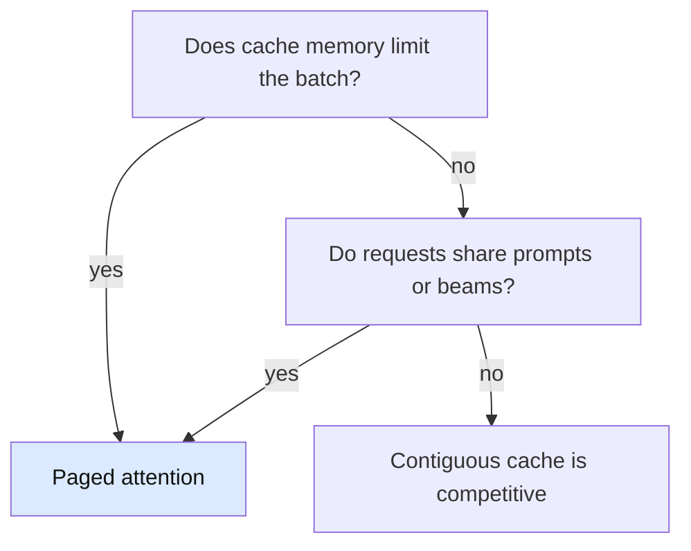

# Can you compare the classic attention mechanism and paged attention mechanism for transformer model architecture?

## 1. Abstract

Anyone serving a transformer language model to many users must decide how attention stores and reads the key-value (KV) cache, the memory that grows with every generated token. Both mechanisms compute the same attention. Classic attention reads each request's cache from one contiguous region reserved up front; paged attention reads it from small blocks allocated as tokens arrive. When cache memory limits how many requests run together, paged attention serves 1.7 to 2.7 times the request rate. When memory is plentiful, that lead shrinks, and the classic kernel is faster.

**Key takeaways:**

- The attention arithmetic is identical; only the cache layout differs.
- Contiguous reservation can leave as little as 20.4% of cache memory in use.
- Blocks waste at most part of one block per request, and requests can share them.
- Paged attention's attention kernel takes 20 to 26% longer.

## 2. Terminology

| Term | Definition |
|---|---|
| **Query, key, value (Q, K, V)** | The three matrices attention works on: queries, and an unordered set of key-value pairs [\[1\]](../sources/attention-wikipedia-machine-learning.md#standard-scaled-dot-product-attention). |
| **KV cache** | The keys and values of earlier tokens, kept so they are not recomputed for each new token [\[2\]](../sources/transformer-wikipedia-deep-learning-architecture.md#kv-caching). |
| **Prefill, decode** | Prefill computes the cache for the prompt; decode then generates tokens one at a time [\[2\]](../sources/transformer-wikipedia-deep-learning-architecture.md#kv-caching). |
| **Block** | A fixed number of tokens' keys and values, stored together [\[3\]](../sources/paged-attention-kwon-sosp2023.md#41-pagedattention). |
| **Block table** | The map from a request's logical blocks to physical blocks in GPU memory [\[4\]](../sources/paged-attention-kwon-sosp2023.md#42-kv-cache-manager). |
| **[→]** | Our own reasoning, after a statement or on a section's heading: a conclusion, comparison or example no cited source states. |
| **[?]** | A gap, after a statement or on a heading: something the question needs that the sources don't answer. |

## 3. The choices

The choice comes up whenever a GPU serves a transformer to many users at once [→]. It decides how many requests fit on the GPU together: batch size is limited by GPU memory, and throughput is memory-bound [\[5\]](../sources/paged-attention-kwon-sosp2023.md#3-memory-challenges-in-llm-serving).

The base scenario is a chat service serving OPT-13B on one GPU. One token's keys and values take 800 KB, so one request of 2,048 tokens can need 1.6 GB [\[5\]](../sources/paged-attention-kwon-sosp2023.md#3-memory-challenges-in-llm-serving). A GPU holds tens of gigabytes, so even with all of it given to the cache, only a few tens of requests fit [\[5\]](../sources/paged-attention-kwon-sosp2023.md#3-memory-challenges-in-llm-serving). Prompts vary in length, and nobody knows in advance how long each answer will be [\[5\]](../sources/paged-attention-kwon-sosp2023.md#3-memory-challenges-in-llm-serving).

### 3.1 Classic attention reads one contiguous cache

Classic attention computes $\mathrm{softmax}\left(QK^{\mathsf{T}}/\sqrt{d_k}\right)V$ [\[1\]](../sources/attention-wikipedia-machine-learning.md#standard-scaled-dot-product-attention), in several heads at once [\[6\]](../sources/attention-wikipedia-machine-learning.md#multi-head-attention). Serving systems before paged attention stored each request's KV cache as one contiguous tensor, because most deep learning operators expect contiguous memory [\[5\]](../sources/paged-attention-kwon-sosp2023.md#3-memory-challenges-in-llm-serving). Not knowing the output length, they reserved space for the request's maximum possible length [\[5\]](../sources/paged-attention-kwon-sosp2023.md#3-memory-challenges-in-llm-serving).

The difference a newcomer misses: the cost is not in the arithmetic but in the reservation. Reserved slots, over-provisioning for the maximum length and the memory allocator's gaps all waste memory [\[5\]](../sources/paged-attention-kwon-sosp2023.md#3-memory-challenges-in-llm-serving). In the paper's measurements, the memory actually used can be as low as 20.4% [\[5\]](../sources/paged-attention-kwon-sosp2023.md#3-memory-challenges-in-llm-serving).

Classic attention wins in the scenario changed one way: memory is plentiful for the sequences served. With OPT-175B on eight GPUs and the short sequences of the Alpaca dataset, contiguous systems batch many requests despite the waste; the workload becomes bound by computation rather than memory, and paged attention's lead over them is much smaller [\[7\]](../sources/paged-attention-kwon-sosp2023.md#62-basic-sampling). There, the classic kernel's speed counts for more (see Speed) [→].

### 3.2 Paged attention reads the cache in blocks

Paged attention "allows storing continuous keys and values in non-contiguous memory space" [\[3\]](../sources/paged-attention-kwon-sosp2023.md#41-pagedattention). It splits each request's KV cache into blocks of a fixed number of tokens and computes attention block by block, which gives the same result [\[3\]](../sources/paged-attention-kwon-sosp2023.md#41-pagedattention). A block manager allocates a physical block only when a request needs one, fills each request's blocks from left to right, and records the mapping in a block table; only the last block's unfilled positions are reserved [\[4\]](../sources/paged-attention-kwon-sosp2023.md#42-kv-cache-manager). The idea is virtual memory's paging: fixed-size pages, mapped to physical pages, allocated as needed [\[4\]](../sources/paged-attention-kwon-sosp2023.md#42-kv-cache-manager).

The difference from its nearest neighbour, the contiguous cache: the reservation is gone, but the kernel must look up and fetch each block separately [\[3\]](../sources/paged-attention-kwon-sosp2023.md#41-pagedattention), [\[8\]](../sources/paged-attention-kwon-sosp2023.md#71-kernel-microbenchmark).

Paged attention wins in the base scenario. vLLM is the serving system built on it [\[9\]](../sources/paged-attention-kwon-sosp2023.md#abstract). On ShareGPT conversations, vLLM batches 2.2 times as many OPT-13B requests at once as Orca (Oracle), a contiguous system that knows every output length in advance [\[7\]](../sources/paged-attention-kwon-sosp2023.md#62-basic-sampling). It sustains 1.7 to 2.7 times Orca (Oracle)'s request rate at similar latency [\[7\]](../sources/paged-attention-kwon-sosp2023.md#62-basic-sampling).

## 4. When to choose which

*Figure 4-1: The two conditions the scenarios changed, as questions; the shaded answer is the base scenario's [\[7\]](../sources/paged-attention-kwon-sosp2023.md#62-basic-sampling), [\[5\]](../sources/paged-attention-kwon-sosp2023.md#3-memory-challenges-in-llm-serving).*

- **If cache memory limits how many requests run at once, use paged attention** [\[7\]](../sources/paged-attention-kwon-sosp2023.md#62-basic-sampling). Long or varied sequences are the usual sign [→].
- **If requests share a prompt, or use parallel sampling or beam search, use paged attention:** blocks can be shared, and contiguous reservations cannot be [\[5\]](../sources/paged-attention-kwon-sosp2023.md#3-memory-challenges-in-llm-serving), [\[9\]](../sources/paged-attention-kwon-sosp2023.md#abstract).
- **If memory is plentiful for the sequences served and nothing is shared, a contiguous cache is competitive** [\[7\]](../sources/paged-attention-kwon-sosp2023.md#62-basic-sampling). The sources do not measure a case where it wins end to end [?].

## 5. At a glance

| Dimension | Classic attention (contiguous cache) | Paged attention (block cache) |
|---|---|---|
| What the attention computes | $\mathrm{softmax}(QK^{\mathsf{T}}/\sqrt{d_k})V$ [\[1\]](../sources/attention-wikipedia-machine-learning.md#standard-scaled-dot-product-attention) | The same, block by block [\[3\]](../sources/paged-attention-kwon-sosp2023.md#41-pagedattention) |
| Memory reserved and wasted | The maximum length, up front; as little as 20.4% used [\[5\]](../sources/paged-attention-kwon-sosp2023.md#3-memory-challenges-in-llm-serving) | Part of the last block per request [\[4\]](../sources/paged-attention-kwon-sosp2023.md#42-kv-cache-manager) |
| Sharing | Prevented by each request's reservation [\[5\]](../sources/paged-attention-kwon-sosp2023.md#3-memory-challenges-in-llm-serving) | Within and across requests [\[9\]](../sources/paged-attention-kwon-sosp2023.md#abstract) |
| Speed | The faster attention kernel [\[8\]](../sources/paged-attention-kwon-sosp2023.md#71-kernel-microbenchmark) | Attention kernel takes 20 to 26% longer [\[8\]](../sources/paged-attention-kwon-sosp2023.md#71-kernel-microbenchmark); 1.7 to 2.7 times Orca (Oracle)'s request rate [\[7\]](../sources/paged-attention-kwon-sosp2023.md#62-basic-sampling) |
| Running out of memory | Not described in the sources [?] | Preempts whole requests; swaps or recomputes their blocks [\[10\]](../sources/paged-attention-kwon-sosp2023.md#45-scheduling-and-preemption) |
| What operating it takes | Standard contiguous kernels [\[5\]](../sources/paged-attention-kwon-sosp2023.md#3-memory-challenges-in-llm-serving) | A block-aware kernel and a block size, 16 by default [\[11\]](../sources/paged-attention-vllm-design-doc.md#concepts), [\[12\]](../sources/paged-attention-kwon-sosp2023.md#72-impact-of-block-size) |

## 6. Dimensions to think through

### 6.1 What the attention computes

This dimension rules out a worry: both give the same outputs. Paged attention rewrites the attention sum as a sum over blocks [\[3\]](../sources/paged-attention-kwon-sosp2023.md#41-pagedattention), [\[1\]](../sources/attention-wikipedia-machine-learning.md#standard-scaled-dot-product-attention). Only where the keys and values are read from changes [→].

### 6.2 Memory reserved and wasted

Batch size is limited by GPU memory, and throughput is memory-bound [\[5\]](../sources/paged-attention-kwon-sosp2023.md#3-memory-challenges-in-llm-serving). A contiguous cache wastes memory three ways: slots reserved for future tokens, internal fragmentation from reserving the maximum length, and external fragmentation from the allocator [\[5\]](../sources/paged-attention-kwon-sosp2023.md#3-memory-challenges-in-llm-serving). A block cache reserves only the last block's unfilled positions, which removes most of that waste [\[4\]](../sources/paged-attention-kwon-sosp2023.md#42-kv-cache-manager). At 16 tokens a block, a request wastes at most 15 token slots: 15 × 800 KB = 12 MB for OPT-13B [\[4\]](../sources/paged-attention-kwon-sosp2023.md#42-kv-cache-manager), [\[12\]](../sources/paged-attention-kwon-sosp2023.md#72-impact-of-block-size), [\[5\]](../sources/paged-attention-kwon-sosp2023.md#3-memory-challenges-in-llm-serving).

### 6.3 Sharing

Parallel samples from one prompt can share the prompt's cache, which was 12% of cache memory in the paper's experiment, and beam search can save up to 55% through sharing [\[5\]](../sources/paged-attention-kwon-sosp2023.md#3-memory-challenges-in-llm-serving). Blocks make this sharing possible within and across requests [\[9\]](../sources/paged-attention-kwon-sosp2023.md#abstract); a contiguous reservation prevents it [\[5\]](../sources/paged-attention-kwon-sosp2023.md#3-memory-challenges-in-llm-serving).

### 6.4 Speed

Reading through a block table costs time: extra lookups, branches and handling of variable lengths make the attention kernel take 20 to 26% longer than FasterTransformer's [\[8\]](../sources/paged-attention-kwon-sosp2023.md#71-kernel-microbenchmark). Only the attention operator pays this, not the model's other layers [\[8\]](../sources/paged-attention-kwon-sosp2023.md#71-kernel-microbenchmark). End to end, the larger batch outweighs it while memory is the limit [\[8\]](../sources/paged-attention-kwon-sosp2023.md#71-kernel-microbenchmark), [\[7\]](../sources/paged-attention-kwon-sosp2023.md#62-basic-sampling). The vLLM kernel spreads the work over a grid of heads, requests and partitions, each warp of 32 threads handling one block at a time [\[11\]](../sources/paged-attention-vllm-design-doc.md#concepts).

### 6.5 Running out of memory

Output lengths are unknown, so a paged system can run out of free blocks mid-answer [\[10\]](../sources/paged-attention-kwon-sosp2023.md#45-scheduling-and-preemption). vLLM then preempts the latest requests first, evicting all of a request's blocks or none [\[10\]](../sources/paged-attention-kwon-sosp2023.md#45-scheduling-and-preemption). It brings them back by swapping them to CPU memory or by recomputing them in one prefill step [\[10\]](../sources/paged-attention-kwon-sosp2023.md#45-scheduling-and-preemption). Recomputation suits small blocks and swapping large ones; from 16 to 64 tokens a block, the two perform alike [\[13\]](../sources/paged-attention-kwon-sosp2023.md#73-comparing-recomputation-and-swapping). How contiguous systems behave when memory runs out is not described in the sources read [?].

### 6.6 What operating it takes

A block cache adds one setting, the block size. Too small, and the GPU reads the cache with too little parallelism; too large, and fragmentation grows inside blocks and sharing becomes less likely [\[12\]](../sources/paged-attention-kwon-sosp2023.md#72-impact-of-block-size). A block size of 16 works for most workloads, and vLLM uses it by default [\[12\]](../sources/paged-attention-kwon-sosp2023.md#72-impact-of-block-size). A contiguous cache needs no such setting [→]. It uses the contiguous tensors that most framework operators expect [\[5\]](../sources/paged-attention-kwon-sosp2023.md#3-memory-challenges-in-llm-serving).

## 7. Pitfalls

- **Expecting different answers.** Paged attention computes the same attention [\[3\]](../sources/paged-attention-kwon-sosp2023.md#41-pagedattention). If outputs differ, look at the implementation, not the mechanism [→].
- **Reading the headline as universal.** The 2 to 4 times throughput holds against the paper's baselines, and grows with longer sequences, larger models and more complex decoding [\[9\]](../sources/paged-attention-kwon-sosp2023.md#abstract); with short sequences and plentiful memory, the gap narrows [\[7\]](../sources/paged-attention-kwon-sosp2023.md#62-basic-sampling).

## 8. Where to go next

- How does vLLM schedule requests across GPUs?
- How does FlashAttention speed up the attention arithmetic itself?

## 9. References

### 9.1 Sources read

- [paged-attention-kwon-sosp2023](../sources/paged-attention-kwon-sosp2023.md): the memory problem, the paged design, scheduling under memory pressure, and the measurements (abstract; sections 3, 4.1, 4.2, 4.5, 6.2 and 7.1 to 7.3).
- [paged-attention-vllm-design-doc](../sources/paged-attention-vllm-design-doc.md): how the paged kernel divides its work.
- [attention-wikipedia-machine-learning](../sources/attention-wikipedia-machine-learning.md): the attention formula and multi-head attention.
- [transformer-wikipedia-deep-learning-architecture](../sources/transformer-wikipedia-deep-learning-architecture.md): the KV cache, prefill and decode.
- The original attention paper (Vaswani and colleagues, 2017) is recorded as a link; no claim here cites it.

### 9.2 Citations

1. [attention-wikipedia-machine-learning: Standard scaled dot-product attention](../sources/attention-wikipedia-machine-learning.md#standard-scaled-dot-product-attention)
2. [transformer-wikipedia-deep-learning-architecture: KV caching](../sources/transformer-wikipedia-deep-learning-architecture.md#kv-caching)
3. [paged-attention-kwon-sosp2023: 4.1 PagedAttention](../sources/paged-attention-kwon-sosp2023.md#41-pagedattention)
4. [paged-attention-kwon-sosp2023: 4.2 KV Cache Manager](../sources/paged-attention-kwon-sosp2023.md#42-kv-cache-manager)
5. [paged-attention-kwon-sosp2023: 3 Memory Challenges in LLM Serving](../sources/paged-attention-kwon-sosp2023.md#3-memory-challenges-in-llm-serving)
6. [attention-wikipedia-machine-learning: Multi-head attention](../sources/attention-wikipedia-machine-learning.md#multi-head-attention)
7. [paged-attention-kwon-sosp2023: 6.2 Basic Sampling](../sources/paged-attention-kwon-sosp2023.md#62-basic-sampling)
8. [paged-attention-kwon-sosp2023: 7.1 Kernel Microbenchmark](../sources/paged-attention-kwon-sosp2023.md#71-kernel-microbenchmark)
9. [paged-attention-kwon-sosp2023: Abstract](../sources/paged-attention-kwon-sosp2023.md#abstract)
10. [paged-attention-kwon-sosp2023: 4.5 Scheduling and Preemption](../sources/paged-attention-kwon-sosp2023.md#45-scheduling-and-preemption)
11. [paged-attention-vllm-design-doc: Concepts](../sources/paged-attention-vllm-design-doc.md#concepts)
12. [paged-attention-kwon-sosp2023: 7.2 Impact of Block Size](../sources/paged-attention-kwon-sosp2023.md#72-impact-of-block-size)
13. [paged-attention-kwon-sosp2023: 7.3 Comparing Recomputation and Swapping](../sources/paged-attention-kwon-sosp2023.md#73-comparing-recomputation-and-swapping)

## 10. Metadata

- **Version:** 2.0
- **Template:** comparison
- **Language:** en
- **Model:** claude-opus-5-5
- **Created:** 2026-10-27
- **Last modified:** 2026-11-24
- **Words:** 1,525 (about 7 min)
- **History:**
  - 2.0 (2026-11-24): Regenerated under sllmwiki 1.4.0's guides: a new spine and outline on the paper's OPT-13B scenario; the decision rule now rests on the paper's measurements (memory-bound against compute-bound workloads, the kernel's 20 to 26% overhead) instead of known output lengths; new dimensions for running out of memory and the block size; read sections 4.5, 6.2 and 7.1 to 7.3
  - 1.1 (2026-10-27): Lint: corrected two overstated claims (waste, sharing), split statements that were both cited and marked, cited the Q, K, V definition
  - 1.0 (2026-10-27): First version.
- **Reading plan:**
  1. `transformer-wikipedia-deep-learning-architecture`, in full: medium relevance, authority C, undated
  2. `attention-wikipedia-machine-learning`, in full: high relevance, authority C, undated
  3. `paged-attention-vllm-design-doc`, in full: high relevance, authority A, undated
  4. `paged-attention-kwon-sosp2023`, in full: high relevance, authority A, 2023-09-12
  5. `attention-vaswani-2017-attention-is-all-you-need`, not read: a link, no saved copy
