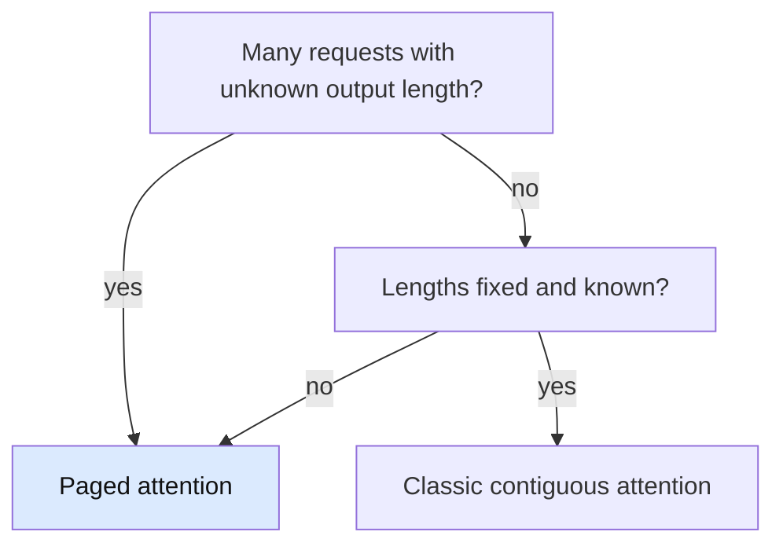

# Can you compare the classic attention mechanism and paged attention mechanism for transformer model architecture?

## 1. Abstract

Serving a transformer language model means choosing how attention reads its key-value (KV) cache, the memory that grows with each generated token. Classic attention keeps each request's cache in one contiguous block; paged attention keeps it in fixed-size blocks that need not sit together. The attention arithmetic is the same in both. The paper behind paged attention reports 2 to 4 times the throughput of earlier serving systems at similar latency [\[1\]](../sources/paged-attention-kwon-sosp2023.md#abstract). Choose by workload, not by the maths.

**Key takeaways:**

- Both compute the same attention function [\[2\]](../sources/attention-wikipedia-machine-learning.md#standard-scaled-dot-product-attention), [\[3\]](../sources/paged-attention-kwon-sosp2023.md#41-pagedattention).
- Only the memory layout differs [\[3\]](../sources/paged-attention-kwon-sosp2023.md#41-pagedattention), [\[4\]](../sources/paged-attention-kwon-sosp2023.md#42-kv-cache-manager).
- Contiguous reservation can leave as little as 20.4 percent of memory in use [\[5\]](../sources/paged-attention-kwon-sosp2023.md#3-memory-challenges-in-llm-serving).
- Blocks grow on demand and can be shared [\[4\]](../sources/paged-attention-kwon-sosp2023.md#42-kv-cache-manager), [\[1\]](../sources/paged-attention-kwon-sosp2023.md#abstract).

## 2. Terminology

| Term | Definition |
|---|---|
| **Query, key, value (Q, K, V)** | The three matrices attention works on: queries, and an unordered set of key-value pairs [\[2\]](../sources/attention-wikipedia-machine-learning.md#standard-scaled-dot-product-attention). |
| **KV cache** | The stored keys and values of earlier tokens, kept so they are not recomputed at each step [\[6\]](../sources/transformer-wikipedia-deep-learning-architecture.md#kv-caching). |
| **Prefill, decode** | Prefill computes the cache for the prompt; decode generates one token at a time from it [\[6\]](../sources/transformer-wikipedia-deep-learning-architecture.md#kv-caching). |
| **Block (KV block)** | A fixed number of tokens' keys and values, stored together [\[3\]](../sources/paged-attention-kwon-sosp2023.md#41-pagedattention). |
| **Block table** | The map from a request's logical blocks to physical blocks in GPU memory [\[4\]](../sources/paged-attention-kwon-sosp2023.md#42-kv-cache-manager). |
| **Fragmentation** | Memory that is free but too scattered to use [\[5\]](../sources/paged-attention-kwon-sosp2023.md#3-memory-challenges-in-llm-serving). |
| **[→]** | Our own reasoning, after a statement or on a section's heading: a conclusion, comparison or example no cited source states. |
| **[?]** | A gap, after a statement or on a heading: something the question needs that the sources don't answer. |

## 3. The choices

Serving systems face this choice whenever many requests run at once on one GPU: the KV caches must fit in GPU memory, and that memory limits how many requests can run together [\[5\]](../sources/paged-attention-kwon-sosp2023.md#3-memory-challenges-in-llm-serving).

### 3.1 Classic attention

Classic attention is the scaled dot-product, $\mathrm{softmax}\left(\frac{QK^{\mathsf{T}}}{\sqrt{d_k}}\right)V$ [\[2\]](../sources/attention-wikipedia-machine-learning.md#standard-scaled-dot-product-attention), applied across heads [\[7\]](../sources/attention-wikipedia-machine-learning.md#multi-head-attention). Earlier serving systems stored each request's KV cache as one contiguous tensor, and allocated it for the request's maximum possible length, whatever its real length turns out to be [\[5\]](../sources/paged-attention-kwon-sosp2023.md#3-memory-challenges-in-llm-serving). The arithmetic is the same as paged attention's; what differs is the reservation. The nearest neighbour, the contiguous allocator, is the one that fragments, so the difference a newcomer misses is that the cost is in memory, not computation [→].

The base scenario is a server handling many chat requests of unknown output length. Classic allocation reserves room for each request's maximum, and the paper found effective memory as low as 20.4 percent [\[5\]](../sources/paged-attention-kwon-sosp2023.md#3-memory-challenges-in-llm-serving). Classic attention wins when the lengths are known and uniform, for example a fixed batch of prompts with fixed output length: every reservation is then used, and the simpler layout costs nothing [→].

### 3.2 Paged attention

Paged attention "allows storing continuous keys and values in non-contiguous memory space" [\[3\]](../sources/paged-attention-kwon-sosp2023.md#41-pagedattention). Each sequence's KV cache is split into blocks of a fixed token count B, and the attention is computed block by block, so the result equals the classic one [\[3\]](../sources/paged-attention-kwon-sosp2023.md#41-pagedattention). The block manager allocates physical blocks on demand, fills each request's logical blocks from left to right, and records the mapping in a block table; only the last block's unfilled positions are reserved [\[4\]](../sources/paged-attention-kwon-sosp2023.md#42-kv-cache-manager). The method borrows virtual memory's paging: fixed-size pages, mapped to physical pages, allocated as needed [\[4\]](../sources/paged-attention-kwon-sosp2023.md#42-kv-cache-manager).

In the base scenario, paged attention wins. The paper reports that its advantage grows with longer sequences, larger models and more complex decoding [\[1\]](../sources/paged-attention-kwon-sosp2023.md#abstract). Sharing is the other gain: in parallel sampling the prompt's cache was 12 percent of the memory, and in beam search sharing saves up to 55 percent [\[5\]](../sources/paged-attention-kwon-sosp2023.md#3-memory-challenges-in-llm-serving).

## 4. When to choose which

*Figure 4-1: Which attention a serving system should use, by workload: the questions are the conditions the scenarios changed.*

Paged attention is the default for a serving system with variable requests [→]. Its gains come from the waste and sharing that section 3 describes [\[5\]](../sources/paged-attention-kwon-sosp2023.md#3-memory-challenges-in-llm-serving), Classic contiguous memory is enough when lengths are known in advance and uniform [→].

## 5. At a glance

| Dimension | Classic attention (contiguous) | Paged attention |
|---|---|---|
| Attention function | $\mathrm{softmax}\left(\frac{QK^{\mathsf{T}}}{\sqrt{d_k}}\right)V$ [\[2\]](../sources/attention-wikipedia-machine-learning.md#standard-scaled-dot-product-attention) | The same, computed block by block [\[3\]](../sources/paged-attention-kwon-sosp2023.md#41-pagedattention) |
| KV cache layout | One contiguous tensor per request [\[5\]](../sources/paged-attention-kwon-sosp2023.md#3-memory-challenges-in-llm-serving) | Fixed-size blocks, not contiguous, mapped by a block table [\[3\]](../sources/paged-attention-kwon-sosp2023.md#41-pagedattention), [\[4\]](../sources/paged-attention-kwon-sosp2023.md#42-kv-cache-manager) |
| Memory reserved | Maximum length, up front [\[5\]](../sources/paged-attention-kwon-sosp2023.md#3-memory-challenges-in-llm-serving) | Blocks as needed; only the last block's unfilled positions are reserved [\[4\]](../sources/paged-attention-kwon-sosp2023.md#42-kv-cache-manager) |
| Sharing | Prevented by each request's pre-allocated chunk [\[5\]](../sources/paged-attention-kwon-sosp2023.md#3-memory-challenges-in-llm-serving) | Within and across requests [\[1\]](../sources/paged-attention-kwon-sosp2023.md#abstract) |
| Reported effect | Effective memory as low as 20.4 percent [\[5\]](../sources/paged-attention-kwon-sosp2023.md#3-memory-challenges-in-llm-serving) | 2 to 4 times the throughput at similar latency [\[1\]](../sources/paged-attention-kwon-sosp2023.md#abstract) |

## 6. Dimensions to think through

### 6.1 What the attention computes

The mathematics is identical: the block-wise form is a rewriting of the same attention [\[3\]](../sources/paged-attention-kwon-sosp2023.md#41-pagedattention), [\[2\]](../sources/attention-wikipedia-machine-learning.md#standard-scaled-dot-product-attention). Paged attention changes where the keys and values are read from, not what is computed [→].

### 6.2 Memory reserved and wasted

Batch size is limited by GPU memory, and throughput is memory-bound [\[5\]](../sources/paged-attention-kwon-sosp2023.md#3-memory-challenges-in-llm-serving). For OPT-13B, one token's KV cache takes 800 KB, so one request of 2048 tokens can take 1.6 GB [\[5\]](../sources/paged-attention-kwon-sosp2023.md#3-memory-challenges-in-llm-serving). Classic allocation wastes memory three ways: reserved slots, internal fragmentation and external fragmentation [\[5\]](../sources/paged-attention-kwon-sosp2023.md#3-memory-challenges-in-llm-serving). Paged blocks reserve only the last block's unfilled positions, which the paper says eliminates most memory waste [\[4\]](../sources/paged-attention-kwon-sosp2023.md#42-kv-cache-manager).

### 6.3 Sharing across requests

Parallel samples from one prompt can share the prompt's cache, and beam search can save up to 55 percent of memory through sharing [\[5\]](../sources/paged-attention-kwon-sosp2023.md#3-memory-challenges-in-llm-serving). The paper's design allows this flexible sharing within and across requests [\[1\]](../sources/paged-attention-kwon-sosp2023.md#abstract). The pre-allocated chunk for each request prevents the sharing that particular decoding algorithms need [\[5\]](../sources/paged-attention-kwon-sosp2023.md#3-memory-challenges-in-llm-serving).

### 6.4 Throughput and latency

The 2 to 4 times figure is the paper's headline [\[1\]](../sources/paged-attention-kwon-sosp2023.md#abstract). The evaluation section, where the setup and the numbers appear, was not read for this narrative, so the figure is quoted from the abstract only [?]. The sources read here do not give a comparison of the two on hardware other than the paper's.

### 6.5 Kernel complexity

The paged kernel identifies and fetches the KV blocks separately [\[3\]](../sources/paged-attention-kwon-sosp2023.md#41-pagedattention), so it has to gather keys and values from scattered blocks [→]. The design document organises the work into thread groups, warps and thread blocks, mapped onto a grid of heads, sequences and partitions [\[8\]](../sources/paged-attention-vllm-design-doc.md#concepts). Classic attention reads one contiguous tensor, so its kernel has less bookkeeping [→]. The sources read do not say what that gathering costs in speed [?].

## 7. Pitfalls

- **Expecting different answers.** Paged attention is the same attention [\[3\]](../sources/paged-attention-kwon-sosp2023.md#41-pagedattention). If outputs differ, the cause is more likely in the implementation than in the mechanism [→].
- **Choosing paged attention for a fixed batch.** With known, uniform lengths there is little waste to recover [→]. Contiguous storage is also what most deep learning frameworks expect [\[5\]](../sources/paged-attention-kwon-sosp2023.md#3-memory-challenges-in-llm-serving).
- **Reading the throughput number as universal.** It depends on sequence length, model size and decoding algorithm [\[1\]](../sources/paged-attention-kwon-sosp2023.md#abstract).

## 8. Where to go next

- How does vLLM schedule requests and swap their blocks when memory runs out? The paper covers this in its scheduling and preemption section, which was not read here.
- How does block size affect performance? The paper has an ablation on it, not read here.

## 9. References

### 9.1 Sources read

- [paged-attention-kwon-sosp2023](../sources/paged-attention-kwon-sosp2023.md): the PagedAttention method, its memory argument and the reported results (abstract, sections 3, 4.1, 4.2).
- [paged-attention-vllm-design-doc](../sources/paged-attention-vllm-design-doc.md): the kernel's concepts: sequences, blocks, thread groups.
- [attention-wikipedia-machine-learning](../sources/attention-wikipedia-machine-learning.md): the attention formula and multi-head attention.
- [transformer-wikipedia-deep-learning-architecture](../sources/transformer-wikipedia-deep-learning-architecture.md): KV caching, prefill and decode.
- The original attention paper, Vaswani and colleagues (2017), is recorded as a link with no saved copy; no claim here cites it.

### 9.2 Citations

1. [paged-attention-kwon-sosp2023: Abstract](../sources/paged-attention-kwon-sosp2023.md#abstract)
2. [attention-wikipedia-machine-learning: Standard scaled dot-product attention](../sources/attention-wikipedia-machine-learning.md#standard-scaled-dot-product-attention)
3. [paged-attention-kwon-sosp2023: 4.1 PagedAttention](../sources/paged-attention-kwon-sosp2023.md#41-pagedattention)
4. [paged-attention-kwon-sosp2023: 4.2 KV Cache Manager](../sources/paged-attention-kwon-sosp2023.md#42-kv-cache-manager)
5. [paged-attention-kwon-sosp2023: 3 Memory Challenges in LLM Serving](../sources/paged-attention-kwon-sosp2023.md#3-memory-challenges-in-llm-serving)
6. [transformer-wikipedia-deep-learning-architecture: KV caching](../sources/transformer-wikipedia-deep-learning-architecture.md#kv-caching)
7. [attention-wikipedia-machine-learning: Multi-head attention](../sources/attention-wikipedia-machine-learning.md#multi-head-attention)
8. [paged-attention-vllm-design-doc: Concepts](../sources/paged-attention-vllm-design-doc.md#concepts)

## 10. Metadata

- **Version:** 1.1
- **Template:** comparison
- **Language:** en
- **Model:** claude-haiku-5-5
- **Created:** 2026-10-27
- **Last modified:** 2026-10-27
- **Words:** 1,225 (about 5 min)
- **History:**
  - 1.1 (2026-10-27): Lint: corrected two overstated claims (waste, sharing), split statements that were both cited and marked, cited the Q, K, V definition
  - 1.0 (2026-10-27): First version.
- **Reading plan:**
  1. `transformer-wikipedia-deep-learning-architecture`, in full: medium relevance, authority C, undated
  2. `attention-wikipedia-machine-learning`, in full: high relevance, authority C, undated
  3. `paged-attention-vllm-design-doc`, in full: high relevance, authority A, undated
  4. `paged-attention-kwon-sosp2023`, in full: high relevance, authority A, 2023-09-12
  5. `attention-vaswani-2017-attention-is-all-you-need`, not read: a link, no saved copy
