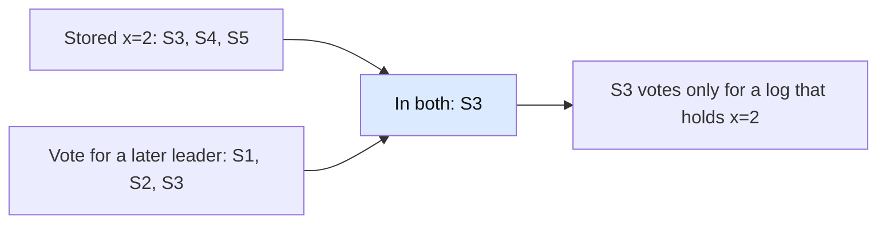
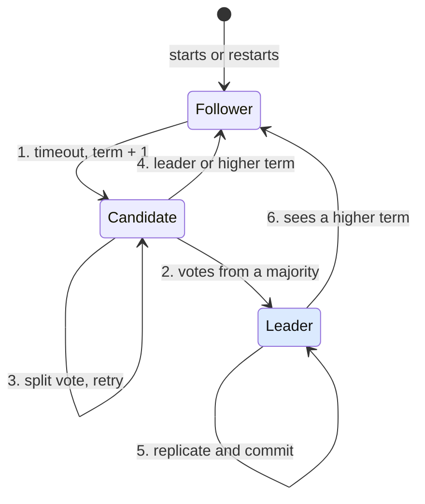
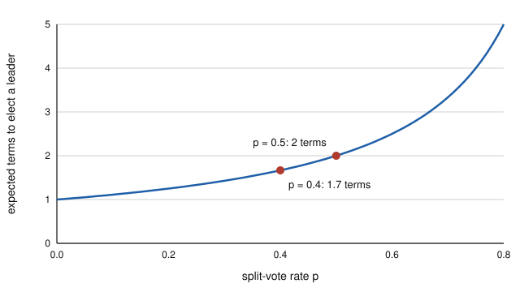

# How does Raft elect a leader and keep every server's log consistent through crashes and network partitions?

## 1. Abstract

Teams that run a service on Raft need its servers to agree on one history, even through crashes and network partitions. Raft elects at most one leader per term by majority vote, and only that leader adds entries to the log. An entry is committed once a majority of servers stores it. A server votes only for a candidate whose log is at least as up to date as its own. Any two majorities share a server, so every new leader already holds every committed entry.

**Key takeaways:**

- Each server votes once per term, so a term has at most one leader.
- Entries flow from the leader to followers; a follower's conflicting entries are overwritten.
- A side without a majority elects no new leader and commits nothing.
- Timing affects only availability, never safety.

## 2. Terminology

| Term | Definition |
|---|---|
| **Leader, follower, candidate** | A server's three roles: the leader handles client requests, followers answer it, and a candidate asks for votes [\[1\]](../sources/raft-ongaro-dissertation-ch3-basic-raft.md#basics). |
| **Term** | A numbered period that begins with an election and has at most one leader [\[1\]](../sources/raft-ongaro-dissertation-ch3-basic-raft.md#basics). |
| **Log entry** | A client command, stored with its index (its position in the log) and the term in which the leader received it [\[2\]](../sources/raft-ongaro-dissertation-ch3-basic-raft.md#log-replication). |
| **Partition** | A network fault that cuts groups of servers off from each other for an extended time [\[3\]](../sources/distributed-systems-kleppmann-cambridge-notes.md#describing-nodes-and-network-behaviour). |
| **Up to date** | Logs compare by their last entries: a later term wins; with equal terms, the longer log wins [\[4\]](../sources/raft-ongaro-dissertation-ch3-basic-raft.md#election-restriction). |
| **Majority** | More than half of all the cluster's servers: 2 of 3, or 3 of 5 [\[5\]](../sources/distributed-systems-kleppmann-cambridge-notes.md#introduction-to-consensus). |
| **Committed** | Safe to apply to the state machines; Raft keeps a committed entry durable [\[2\]](../sources/raft-ongaro-dissertation-ch3-basic-raft.md#log-replication). |
| **Election timeout** | How long a follower waits without hearing from a leader before it starts an election [\[6\]](../sources/raft-ongaro-dissertation-ch3-basic-raft.md#leader-election). |
| **RPC** | Remote procedure call; core Raft uses two, RequestVote and AppendEntries [\[1\]](../sources/raft-ongaro-dissertation-ch3-basic-raft.md#basics). |
| **MTBF** | Mean time between failures of a single server [\[7\]](../sources/raft-ongaro-dissertation-ch3-basic-raft.md#timing-and-availability). |
| **[→]** | Our own reasoning, after a statement or on a section's heading: a conclusion, comparison or example no cited source states. |

## 3. Background

Raft is a consensus algorithm: it manages a replicated log [\[8\]](../sources/raft-ongaro-dissertation-ch3-basic-raft.md#raft-overview). Every server applies the same log of commands in the same order, which keeps each server's copy of the state machine in step [\[9\]](../sources/raft-etcd-raft-readme.md#raft-library). You meet Raft inside etcd, Kubernetes, CockroachDB and TiDB, which use the etcd Raft library [\[9\]](../sources/raft-etcd-raft-readme.md#raft-library).

### 3.1 Five servers lose the network between them

A key-value store runs on five servers, S1 to S5. Five is a typical size, and it tolerates two failed servers [\[1\]](../sources/raft-ongaro-dissertation-ch3-basic-raft.md#basics). S1 leads term 2. All five servers hold entries 1 to 4, the last written in term 2, and all four are committed. A message takes 15 ms one way between any two servers. Each server draws its election timeout at random from 150 to 300 ms [\[6\]](../sources/raft-ongaro-dissertation-ch3-basic-raft.md#leader-election).

Then a switch fails and cuts S1 and S2 off from S3, S4 and S5. During the partition, one client sends `x=1` to S1, and another sends `x=2` to whichever server leads S3, S4 and S5.

Without a consensus rule, each group accepts its write, and entry 5 differs between them. Two leaders deciding differently is called split brain [\[5\]](../sources/distributed-systems-kleppmann-cambridge-notes.md#introduction-to-consensus); [the failure-modes survey](what-are-the-classic-failure-modes-of-large-scale-distributed-systems-and-their-mitigations.md) covers it beyond Raft. Raft must keep exactly one of the two writes.

Raft assumes that servers crash and restart but never act maliciously, and that messages can be lost, delayed or reordered [\[5\]](../sources/distributed-systems-kleppmann-cambridge-notes.md#introduction-to-consensus), [\[1\]](../sources/raft-ongaro-dissertation-ch3-basic-raft.md#basics). So its safety cannot depend on timing; only its availability may [\[7\]](../sources/raft-ongaro-dissertation-ch3-basic-raft.md#timing-and-availability).

## 4. The core idea

Raft lets one server, the leader, decide the order of all entries [\[8\]](../sources/raft-ongaro-dissertation-ch3-basic-raft.md#raft-overview). It then asks a majority before two decisions: who becomes leader, and when an entry is final [\[5\]](../sources/distributed-systems-kleppmann-cambridge-notes.md#introduction-to-consensus). A majority that elects a later leader and a majority that stored an entry always share a server [\[10\]](../sources/raft-ongaro-dissertation-ch3-basic-raft.md#safety-argument). That server votes once per term [\[6\]](../sources/raft-ongaro-dissertation-ch3-basic-raft.md#leader-election), and refuses a candidate whose log lacks what it stored [\[4\]](../sources/raft-ongaro-dissertation-ch3-basic-raft.md#election-restriction).

**The rule:** a candidate needs votes from a majority for its term; a server votes for it only if the candidate's log is at least as up to date as its own; and an entry from the leader's current term is committed once a majority stores it [\[6\]](../sources/raft-ongaro-dissertation-ch3-basic-raft.md#leader-election), [\[4\]](../sources/raft-ongaro-dissertation-ch3-basic-raft.md#election-restriction), [\[11\]](../sources/raft-ongaro-dissertation-ch3-basic-raft.md#committing-entries-from-previous-terms).

*Figure 4-1: A majority that commits an entry and a majority that elects a later leader share a server, shaded; it refuses any candidate without the entry [\[10\]](../sources/raft-ongaro-dissertation-ch3-basic-raft.md#safety-argument), [\[4\]](../sources/raft-ongaro-dissertation-ch3-basic-raft.md#election-restriction).*

## 5. How does it work?

### 5.1 Three servers bring in one idea at a time

This toy brings in Raft's ideas one at a time, on three servers, A, B and C. A leads term 1. No message is lost, but C is slow to receive them.

1. **One leader orders the writes.** A leads. A client sends `y=1`. A appends it to its log as entry 1 and sends it to B and C in an AppendEntries RPC [\[2\]](../sources/raft-ongaro-dissertation-ch3-basic-raft.md#log-replication).
2. **A majority makes an entry final.** B stores entry 1 and replies; C has not received it yet. A and B are 2 of 3, a majority, so entry 1 is committed: A applies it and answers the client [\[2\]](../sources/raft-ongaro-dissertation-ch3-basic-raft.md#log-replication). A's next AppendEntries carries the highest committed index, so B applies entry 1 too [\[2\]](../sources/raft-ongaro-dissertation-ch3-basic-raft.md#log-replication).
3. **Silence starts an election.** A crashes. B hears no heartbeat, an AppendEntries with no entries, for an election timeout [\[6\]](../sources/raft-ongaro-dissertation-ch3-basic-raft.md#leader-election). B raises its term from 1 to 2, votes for itself and sends a RequestVote to C [\[6\]](../sources/raft-ongaro-dissertation-ch3-basic-raft.md#leader-election). C has not voted in term 2, so it votes for B. With 2 of 3 votes, B leads term 2 [\[6\]](../sources/raft-ongaro-dissertation-ch3-basic-raft.md#leader-election).
4. **Votes go only to complete logs.** Suppose instead C, which still lacks entry 1, had timed out first. B would refuse C's RequestVote, because B's log is more up to date [\[4\]](../sources/raft-ongaro-dissertation-ch3-basic-raft.md#election-restriction). Without B's vote, C cannot reach 2 of 3, so a leader without entry 1 never arises [\[4\]](../sources/raft-ongaro-dissertation-ch3-basic-raft.md#election-restriction).

The two RPCs carry these fields; every request and reply also carries the sender's current term [\[1\]](../sources/raft-ongaro-dissertation-ch3-basic-raft.md#basics).

| RPC | Sent by, to | Carries |
|---|---|---|
| RequestVote | a candidate, to every other server | the index and term of the candidate's last entry [\[4\]](../sources/raft-ongaro-dissertation-ch3-basic-raft.md#election-restriction) |
| AppendEntries | the leader, to each follower | the index and term of the entry just before the new ones, the new entries (none for a heartbeat), and the leader's commit index [\[2\]](../sources/raft-ongaro-dissertation-ch3-basic-raft.md#log-replication) |

| In the toy | In the five-server example |
|---|---|
| A, B, C; a majority is 2 | S1 to S5; a majority is 3 |
| A crashes | a switch partitions S1 and S2 from S3, S4 and S5 |
| B wins term 2 | S3 wins term 3 |
| entry 1 committed on A and B | `x=2` committed on S3, S4 and S5 |

Unlike A in the toy, S1 keeps running and still believes it leads.

### 5.2 The five servers come through the partition

*Figure 5-1: A server's three roles and the six transitions between them, numbered as the steps below; the leader, the only role that adds entries, is shaded [\[1\]](../sources/raft-ongaro-dissertation-ch3-basic-raft.md#basics), [\[6\]](../sources/raft-ongaro-dissertation-ch3-basic-raft.md#leader-election).*

In the example, S3 times out after the partition, wins the election and serves the write; after the network heals, S1 learns of term 3 and S3 repairs the diverged logs.

1. **Follower to candidate.** S3, S4 and S5 stop receiving S1's heartbeats [\[6\]](../sources/raft-ongaro-dissertation-ch3-basic-raft.md#leader-election). S3's timer fires first: S3 moves to term 3, votes for itself and sends RequestVote to the other four servers [\[6\]](../sources/raft-ongaro-dissertation-ch3-basic-raft.md#leader-election). S1 never hears it and still believes it leads term 2 [\[5\]](../sources/distributed-systems-kleppmann-cambridge-notes.md#introduction-to-consensus). A variant, [Pre-Vote](#91-pre-vote-keeps-a-cut-off-server-from-forcing-an-election), adds a check before this step.
2. **Candidate to leader.** S4 and S5 have not voted in term 3. S3's last entry is index 4, term 2, the same as theirs, so its log is at least as up to date [\[4\]](../sources/raft-ongaro-dissertation-ch3-basic-raft.md#election-restriction). Both vote for S3, which with its own vote has 3 of 5 and leads term 3 [\[6\]](../sources/raft-ongaro-dissertation-ch3-basic-raft.md#leader-election). A rival could collect at most the two votes left, S1's and S2's, so term 3 has one leader [\[6\]](../sources/raft-ongaro-dissertation-ch3-basic-raft.md#leader-election).
3. **Candidate to candidate.** Had S4's timer fired within 15 ms of S3's, before S3's RequestVote reached it, the two would split the votes: each votes for itself, S5 can give only one more, and neither reaches 3 [\[6\]](../sources/raft-ongaro-dissertation-ch3-basic-raft.md#leader-election). Each would wait a new random timeout and retry in a higher term [\[6\]](../sources/raft-ongaro-dissertation-ch3-basic-raft.md#leader-election). Each term's election fails with the same split-vote rate $p$, independently, so the number of terms needed is geometric, with mean $1/(1-p)$. At a high $p = 0.5$ that is $1/(1-0.5) = 2$ terms; the recommended timeout range keeps $p$ under 0.4, which gives $1/(1-0.4) \approx 1.7$ terms [\[12\]](../sources/raft-ongaro-dissertation-ch9-leader-election.md#leader-election-evaluation).

*Figure 5-2: Split votes cost little until they are common: the expected number of terms grows slowly up to p = 0.5, then steeply; the recommended timeout range keeps p under 0.4 [\[12\]](../sources/raft-ongaro-dissertation-ch9-leader-election.md#leader-election-evaluation).*

4. **Candidate to follower.** In step 3's split vote, suppose S3's new timeout fires first and it asks for votes in term 4. S4, still a candidate in term 3, sees the higher term, adopts it and returns to follower, so it can vote for S3 [\[1\]](../sources/raft-ongaro-dissertation-ch3-basic-raft.md#basics). A candidate also returns to follower when it hears AppendEntries from a leader of its term or later [\[6\]](../sources/raft-ongaro-dissertation-ch3-basic-raft.md#leader-election).
5. **The leader replicates and commits.** S3 appends the client's `x=2` as entry 5 in term 3 and sends AppendEntries to every server [\[2\]](../sources/raft-ongaro-dissertation-ch3-basic-raft.md#log-replication). S4 and S5 store it: 3 of 5, so entry 5 is committed, and S3 answers the client [\[2\]](../sources/raft-ongaro-dissertation-ch3-basic-raft.md#log-replication). Meanwhile, S1 appends `x=1` as entry 5 in term 2 and sends it to S2. Two of 5 is no majority, so that entry never commits [\[2\]](../sources/raft-ongaro-dissertation-ch3-basic-raft.md#log-replication). An old leader cut off from a majority cannot decide anything [\[5\]](../sources/distributed-systems-kleppmann-cambridge-notes.md#introduction-to-consensus).
6. **Leader to follower, then repair.** The network heals. S3's next AppendEntries reaches S1 with term 3, higher than S1's term 2, so S1 becomes a follower [\[1\]](../sources/raft-ongaro-dissertation-ch3-basic-raft.md#basics), [\[13\]](../sources/distributed-systems-kleppmann-cambridge-notes.md#the-raft-consensus-algorithm). S3 keeps, for each follower, the next index to send, set to 5, one past its last entry, when it took office [\[2\]](../sources/raft-ongaro-dissertation-ch3-basic-raft.md#log-replication). It sends entry 5 with its predecessor, index 4 in term 2. S1 holds that entry, so it deletes its conflicting `x=1` and appends `x=2` [\[2\]](../sources/raft-ongaro-dissertation-ch3-basic-raft.md#log-replication). S2 is repaired the same way. Had the logs differed further back, S1 would refuse, and S3 would lower the next index and retry until they match [\[2\]](../sources/raft-ongaro-dissertation-ch3-basic-raft.md#log-replication). The leader never deletes its own entries [\[2\]](../sources/raft-ongaro-dissertation-ch3-basic-raft.md#log-replication).

| Server | Entries 1 to 4 | Entry 5 before repair | Entry 5 after repair |
|---|---|---|---|
| S1, S2 | the same everywhere, committed | `x=1`, term 2, not committed | `x=2`, term 3 |
| S3, S4, S5 | the same everywhere, committed | `x=2`, term 3, committed | `x=2`, term 3 |

### 5.3 Every new leader already holds every committed entry

Entry 5 sits on S3, S4 and S5. Any later leader needs three votes. Three voters and these three holders make 3 + 3 = 6, more than the 5 servers, so at least one voter is a holder [\[10\]](../sources/raft-ongaro-dissertation-ch3-basic-raft.md#safety-argument). That voter's log ends in term 3. A candidate without entry 5 ends its log in term 2 or earlier, so it is less up to date and the voter refuses it [\[4\]](../sources/raft-ongaro-dissertation-ch3-basic-raft.md#election-restriction). So every later leader already holds `x=2`; no entry ever has to be sent to a new leader, and entries flow only from leader to followers [\[4\]](../sources/raft-ongaro-dissertation-ch3-basic-raft.md#election-restriction).

One case needs a stricter rule. An entry from an earlier term can sit on a majority and still be overwritten by a later leader: a candidate whose last entry has a later term counts as more up to date, so the entry's holders can vote for it [\[4\]](../sources/raft-ongaro-dissertation-ch3-basic-raft.md#election-restriction), [\[11\]](../sources/raft-ongaro-dissertation-ch3-basic-raft.md#committing-entries-from-previous-terms). So a leader counts replicas only for entries from its own term; earlier entries become committed along with them [\[11\]](../sources/raft-ongaro-dissertation-ch3-basic-raft.md#committing-entries-from-previous-terms). In the example the rule never bites: entry 5 is from S3's own term 3, and committing it also commits entries 1 to 4 [\[2\]](../sources/raft-ongaro-dissertation-ch3-basic-raft.md#log-replication). Together, these rules give State Machine Safety: once a server applies an entry at an index, no server applies a different entry at that index [\[8\]](../sources/raft-ongaro-dissertation-ch3-basic-raft.md#raft-overview), [\[10\]](../sources/raft-ongaro-dissertation-ch3-basic-raft.md#safety-argument).

### 5.4 A restart cannot undo a vote or a commit

A crashed follower or candidate misses RPCs; they are retried indefinitely, and a repeated RPC is harmless [\[14\]](../sources/raft-ongaro-dissertation-ch3-basic-raft.md#follower-and-candidate-crashes). Each server writes its current term and its vote to stable storage, so it cannot vote twice in a term after a restart [\[15\]](../sources/raft-ongaro-dissertation-ch3-basic-raft.md#persisted-state-and-server-restarts). It also writes each new entry before the entry counts toward commitment, so a restart cannot uncommit it [\[15\]](../sources/raft-ongaro-dissertation-ch3-basic-raft.md#persisted-state-and-server-restarts). Other state, such as the commit index, is rebuilt after a restart [\[15\]](../sources/raft-ongaro-dissertation-ch3-basic-raft.md#persisted-state-and-server-restarts). The etcd library makes this its users' job: persist entries and state before sending the messages that depend on them [\[16\]](../sources/raft-etcd-raft-readme.md#usage).

## 6. Design decisions and trade-offs

**Random timeouts, not ranked candidates.** Ranking candidates kept exposing availability corner cases; random retries proved simpler [\[6\]](../sources/raft-ongaro-dissertation-ch3-basic-raft.md#leader-election). The election timeout must satisfy $\mathit{broadcastTime} \ll \mathit{electionTimeout} \ll \mathit{MTBF}$ [\[7\]](../sources/raft-ongaro-dissertation-ch3-basic-raft.md#timing-and-availability). Broadcast time includes writing to stable storage and runs from about 0.5 to 20 ms, so the election timeout is likely 10 to 500 ms [\[7\]](../sources/raft-ongaro-dissertation-ch3-basic-raft.md#timing-and-availability). As a rule, draw it from a range 10 to 20 times the one-way network latency; a leader is then elected in under 20 times that latency on average [\[12\]](../sources/raft-ongaro-dissertation-ch9-leader-election.md#leader-election-evaluation). The example's 150 to 300 ms suits its one-way latency of 15 ms: $10 \times 15 = 150$ ms and $20 \times 15 = 300$ ms, and a leader is then elected in under $20 \times 15 = 300$ ms on average [\[12\]](../sources/raft-ongaro-dissertation-ch9-leader-election.md#leader-election-evaluation). A broadcast then takes at least $2 \times 15 = 30$ ms, though, so 150 ms is only $150 / 30 = 5$ times it, short of the order of magnitude the first rule asks for [\[7\]](../sources/raft-ongaro-dissertation-ch3-basic-raft.md#timing-and-availability). The two rules of thumb differ; the measured one keeps split votes under 40% [\[12\]](../sources/raft-ongaro-dissertation-ch9-leader-election.md#leader-election-evaluation). Too short, and heartbeats cannot hold off elections. Too long, and a leader crash leaves the cluster unavailable for about one timeout [\[7\]](../sources/raft-ongaro-dissertation-ch3-basic-raft.md#timing-and-availability).

**A leader whose log is already complete.** Viewstamped Replication can elect a leader that lacks committed entries and then send them to it, which adds mechanism; Raft's vote rule avoids that [\[4\]](../sources/raft-ongaro-dissertation-ch3-basic-raft.md#election-restriction). The cost: a preferred server, such as one near the clients, may not win, so an optional extension, not yet implemented by its author, lets the leader hand leadership to it explicitly [\[17\]](../sources/raft-ongaro-dissertation-ch3-basic-raft.md#leadership-transfer-extension).

**A cautious commit rule.** Counting replicas only for current-term entries delays commitment briefly [\[18\]](../sources/raft-ongaro-dissertation-ch3-basic-raft.md#conclusion). In return, entries keep their original terms in every log, which makes logs easier to reason about [\[11\]](../sources/raft-ongaro-dissertation-ch3-basic-raft.md#committing-entries-from-previous-terms).

## 7. Limitations and failure modes

**The smaller side stops.** Raft commits entries only while a majority is up and reachable [\[2\]](../sources/raft-ongaro-dissertation-ch3-basic-raft.md#log-replication). During the partition, S1 and S2 complete no write: Raft picks consistency over availability for them [→]. [Choose consistency deliberately](what-are-the-common-design-tenets-and-principles-for-distributed-systems.md#541-choose-consistency-deliberately) describes that trade-off, and [the failure-modes survey](what-are-the-classic-failure-modes-of-large-scale-distributed-systems-and-their-mitigations.md#522-a-partition-splits-the-system) the majority remedy it is an instance of.

**No guaranteed election time.** By the FLP result, no deterministic fault-tolerant consensus protocol is guaranteed to terminate in a purely asynchronous system [\[12\]](../sources/raft-ongaro-dissertation-ch9-leader-election.md#leader-election-evaluation), [\[5\]](../sources/distributed-systems-kleppmann-cambridge-notes.md#introduction-to-consensus). In Raft this shows as split votes, so elections are fast only with high probability [\[12\]](../sources/raft-ongaro-dissertation-ch9-leader-election.md#leader-election-evaluation). While timing assumptions fail, the cluster may have no leader, but it stays safe [\[12\]](../sources/raft-ongaro-dissertation-ch9-leader-election.md#leader-election-evaluation).

**Lost stable storage.** A server that loses its persisted state cannot rejoin under its old identity. If a majority loses it, log entries may be lost [\[15\]](../sources/raft-ongaro-dissertation-ch3-basic-raft.md#persisted-state-and-server-restarts).

## 8. Where to go next

- How does a Raft leader serve reads without stale data? The etcd library offers read-index and lease-based reads [\[19\]](../sources/raft-etcd-raft-readme.md#features).
- How does Raft add or remove servers safely?

## 9. Appendix

### 9.1 Pre-Vote keeps a cut-off server from forcing an election

Change the example in one way: after S3 leads term 3, S5 alone is cut off. S5 hears no heartbeats, so it times out again and again, raising its term each time without winning. When it reconnects, its higher term reaches S3 and forces S3 to step down, costing an election [\[20\]](../sources/raft-ongaro-dissertation-ch9-leader-election.md#preventing-disruptions-when-a-server-rejoins-the-cluster). With Pre-Vote, a candidate raises its term only after a majority says it would grant its vote: its log is up to date enough, and they have heard no leader for an election timeout [\[20\]](../sources/raft-ongaro-dissertation-ch9-leader-election.md#preventing-disruptions-when-a-server-rejoins-the-cluster). A cut-off server never gets that answer, so it rejoins in its old term [\[20\]](../sources/raft-ongaro-dissertation-ch9-leader-election.md#preventing-disruptions-when-a-server-rejoins-the-cluster). Its author recommends it where robustness matters, and it barely slows elections [\[20\]](../sources/raft-ongaro-dissertation-ch9-leader-election.md#preventing-disruptions-when-a-server-rejoins-the-cluster).

## 10. References

### 10.1 Sources read

- [raft-ongaro-dissertation-ch3-basic-raft](../sources/raft-ongaro-dissertation-ch3-basic-raft.md): the specification: roles, terms, elections, replication, the vote rule, the commit rule, crashes, persistence and timing.
- [raft-ongaro-dissertation-ch9-leader-election](../sources/raft-ongaro-dissertation-ch9-leader-election.md): election performance, the timeout rule of thumb, FLP and Pre-Vote.
- [distributed-systems-kleppmann-cambridge-notes](../sources/distributed-systems-kleppmann-cambridge-notes.md): the system model, split brain, and why an old leader cannot decide.
- [raft-etcd-raft-readme](../sources/raft-etcd-raft-readme.md): production use, persisting before sending, and reads.

### 10.2 Citations

1. [raft-ongaro-dissertation-ch3-basic-raft: basics](../sources/raft-ongaro-dissertation-ch3-basic-raft.md#basics)
2. [raft-ongaro-dissertation-ch3-basic-raft: Log replication](../sources/raft-ongaro-dissertation-ch3-basic-raft.md#log-replication)
3. [distributed-systems-kleppmann-cambridge-notes: Describing nodes and network behaviour](../sources/distributed-systems-kleppmann-cambridge-notes.md#describing-nodes-and-network-behaviour)
4. [raft-ongaro-dissertation-ch3-basic-raft: Election restriction](../sources/raft-ongaro-dissertation-ch3-basic-raft.md#election-restriction)
5. [distributed-systems-kleppmann-cambridge-notes: Introduction to consensus](../sources/distributed-systems-kleppmann-cambridge-notes.md#introduction-to-consensus)
6. [raft-ongaro-dissertation-ch3-basic-raft: Leader election](../sources/raft-ongaro-dissertation-ch3-basic-raft.md#leader-election)
7. [raft-ongaro-dissertation-ch3-basic-raft: Timing and availability](../sources/raft-ongaro-dissertation-ch3-basic-raft.md#timing-and-availability)
8. [raft-ongaro-dissertation-ch3-basic-raft: Raft overview](../sources/raft-ongaro-dissertation-ch3-basic-raft.md#raft-overview)
9. [raft-etcd-raft-readme: Raft library](../sources/raft-etcd-raft-readme.md#raft-library)
10. [raft-ongaro-dissertation-ch3-basic-raft: Safety argument](../sources/raft-ongaro-dissertation-ch3-basic-raft.md#safety-argument)
11. [raft-ongaro-dissertation-ch3-basic-raft: Committing entries from previous terms](../sources/raft-ongaro-dissertation-ch3-basic-raft.md#committing-entries-from-previous-terms)
12. [raft-ongaro-dissertation-ch9-leader-election: Leader election evaluation](../sources/raft-ongaro-dissertation-ch9-leader-election.md#leader-election-evaluation)
13. [distributed-systems-kleppmann-cambridge-notes: The Raft consensus algorithm](../sources/distributed-systems-kleppmann-cambridge-notes.md#the-raft-consensus-algorithm)
14. [raft-ongaro-dissertation-ch3-basic-raft: Follower and candidate crashes](../sources/raft-ongaro-dissertation-ch3-basic-raft.md#follower-and-candidate-crashes)
15. [raft-ongaro-dissertation-ch3-basic-raft: Persisted state and server restarts](../sources/raft-ongaro-dissertation-ch3-basic-raft.md#persisted-state-and-server-restarts)
16. [raft-etcd-raft-readme: Usage](../sources/raft-etcd-raft-readme.md#usage)
17. [raft-ongaro-dissertation-ch3-basic-raft: Leadership transfer extension](../sources/raft-ongaro-dissertation-ch3-basic-raft.md#leadership-transfer-extension)
18. [raft-ongaro-dissertation-ch3-basic-raft: Conclusion](../sources/raft-ongaro-dissertation-ch3-basic-raft.md#conclusion)
19. [raft-etcd-raft-readme: Features](../sources/raft-etcd-raft-readme.md#features)
20. [raft-ongaro-dissertation-ch9-leader-election: Preventing disruptions when a server rejoins the cluster](../sources/raft-ongaro-dissertation-ch9-leader-election.md#preventing-disruptions-when-a-server-rejoins-the-cluster)

## 11. Metadata

- **Version:** 2.2
- **Template:** technical_brief_overview
- **Language:** en
- **Model:** claude-opus-5-5
- **Created:** 2026-10-27
- **Last modified:** 2026-11-24
- **Words:** 2,764 (about 12 min)
- **History:**
  - 2.2 (2026-11-24): An SVG figure drawn from the narrative's own cited numbers, where a chart shows what a diagram can't
  - 2.1 (2026-11-24): Lint: Pre-Vote's example uses a cut-off follower, not the leader; the overlap arithmetic and the definition of up to date written out; steps 3 and 4 worked on the example; the timing rules' tension stated; partition, not split, for the network event; leadership transfer marked as an optional extension
  - 2.0 (2026-11-24): Regenerated under sllmwiki 1.4.0's guides: a new spine and outline, a three-server toy before the five-server partition, a table of what each RPC carries, statement headings, and Pre-Vote moved to the Appendix
  - 1.1 (2026-10-27): Lint: corrected the log-repair walkthrough (S3 sends entry 5, not 6), cited the core rule, grounded the Background's opening in its sources, TiDB for TiKV, and dropped the undefined term hard state.
  - 1.0 (2026-10-27): First version.
- **Reading plan:**
  1. `what-are-the-common-design-tenets-and-principles-for-distributed-systems`, in full: existing narrative, background
  2. `what-is-a-distributed-system`, in full: existing narrative, background
  3. `what-are-the-classic-failure-modes-of-large-scale-distributed-systems-and-their-mitigations`, in full: existing narrative, background
  4. `raft-etcd-raft-readme`, in full: medium relevance, authority A, undated
  5. `distributed-systems-kleppmann-cambridge-notes`, in full: high relevance, authority B, 2021-10-01
  6. `raft-ongaro-dissertation-ch3-basic-raft`, in full: high relevance, authority A, 2014-08-01
  7. `raft-ongaro-dissertation-ch9-leader-election`, in full: high relevance, authority A, 2014-08-01
  8. `distributed-systems-van-steen-tanenbaum-brief-intro`, abstract only: low relevance
  9. `distributed-system-design-wikipedia-fallacies`, abstract only: low relevance
  10. `distributed-system-design-aws-well-architected-reliability-principles`, abstract only: low relevance
  11. `distributed-system-design-azure-design-principles`, abstract only: low relevance
  12. `distributed-system-design-azure-retry-pattern`, abstract only: low relevance
  13. `distributed-system-design-azure-circuit-breaker-pattern`, abstract only: low relevance
  14. `distributed-system-design-azure-bulkhead-pattern`, abstract only: low relevance
  15. `distributed-system-design-azure-throttling-pattern`, abstract only: low relevance
  16. `distributed-system-design-azure-transient-fault-handling`, abstract only: low relevance
  17. `distributed-system-design-wikipedia-cap-theorem`, abstract only: low relevance
  18. `distributed-system-design-wikipedia-end-to-end-principle`, abstract only: low relevance
  19. `distributed-system-design-wikipedia-cascading-failure`, abstract only: low relevance
  20. `distributed-system-design-ongaro-raft-consensus`, not read: a link, no saved copy
  21. `ewma-linkerd-beyond-round-robin`, not read: a link, no saved copy
  22. `distributed-system-design-waldo-note-on-distributed-computing`, not read: a link, no saved copy
  23. `distributed-system-design-hamilton-internet-scale-services`, not read: a link, no saved copy
  24. `distributed-system-design-aws-timeouts-retries-backoff`, not read: a link, no saved copy
  25. `distributed-system-design-aws-challenges-distributed-systems`, not read: a link, no saved copy
  26. `distributed-system-design-google-sre-cascading-failures`, not read: a link, no saved copy
  27. `distributed-system-design-brewer-cap-twelve-years-later`, not read: a link, no saved copy
  28. `distributed-system-design-lamport-time-clocks`, not read: a link, no saved copy
  29. `distributed-system-design-saltzer-end-to-end-arguments`, not read: a link, no saved copy
