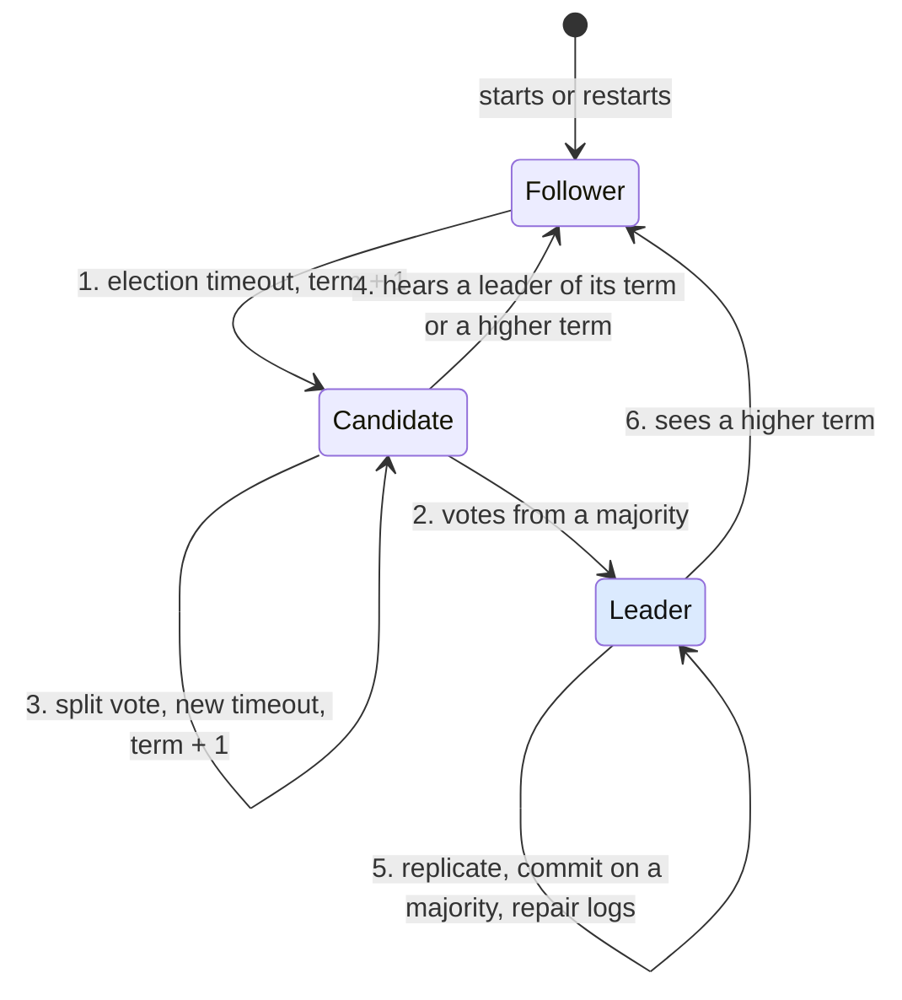

# How does Raft elect a leader and keep every server's log consistent through crashes and network partitions?

## 1. Abstract

Engineers running a service on Raft need to know why its servers never disagree about history, even through crashes and network splits. Raft elects one leader per term by majority vote, and only the leader writes the log; it overwrites follower entries that conflict with its own. A server votes only for a candidate whose log is at least as up to date as its own, and an entry is committed once a majority stores it. Two majorities always share a server, so every new leader holds every committed entry.

**Key takeaways:**

- A higher term always wins; a stale leader steps down.
- One vote per server per term: at most one leader per term.
- Logs flow from leader to followers; conflicts are overwritten.
- A minority side elects no one and commits nothing.
- Timing affects availability, never safety.

## 2. Terminology

| Term | Definition |
|---|---|
| **Term** | A numbered period that starts with an election and has at most one leader. |
| **Leader, follower, candidate** | A server's three roles: the leader runs the log, followers copy it, a candidate is seeking votes. |
| **Majority** | More than half of the cluster's servers: 3 of 5. |
| **Log entry** | A client command, stored with its index (position in the log) and the term in which the leader received it. |
| **Committed** | Safe to apply to the state machines; a committed entry is never lost or changed. |
| **Election timeout** | How long a follower waits without hearing from a leader before it starts an election. |
| **RPC** | Remote procedure call. Raft needs two: RequestVote and AppendEntries. |
| **MTBF** | Mean time between failures of a single server. |

## 3. Background

Raft is a consensus algorithm for managing a replicated log: every server runs the same deterministic state machine and applies the same commands in the same order, so the cluster behaves like one machine that survives the failure of some of its members [\[1\]](../sources/raft-ongaro-dissertation-ch3-basic-raft.md#raft-overview), [\[2\]](../sources/distributed-systems-kleppmann-cambridge-notes.md#introduction-to-consensus). You meet it inside etcd, Kubernetes, CockroachDB and TiKV, all built on the etcd Raft library [\[3\]](../sources/raft-etcd-raft-readme.md#raft-library).

The running example is a key-value store on five servers, S1 to S5, a typical size that tolerates two failures [\[4\]](../sources/raft-ongaro-dissertation-ch3-basic-raft.md#basics). S1 leads term 2, and all five hold entries 1 to 4, all committed. Then a switch fails and splits the cluster into {S1, S2} and {S3, S4, S5}. Without a consensus rule, each side could keep accepting writes: index 5 could become `x=1` on one side and `x=2` on the other, and when the network heals there would be two histories, the situation known as split brain [\[2\]](../sources/distributed-systems-kleppmann-cambridge-notes.md#introduction-to-consensus). Raft has to pick exactly one.

Raft assumes servers crash and restart but never lie, and messages may be lost, delayed or reordered without bound; so safety must hold whatever the timing, and only progress may use clocks [\[2\]](../sources/distributed-systems-kleppmann-cambridge-notes.md#introduction-to-consensus), [\[4\]](../sources/raft-ongaro-dissertation-ch3-basic-raft.md#basics).

## 4. The core idea

Raft gives one server, the leader, sole authority over the log, then guards two moments with majorities: who may become leader, and when an entry counts as decided [\[1\]](../sources/raft-ongaro-dissertation-ch3-basic-raft.md#raft-overview). Any majority that elects a leader and any majority that stored a committed entry share at least one server, and that server carries the decision across: it votes once per term, and it refuses a candidate whose log lacks what it holds [\[5\]](../sources/raft-ongaro-dissertation-ch3-basic-raft.md#safety-argument), [\[6\]](../sources/raft-ongaro-dissertation-ch3-basic-raft.md#election-restriction).

**The rule:** a candidate needs votes from a majority for its term, and a server votes only for a candidate whose log is at least as up to date as its own; an entry from the leader's current term is committed once a majority stores it.

*Figure 4-1: A server's roles and transitions, numbered as the steps in the next section; the leader, the only role that writes the log, is shaded [\[4\]](../sources/raft-ongaro-dissertation-ch3-basic-raft.md#basics), [\[7\]](../sources/raft-ongaro-dissertation-ch3-basic-raft.md#leader-election).*

## 5. How does it work?

**1. Follower to candidate.** A leader sends periodic heartbeats, AppendEntries RPCs with no entries; a follower that hears none for an election timeout increments its term, votes for itself and sends RequestVote to every other server in parallel [\[7\]](../sources/raft-ongaro-dissertation-ch3-basic-raft.md#leader-election). Timeouts are drawn at random from a fixed range, such as 150 to 300 ms, so usually one server times out well before the others [\[7\]](../sources/raft-ongaro-dissertation-ch3-basic-raft.md#leader-election). In the example, S3, S4 and S5 stop hearing S1; S3's timer fires first and it starts term 3. S1 still believes it leads term 2 [\[2\]](../sources/distributed-systems-kleppmann-cambridge-notes.md#introduction-to-consensus).

**2. Candidate to leader.** A server grants at most one vote per term, first come first served, and only to a candidate whose log is at least as up to date as its own: the log whose last entry has the later term wins, and with equal last terms the longer one wins [\[7\]](../sources/raft-ongaro-dissertation-ch3-basic-raft.md#leader-election), [\[6\]](../sources/raft-ongaro-dissertation-ch3-basic-raft.md#election-restriction). S3's log ends at index 4, term 2, like those of S4 and S5, so both vote for it: with its own vote that is 3 of 5, and S3 leads term 3. Any rival in term 3 could collect at most the 2 remaining votes, which is why a term has at most one leader [\[7\]](../sources/raft-ongaro-dissertation-ch3-basic-raft.md#leader-election).

**3. Candidate to candidate.** If several followers time out together, the votes can split with no majority for anyone. Each candidate then waits a fresh random timeout and tries again in a higher term [\[7\]](../sources/raft-ongaro-dissertation-ch3-basic-raft.md#leader-election). The number of terms an election needs is geometric, so even a 50% split-vote rate needs only two terms on average [\[8\]](../sources/raft-ongaro-dissertation-ch9-leader-election.md#leader-election-evaluation).

**4. Candidate to follower.** A candidate that receives AppendEntries from a leader whose term is at least its own accepts that leader [\[7\]](../sources/raft-ongaro-dissertation-ch3-basic-raft.md#leader-election). More generally, every message carries its sender's term: a server that sees a higher term adopts it, a candidate or leader whose term is out of date reverts to follower, and a request with a stale term is rejected [\[4\]](../sources/raft-ongaro-dissertation-ch3-basic-raft.md#basics).

**5. Leader: replicate and commit.** A client writes `x=2` to S3. S3 appends it at index 5 in term 3, sends AppendEntries in parallel, and once a majority stores it (S3, S4 and S5) the entry is committed: S3 applies it and answers the client [\[9\]](../sources/raft-ongaro-dissertation-ch3-basic-raft.md#log-replication). Followers learn the commit index from later AppendEntries and apply entries in log order [\[9\]](../sources/raft-ongaro-dissertation-ch3-basic-raft.md#log-replication). Each AppendEntries also names the index and term of the entry just before the new ones, and a follower that has no such entry refuses them [\[9\]](../sources/raft-ongaro-dissertation-ch3-basic-raft.md#log-replication). By induction this keeps the Log Matching property: "If two entries in different logs have the same index and term, then the logs are identical in all preceding entries" [\[9\]](../sources/raft-ongaro-dissertation-ch3-basic-raft.md#log-replication).

On the other side, S1 accepts `x=1` at index 5 in term 2 and replicates it to S2. Two of five is no majority, so the entry never commits and S1 never reports success to that client [\[9\]](../sources/raft-ongaro-dissertation-ch3-basic-raft.md#log-replication). A leader cut off from a majority may believe it leads, but it can decide nothing [\[2\]](../sources/distributed-systems-kleppmann-cambridge-notes.md#introduction-to-consensus).

**6. Leader to follower.** The partition heals. S3's next AppendEntries reaches S1 carrying term 3, higher than S1's 2, so S1 steps down and follows S3 [\[4\]](../sources/raft-ongaro-dissertation-ch3-basic-raft.md#basics), [\[10\]](../sources/distributed-systems-kleppmann-cambridge-notes.md#the-raft-consensus-algorithm).

S3 then repairs the logs of S1 and S2 with step 5's own mechanism. A leader keeps a nextIndex per follower, starting just after its own last entry; when a follower refuses, the leader decrements nextIndex and retries until the logs match, and the accepted AppendEntries deletes the follower's conflicting entries and appends the leader's [\[9\]](../sources/raft-ongaro-dissertation-ch3-basic-raft.md#log-replication). S3 sends entry 6 with predecessor (index 5, term 3); S1 holds (5, term 2) and refuses; S3 backs up to predecessor (4, term 2), which matches, so S1 drops `x=1` and takes `x=2` [\[9\]](../sources/raft-ongaro-dissertation-ch3-basic-raft.md#log-replication). The leader never deletes its own entries [\[9\]](../sources/raft-ongaro-dissertation-ch3-basic-raft.md#log-replication).

| Server | Index 1–4 | Index 5 before repair | Index 5 after repair |
|---|---|---|---|
| S1, S2 | same everywhere, committed | `x=1`, term 2, uncommitted | `x=2`, term 3 |
| S3, S4, S5 | same everywhere, committed | `x=2`, term 3, committed | `x=2`, term 3 |

**Why the new leader always has every committed entry.** A committed entry sits on a majority, and a winning candidate has votes from a majority, so at least one voter holds the entry and would have refused a candidate whose log lacks it [\[6\]](../sources/raft-ongaro-dissertation-ch3-basic-raft.md#election-restriction), [\[5\]](../sources/raft-ongaro-dissertation-ch3-basic-raft.md#safety-argument). A new leader therefore never needs committed entries sent to it, and entries flow only from leader to followers [\[6\]](../sources/raft-ongaro-dissertation-ch3-basic-raft.md#election-restriction). One subtlety: an earlier term's entry can sit on a majority and still be overwritten, so a leader counts replicas only for its own term's entries, and earlier ones commit along with them [\[11\]](../sources/raft-ongaro-dissertation-ch3-basic-raft.md#committing-entries-from-previous-terms). Together these give State Machine Safety: no two servers ever apply different entries at the same index [\[5\]](../sources/raft-ongaro-dissertation-ch3-basic-raft.md#safety-argument).

**Crashes.** A crashed follower or candidate misses RPCs, which are retried indefinitely; a repeated RPC is harmless [\[12\]](../sources/raft-ongaro-dissertation-ch3-basic-raft.md#follower-and-candidate-crashes). Each server persists its current term and vote, so it cannot vote twice in a term, and stores log entries before they count toward commitment, so a restart cannot uncommit them; the rest, such as the commit index, is rebuilt [\[13\]](../sources/raft-ongaro-dissertation-ch3-basic-raft.md#persisted-state-and-server-restarts). The etcd library makes this its users' contract: persist entries and hard state before sending the messages that depend on them [\[14\]](../sources/raft-etcd-raft-readme.md#usage).

## 6. Variants

**Pre-Vote.** This one changes step 1. Suppose S1 had been cut off alone. It times out again and again, raising its term each time without winning. When it reconnects, its higher term reaches the others and forces S3 to step down, costing an election [\[15\]](../sources/raft-ongaro-dissertation-ch9-leader-election.md#preventing-disruptions-when-a-server-rejoins-the-cluster). With Pre-Vote, a candidate raises its term only after a majority says it would grant its vote, meaning its log is up to date enough and they have heard no leader for an election timeout; a partitioned server never gets that, so it rejoins quietly in its old term [\[15\]](../sources/raft-ongaro-dissertation-ch9-leader-election.md#preventing-disruptions-when-a-server-rejoins-the-cluster). Its author recommends it where robustness matters, and it barely slows elections [\[15\]](../sources/raft-ongaro-dissertation-ch9-leader-election.md#preventing-disruptions-when-a-server-rejoins-the-cluster).

## 7. Design decisions and trade-offs

**Randomized timeouts, not ranked candidates.** A first design ranked candidates, but kept exposing availability corner cases; randomized retry proved simpler [\[7\]](../sources/raft-ongaro-dissertation-ch3-basic-raft.md#leader-election). The parameter is the election timeout, which must satisfy $\mathit{broadcastTime} \ll \mathit{electionTimeout} \ll \mathit{MTBF}$ [\[16\]](../sources/raft-ongaro-dissertation-ch3-basic-raft.md#timing-and-availability). Broadcast time, which includes writing to stable storage, runs from about 0.5 to 20 ms, so the election timeout is likely 10 to 500 ms [\[16\]](../sources/raft-ongaro-dissertation-ch3-basic-raft.md#timing-and-availability). As a rule, draw it from a range 10 to 20 times the one-way network latency: split votes stay rare and a leader is elected in about 20 times that latency on average [\[8\]](../sources/raft-ongaro-dissertation-ch9-leader-election.md#leader-election-evaluation). Too short, and heartbeats can't hold off elections; too long, and a leader crash leaves the cluster unavailable for about that long [\[16\]](../sources/raft-ongaro-dissertation-ch3-basic-raft.md#timing-and-availability).

**A strong leader whose log is already complete.** Viewstamped Replication may elect a leader that lacks committed entries and then send them to it, which adds mechanism; Raft's vote restriction avoids that [\[6\]](../sources/raft-ongaro-dissertation-ch3-basic-raft.md#election-restriction). The cost: a preferred server, say one near the clients, may lack an up-to-date enough log to win, so Raft moves leadership by explicit transfer [\[17\]](../sources/raft-ongaro-dissertation-ch3-basic-raft.md#leadership-transfer-extension).

**A conservative commit rule.** Counting only current-term entries delays commitment slightly, but entries keep their original terms, which makes logs easier to reason about [\[11\]](../sources/raft-ongaro-dissertation-ch3-basic-raft.md#committing-entries-from-previous-terms), [\[18\]](../sources/raft-ongaro-dissertation-ch3-basic-raft.md#conclusion).

## 8. Limitations and failure modes

**The minority side stops.** Raft accepts and commits entries only while a majority is up and reachable [\[9\]](../sources/raft-ongaro-dissertation-ch3-basic-raft.md#log-replication). During the split, S1 and S2 cannot complete a single write: Raft chooses consistency over availability for the cut-off side, the trade-off of [choosing consistency deliberately](what-are-the-common-design-tenets-and-principles-for-distributed-systems.md#541-choose-consistency-deliberately).

**No guaranteed election time.** By the FLP result, no deterministic fault-tolerant consensus can be guaranteed to terminate in a purely asynchronous system; in Raft this shows as split votes, so elections are fast only with high probability [\[8\]](../sources/raft-ongaro-dissertation-ch9-leader-election.md#leader-election-evaluation), [\[2\]](../sources/distributed-systems-kleppmann-cambridge-notes.md#introduction-to-consensus). While timing assumptions fail, there may be no leader, but nothing unsafe happens [\[8\]](../sources/raft-ongaro-dissertation-ch9-leader-election.md#leader-election-evaluation).

**Lost persistent state.** A server that loses its stored state cannot rejoin under its old identity; if a majority lose it, log entries may be lost [\[13\]](../sources/raft-ongaro-dissertation-ch3-basic-raft.md#persisted-state-and-server-restarts).

## 9. Where to go next

- How does a Raft leader serve reads without stale data? The etcd library offers read-index and lease-based reads [\[19\]](../sources/raft-etcd-raft-readme.md#features).
- How does Raft add or remove servers safely?
- Consensus among the wider principles: [What are the common design tenets and principles for distributed systems?](what-are-the-common-design-tenets-and-principles-for-distributed-systems.md)

## 10. References

### 10.1 Sources read

- [raft-ongaro-dissertation-ch3-basic-raft](../sources/raft-ongaro-dissertation-ch3-basic-raft.md): the specification: terms, roles, election, log replication, the election restriction, the commit rule, crashes, persistence and timing.
- [raft-ongaro-dissertation-ch9-leader-election](../sources/raft-ongaro-dissertation-ch9-leader-election.md): election performance, the timeout rule of thumb, FLP, and Pre-Vote.
- [distributed-systems-kleppmann-cambridge-notes](../sources/distributed-systems-kleppmann-cambridge-notes.md): consensus and its system model, split brain, and why an old leader cannot decide (sections Introduction to consensus and The Raft consensus algorithm).
- [raft-etcd-raft-readme](../sources/raft-etcd-raft-readme.md): production use, persistence before messages, and extensions such as step-down on lost quorum.
- The original paper, Ongaro and Ousterhout's "In Search of an Understandable Consensus Algorithm" (<https://raft.github.io/raft.pdf>), is recorded as a link, not read; the dissertation chapters cover the same ground.

### 10.2 Citations

1. [raft-ongaro-dissertation-ch3-basic-raft: Raft overview](../sources/raft-ongaro-dissertation-ch3-basic-raft.md#raft-overview)
2. [distributed-systems-kleppmann-cambridge-notes: Introduction to consensus](../sources/distributed-systems-kleppmann-cambridge-notes.md#introduction-to-consensus)
3. [raft-etcd-raft-readme: Raft library](../sources/raft-etcd-raft-readme.md#raft-library)
4. [raft-ongaro-dissertation-ch3-basic-raft: basics](../sources/raft-ongaro-dissertation-ch3-basic-raft.md#basics)
5. [raft-ongaro-dissertation-ch3-basic-raft: Safety argument](../sources/raft-ongaro-dissertation-ch3-basic-raft.md#safety-argument)
6. [raft-ongaro-dissertation-ch3-basic-raft: Election restriction](../sources/raft-ongaro-dissertation-ch3-basic-raft.md#election-restriction)
7. [raft-ongaro-dissertation-ch3-basic-raft: Leader election](../sources/raft-ongaro-dissertation-ch3-basic-raft.md#leader-election)
8. [raft-ongaro-dissertation-ch9-leader-election: Leader election evaluation](../sources/raft-ongaro-dissertation-ch9-leader-election.md#leader-election-evaluation)
9. [raft-ongaro-dissertation-ch3-basic-raft: Log replication](../sources/raft-ongaro-dissertation-ch3-basic-raft.md#log-replication)
10. [distributed-systems-kleppmann-cambridge-notes: The Raft consensus algorithm](../sources/distributed-systems-kleppmann-cambridge-notes.md#the-raft-consensus-algorithm)
11. [raft-ongaro-dissertation-ch3-basic-raft: Committing entries from previous terms](../sources/raft-ongaro-dissertation-ch3-basic-raft.md#committing-entries-from-previous-terms)
12. [raft-ongaro-dissertation-ch3-basic-raft: Follower and candidate crashes](../sources/raft-ongaro-dissertation-ch3-basic-raft.md#follower-and-candidate-crashes)
13. [raft-ongaro-dissertation-ch3-basic-raft: Persisted state and server restarts](../sources/raft-ongaro-dissertation-ch3-basic-raft.md#persisted-state-and-server-restarts)
14. [raft-etcd-raft-readme: Usage](../sources/raft-etcd-raft-readme.md#usage)
15. [raft-ongaro-dissertation-ch9-leader-election: Preventing disruptions when a server rejoins the cluster](../sources/raft-ongaro-dissertation-ch9-leader-election.md#preventing-disruptions-when-a-server-rejoins-the-cluster)
16. [raft-ongaro-dissertation-ch3-basic-raft: Timing and availability](../sources/raft-ongaro-dissertation-ch3-basic-raft.md#timing-and-availability)
17. [raft-ongaro-dissertation-ch3-basic-raft: Leadership transfer extension](../sources/raft-ongaro-dissertation-ch3-basic-raft.md#leadership-transfer-extension)
18. [raft-ongaro-dissertation-ch3-basic-raft: Conclusion](../sources/raft-ongaro-dissertation-ch3-basic-raft.md#conclusion)
19. [raft-etcd-raft-readme: Features](../sources/raft-etcd-raft-readme.md#features)

## 11. Metadata

- **Version:** 1.0
- **Template:** technical_brief_overview
- **Language:** en
- **Created:** 2026-10-27
- **Last modified:** 2026-10-27
- **Words:** 2,007 (about 9 min)
- **History:**
  - 1.0 (2026-10-27): First version.
- **Reading plan:**
  1. `what-are-the-common-design-tenets-and-principles-for-distributed-systems`, in full: existing narrative, medium relevance
  2. `raft-etcd-raft-readme`, in full: medium relevance, authority A, undated
  3. `distributed-systems-kleppmann-cambridge-notes`, in full: high relevance, authority B, 2021-10-01
  4. `raft-ongaro-dissertation-ch3-basic-raft`, in full: high relevance, authority A, 2014-08-01
  5. `raft-ongaro-dissertation-ch9-leader-election`, in full: high relevance, authority A, 2014-08-01
  6. `what-is-a-distributed-system`, abstract only: existing narrative, low relevance
  7. `distributed-systems-van-steen-tanenbaum-brief-intro`, abstract only: low relevance
  8. `distributed-system-design-wikipedia-fallacies`, abstract only: low relevance
  9. `distributed-system-design-aws-well-architected-reliability-principles`, abstract only: low relevance
  10. `distributed-system-design-azure-design-principles`, abstract only: low relevance
  11. `distributed-system-design-azure-retry-pattern`, abstract only: low relevance
  12. `distributed-system-design-azure-circuit-breaker-pattern`, abstract only: low relevance
  13. `distributed-system-design-azure-bulkhead-pattern`, abstract only: low relevance
  14. `distributed-system-design-azure-throttling-pattern`, abstract only: low relevance
  15. `distributed-system-design-azure-transient-fault-handling`, abstract only: low relevance
  16. `distributed-system-design-wikipedia-cap-theorem`, abstract only: low relevance
  17. `distributed-system-design-wikipedia-end-to-end-principle`, abstract only: low relevance
  18. `distributed-system-design-wikipedia-cascading-failure`, abstract only: low relevance
  19. `distributed-system-design-ongaro-raft-consensus`, not read: a link, no saved copy
  20. `ewma-linkerd-beyond-round-robin`, not read: a link, no saved copy
  21. `distributed-system-design-waldo-note-on-distributed-computing`, not read: a link, no saved copy
  22. `distributed-system-design-hamilton-internet-scale-services`, not read: a link, no saved copy
  23. `distributed-system-design-aws-timeouts-retries-backoff`, not read: a link, no saved copy
  24. `distributed-system-design-aws-challenges-distributed-systems`, not read: a link, no saved copy
  25. `distributed-system-design-google-sre-cascading-failures`, not read: a link, no saved copy
  26. `distributed-system-design-brewer-cap-twelve-years-later`, not read: a link, no saved copy
  27. `distributed-system-design-lamport-time-clocks`, not read: a link, no saved copy
  28. `distributed-system-design-saltzer-end-to-end-arguments`, not read: a link, no saved copy
