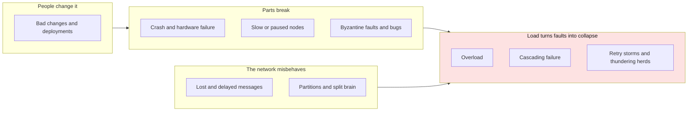

# Can you walk me through the classic failure modes in large scale distributed system and what are the common solutions to prevent or mitigate each one?

## 1. Abstract

Engineers who build or run services spread over many machines need to know how such systems fail and what the standard defences are. The classic failure modes fall into four groups: parts break (crashes, slow or misbehaving nodes), the network misbehaves (lost or delayed messages, partitions that split the system), load turns a small fault into a collapse (overload, cascading failures, retry storms), and people break it with changes. Each has a well-known remedy: redundancy and failure detection, timeouts with bounded retries, quorums, throttling and isolation, and automated, gradual change.

**Key takeaways:**

- Faults are certain; design so the whole survives some broken parts.
- A timeout can't tell a dead node from a slow one.
- Retries cure transient faults but can cause overload: bound them, back off, add jitter.
- Isolate and shed load so one failure doesn't spread.
- Roll changes out gradually and automatically.

## 2. Terminology

| Term | Definition |
|---|---|
| **Fault** | One part of the system not working: a node or a network link. |
| **Failure** | The system as a whole not working. |
| **Fault tolerance** | The system keeps working despite up to some number of faults. |
| **SPOF** | Single point of failure: a part whose fault takes the whole system down. |
| **Partition** | A network fault that splits nodes into groups that cannot reach each other for a while. |
| **Transient fault** | A fault that corrects itself after a short time, such as a dropped connection or a busy service. |
| **Quorum** | A majority of nodes whose agreement is needed to act. |
| **Backoff, jitter** | Waiting longer between successive retries; adding a random amount to each wait. |
| **[→]** | Our own reasoning, after a statement or on a section's heading: a conclusion, comparison or example no cited source states. |
| **[?]** | A gap, after a statement or on a heading: something the question needs that the sources don't answer. |

## 3. Overview

A large-scale distributed system is many independent machines cooperating over a network, so faults in its parts are a routine cause of downtime, and what matters is whether a fault in one part becomes a failure of the whole [\[1\]](../sources/distributed-systems-kleppmann-cambridge-notes.md#fault-tolerance-and-high-availability). The running example is an online shop that wants to sell around the clock [\[1\]](../sources/distributed-systems-kleppmann-cambridge-notes.md#fault-tolerance-and-high-availability): a checkout service calls payment and inventory services, which share a replicated database.

The items here are the failure modes the wiki's saved sources treat as standard. They were checked against three lists: Kleppmann's system model of what can go wrong with networks, nodes and timing [\[2\]](../sources/distributed-systems-kleppmann-cambridge-notes.md#describing-nodes-and-network-behaviour); the fallacies of distributed computing [\[3\]](../sources/distributed-system-design-wikipedia-fallacies.md#the-fallacies); and the cloud vendors' reliability principles and resilience patterns [\[4\]](../sources/distributed-system-design-azure-design-principles.md#core-principles), [\[5\]](../sources/distributed-system-design-aws-well-architected-reliability-principles.md#design-principles). Two failure modes named in research, gray failure and metastable failure, are noted under the items they extend, since the wiki holds their papers only as links. Left out: security attacks, except where they look like overload, and clock skew and event ordering, which corrupt results rather than take systems down and are covered under [ordering events without a global clock](what-are-the-common-design-tenets-and-principles-for-distributed-systems.md#542-order-events-without-a-global-clock) [→].

The map comes first, then each group and its items, then where the remedies pull against each other, two classic cases, and questions to ask of a design.

## 4. The map

Each failure mode lands in one of four groups by where it starts: in a component, in the network, in the load, or in a change [→].

*Figure 4-1: The failure modes in four groups. Arrows show which groups commonly feed others: a broken part, a slow network or a bad change sets off the load-driven failures, shaded, which spread it [→].*

## 5. The main items

### 5.1 Parts break

Single machines crash, stall or misbehave; the defences are to have more than one of everything and to notice quickly when one stops working [→].

#### 5.1.1 Crash and hardware failure

A node crashes and stops, perhaps restarting later with only what it stored on disk [\[2\]](../sources/distributed-systems-kleppmann-cambridge-notes.md#describing-nodes-and-network-behaviour). If that node is a single point of failure, the whole service goes down [\[1\]](../sources/distributed-systems-kleppmann-cambridge-notes.md#fault-tolerance-and-high-availability). The remedy is redundancy: multiple instances behind load balancers, database replicas, several zones or regions, sized to the business's risk tolerance [\[4\]](../sources/distributed-system-design-azure-design-principles.md#core-principles); many small resources instead of one large one, so one loss matters less [\[5\]](../sources/distributed-system-design-aws-well-architected-reliability-principles.md#design-principles); and automatic recovery driven by monitoring [\[5\]](../sources/distributed-system-design-aws-well-architected-reliability-principles.md#design-principles). Tolerance is always bounded: an algorithm that needs a majority stops once more than half the nodes are gone [\[1\]](../sources/distributed-systems-kleppmann-cambridge-notes.md#fault-tolerance-and-high-availability).

#### 5.1.2 Slow or paused nodes

A node that is alive but slow is harder to handle than a dead one. Garbage-collection pauses, swapping or scheduling can freeze a process for seconds or, on large heaps, minutes, while other nodes decide it has crashed [\[2\]](../sources/distributed-systems-kleppmann-cambridge-notes.md#describing-nodes-and-network-behaviour). Failure detectors work by timeout, so they cannot tell a crashed node from a slow node, a lost message or a delayed one; the best possible in practice is a detector that is wrong for a while but eventually right [\[1\]](../sources/distributed-systems-kleppmann-cambridge-notes.md#fault-tolerance-and-high-availability). The remedies are a timeout on every outbound call [\[6\]](../sources/distributed-system-design-azure-transient-fault-handling.md#determine-an-appropriate-retry-count-and-interval) and algorithms whose correctness never depends on timing, so a false suspicion costs only progress [\[7\]](../sources/distributed-systems-kleppmann-cambridge-notes.md#introduction-to-consensus). Subtler partial faults that health checks miss but users feel, which research calls gray failure, are not covered by the wiki's saved sources [?].

#### 5.1.3 Byzantine faults and bugs

A Byzantine node deviates from the protocol in arbitrary ways, maliciously or not [\[2\]](../sources/distributed-systems-kleppmann-cambridge-notes.md#describing-nodes-and-network-behaviour). On the network, TLS stops an attacker from eavesdropping, altering, spoofing or replaying traffic, though not from blocking it [\[2\]](../sources/distributed-systems-kleppmann-cambridge-notes.md#describing-nodes-and-network-behaviour). A software bug is in principle the same kind of fault, but every node runs the same code, so Byzantine-tolerant algorithms, which assume fewer than a third of nodes are faulty, cannot mask it; the term is usually kept for deliberate misbehaviour [\[2\]](../sources/distributed-systems-kleppmann-cambridge-notes.md#describing-nodes-and-network-behaviour). Defending against bugs is therefore a matter of how changes are tested and rolled out (see "Bad changes and deployments").

### 5.2 The network misbehaves

The first fallacy of distributed computing is that the network is reliable [\[3\]](../sources/distributed-system-design-wikipedia-fallacies.md#the-fallacies). Messages get lost, delayed and reordered, and sometimes whole groups of nodes can't talk to each other [\[2\]](../sources/distributed-systems-kleppmann-cambridge-notes.md#describing-nodes-and-network-behaviour).

#### 5.2.1 Lost and delayed messages

Links may lose, duplicate or reorder messages, and latency varies with congestion, retransmission and route changes [\[2\]](../sources/distributed-systems-kleppmann-cambridge-notes.md#describing-nodes-and-network-behaviour). Code that assumes otherwise stalls or waits forever during an outage, holding memory, and may never retry its stalled work [\[8\]](../sources/distributed-system-design-wikipedia-fallacies.md#the-effects-of-the-fallacies). Cloud environments add transient faults from shared, throttled resources, replaced hardware and the routers and load balancers in between [\[9\]](../sources/distributed-system-design-azure-transient-fault-handling.md#why-do-transient-faults-occur-in-the-cloud). The remedies: a timeout on every outbound call, set before any retry logic [\[6\]](../sources/distributed-system-design-azure-transient-fault-handling.md#determine-an-appropriate-retry-count-and-interval); retries after a delay for faults likely to clear [\[10\]](../sources/distributed-system-design-azure-retry-pattern.md#retry-strategies); and deduplication, so that retrying over a lossy link is safe [\[2\]](../sources/distributed-systems-kleppmann-cambridge-notes.md#describing-nodes-and-network-behaviour). Retried operations should be idempotent, since a request can succeed while its response is lost [\[11\]](../sources/distributed-system-design-azure-retry-pattern.md#idempotency).

#### 5.2.2 Partitions and split brain

A partition is a network fault that cuts off groups of nodes for an extended time [\[2\]](../sources/distributed-systems-kleppmann-cambridge-notes.md#describing-nodes-and-network-behaviour). Since no system is safe from it, a system must choose during one: stay consistent and return errors, or stay available and possibly serve stale data [\[12\]](../sources/distributed-system-design-wikipedia-cap-theorem.md#explanation). A partition can also cause split brain: in a high-availability cluster whose heartbeat links fail, each node believes it is the only one running and accepts its own updates, which can corrupt data [\[13\]](../sources/failure-modes-wikipedia-split-brain.md#state). The pessimistic remedy is a quorum: only the side with a majority stays available, and the others fence themselves off [\[14\]](../sources/failure-modes-wikipedia-split-brain.md#approaches-for-dealing-with-split-brain). Optimistic systems keep both sides running and reconcile afterwards [\[14\]](../sources/failure-modes-wikipedia-split-brain.md#approaches-for-dealing-with-split-brain). Raft is a worked example of the quorum approach, covered in [How does Raft elect a leader and keep every server's log consistent through crashes and network partitions?](how-does-raft-elect-a-leader-and-keep-every-servers-log-consistent.md).

### 5.3 Load turns faults into collapse

These failures need no broken part, only too much work. Each feeds on itself: a slow component holds resources, callers retry, and the extra load slows it further [→].

#### 5.3.1 Overload

When demand exceeds capacity, the system slows or fails; autoscaling helps, but new capacity takes time and money [\[15\]](../sources/distributed-system-design-azure-throttling-pattern.md#context-and-problem). Throttling caps use instead: per-client rate limits, turning off non-essential features, deferring low-priority work, and limiting outbound calls to an unhealthy dependency [\[16\]](../sources/distributed-system-design-azure-throttling-pattern.md#solution). A queue between callers and a service absorbs peaks so the service works at its own pace [\[17\]](../sources/failure-modes-azure-queue-based-load-leveling.md#solution). Neither is free: a queue keeps growing if producers outpace consumers on average, and scaling consumers without bounding their downstream rate just moves the overload [\[18\]](../sources/failure-modes-azure-queue-based-load-leveling.md#problems-and-considerations). In the shop, a sale-day spike could be met by turning off recommendations to keep checkout alive [→].

#### 5.3.2 Cascading failure

A cascading failure spreads from one overloaded part to the next. In networks, an overloaded router goes down, traffic shifts to an alternative path, that path overloads, and so on [\[19\]](../sources/distributed-system-design-wikipedia-cascading-failure.md#in-computer-networks). In services, calls to a slow dependency block until they time out, holding threads, memory and connections, until unrelated parts of the system fail for lack of them [\[20\]](../sources/distributed-system-design-azure-circuit-breaker-pattern.md#context-and-problem). Two patterns contain it. A bulkhead partitions resources, such as one connection pool per downstream service, so one failing dependency exhausts only its own share [\[21\]](../sources/distributed-system-design-azure-bulkhead-pattern.md#solution). A circuit breaker counts recent failures and, past a threshold, fails calls at once instead of waiting, then lets a few trial calls through to detect recovery [\[22\]](../sources/distributed-system-design-azure-circuit-breaker-pattern.md#solution).

#### 5.3.3 Retry storms and thundering herds

Retries meant to ride out transient faults can stop a struggling service from recovering: clients that retry too often or too long overwhelm it during recovery [\[23\]](../sources/failure-modes-azure-retry-storm-antipattern.md#context-and-problem). Retries also multiply through layers: three retries at each of two levels make nine attempts [\[24\]](../sources/distributed-system-design-azure-transient-fault-handling.md#avoid-antipatterns). A thundering herd is the synchronized version: many waiters wake at once for something only one can use, a cache stampede when it hits a cache [\[25\]](../sources/failure-modes-wikipedia-thundering-herd.md#thundering-herd-problem---wikipedia). Remedies: cap retry count and duration, back off exponentially, honour the server's `Retry-After`, and use a circuit breaker [\[26\]](../sources/failure-modes-azure-retry-storm-antipattern.md#solution); add jitter so clients stop retrying in lockstep [\[27\]](../sources/failure-modes-wikipedia-thundering-herd.md#mitigation); and set a retry budget for each dependency, so many requests retrying a little can't add up to a cascade [\[24\]](../sources/distributed-system-design-azure-transient-fault-handling.md#avoid-antipatterns). Failures in which such load keeps a system down after the trigger is gone, which research calls metastable, are not covered by the wiki's saved sources [?].

### 5.4 People change it

#### 5.4.1 Bad changes and deployments

Many outages start with a change, not a fault. In December 2012 a routine update to Gmail's load-balancing software, with an "all" where "some" was meant, cascaded into an 18-minute partial outage [\[28\]](../sources/distributed-system-design-wikipedia-cascading-failure.md#example). The remedies: make changes through automation that is itself tracked and reviewed [\[5\]](../sources/distributed-system-design-aws-well-architected-reliability-principles.md#design-principles); roll upgrades out one node at a time, which fault tolerance makes possible without clients noticing [\[1\]](../sources/distributed-systems-kleppmann-cambridge-notes.md#fault-tolerance-and-high-availability); and test how the system fails and recovers, not only that it works [\[5\]](../sources/distributed-system-design-aws-well-architected-reliability-principles.md#design-principles). Taking nodes down for maintenance or upgrades can itself start a cascade [\[19\]](../sources/distributed-system-design-wikipedia-cascading-failure.md#in-computer-networks).

## 6. Tensions and trade-offs

**Retries against overload.** Retries fix transient faults, but an aggressive policy degrades a busy service further [\[29\]](../sources/distributed-system-design-azure-retry-pattern.md#impact-on-performance). The balance is bounded retries with backoff and jitter, a retry budget, and a circuit breaker for faults that persist [\[24\]](../sources/distributed-system-design-azure-transient-fault-handling.md#avoid-antipatterns), [\[30\]](../sources/distributed-system-design-azure-transient-fault-handling.md#manage-operations-that-continually-fail).

**Timeouts: too short or too long.** Long timeouts let threads and connections pile up during an outage; short ones fail calls that would have succeeded [\[6\]](../sources/distributed-system-design-azure-transient-fault-handling.md#determine-an-appropriate-retry-count-and-interval).

**Consistency against availability.** During a partition you choose between errors and possibly stale answers [\[12\]](../sources/distributed-system-design-wikipedia-cap-theorem.md#explanation), and the [design principles narrative](what-are-the-common-design-tenets-and-principles-for-distributed-systems.md#541-choose-consistency-deliberately) argues for choosing per operation.

**Absorbing load against moving it.** Queues and autoscaling absorb spikes, but unbounded consumers push the overload onto the next dependency [\[18\]](../sources/failure-modes-azure-queue-based-load-leveling.md#problems-and-considerations).

## 7. Classic case studies

**Gmail, December 2012.** A faulty load-balancer update cut 40% of Gmail service worldwide for 18 minutes; it was fixed by fully updating a single node instead of partially updating all of them [\[28\]](../sources/distributed-system-design-wikipedia-cascading-failure.md#example). It shows a bad change and a cascade together. *What happened in the Gmail outage of 2012, and what does it teach?* is a case study of its own.

**ISP rerouting.** When a backbone node fails, redundant routing sends its traffic along a longer path through systems that never carried that much, which fail in turn; DNS failures then break connections not involved at all [\[28\]](../sources/distributed-system-design-wikipedia-cascading-failure.md#example). It shows redundancy turning one fault into a cascading failure.

## 8. Applying them [→]

For each remote call in a design like the shop's checkout:

1. Does it have a timeout, and is retrying it safe (idempotent)?
2. Are its retries bounded, backed off, jittered and within a budget?
3. When the dependency is down, does a circuit breaker or fallback answer instead, and is the dependency's resource pool isolated?
4. During a partition, which side keeps accepting writes?
5. Under overload, what is shed first?
6. Does a change reach one node before all of them?

## 9. Where to go next

- [What are the common design tenets and principles for distributed systems?](what-are-the-common-design-tenets-and-principles-for-distributed-systems.md): the same defences, organized as principles.
- [What is a distributed system?](what-is-a-distributed-system.md): why partial failure is the defining difficulty.
- How should timeouts, retries and backoff be set?
- How do services avoid cascading failures with circuit breakers and bulkheads?
- What are metastable failures, and how do systems escape them?
- What is gray failure, and how is it detected?

## 10. References

### 10.1 Sources read

- [distributed-systems-kleppmann-cambridge-notes](../sources/distributed-systems-kleppmann-cambridge-notes.md): the system model (network, node and timing faults), failure detectors, fault tolerance, SPOFs and rolling upgrades.
- [distributed-system-design-wikipedia-fallacies](../sources/distributed-system-design-wikipedia-fallacies.md): the fallacies and their effects.
- [distributed-system-design-azure-design-principles](../sources/distributed-system-design-azure-design-principles.md) and [distributed-system-design-aws-well-architected-reliability-principles](../sources/distributed-system-design-aws-well-architected-reliability-principles.md): redundancy, recovery, capacity and change.
- [distributed-system-design-azure-transient-fault-handling](../sources/distributed-system-design-azure-transient-fault-handling.md), [distributed-system-design-azure-retry-pattern](../sources/distributed-system-design-azure-retry-pattern.md) and [failure-modes-azure-retry-storm-antipattern](../sources/failure-modes-azure-retry-storm-antipattern.md): transient faults, retries and retry storms.
- [distributed-system-design-azure-circuit-breaker-pattern](../sources/distributed-system-design-azure-circuit-breaker-pattern.md), [distributed-system-design-azure-bulkhead-pattern](../sources/distributed-system-design-azure-bulkhead-pattern.md), [distributed-system-design-azure-throttling-pattern](../sources/distributed-system-design-azure-throttling-pattern.md) and [failure-modes-azure-queue-based-load-leveling](../sources/failure-modes-azure-queue-based-load-leveling.md): containing failures and overload.
- [distributed-system-design-wikipedia-cascading-failure](../sources/distributed-system-design-wikipedia-cascading-failure.md), [failure-modes-wikipedia-thundering-herd](../sources/failure-modes-wikipedia-thundering-herd.md), [failure-modes-wikipedia-split-brain](../sources/failure-modes-wikipedia-split-brain.md) and [distributed-system-design-wikipedia-cap-theorem](../sources/distributed-system-design-wikipedia-cap-theorem.md): definitions and cases.
- Recorded as links, not read: Bronson et al. on metastable failures (<https://sigops.org/s/conferences/hotos/2021/papers/hotos21-s11-bronson.pdf>) and Huang et al. on gray failure (<https://www.microsoft.com/en-us/research/wp-content/uploads/2017/06/paper-1.pdf>).

### 10.2 Citations

1. [distributed-systems-kleppmann-cambridge-notes: Fault tolerance and high availability](../sources/distributed-systems-kleppmann-cambridge-notes.md#fault-tolerance-and-high-availability)
2. [distributed-systems-kleppmann-cambridge-notes: Describing nodes and network behaviour](../sources/distributed-systems-kleppmann-cambridge-notes.md#describing-nodes-and-network-behaviour)
3. [distributed-system-design-wikipedia-fallacies: The fallacies](../sources/distributed-system-design-wikipedia-fallacies.md#the-fallacies)
4. [distributed-system-design-azure-design-principles: Core principles](../sources/distributed-system-design-azure-design-principles.md#core-principles)
5. [distributed-system-design-aws-well-architected-reliability-principles: Design principles](../sources/distributed-system-design-aws-well-architected-reliability-principles.md#design-principles)
6. [distributed-system-design-azure-transient-fault-handling: Determine an appropriate retry count and interval](../sources/distributed-system-design-azure-transient-fault-handling.md#determine-an-appropriate-retry-count-and-interval)
7. [distributed-systems-kleppmann-cambridge-notes: Introduction to consensus](../sources/distributed-systems-kleppmann-cambridge-notes.md#introduction-to-consensus)
8. [distributed-system-design-wikipedia-fallacies: The effects of the fallacies](../sources/distributed-system-design-wikipedia-fallacies.md#the-effects-of-the-fallacies)
9. [distributed-system-design-azure-transient-fault-handling: Why do transient faults occur in the cloud?](../sources/distributed-system-design-azure-transient-fault-handling.md#why-do-transient-faults-occur-in-the-cloud)
10. [distributed-system-design-azure-retry-pattern: Retry strategies](../sources/distributed-system-design-azure-retry-pattern.md#retry-strategies)
11. [distributed-system-design-azure-retry-pattern: Idempotency](../sources/distributed-system-design-azure-retry-pattern.md#idempotency)
12. [distributed-system-design-wikipedia-cap-theorem: Explanation](../sources/distributed-system-design-wikipedia-cap-theorem.md#explanation)
13. [failure-modes-wikipedia-split-brain: State](../sources/failure-modes-wikipedia-split-brain.md#state)
14. [failure-modes-wikipedia-split-brain: Approaches for dealing with split-brain](../sources/failure-modes-wikipedia-split-brain.md#approaches-for-dealing-with-split-brain)
15. [distributed-system-design-azure-throttling-pattern: Context and problem](../sources/distributed-system-design-azure-throttling-pattern.md#context-and-problem)
16. [distributed-system-design-azure-throttling-pattern: Solution](../sources/distributed-system-design-azure-throttling-pattern.md#solution)
17. [failure-modes-azure-queue-based-load-leveling: Solution](../sources/failure-modes-azure-queue-based-load-leveling.md#solution)
18. [failure-modes-azure-queue-based-load-leveling: Problems and considerations](../sources/failure-modes-azure-queue-based-load-leveling.md#problems-and-considerations)
19. [distributed-system-design-wikipedia-cascading-failure: In computer networks](../sources/distributed-system-design-wikipedia-cascading-failure.md#in-computer-networks)
20. [distributed-system-design-azure-circuit-breaker-pattern: Context and problem](../sources/distributed-system-design-azure-circuit-breaker-pattern.md#context-and-problem)
21. [distributed-system-design-azure-bulkhead-pattern: Solution](../sources/distributed-system-design-azure-bulkhead-pattern.md#solution)
22. [distributed-system-design-azure-circuit-breaker-pattern: Solution](../sources/distributed-system-design-azure-circuit-breaker-pattern.md#solution)
23. [failure-modes-azure-retry-storm-antipattern: Context and problem](../sources/failure-modes-azure-retry-storm-antipattern.md#context-and-problem)
24. [distributed-system-design-azure-transient-fault-handling: Avoid antipatterns](../sources/distributed-system-design-azure-transient-fault-handling.md#avoid-antipatterns)
25. [failure-modes-wikipedia-thundering-herd: Thundering herd problem](../sources/failure-modes-wikipedia-thundering-herd.md#thundering-herd-problem---wikipedia)
26. [failure-modes-azure-retry-storm-antipattern: Solution](../sources/failure-modes-azure-retry-storm-antipattern.md#solution)
27. [failure-modes-wikipedia-thundering-herd: Mitigation](../sources/failure-modes-wikipedia-thundering-herd.md#mitigation)
28. [distributed-system-design-wikipedia-cascading-failure: Example](../sources/distributed-system-design-wikipedia-cascading-failure.md#example)
29. [distributed-system-design-azure-retry-pattern: Impact on performance](../sources/distributed-system-design-azure-retry-pattern.md#impact-on-performance)
30. [distributed-system-design-azure-transient-fault-handling: Manage operations that continually fail](../sources/distributed-system-design-azure-transient-fault-handling.md#manage-operations-that-continually-fail)

## 11. Metadata

- **Version:** 1.1
- **Template:** survey
- **Language:** en
- **Model:** claude-opus-5-5
- **Created:** 2026-10-27
- **Last modified:** 2026-10-27
- **Words:** 2,180 (about 9 min)
- **History:**
  - 1.1 (2026-10-27): Lint: cited the slow-node remedies, corrected the majority bound to more than half, and named clock skew and event ordering as left out.
  - 1.0 (2026-10-27): First version.
- **Reading plan:**
  1. `distributed-system-design-wikipedia-cap-theorem`, in full: medium relevance, authority C, undated
  2. `distributed-system-design-aws-well-architected-reliability-principles`, in full: medium relevance, authority A, undated
  3. `distributed-system-design-azure-design-principles`, in full: medium relevance, authority A, undated
  4. `distributed-system-design-wikipedia-fallacies`, in full: high relevance, authority C, undated
  5. `distributed-system-design-wikipedia-cascading-failure`, in full: high relevance, authority C, undated
  6. `failure-modes-wikipedia-thundering-herd`, in full: high relevance, authority C, undated
  7. `failure-modes-wikipedia-split-brain`, in full: high relevance, authority C, undated
  8. `distributed-systems-kleppmann-cambridge-notes`, in full: high relevance, authority B, 2021-10-01
  9. `distributed-system-design-azure-retry-pattern`, in full: high relevance, authority A, undated
  10. `distributed-system-design-azure-circuit-breaker-pattern`, in full: high relevance, authority A, undated
  11. `distributed-system-design-azure-bulkhead-pattern`, in full: high relevance, authority A, undated
  12. `distributed-system-design-azure-throttling-pattern`, in full: high relevance, authority A, undated
  13. `distributed-system-design-azure-transient-fault-handling`, in full: high relevance, authority A, undated
  14. `failure-modes-azure-retry-storm-antipattern`, in full: high relevance, authority A, undated
  15. `failure-modes-azure-queue-based-load-leveling`, in full: high relevance, authority A, undated
  16. `how-does-raft-elect-a-leader-and-keep-every-servers-log-consistent`, in full: existing narrative, high relevance: built on
  17. `raft-ongaro-dissertation-ch3-basic-raft`, abstract only: low relevance
  18. `raft-ongaro-dissertation-ch9-leader-election`, abstract only: low relevance
  19. `raft-etcd-raft-readme`, abstract only: low relevance
  20. `distributed-system-design-aws-timeouts-retries-backoff`, not read: a link, no saved copy
  21. `distributed-system-design-google-sre-cascading-failures`, not read: a link, no saved copy
  22. `failure-modes-bronson-metastable-failures`, not read: a link, no saved copy
  23. `failure-modes-huang-gray-failure`, not read: a link, no saved copy
  24. `distributed-system-design-ongaro-raft-consensus`, not read: a link, no saved copy
