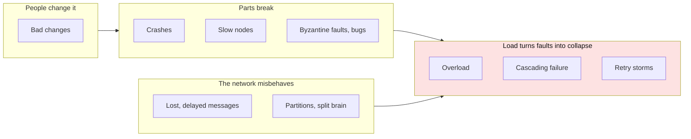
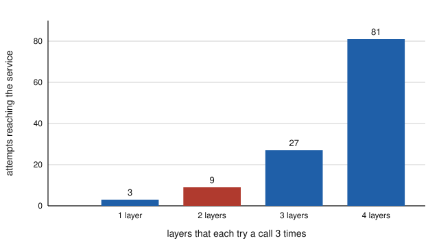

# Can you walk me through the classic failure modes in large scale distributed system and what are the common solutions to prevent or mitigate each one?

## 1. Abstract

Engineers who build or run services across many machines need to know how such systems fail and what the standard defences are. The classic failure modes fall into four groups: parts break, the network misbehaves, load turns a small fault into a collapse, and people break the system with changes. Each has a well-known remedy: redundancy and failure detection, timeouts with bounded retries, majorities, throttling and isolation, and gradual, automated change.

**Key takeaways:**

- Faults are certain; design so the whole survives some broken parts.
- A timeout cannot tell a dead node from a slow one.
- Retries cure transient faults but can cause overload: bound them, back off and add jitter.
- Isolate and shed load, so one failure does not spread.
- Roll changes out gradually and automatically.

## 2. Terminology

| Term | Definition |
|---|---|
| **Fault** | One part of the system not working, such as a node or a network link [\[1\]](../sources/distributed-systems-kleppmann-cambridge-notes.md#fault-tolerance-and-high-availability). |
| **Failure** | The system as a whole not working [\[1\]](../sources/distributed-systems-kleppmann-cambridge-notes.md#fault-tolerance-and-high-availability). Established names, such as failure detector and cascading failure, keep the word by convention even where one part's fault is meant [\[1\]](../sources/distributed-systems-kleppmann-cambridge-notes.md#fault-tolerance-and-high-availability). |
| **Single point of failure** | A part whose fault takes the whole system down [\[1\]](../sources/distributed-systems-kleppmann-cambridge-notes.md#fault-tolerance-and-high-availability). |
| **Partition** | A network fault that cuts groups of nodes off from each other for an extended time [\[2\]](../sources/distributed-systems-kleppmann-cambridge-notes.md#describing-nodes-and-network-behaviour). |
| **Transient fault** | A fault that typically corrects itself, such as a momentary loss of connectivity or a busy service that times out [\[3\]](../sources/distributed-system-design-azure-retry-pattern.md#context-and-problem). |
| **Majority** | More than half of the nodes, whose agreement an algorithm needs before it acts [\[4\]](../sources/distributed-systems-kleppmann-cambridge-notes.md#introduction-to-consensus). |
| **Backoff, jitter** | Waiting longer before each successive retry; adding a random amount to each wait [\[5\]](../sources/distributed-system-design-azure-retry-pattern.md#retry-strategies), [\[6\]](../sources/failure-modes-wikipedia-thundering-herd.md#mitigation). |
| **[→]** | Our own reasoning, after a statement or on a section's heading: a conclusion, comparison or example no cited source states. |
| **[?]** | A gap, after a statement or on a heading: something the question needs that the sources don't answer. |

## 3. Overview

A large-scale distributed system is many machines cooperating over a network. Faults in its parts are a routine cause of downtime, and what matters is whether one part's fault becomes a failure of the whole [\[1\]](../sources/distributed-systems-kleppmann-cambridge-notes.md#fault-tolerance-and-high-availability).

The running example is an online shop that wants to sell around the clock [\[1\]](../sources/distributed-systems-kleppmann-cambridge-notes.md#fault-tolerance-and-high-availability). Its checkout service calls a payment service and an inventory service over the network, and its pages also show product recommendations. The two services share a replicated database. Each item below says in a sentence how it would hit this shop [→].

The items are the failure modes the wiki's saved sources treat as standard. They were checked against three lists: Kleppmann's model of what can go wrong with networks, nodes and timing [\[2\]](../sources/distributed-systems-kleppmann-cambridge-notes.md#describing-nodes-and-network-behaviour); the fallacies of distributed computing [\[7\]](../sources/distributed-system-design-wikipedia-fallacies.md#the-fallacies); and the cloud vendors' reliability principles [\[8\]](../sources/distributed-system-design-azure-design-principles.md#core-principles), [\[9\]](../sources/distributed-system-design-aws-well-architected-reliability-principles.md#design-principles). Two modes named in research, gray failure and metastable failure, are noted under the items they extend, because the wiki holds their papers only as links. Left out: security attacks, except where they look like overload; and clock skew and event ordering, which the design principles narrative covers under [ordering events without a global clock](what-are-the-common-design-tenets-and-principles-for-distributed-systems.md#542-order-events-without-a-global-clock). Of the fallacies, finite bandwidth, one administrator, transport cost and a homogeneous network are left out, because they shape capacity and cost planning rather than name a failure mode; a changing topology appears inside cascading failure [→].

The map comes first, then each group and its items, then the tensions between the remedies, two classic cases, and questions to ask of a design.

## 4. The map

*Figure 4-1: Nine failure modes in four groups, by where each starts: a part, the network, the load or a change. Arrows show which groups commonly set off others; the load group, shaded, spreads a fault [→].*

## 5. The main items

### 5.1 Parts break

Single machines crash, stall or misbehave. The defences are to have more than one of everything and to notice quickly when one stops [→].

#### 5.1.1 A crash stops a node

A node crashes and stops, and may restart later with only what it stored on disk [\[2\]](../sources/distributed-systems-kleppmann-cambridge-notes.md#describing-nodes-and-network-behaviour). If that node is a single point of failure, the whole service goes down [\[1\]](../sources/distributed-systems-kleppmann-cambridge-notes.md#fault-tolerance-and-high-availability). In the shop, a lone payment server would take checkout down with it [→]. The remedy is redundancy: several instances behind load balancers, database replicas, and several zones or regions, sized to the business's tolerance for risk [\[8\]](../sources/distributed-system-design-azure-design-principles.md#core-principles). Many small resources replace one large one, so one loss matters less, and monitoring drives automatic recovery [\[9\]](../sources/distributed-system-design-aws-well-architected-reliability-principles.md#design-principles). Tolerance is always bounded: an algorithm that needs a majority works only while a majority of nodes is up and able to communicate [\[4\]](../sources/distributed-systems-kleppmann-cambridge-notes.md#introduction-to-consensus).

#### 5.1.2 A slow node looks like a dead one

A node that is alive but slow is harder to handle than a dead one. Garbage-collection pauses, swapping or scheduling can pause a process for a long time, on large heaps for several minutes, and other nodes may assume it has crashed [\[2\]](../sources/distributed-systems-kleppmann-cambridge-notes.md#describing-nodes-and-network-behaviour). Failure detectors usually work by timeout, so they cannot tell a crashed node from a slow node or a lost message. In a partially synchronous system no perfect detector exists; the useful one is eventually perfect, wrong for a while but eventually right [\[1\]](../sources/distributed-systems-kleppmann-cambridge-notes.md#fault-tolerance-and-high-availability). In the shop, a payment server paused for garbage collection could be declared dead, then resume and finish a charge its replacement is also handling [→]. The remedies are a timeout on every outbound call [\[10\]](../sources/distributed-system-design-azure-transient-fault-handling.md#determine-an-appropriate-retry-count-and-interval) and algorithms whose correctness never depends on timing, so a false suspicion costs only progress [\[4\]](../sources/distributed-systems-kleppmann-cambridge-notes.md#introduction-to-consensus). Subtler partial faults that health checks miss but users feel, called gray failure, are not covered by the wiki's saved sources [?].

#### 5.1.3 A Byzantine node or a bug breaks the protocol

A Byzantine node deviates from the protocol in arbitrary ways, maliciously or not [\[2\]](../sources/distributed-systems-kleppmann-cambridge-notes.md#describing-nodes-and-network-behaviour). A software bug is in principle the same kind of fault. Every node runs the same code, though, so Byzantine-tolerant algorithms, which assume fewer than a third of nodes are faulty, cannot mask it [\[2\]](../sources/distributed-systems-kleppmann-cambridge-notes.md#describing-nodes-and-network-behaviour). In the shop, a bug in the payment code fails on every instance at once [→]. Defending against bugs is therefore a matter of how changes are tested and rolled out, under [a bad change](#541-a-bad-change-takes-down-what-was-working) [→].

### 5.2 The network misbehaves

The first fallacy of distributed computing is that the network is reliable [\[7\]](../sources/distributed-system-design-wikipedia-fallacies.md#the-fallacies). Messages get lost, delayed and reordered, and sometimes whole groups of nodes cannot reach each other [\[2\]](../sources/distributed-systems-kleppmann-cambridge-notes.md#describing-nodes-and-network-behaviour).

#### 5.2.1 Messages get lost and delayed

Links may lose, duplicate or reorder messages, and latency varies with congestion, retransmission and route changes [\[2\]](../sources/distributed-systems-kleppmann-cambridge-notes.md#describing-nodes-and-network-behaviour). Code that assumes otherwise can stall or wait forever during an outage, holds memory, and may never retry its stalled work [\[11\]](../sources/distributed-system-design-wikipedia-fallacies.md#the-effects-of-the-fallacies). Cloud environments add transient faults from shared, throttled resources, replaced hardware, and the routers and load balancers in between [\[12\]](../sources/distributed-system-design-azure-transient-fault-handling.md#why-do-transient-faults-occur-in-the-cloud). In the shop, a checkout call to inventory can hang with no answer [→]. The remedies are a timeout on every outbound call, set before any retry logic [\[10\]](../sources/distributed-system-design-azure-transient-fault-handling.md#determine-an-appropriate-retry-count-and-interval); a retry after a delay for faults likely to clear [\[5\]](../sources/distributed-system-design-azure-retry-pattern.md#retry-strategies); and deduplication, so that retrying over a lossy link is safe [\[2\]](../sources/distributed-systems-kleppmann-cambridge-notes.md#describing-nodes-and-network-behaviour). A retried operation should be idempotent, since a request can succeed while its response is lost [\[13\]](../sources/distributed-system-design-azure-retry-pattern.md#idempotency).

#### 5.2.2 A partition splits the system

A partition cuts groups of nodes off from each other for an extended time [\[2\]](../sources/distributed-systems-kleppmann-cambridge-notes.md#describing-nodes-and-network-behaviour). No system is safe from it, so during one a system must choose: stay consistent and return errors, or stay available and possibly serve stale data [\[14\]](../sources/distributed-system-design-wikipedia-cap-theorem.md#explanation). A partition can also cause split brain: when a cluster's heartbeat links fail, each node believes it is the only one running and accepts its own updates, which can corrupt data [\[15\]](../sources/failure-modes-wikipedia-split-brain.md#state). In the shop, two database replicas could each accept the last item's sale [→]. The pessimistic remedy is a majority: only the side with a majority stays available, and the others fence themselves off [\[16\]](../sources/failure-modes-wikipedia-split-brain.md#approaches-for-dealing-with-split-brain). Optimistic systems keep both sides running and reconcile afterwards [\[16\]](../sources/failure-modes-wikipedia-split-brain.md#approaches-for-dealing-with-split-brain). In a consensus system, split brain means two leaders deciding differently; with a majority rule, a cut-off old leader may still believe it leads but can no longer decide anything [\[4\]](../sources/distributed-systems-kleppmann-cambridge-notes.md#introduction-to-consensus). [The five servers come through the partition](how-does-raft-elect-a-leader-and-keep-every-servers-log-consistent.md#52-the-five-servers-come-through-the-partition) works this through in Raft.

### 5.3 Load turns faults into collapse

These failures start from too much work, or from a small fault that extra work makes worse. Each feeds on itself: a slow component holds resources, callers retry, and the extra load slows it further [\[10\]](../sources/distributed-system-design-azure-transient-fault-handling.md#determine-an-appropriate-retry-count-and-interval).

#### 5.3.1 Overload exceeds capacity

When demand exceeds capacity, the system slows or fails. Resource saturation is a common cause of failure [\[9\]](../sources/distributed-system-design-aws-well-architected-reliability-principles.md#design-principles). Autoscaling helps, but new capacity takes time and money [\[17\]](../sources/distributed-system-design-azure-throttling-pattern.md#context-and-problem). Throttling caps use instead: rate limits per client, turning off non-essential features, deferring low-priority work, and limiting calls to an unhealthy dependency [\[18\]](../sources/distributed-system-design-azure-throttling-pattern.md#solution). A queue between callers and a service absorbs peaks, so the service works at its own pace [\[19\]](../sources/failure-modes-azure-queue-based-load-leveling.md#solution). Neither is free: a queue keeps growing if producers outpace consumers on average, and scaling consumers without bounding their calls downstream only moves the overload [\[20\]](../sources/failure-modes-azure-queue-based-load-leveling.md#problems-and-considerations). In the shop, a sale-day spike could be met by turning off recommendations to keep checkout alive [→].

#### 5.3.2 A failure cascades from part to part

A cascading failure spreads from one overloaded part to the next. In networks, an overloaded router goes down, its traffic shifts to another path, that path overloads, and so on [\[21\]](../sources/distributed-system-design-wikipedia-cascading-failure.md#in-computer-networks). In services, calls to a slow dependency block until they time out, holding threads, memory and connections, until unrelated parts fail for lack of them [\[22\]](../sources/distributed-system-design-azure-circuit-breaker-pattern.md#context-and-problem). In the shop, a slow inventory service could use up all of checkout's threads [→]. Two patterns contain a cascade. A bulkhead partitions resources, such as one connection pool per downstream service, so a failing dependency uses up only its own share [\[23\]](../sources/distributed-system-design-azure-bulkhead-pattern.md#solution). A circuit breaker counts recent failures and, past a threshold, fails calls at once instead of waiting; it then lets a few trial calls through to detect recovery [\[24\]](../sources/distributed-system-design-azure-circuit-breaker-pattern.md#solution).

#### 5.3.3 Retries pile onto a struggling service

*Figure 5-1: Retries multiply through layers: each layer that tries a call 3 times triples the attempts, 3 × 3 = 9 for two layers (red), 3 × 3 × 3 = 27 for three [\[25\]](../sources/distributed-system-design-azure-transient-fault-handling.md#avoid-antipatterns).*

Retries meant to ride out transient faults can stop a struggling service from recovering: clients that retry too often or too long overwhelm it [\[26\]](../sources/failure-modes-azure-retry-storm-antipattern.md#context-and-problem). Retries also multiply through layers: when a component tries a call three times and the component it calls also tries three times, the service receives up to 3 × 3 = 9 attempts [\[25\]](../sources/distributed-system-design-azure-transient-fault-handling.md#avoid-antipatterns). A thundering herd is the synchronized form: many waiters wake at once for something only one can use, called a cache stampede when it hits a cache [\[27\]](../sources/failure-modes-wikipedia-thundering-herd.md#thundering-herd-problem---wikipedia). In the shop, every checkout retrying payment at once would keep payment down [→]. The remedies are to cap retry count and duration, back off exponentially, honour the server's `Retry-After`, and use a circuit breaker [\[28\]](../sources/failure-modes-azure-retry-storm-antipattern.md#solution); to add jitter, so clients stop retrying in lockstep [\[6\]](../sources/failure-modes-wikipedia-thundering-herd.md#mitigation); and to give each dependency a retry budget [\[25\]](../sources/distributed-system-design-azure-transient-fault-handling.md#avoid-antipatterns). Failures in which such load keeps a system down after the trigger is gone, called metastable, are not covered by the wiki's saved sources [?].

### 5.4 People change it

A change can break a system that was working, with no part at fault [\[29\]](../sources/distributed-system-design-wikipedia-cascading-failure.md#example).

#### 5.4.1 A bad change takes down what was working

In December 2012, a routine update to Gmail's load-balancing software used "all" where "some" was meant. The cascade cut 40% of Gmail's service worldwide for 18 minutes; engineers fixed it by fully updating a single node instead of partially updating all of them [\[29\]](../sources/distributed-system-design-wikipedia-cascading-failure.md#example). In the shop, a new checkout release could reach every server before anyone sees it fail [→]. The remedies are to make changes through automation that is itself tracked and reviewed [\[9\]](../sources/distributed-system-design-aws-well-architected-reliability-principles.md#design-principles); to roll upgrades out one node at a time, which fault tolerance makes possible without clients noticing [\[1\]](../sources/distributed-systems-kleppmann-cambridge-notes.md#fault-tolerance-and-high-availability); and to test how the system fails and recovers, not only that it works [\[9\]](../sources/distributed-system-design-aws-well-architected-reliability-principles.md#design-principles). Taking nodes down for maintenance or upgrades can itself start a cascade [\[21\]](../sources/distributed-system-design-wikipedia-cascading-failure.md#in-computer-networks), so a rolling upgrade needs spare capacity to carry each node's load while it is down [→].

## 6. Tensions and trade-offs

**Retries against overload.** Retries fix transient faults, but an aggressive retry policy degrades a busy service further [\[30\]](../sources/distributed-system-design-azure-retry-pattern.md#impact-on-performance). The balance is bounded retries with backoff and jitter, a retry budget, and a circuit breaker for faults that persist [\[25\]](../sources/distributed-system-design-azure-transient-fault-handling.md#avoid-antipatterns), [\[31\]](../sources/distributed-system-design-azure-transient-fault-handling.md#manage-operations-that-continually-fail).

**Timeouts that are too short or too long.** Long timeouts let threads and connections pile up during an outage; short ones fail calls that would have succeeded [\[10\]](../sources/distributed-system-design-azure-transient-fault-handling.md#determine-an-appropriate-retry-count-and-interval).

**Consistency against availability.** During a partition you choose between errors and possibly stale answers [\[14\]](../sources/distributed-system-design-wikipedia-cap-theorem.md#explanation); the [design principles narrative](what-are-the-common-design-tenets-and-principles-for-distributed-systems.md#541-choose-consistency-deliberately) argues for choosing per operation.

**Absorbing load against moving it.** Queues and autoscaling absorb spikes, but consumers without a bound push the overload onto the next dependency [\[20\]](../sources/failure-modes-azure-queue-based-load-leveling.md#problems-and-considerations).

## 7. Classic case studies

**Gmail, December 2012.** The outage set up under [a bad change](#541-a-bad-change-takes-down-what-was-working) shows a bad change and a cascade together, and its fix, one node fully updated, is the one-node-at-a-time rollout that item recommends [→]. *What happened in the Gmail outage of 2012, and what does it teach?* is a case study of its own.

**An ISP reroutes around a failed node.** When a single network node fails, routing sends its traffic along a longer path through systems that never carried that much, and they fail in turn; DNS failures then break connections that were not involved at all [\[29\]](../sources/distributed-system-design-wikipedia-cascading-failure.md#example). It shows redundancy turning one fault into a cascading failure [→].

## 8. Applying them [→]

Ask these questions of each remote call in a design like the shop's checkout:

1. Does the call have a timeout, and is retrying it safe?
2. Are its retries bounded, backed off, jittered and within a budget?
3. When the dependency is down, does a circuit breaker or a fallback answer instead, and is the dependency's resource pool isolated?
4. During a partition, which side keeps accepting writes?
5. Under overload, what is shed first?
6. Does a change reach one node before all of them?

## 9. Where to go next

- [What are the common design tenets and principles for distributed systems?](what-are-the-common-design-tenets-and-principles-for-distributed-systems.md): the same defences, organized as principles.
- [What is a distributed system?](what-is-a-distributed-system.md): why partial failure is the defining difficulty.
- How should timeouts, retries and backoff be set?
- How do circuit breakers and bulkheads stop a cascading failure?
- What are metastable failures, and how do systems escape them?
- What is gray failure, and how is it detected?

## 10. References

### 10.1 Sources read

- [distributed-systems-kleppmann-cambridge-notes](../sources/distributed-systems-kleppmann-cambridge-notes.md): the system model of node, network and timing faults; fault tolerance and failure detection.
- [distributed-system-design-wikipedia-fallacies](../sources/distributed-system-design-wikipedia-fallacies.md): the fallacies and their effects.
- [distributed-system-design-azure-design-principles](../sources/distributed-system-design-azure-design-principles.md) and [distributed-system-design-aws-well-architected-reliability-principles](../sources/distributed-system-design-aws-well-architected-reliability-principles.md): the vendors' reliability principles.
- [distributed-system-design-azure-transient-fault-handling](../sources/distributed-system-design-azure-transient-fault-handling.md), [distributed-system-design-azure-retry-pattern](../sources/distributed-system-design-azure-retry-pattern.md) and [failure-modes-azure-retry-storm-antipattern](../sources/failure-modes-azure-retry-storm-antipattern.md): transient faults, timeouts, retries and their dangers.
- [distributed-system-design-azure-throttling-pattern](../sources/distributed-system-design-azure-throttling-pattern.md), [failure-modes-azure-queue-based-load-leveling](../sources/failure-modes-azure-queue-based-load-leveling.md), [distributed-system-design-azure-circuit-breaker-pattern](../sources/distributed-system-design-azure-circuit-breaker-pattern.md) and [distributed-system-design-azure-bulkhead-pattern](../sources/distributed-system-design-azure-bulkhead-pattern.md): overload and its containment.
- [distributed-system-design-wikipedia-cascading-failure](../sources/distributed-system-design-wikipedia-cascading-failure.md), [failure-modes-wikipedia-thundering-herd](../sources/failure-modes-wikipedia-thundering-herd.md), [failure-modes-wikipedia-split-brain](../sources/failure-modes-wikipedia-split-brain.md) and [distributed-system-design-wikipedia-cap-theorem](../sources/distributed-system-design-wikipedia-cap-theorem.md): cascades and their examples, herds, split brain and the partition trade-off.
- Recorded as links, not read: the metastable-failure and gray-failure papers, the Google SRE chapter on cascading failures, and the AWS article on timeouts and backoff.

### 10.2 Citations

1. [distributed-systems-kleppmann-cambridge-notes: Fault tolerance and high availability](../sources/distributed-systems-kleppmann-cambridge-notes.md#fault-tolerance-and-high-availability)
2. [distributed-systems-kleppmann-cambridge-notes: Describing nodes and network behaviour](../sources/distributed-systems-kleppmann-cambridge-notes.md#describing-nodes-and-network-behaviour)
3. [distributed-system-design-azure-retry-pattern: Context and problem](../sources/distributed-system-design-azure-retry-pattern.md#context-and-problem)
4. [distributed-systems-kleppmann-cambridge-notes: Introduction to consensus](../sources/distributed-systems-kleppmann-cambridge-notes.md#introduction-to-consensus)
5. [distributed-system-design-azure-retry-pattern: Retry strategies](../sources/distributed-system-design-azure-retry-pattern.md#retry-strategies)
6. [failure-modes-wikipedia-thundering-herd: Mitigation](../sources/failure-modes-wikipedia-thundering-herd.md#mitigation)
7. [distributed-system-design-wikipedia-fallacies: The fallacies](../sources/distributed-system-design-wikipedia-fallacies.md#the-fallacies)
8. [distributed-system-design-azure-design-principles: Core principles](../sources/distributed-system-design-azure-design-principles.md#core-principles)
9. [distributed-system-design-aws-well-architected-reliability-principles: Design principles](../sources/distributed-system-design-aws-well-architected-reliability-principles.md#design-principles)
10. [distributed-system-design-azure-transient-fault-handling: Determine an appropriate retry count and interval](../sources/distributed-system-design-azure-transient-fault-handling.md#determine-an-appropriate-retry-count-and-interval)
11. [distributed-system-design-wikipedia-fallacies: The effects of the fallacies](../sources/distributed-system-design-wikipedia-fallacies.md#the-effects-of-the-fallacies)
12. [distributed-system-design-azure-transient-fault-handling: Why do transient faults occur in the cloud?](../sources/distributed-system-design-azure-transient-fault-handling.md#why-do-transient-faults-occur-in-the-cloud)
13. [distributed-system-design-azure-retry-pattern: Idempotency](../sources/distributed-system-design-azure-retry-pattern.md#idempotency)
14. [distributed-system-design-wikipedia-cap-theorem: Explanation](../sources/distributed-system-design-wikipedia-cap-theorem.md#explanation)
15. [failure-modes-wikipedia-split-brain: State](../sources/failure-modes-wikipedia-split-brain.md#state)
16. [failure-modes-wikipedia-split-brain: Approaches for dealing with split-brain](../sources/failure-modes-wikipedia-split-brain.md#approaches-for-dealing-with-split-brain)
17. [distributed-system-design-azure-throttling-pattern: Context and problem](../sources/distributed-system-design-azure-throttling-pattern.md#context-and-problem)
18. [distributed-system-design-azure-throttling-pattern: Solution](../sources/distributed-system-design-azure-throttling-pattern.md#solution)
19. [failure-modes-azure-queue-based-load-leveling: Solution](../sources/failure-modes-azure-queue-based-load-leveling.md#solution)
20. [failure-modes-azure-queue-based-load-leveling: Problems and considerations](../sources/failure-modes-azure-queue-based-load-leveling.md#problems-and-considerations)
21. [distributed-system-design-wikipedia-cascading-failure: In computer networks](../sources/distributed-system-design-wikipedia-cascading-failure.md#in-computer-networks)
22. [distributed-system-design-azure-circuit-breaker-pattern: Context and problem](../sources/distributed-system-design-azure-circuit-breaker-pattern.md#context-and-problem)
23. [distributed-system-design-azure-bulkhead-pattern: Solution](../sources/distributed-system-design-azure-bulkhead-pattern.md#solution)
24. [distributed-system-design-azure-circuit-breaker-pattern: Solution](../sources/distributed-system-design-azure-circuit-breaker-pattern.md#solution)
25. [distributed-system-design-azure-transient-fault-handling: Avoid antipatterns](../sources/distributed-system-design-azure-transient-fault-handling.md#avoid-antipatterns)
26. [failure-modes-azure-retry-storm-antipattern: Context and problem](../sources/failure-modes-azure-retry-storm-antipattern.md#context-and-problem)
27. [failure-modes-wikipedia-thundering-herd: Thundering herd problem](../sources/failure-modes-wikipedia-thundering-herd.md#thundering-herd-problem---wikipedia)
28. [failure-modes-azure-retry-storm-antipattern: Solution](../sources/failure-modes-azure-retry-storm-antipattern.md#solution)
29. [distributed-system-design-wikipedia-cascading-failure: Example](../sources/distributed-system-design-wikipedia-cascading-failure.md#example)
30. [distributed-system-design-azure-retry-pattern: Impact on performance](../sources/distributed-system-design-azure-retry-pattern.md#impact-on-performance)
31. [distributed-system-design-azure-transient-fault-handling: Manage operations that continually fail](../sources/distributed-system-design-azure-transient-fault-handling.md#manage-operations-that-continually-fail)

## 11. Metadata

- **Version:** 2.2
- **Template:** survey
- **Language:** en
- **Model:** claude-opus-5-5
- **Created:** 2026-10-27
- **Last modified:** 2026-11-24
- **Words:** 2,484 (about 11 min)
- **History:**
  - 2.2 (2026-11-24): An SVG figure drawn from the narrative's own cited numbers, where a chart shows what a diagram can't
  - 2.1 (2026-11-24): Lint: the retry arithmetic (3 × 3 tries), the majority bound, failure detectors as the source states them, split brain consistent with the Raft narrative and linked to its walkthrough, the shop example completed and the Gmail case told once, left-out fallacies named, and smaller wording fixes
  - 2.0 (2026-11-24): Regenerated under sllmwiki 1.4.0's guides: a new spine and outline, the shop example set up once in the Overview and shown in each item, statement headings for every item, and terms cited where defined
  - 1.1 (2026-10-27): Lint: cited the slow-node remedies, corrected the majority bound to more than half, and named clock skew and event ordering as left out.
  - 1.0 (2026-10-27): First version.
- **Reading plan:**
  1. `how-does-raft-elect-a-leader-and-keep-every-servers-log-consistent`, in full: existing narrative, background
  2. `distributed-system-design-wikipedia-cap-theorem`, in full: medium relevance, authority C, undated
  3. `distributed-system-design-aws-well-architected-reliability-principles`, in full: medium relevance, authority A, undated
  4. `distributed-system-design-azure-design-principles`, in full: medium relevance, authority A, undated
  5. `distributed-system-design-wikipedia-fallacies`, in full: high relevance, authority C, undated
  6. `distributed-system-design-wikipedia-cascading-failure`, in full: high relevance, authority C, undated
  7. `failure-modes-wikipedia-thundering-herd`, in full: high relevance, authority C, undated
  8. `failure-modes-wikipedia-split-brain`, in full: high relevance, authority C, undated
  9. `distributed-systems-kleppmann-cambridge-notes`, in full: high relevance, authority B, 2021-10-01
  10. `distributed-system-design-azure-retry-pattern`, in full: high relevance, authority A, undated
  11. `distributed-system-design-azure-circuit-breaker-pattern`, in full: high relevance, authority A, undated
  12. `distributed-system-design-azure-bulkhead-pattern`, in full: high relevance, authority A, undated
  13. `distributed-system-design-azure-throttling-pattern`, in full: high relevance, authority A, undated
  14. `distributed-system-design-azure-transient-fault-handling`, in full: high relevance, authority A, undated
  15. `failure-modes-azure-retry-storm-antipattern`, in full: high relevance, authority A, undated
  16. `failure-modes-azure-queue-based-load-leveling`, in full: high relevance, authority A, undated
  17. `raft-ongaro-dissertation-ch3-basic-raft`, abstract only: low relevance
  18. `raft-ongaro-dissertation-ch9-leader-election`, abstract only: low relevance
  19. `raft-etcd-raft-readme`, abstract only: low relevance
  20. `distributed-system-design-aws-timeouts-retries-backoff`, not read: a link, no saved copy
  21. `distributed-system-design-google-sre-cascading-failures`, not read: a link, no saved copy
  22. `failure-modes-bronson-metastable-failures`, not read: a link, no saved copy
  23. `failure-modes-huang-gray-failure`, not read: a link, no saved copy
  24. `distributed-system-design-ongaro-raft-consensus`, not read: a link, no saved copy
