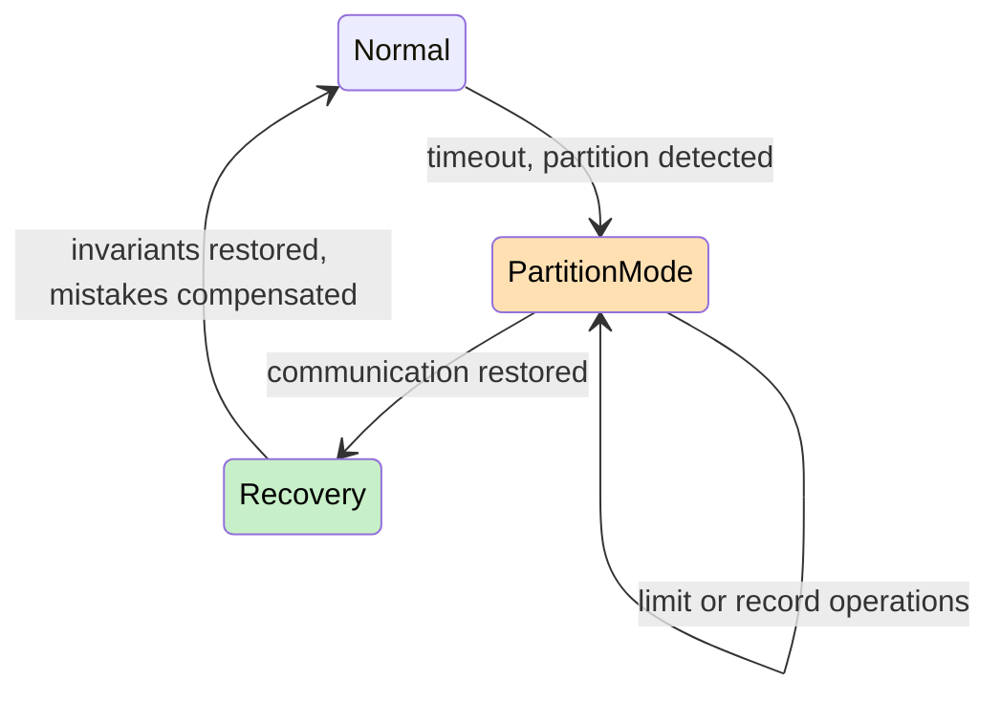
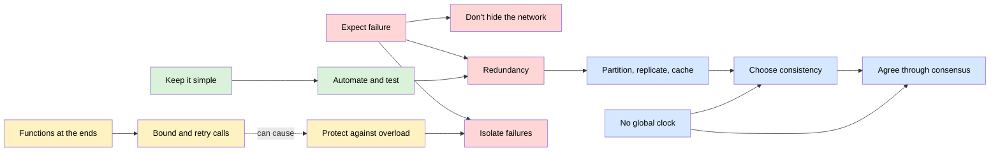

# What are the common design tenets and principles for distributed systems?

## 1. Abstract

The principles that recur across the classic papers, textbooks and cloud providers' official lists all start from one fact: in a distributed system, parts fail independently, the network is slow and unreliable, and no node sees the whole system at once. Thirteen principles cover the ground. Expect failure and design for it from the start. Don't pretend the network away. Remove single points of failure with redundancy, and scale out by partitioning, replicating and caching. Choose consistency deliberately: during a partition a system trades consistency against availability, so decide per operation and plan the recovery. Where replicas must agree on one history, use a consensus algorithm such as Raft. Don't order events by physical clocks: "happened before" is only a partial order. Put functions such as duplicate suppression at the ends, where the application can do them completely. Bound every remote call with a timeout, and retry with backoff, jitter and a budget. Protect services against overload, isolate failures so they don't cascade, keep designs simple, and automate operations, testing failure and rolling out in stages. The principles pull on each other: consistency and consensus cost availability, retries need idempotency and can cause overload, and tested automation is what makes redundancy real.

## 2. Terminology

| Term | Definition |
|---|---|
| **Fault / failure** | A fault is one part not working; a failure is the system as a whole not working. |
| **Fault tolerance** | Designing a system to keep working while some of its parts are faulty. |
| **Partial failure** | Some components or links fail while the rest keep running. |
| **Single point of failure** | A component whose failure brings down the whole service. |
| **Load balancer** | A component that spreads incoming requests across several interchangeable servers. |
| **Checksum** | A small value computed from a block of data and sent with it, so the receiver can detect corrupted bits. |
| **Leader** | The one server in a cluster that the others take direction from. |
| **Partition** | A break in communication that splits the nodes into groups that can't reach each other. |
| **Partition mode** | Brewer's explicit mode a system enters on detecting a partition, limiting or recording operations until recovery. |
| **CAP** | Consistency, availability, partition tolerance: a shared-data system can't have all three during a partition. |
| **Eventual consistency** | Replicas may disagree for a while, but converge once updates are exchanged. |
| **Invariant** | A rule the data must always satisfy, such as unique keys or a balance of zero or more. |
| **Consensus** | Getting a group of machines to agree on values, such as the order of commands, despite some of them failing. |
| **Replicated state machine** | Identical, deterministic state machines on several servers that apply the same commands in the same order. |
| **Majority (quorum)** | More than half of a group's servers. |
| **$n$, $f$** | The number of servers in a cluster, and the number of them that may fail. |
| **Happened before** | Lamport's relation between two events: one could have influenced the other, through a process's order or a message. |
| **Logical clock** | A counter that numbers events consistently with happened before, with no link to physical time. |
| **End-to-end argument** | Saltzer, Reed and Clark's principle that functions the application must check anyway belong at the ends, not in the network. |
| **Timeout / deadline** | The longest a caller waits for a remote call; a deadline is the same limit carried through a chain of calls. |
| **Exponential backoff** | Waiting longer after each failed attempt, multiplying the wait each time, up to a cap. |
| **Jitter** | Randomness added to waits and timers so that many clients don't act in lockstep. |
| **Idempotent** | An operation that has the same effect whether it runs once or several times. |
| **Retry budget** | A cap on how many retries a client or server may make in a period. |
| **Admission control** | Deciding at the door which requests a service accepts, so that it doesn't take on more than it can serve. |
| **Load shedding** | Rejecting some requests on purpose when overloaded, to keep serving the rest. |
| **Graceful degradation** | Serving a reduced or lower-quality result instead of failing outright. |
| **Cascading failure** | A failure that spreads from one component to others through positive feedback, such as overload moving to the survivors. |
| **[sllmwiki_reasoning]** | The narrative's own reasoning: a conclusion, comparison or reconstruction no cited source states. |
| **[sllmwiki_gap]** | Something the question needs that the sources don't answer. |

## 3. Scope

The survey covers the principles for building and running distributed services: failure, load, agreement, time and change. It names the foundations beneath them (consistency, consensus, logical time) without their algorithms, and leaves out security. [sllmwiki_reasoning] The items come from the classic lists (the fallacies, Hamilton's tenets), AWS's and Azure's official lists, and each main area of the field: those at least two sources state or one authoritative source puts first, overlaps merged.

## 4. At a glance

| Item | In one line | Sources |
|---|---|---|
| Expect failure | Any component can fail at any time; survive it | [\[1\]](../sources/distributed-system-design-hamilton-internet-scale-services.md#page-1), [\[2\]](../sources/distributed-system-design-aws-timeouts-retries-backoff.md#failures-happen), [\[3\]](../sources/distributed-system-design-azure-design-principles.md#core-principles), [\[4\]](../sources/distributed-systems-kleppmann-cambridge-notes.md#fault-tolerance-and-high-availability) |
| Don't hide the network | Design against the fallacies | [\[5\]](../sources/distributed-system-design-wikipedia-fallacies.md#the-fallacies), [\[6\]](../sources/distributed-systems-van-steen-tanenbaum-brief-intro.md#35-pitfalls) |
| Redundancy, no single point of failure | Many small resources, not one large one | [\[7\]](../sources/distributed-system-design-hamilton-internet-scale-services.md#page-2), [\[8\]](../sources/distributed-system-design-aws-well-architected-reliability-principles.md#design-principles), [\[3\]](../sources/distributed-system-design-azure-design-principles.md#core-principles) |
| Partition, replicate and cache | Scale out by splitting and copying | [\[9\]](../sources/distributed-systems-van-steen-tanenbaum-brief-intro.md#342-scaling-techniques), [\[3\]](../sources/distributed-system-design-azure-design-principles.md#core-principles) |
| Choose consistency deliberately | In a partition, trade consistency against availability per operation | [\[10\]](../sources/distributed-system-design-brewer-cap-twelve-years-later.md#why-2-of-3-is-missleading), [\[3\]](../sources/distributed-system-design-azure-design-principles.md#core-principles) |
| Agree through consensus | Replicas agree through a majority-based algorithm | [\[11\]](../sources/distributed-system-design-ongaro-raft-consensus.md#page-1), [\[12\]](../sources/distributed-system-design-ongaro-raft-consensus.md#page-2) |
| Don't rely on a global clock | Events are only partially ordered | [\[13\]](../sources/distributed-system-design-lamport-time-clocks.md#page-1), [\[12\]](../sources/distributed-system-design-ongaro-raft-consensus.md#page-2) |
| Put functions at the ends | What the application must check belongs there | [\[14\]](../sources/distributed-system-design-saltzer-end-to-end-arguments.md#introduction) |
| Bound and retry calls with care | Timeouts on every call; backoff, jitter, budgets, idempotency | [\[15\]](../sources/distributed-system-design-aws-timeouts-retries-backoff.md#timeouts), [\[16\]](../sources/distributed-system-design-aws-timeouts-retries-backoff.md#retries-and-backoff), [\[17\]](../sources/distributed-system-design-google-sre-cascading-failures.md#retries) |
| Protect against overload | Admission control, load shedding, degradation | [\[18\]](../sources/distributed-system-design-hamilton-internet-scale-services.md#page-4), [\[19\]](../sources/distributed-system-design-google-sre-cascading-failures.md#load-shedding-and-graceful-degradation) |
| Isolate failures | Fail fast; stop failures spreading | [\[20\]](../sources/distributed-system-design-hamilton-internet-scale-services.md#page-6), [\[21\]](../sources/distributed-system-design-google-sre-cascading-failures.md#addressing-cascading-failures) |
| Keep it simple | Complexity breeds failures | [\[1\]](../sources/distributed-system-design-hamilton-internet-scale-services.md#page-1), [\[22\]](../sources/distributed-system-design-hamilton-internet-scale-services.md#page-3) |
| Automate, test failure, roll out in stages | Machines recover; failure is exercised; deploys are gradual | [\[1\]](../sources/distributed-system-design-hamilton-internet-scale-services.md#page-1), [\[8\]](../sources/distributed-system-design-aws-well-architected-reliability-principles.md#design-principles), [\[23\]](../sources/distributed-system-design-hamilton-internet-scale-services.md#page-5) |

## 5. The main items

### 5.1 Expect failure

**What.** Hamilton opens with Bill Hoffman's three tenets, and puts "expect failures" first: any component may crash or be stopped at any time, and the service must survive without human action. [\[1\]](../sources/distributed-system-design-hamilton-internet-scale-services.md#page-1) AWS aims not to magnify a few failures into an outage, [\[2\]](../sources/distributed-system-design-aws-timeouts-retries-backoff.md#failures-happen) and Azure's first principle, self-healing, starts from failures being inevitable. [\[3\]](../sources/distributed-system-design-azure-design-principles.md#core-principles)

**Why.** Better hardware lowers the rate of faults but never to zero, so many distributed systems tolerate faults instead. [\[4\]](../sources/distributed-systems-kleppmann-cambridge-notes.md#fault-tolerance-and-high-availability) A caller can't always tell what failed: a timed-out request may or may not have taken effect. [\[24\]](../sources/distributed-system-design-aws-challenges-distributed-systems.md#handling-failure-modes-in-hard-real-time-distributed-systems)

**Example.** Hamilton's acid test: can operations kill any server at any time, undrained (without first moving its work elsewhere), and the service carry on? [\[7\]](../sources/distributed-system-design-hamilton-internet-scale-services.md#page-2)

**Deeper.** How do distributed systems handle partial failure and unknown outcomes?

### 5.2 Don't hide the network

**What.** The fallacies of distributed computing are eight false assumptions: the network is reliable, latency is zero, bandwidth is infinite, the network is secure, topology doesn't change, there is one administrator, transport cost is zero, and the network is homogeneous. [\[5\]](../sources/distributed-system-design-wikipedia-fallacies.md#the-fallacies) Van Steen and Tanenbaum list them as pitfalls. [\[6\]](../sources/distributed-systems-van-steen-tanenbaum-brief-intro.md#35-pitfalls)

**Why.** Hiding distribution completely is not always a good idea: no system hides that a message across the world takes tens of milliseconds, and masking a server failure can slow everything. [\[25\]](../sources/distributed-systems-van-steen-tanenbaum-brief-intro.md#322-degree-of-distribution-transparency)

**Example.** Code assuming a reliable network may wait forever for a reply. [\[26\]](../sources/distributed-system-design-wikipedia-fallacies.md#the-effects-of-the-fallacies)

**Deeper.** How much distribution transparency should a system offer?

### 5.3 Redundancy and no single point of failure

**What.** Make every component redundant, so the service survives any single failure, and build from small commodity units. [\[7\]](../sources/distributed-system-design-hamilton-internet-scale-services.md#page-2) AWS: "Replace one large resource with multiple small resources to reduce the impact of a single failure on the overall workload." [\[8\]](../sources/distributed-system-design-aws-well-architected-reliability-principles.md#design-principles) Azure's "make all things redundant" agrees. [\[3\]](../sources/distributed-system-design-azure-design-principles.md#core-principles)

**Why.** Interchangeable, stateless machines behind a load balancer remove single points of failure. [\[18\]](../sources/distributed-system-design-hamilton-internet-scale-services.md#page-4)

**Example.** With small commodity servers, one failure takes out less capacity. [\[7\]](../sources/distributed-system-design-hamilton-internet-scale-services.md#page-2)

**Deeper.** How much redundancy does a service need, and where?

### 5.4 Partition, replicate and cache

**What.** Van Steen and Tanenbaum's scaling techniques: hide latency, partition and distribute (as DNS does), and replicate and cache. [\[9\]](../sources/distributed-systems-van-steen-tanenbaum-brief-intro.md#342-scaling-techniques) Azure says the same: scale out, and partition around limits. [\[3\]](../sources/distributed-system-design-azure-design-principles.md#core-principles)

**Why.** A system has to scale in size, across geography and across administrative domains, and centralized components limit all three. [\[27\]](../sources/distributed-systems-van-steen-tanenbaum-brief-intro.md#341-scalability-dimensions)

**Example.** Replication and caching speed reads, but bring consistency problems between the copies. [\[9\]](../sources/distributed-systems-van-steen-tanenbaum-brief-intro.md#342-scaling-techniques)

**Deeper.** How should data be partitioned, and how are hotspots avoided?

### 5.5 Choose consistency deliberately

**What.** Brewer's CAP theorem: across a partition, nodes that accept updates become inconsistent, and nodes that stay consistent must act unavailable. Brewer calls "2 of 3" misleading: partitions are rare, the choice can differ per operation, and each property is a matter of degree. [\[10\]](../sources/distributed-system-design-brewer-cap-twelve-years-later.md#why-2-of-3-is-missleading) Azure asks to minimize coordination. [\[3\]](../sources/distributed-system-design-azure-design-principles.md#core-principles)

**Why.** The decision comes at every timeout: cancel and lose availability, or proceed and risk inconsistency. [\[28\]](../sources/distributed-system-design-brewer-cap-twelve-years-later.md#cap-latency-connection) Giving up consistency means knowing every invariant to restore afterwards. [\[29\]](../sources/distributed-system-design-brewer-cap-twelve-years-later.md#cap-confusion)

**Example.** Brewer manages a partition in three explicit steps: detect it, enter a partition mode that limits some operations or records extra information, and recover when communication returns, restoring consistency and compensating for mistakes. [\[30\]](../sources/distributed-system-design-brewer-cap-twelve-years-later.md#managing-partitions) Brewer's example is a bank's cash machine (ATM). It offers deposit, withdraw and check balance, and the invariant is that an account's balance stays at zero or more; only a withdrawal can break it. When a partition cuts the ATM off, it can't know the true balance: refusing all withdrawals would keep the balance safe but cost availability, and banks favour availability because it means revenue. So an ATM in partition mode caps net withdrawals at a bound, such as \$200: below it, withdrawals work; at it, they are refused. When the partition ends, a balance left below zero is compensated: the bank charges a fee and expects repayment, and since the cap bounds the risk, the problem stays small. [\[31\]](../sources/distributed-system-design-brewer-cap-twelve-years-later.md#compensation-issues-in-an-automated-teller-machine)



Orange marks where operations may be inconsistent; green, the recovery that repairs them.

**Deeper.** How should a system detect, operate through and recover from a partition?

### 5.6 Agree through consensus

**What.** Consensus lets machines act as one group that survives some members' failures. [\[11\]](../sources/distributed-system-design-ongaro-raft-consensus.md#page-1) It keeps a replicated state machine's log consistent, so every server applies the same commands in order. [\[12\]](../sources/distributed-system-design-ongaro-raft-consensus.md#page-2)

**Why.** It stays safe under delays, partitions and loss, and available while a majority is up: five servers tolerate two failures. [\[12\]](../sources/distributed-system-design-ongaro-raft-consensus.md#page-2) [sllmwiki_reasoning] In general, tolerating $f$ failures takes $n$ servers, where

$$
n = 2f + 1
$$

The price: in a partition, only the side with a quorum proceeds. [\[30\]](../sources/distributed-system-design-brewer-cap-twelve-years-later.md#managing-partitions)

**Example.** GFS and HDFS are large-scale systems run by a single cluster leader, a server the others take direction from. [\[12\]](../sources/distributed-system-design-ongaro-raft-consensus.md#page-2) [sllmwiki_reasoning] If two servers each believed they were the leader, or the cluster's configuration were lost when the leader crashed, the servers would act on conflicting instructions. Such systems therefore choose their leader, and store the configuration that must survive a leader's crash, in a separate replicated state machine such as ZooKeeper. [\[12\]](../sources/distributed-system-design-ongaro-raft-consensus.md#page-2)

**Deeper.** How do Paxos and Raft reach agreement, and what do they cost?

### 5.7 Don't rely on a global clock

**What.** Since it is sometimes impossible to say which of two events came first, Lamport's "happened before" is only a partial order, defined without physical clocks. [\[13\]](../sources/distributed-system-design-lamport-time-clocks.md#page-1) Logical clocks, plain counters, number events consistently with it. [\[32\]](../sources/distributed-system-design-lamport-time-clocks.md#page-2)

**Why.** Problems arise when people forget the order is partial. [\[13\]](../sources/distributed-system-design-lamport-time-clocks.md#page-1) Consensus doesn't depend on timing: faulty clocks at worst cost availability. [\[12\]](../sources/distributed-system-design-ongaro-raft-consensus.md#page-2)

**Example.** Brewer tracks updates during a partition with version vectors; vectors that can't be ordered mark concurrent updates. [\[33\]](../sources/distributed-system-design-brewer-cap-twelve-years-later.md#which-operations-should-proceed)

**Deeper.** How do logical, vector and synchronized physical clocks compare?

### 5.8 Put functions at the ends

**What.** Saltzer, Reed and Clark's end-to-end argument: a function "can completely and correctly be implemented only with the knowledge and help of the application standing at the end points of the communication system", so a partial version in the network is only a performance enhancement. [\[14\]](../sources/distributed-system-design-saltzer-end-to-end-arguments.md#introduction) Only their paper states it.

**Why.** A low-level function charges every application and knows less than the application. [\[34\]](../sources/distributed-system-design-saltzer-end-to-end-arguments.md#performance-aspects) Retrying applications must suppress duplicates anyway, which covers the network's too. [\[35\]](../sources/distributed-system-design-saltzer-end-to-end-arguments.md#duplicate-message-suppression)

**Example.** At MIT, several local networks were joined by gateways, computers that pass packets from one network on to the next. Each hop from gateway to gateway carried a checksum, on the assumption that the main threat was bits corrupted in transmission, and application programmers took that to mean the network delivered data reliably. But data sitting in a gateway's memory between hops was unprotected. One gateway developed a fault that swapped a pair of bytes about once in every million it copied, and operating-system source files sent through it repeatedly were corrupted; their owners had to compare them by hand against old printed listings. [\[36\]](../sources/distributed-system-design-saltzer-end-to-end-arguments.md#a-too-real-example)

**Deeper.** Where should reliability, ordering and security live in a layered system?

### 5.9 Bound and retry calls with care

**What.** AWS's rule: "set a timeout on any remote call, and generally on any call across processes even on the same box." [\[15\]](../sources/distributed-system-design-aws-timeouts-retries-backoff.md#timeouts) Google SRE carries a deadline through a chain of calls, checked at each stage. [\[37\]](../sources/distributed-system-design-google-sre-cascading-failures.md#deadline-propagation) Retry with capped exponential backoff and a limit on attempts, at one point in the stack, and only operations that are idempotent; [\[16\]](../sources/distributed-system-design-aws-timeouts-retries-backoff.md#retries-and-backoff) add jitter so that retries don't line up. [\[38\]](../sources/distributed-system-design-aws-timeouts-retries-backoff.md#jitter)

**Why.** Retries are selfish, adding load just when a dependency struggles. [\[16\]](../sources/distributed-system-design-aws-timeouts-retries-backoff.md#retries-and-backoff) Google SRE caps them with a retry budget, such as 60 a minute per process. [\[17\]](../sources/distributed-system-design-google-sre-cascading-failures.md#retries)

**Example.** With a five-deep stack of calls each retrying three times, one failing database query becomes $3^5 = 243$ calls. [\[16\]](../sources/distributed-system-design-aws-timeouts-retries-backoff.md#retries-and-backoff) [sllmwiki_reasoning] The pseudocode below follows AWS's advice above; the doubling and full-range jitter are one common choice.

```text
call_with_retries(request, max_attempts, base, cap):
    if request is not idempotent: max_attempts = 1
    for attempt = 0 .. max_attempts - 1:
        result = send(request, timeout)          # every call is bounded
        if result succeeded: return result
        if result is a client error: return result   # won't succeed later
        if retry budget is empty: return result
        wait = min(cap, base * 2^attempt)        # capped exponential backoff
        sleep(random(0, wait))                   # jitter spreads the retries
    return result
```

**Deeper.** How do backoff, jitter and retry budgets work together?

### 5.10 Protect against overload

**What.** Hamilton asks for admission control at every level, turning users away "before giving uniform poor service to all users". [\[18\]](../sources/distributed-system-design-hamilton-internet-scale-services.md#page-4) Google SRE has overloaded servers reject requests early and cheaply, [\[39\]](../sources/distributed-system-design-google-sre-cascading-failures.md#preventing-server-overload) with load shedding, graceful degradation and small queues. [\[19\]](../sources/distributed-system-design-google-sre-cascading-failures.md#load-shedding-and-graceful-degradation) [\[40\]](../sources/distributed-system-design-google-sre-cascading-failures.md#queue-management)

**Why.** Overload is the most common cause of cascading failures. [\[41\]](../sources/distributed-system-design-google-sre-cascading-failures.md#server-overload) AWS says to stop guessing capacity. [\[8\]](../sources/distributed-system-design-aws-well-architected-reliability-principles.md#design-principles)

**Example.** Hamilton's "big red switch" sheds non-critical load in an emergency. [\[42\]](../sources/distributed-system-design-hamilton-internet-scale-services.md#page-11)

**Deeper.** How do load shedding and admission control choose?

### 5.11 Isolate failures

**What.** "The architecture of the site must prevent cascading failures. Always 'fail fast.'" [\[20\]](../sources/distributed-system-design-hamilton-internet-scale-services.md#page-6) Google SRE defines a cascading failure as one "that grows over time as a result of positive feedback". [\[21\]](../sources/distributed-system-design-google-sre-cascading-failures.md#addressing-cascading-failures) Azure names circuit breakers and bulkheads. [\[3\]](../sources/distributed-system-design-azure-design-principles.md#core-principles)

**Why.** The amazon.com website gets its product information from a remote catalog service, a group of servers behind a load balancer that picks a server for each request. When one catalog server's disk filled up, a mishandled error made it answer every request quickly and with nothing. The load balancer saw only that it was much faster than the others, sent it a huge share of the traffic, and one server's fault took down the whole website. [\[43\]](../sources/distributed-system-design-aws-challenges-distributed-systems.md#distributed-bugs-spread-epidemically)

**Example.** Hamilton builds a service from pods that each run independently, so one pod's failure doesn't affect another. [\[22\]](../sources/distributed-system-design-hamilton-internet-scale-services.md#page-3)

**Deeper.** What are bulkheads, cells and circuit breakers, and when does each fit?

### 5.12 Keep it simple

**What.** The second of Hamilton's three tenets (from Bill Hoffman): complexity breeds problems, [\[1\]](../sources/distributed-system-design-hamilton-internet-scale-services.md#page-1) and only order-of-magnitude optimizations are worth theirs. [\[18\]](../sources/distributed-system-design-hamilton-internet-scale-services.md#page-4)

**Why.** In Google SRE's words, "the code path you never use is the code path that (often) doesn't work." [\[19\]](../sources/distributed-system-design-google-sre-cascading-failures.md#load-shedding-and-graceful-degradation)

**Example.** Hamilton prefers single-version software, one version of the service for everyone. [\[22\]](../sources/distributed-system-design-hamilton-internet-scale-services.md#page-3)

**Deeper.** How do teams measure and limit operational complexity?

### 5.13 Automate, test failure, roll out in stages

**What.** The third of those tenets: automate everything. [\[1\]](../sources/distributed-system-design-hamilton-internet-scale-services.md#page-1) AWS lists automatic recovery, change through automation, and testing recovery procedures. [\[8\]](../sources/distributed-system-design-aws-well-architected-reliability-principles.md#design-principles) Azure asks to design for operations: logging, tracing, metrics. [\[44\]](../sources/distributed-system-design-azure-design-principles.md#operational-principles)

**Why.** Operators under pressure make mistakes about 20% of the time. [\[18\]](../sources/distributed-system-design-hamilton-internet-scale-services.md#page-4) Google SRE load-tests past failure. [\[45\]](../sources/distributed-system-design-google-sre-cascading-failures.md#test-until-failure-and-beyond)

**Example.** Hamilton fails services regularly and tests in production. [\[23\]](../sources/distributed-system-design-hamilton-internet-scale-services.md#page-5) He deploys in stages, one system, then one per data center, then a data center, then everywhere: "Big-bang deployments are very dangerous." [\[20\]](../sources/distributed-system-design-hamilton-internet-scale-services.md#page-6)

**Deeper.** How do staged rollouts and fault injection work in practice?

## 6. How they relate



Colors mark areas: red failure, blue data and time, yellow calls and load, green operations. The dotted arrow pulls against its target.

[sllmwiki_reasoning] Expecting failure is the root: the honest network, redundancy and isolation follow from it, and redundancy leads to replication. [sllmwiki_reasoning] Replicas can diverge, forcing the consistency choice; where consistency wins, consensus is how they agree. [sllmwiki_reasoning] The missing global clock lies under both. [sllmwiki_reasoning] The end-to-end argument feeds retries: a retried call can create a duplicate only the application recognizes, hence idempotency. Naive retries multiply load on an overloaded backend, pulling against overload protection. [\[17\]](../sources/distributed-system-design-google-sre-cascading-failures.md#retries) [sllmwiki_reasoning] Overload protection serves isolation, and simplicity makes the automation that proves redundancy feasible.

## 7. Applying them

[sllmwiki_reasoning] Questions to ask of a design: What happens when each component, or a link, fails or slows? Which component, if lost, takes the service down? Which operations must stay consistent during a partition? Does every remote call have a timeout, and is every retried operation idempotent? What does the service drop first when overloaded? Which recovery steps are automated, and when were they last tested?

## 8. Where to go next

- [What is a distributed system?](what-is-a-distributed-system.md)
- How should a system detect, operate through and recover from a partition? (not yet in the wiki)
- How do Paxos and Raft reach agreement, and what do they cost? (not yet in the wiki)
- What consistency models do replicated systems offer? (not yet in the wiki)
- How do backoff, jitter and retry budgets work together? (not yet in the wiki)
- [sllmwiki_gap] Waldo et al., "A Note on Distributed Computing" (1994), on why remote calls can't be made to look local, is recorded as a link only, and Lamport's Paxos papers weren't saved; neither was read for this narrative.

## 9. References

### 9.1 Sources read

- [distributed-system-design-hamilton-internet-scale-services](../sources/distributed-system-design-hamilton-internet-scale-services.md): the three tenets and most operational principles.
- [distributed-system-design-brewer-cap-twelve-years-later](../sources/distributed-system-design-brewer-cap-twelve-years-later.md): CAP, the partition decision, partition modes and recovery.
- [distributed-system-design-saltzer-end-to-end-arguments](../sources/distributed-system-design-saltzer-end-to-end-arguments.md): the end-to-end argument.
- [distributed-system-design-azure-design-principles](../sources/distributed-system-design-azure-design-principles.md): Azure's official list of design principles.
- [distributed-system-design-aws-well-architected-reliability-principles](../sources/distributed-system-design-aws-well-architected-reliability-principles.md): AWS's five reliability design principles.
- [distributed-systems-van-steen-tanenbaum-brief-intro](../sources/distributed-systems-van-steen-tanenbaum-brief-intro.md): transparency limits, scaling techniques, pitfalls.
- [distributed-system-design-google-sre-cascading-failures](../sources/distributed-system-design-google-sre-cascading-failures.md): overload, load shedding, retry budgets, deadlines, testing.
- [distributed-system-design-aws-timeouts-retries-backoff](../sources/distributed-system-design-aws-timeouts-retries-backoff.md): timeouts, retries, backoff, jitter, idempotency.
- [distributed-system-design-wikipedia-fallacies](../sources/distributed-system-design-wikipedia-fallacies.md): the eight fallacies and their effects.
- [distributed-system-design-ongaro-raft-consensus](../sources/distributed-system-design-ongaro-raft-consensus.md): consensus, majorities and replicated state machines.
- [distributed-system-design-lamport-time-clocks](../sources/distributed-system-design-lamport-time-clocks.md): happened before and logical clocks.
- [distributed-systems-kleppmann-cambridge-notes](../sources/distributed-systems-kleppmann-cambridge-notes.md): faults, failures and fault tolerance.
- [distributed-system-design-aws-challenges-distributed-systems](../sources/distributed-system-design-aws-challenges-distributed-systems.md): unknown outcomes and the amazon.com cascade.

### 9.2 Citations

1. [distributed-system-design-hamilton-internet-scale-services: page 1](../sources/distributed-system-design-hamilton-internet-scale-services.md#page-1)
2. [distributed-system-design-aws-timeouts-retries-backoff: Failures happen](../sources/distributed-system-design-aws-timeouts-retries-backoff.md#failures-happen)
3. [distributed-system-design-azure-design-principles: Core principles](../sources/distributed-system-design-azure-design-principles.md#core-principles)
4. [distributed-systems-kleppmann-cambridge-notes: Fault tolerance and high availability](../sources/distributed-systems-kleppmann-cambridge-notes.md#fault-tolerance-and-high-availability)
5. [distributed-system-design-wikipedia-fallacies: The fallacies](../sources/distributed-system-design-wikipedia-fallacies.md#the-fallacies)
6. [distributed-systems-van-steen-tanenbaum-brief-intro: 3.5 Pitfalls](../sources/distributed-systems-van-steen-tanenbaum-brief-intro.md#35-pitfalls)
7. [distributed-system-design-hamilton-internet-scale-services: page 2](../sources/distributed-system-design-hamilton-internet-scale-services.md#page-2)
8. [distributed-system-design-aws-well-architected-reliability-principles: Design principles](../sources/distributed-system-design-aws-well-architected-reliability-principles.md#design-principles)
9. [distributed-systems-van-steen-tanenbaum-brief-intro: 3.4.2 Scaling techniques](../sources/distributed-systems-van-steen-tanenbaum-brief-intro.md#342-scaling-techniques)
10. [distributed-system-design-brewer-cap-twelve-years-later: Why "2 of 3" is missleading](../sources/distributed-system-design-brewer-cap-twelve-years-later.md#why-2-of-3-is-missleading)
11. [distributed-system-design-ongaro-raft-consensus: page 1](../sources/distributed-system-design-ongaro-raft-consensus.md#page-1)
12. [distributed-system-design-ongaro-raft-consensus: page 2](../sources/distributed-system-design-ongaro-raft-consensus.md#page-2)
13. [distributed-system-design-lamport-time-clocks: page 1](../sources/distributed-system-design-lamport-time-clocks.md#page-1)
14. [distributed-system-design-saltzer-end-to-end-arguments: Introduction](../sources/distributed-system-design-saltzer-end-to-end-arguments.md#introduction)
15. [distributed-system-design-aws-timeouts-retries-backoff: Timeouts](../sources/distributed-system-design-aws-timeouts-retries-backoff.md#timeouts)
16. [distributed-system-design-aws-timeouts-retries-backoff: Retries and backoff](../sources/distributed-system-design-aws-timeouts-retries-backoff.md#retries-and-backoff)
17. [distributed-system-design-google-sre-cascading-failures: Retries](../sources/distributed-system-design-google-sre-cascading-failures.md#retries)
18. [distributed-system-design-hamilton-internet-scale-services: page 4](../sources/distributed-system-design-hamilton-internet-scale-services.md#page-4)
19. [distributed-system-design-google-sre-cascading-failures: Load shedding and graceful degradation](../sources/distributed-system-design-google-sre-cascading-failures.md#load-shedding-and-graceful-degradation)
20. [distributed-system-design-hamilton-internet-scale-services: page 6](../sources/distributed-system-design-hamilton-internet-scale-services.md#page-6)
21. [distributed-system-design-google-sre-cascading-failures: Addressing cascading failures](../sources/distributed-system-design-google-sre-cascading-failures.md#addressing-cascading-failures)
22. [distributed-system-design-hamilton-internet-scale-services: page 3](../sources/distributed-system-design-hamilton-internet-scale-services.md#page-3)
23. [distributed-system-design-hamilton-internet-scale-services: page 5](../sources/distributed-system-design-hamilton-internet-scale-services.md#page-5)
24. [distributed-system-design-aws-challenges-distributed-systems: Handling failure modes](../sources/distributed-system-design-aws-challenges-distributed-systems.md#handling-failure-modes-in-hard-real-time-distributed-systems)
25. [distributed-systems-van-steen-tanenbaum-brief-intro: 3.2.2 Degree of distribution transparency](../sources/distributed-systems-van-steen-tanenbaum-brief-intro.md#322-degree-of-distribution-transparency)
26. [distributed-system-design-wikipedia-fallacies: The effects of the fallacies](../sources/distributed-system-design-wikipedia-fallacies.md#the-effects-of-the-fallacies)
27. [distributed-systems-van-steen-tanenbaum-brief-intro: 3.4.1 Scalability dimensions](../sources/distributed-systems-van-steen-tanenbaum-brief-intro.md#341-scalability-dimensions)
28. [distributed-system-design-brewer-cap-twelve-years-later: Cap-latency connection](../sources/distributed-system-design-brewer-cap-twelve-years-later.md#cap-latency-connection)
29. [distributed-system-design-brewer-cap-twelve-years-later: Cap confusion](../sources/distributed-system-design-brewer-cap-twelve-years-later.md#cap-confusion)
30. [distributed-system-design-brewer-cap-twelve-years-later: Managing partitions](../sources/distributed-system-design-brewer-cap-twelve-years-later.md#managing-partitions)
31. [distributed-system-design-brewer-cap-twelve-years-later: Compensation issues in an automated teller machine](../sources/distributed-system-design-brewer-cap-twelve-years-later.md#compensation-issues-in-an-automated-teller-machine)
32. [distributed-system-design-lamport-time-clocks: page 2](../sources/distributed-system-design-lamport-time-clocks.md#page-2)
33. [distributed-system-design-brewer-cap-twelve-years-later: Which operations should proceed?](../sources/distributed-system-design-brewer-cap-twelve-years-later.md#which-operations-should-proceed)
34. [distributed-system-design-saltzer-end-to-end-arguments: Performance aspects](../sources/distributed-system-design-saltzer-end-to-end-arguments.md#performance-aspects)
35. [distributed-system-design-saltzer-end-to-end-arguments: Duplicate message suppression](../sources/distributed-system-design-saltzer-end-to-end-arguments.md#duplicate-message-suppression)
36. [distributed-system-design-saltzer-end-to-end-arguments: A too-real example](../sources/distributed-system-design-saltzer-end-to-end-arguments.md#a-too-real-example)
37. [distributed-system-design-google-sre-cascading-failures: Deadline propagation](../sources/distributed-system-design-google-sre-cascading-failures.md#deadline-propagation)
38. [distributed-system-design-aws-timeouts-retries-backoff: Jitter](../sources/distributed-system-design-aws-timeouts-retries-backoff.md#jitter)
39. [distributed-system-design-google-sre-cascading-failures: Preventing server overload](../sources/distributed-system-design-google-sre-cascading-failures.md#preventing-server-overload)
40. [distributed-system-design-google-sre-cascading-failures: Queue management](../sources/distributed-system-design-google-sre-cascading-failures.md#queue-management)
41. [distributed-system-design-google-sre-cascading-failures: Server overload](../sources/distributed-system-design-google-sre-cascading-failures.md#server-overload)
42. [distributed-system-design-hamilton-internet-scale-services: page 11](../sources/distributed-system-design-hamilton-internet-scale-services.md#page-11)
43. [distributed-system-design-aws-challenges-distributed-systems: Distributed bugs spread epidemically](../sources/distributed-system-design-aws-challenges-distributed-systems.md#distributed-bugs-spread-epidemically)
44. [distributed-system-design-azure-design-principles: Operational principles](../sources/distributed-system-design-azure-design-principles.md#operational-principles)
45. [distributed-system-design-google-sre-cascading-failures: Test until failure and beyond](../sources/distributed-system-design-google-sre-cascading-failures.md#test-until-failure-and-beyond)

## 10. Metadata

- **Version:** 2.3
- **Template:** survey
- **Model:** claude-opus-5-5
- **Created:** 2026-10-20
- **Last modified:** 2026-10-21
- **History:**
  - 2.3 (2026-10-21): Examples rule: set the scene of Brewer's ATM, GFS and HDFS's leader election, the MIT gateway and the amazon.com outage before each, and glossed 'undrained'; added Terminology rows for load balancer, checksum and leader.
  - 2.2 (2026-10-21): Lint: the three tenets credited to Bill Hoffman via Hamilton; fallacies attribution removed where its section didn't support it; the transparency claim reworded to match van Steen's section 3.2.2.
  - 2.1 (2026-10-21): Reworked under the current survey template and shared writing guide: a state diagram of Brewer's partition management, a colored flowchart of how the items relate, retry pseudocode, TeX for the 243-call sum and the 2f+1 majority; added Kleppmann on faults and fault tolerance; fixed a misattributed Hamilton quote; trimmed to the 2200-word budget.
  - 2.0 (2026-10-21): Sources searched again for what the survey can't miss; added CAP and consistency, consensus, logical time and the end-to-end argument, and Azure's official list; merged timeouts with retries, and automation with testing; now thirteen items.
  - 1.0 (2026-10-20): First version.
- **Reading plan:**
  1. `what-is-a-distributed-system`, in full: existing narrative, background
  2. `distributed-system-design-aws-challenges-distributed-systems`, in full: medium relevance, authority C, undated
  3. `distributed-systems-kleppmann-cambridge-notes`, in full: medium relevance, authority B, 2021-10-01
  4. `distributed-system-design-lamport-time-clocks`, in full: medium relevance, authority A, 1978-07-01
  5. `distributed-system-design-ongaro-raft-consensus`, in full: medium relevance, authority A, 2014-06-19
  6. `distributed-system-design-wikipedia-fallacies`, in full: high relevance, authority C, undated
  7. `distributed-system-design-aws-timeouts-retries-backoff`, in full: high relevance, authority C, undated
  8. `distributed-system-design-google-sre-cascading-failures`, in full: high relevance, authority B, 2016-04-01
  9. `distributed-systems-van-steen-tanenbaum-brief-intro`, in full: high relevance, authority B, 2016-09-01
  10. `distributed-system-design-aws-well-architected-reliability-principles`, in full: high relevance, authority A, undated
  11. `distributed-system-design-azure-design-principles`, in full: high relevance, authority A, undated
  12. `distributed-system-design-saltzer-end-to-end-arguments`, in full: high relevance, authority A, 1984-11-01
  13. `distributed-system-design-hamilton-internet-scale-services`, in full: high relevance, authority A, 2007-11-01
  14. `distributed-system-design-brewer-cap-twelve-years-later`, in full: high relevance, authority A, 2012-05-30
  15. `ewma-linkerd-beyond-round-robin`, abstract only: low relevance
  16. `distributed-systems-lamport-definition-email`, abstract only: low relevance
  17. `distributed-systems-wikipedia-distributed-computing`, abstract only: low relevance
  18. `distributed-system-design-waldo-note-on-distributed-computing`, not read: a link, no saved copy
