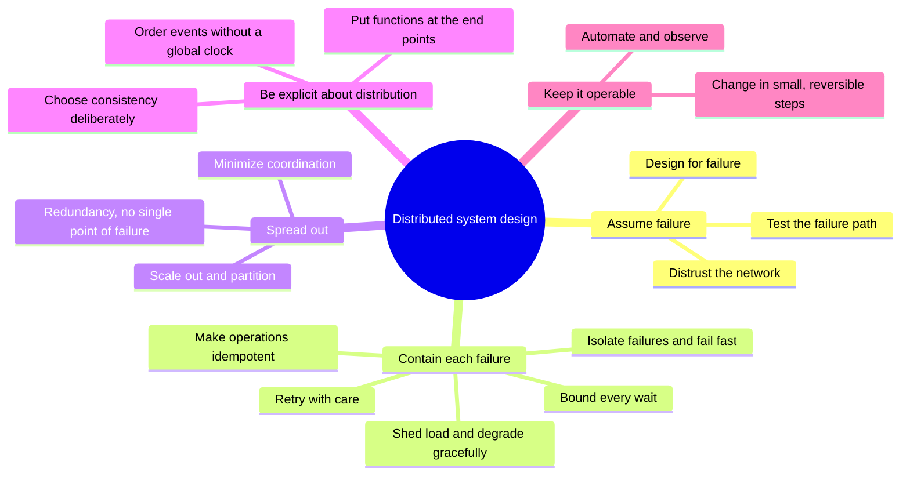

# What are the common design tenets and principles for distributed systems?

## 1. Abstract

Engineers designing a service that spans many machines need a short list of principles that keeps it working when parts of it fail. The sources agree on one starting point: expect failure, because it is certain. From there, contain each failure at the call where it happens, spread work and data so no single part matters, decide on purpose what to give up when the network splits, and automate and observe the system so people can operate and change it safely.

**Key takeaways:**

- Design for failure: it is normal, not exceptional.
- Bound every remote call: timeouts, careful retries, idempotent operations.
- Shed load and degrade gracefully instead of collapsing.
- Choose consistency or availability per operation, not once.
- Automation, observability and small changes are reliability principles too.

## 2. Terminology

| Term | Definition |
|---|---|
| **Partition** | A network fault that splits nodes into groups that cannot reach each other. |
| **Idempotent** | An operation that has the same effect whether it runs once or several times. |
| **SPOF** | Single point of failure: a part whose fault takes down the whole system. |
| **Backoff, jitter** | Waiting longer between successive retries; adding randomness to that wait. |
| **Graceful degradation** | Serving a cheaper or partial result under stress instead of failing outright. |
| **SLO, SLA** | Service-level objective, a target such as a share of requests answered in time; service-level agreement, a contract around an SLO. |
| **CAP** | Consistency, availability, partition tolerance: during a partition a system must trade the first two. |
| **[→]** | Our own reasoning, after a statement or on a section's heading: a conclusion, comparison or example no cited source states. |
| **[?]** | A gap, after a statement or on a heading: something the question needs that the sources don't answer. |

## 3. Overview

Any service with more than one machine behind it has parts that fail independently, and a caller often cannot tell what failed; [What is a distributed system?](what-is-a-distributed-system.md) explains why. This narrative covers the principles used to build such services anyway. In a large cloud, failures are not rare events: commodity hardware is recycled and replaced automatically, so brief faults are part of normal operation [\[1\]](../sources/distributed-system-design-azure-transient-fault-handling.md#why-do-transient-faults-occur-in-the-cloud).

**The running example.** An online shop's checkout service calls a payment service to charge a card. Without these principles, a slow payment service ties up checkout, a retried charge bills the customer twice, and one overloaded server takes the shop down [→].

**How the items were chosen.** They were checked against four lists: Azure's design principles, [\[2\]](../sources/distributed-system-design-azure-design-principles.md#core-principles) AWS's reliability principles, [\[3\]](../sources/distributed-system-design-aws-well-architected-reliability-principles.md#design-principles) van Steen and Tanenbaum's design goals, [\[4\]](../sources/distributed-systems-van-steen-tanenbaum-brief-intro.md#3-design-goals) and the fallacies of distributed computing [\[5\]](../sources/distributed-system-design-wikipedia-fallacies.md#the-fallacies); and against the patterns and textbook treatments behind them: Microsoft's retry, circuit-breaker, bulkhead and throttling patterns, Kleppmann's lecture notes, and the CAP theorem, the end-to-end principle and the CALM theorem. An item is in when several lists state it, or a classic idea makes it its subject [→].

**Left out.** Platform choices: managed services and identity services [\[6\]](../sources/distributed-system-design-azure-design-principles.md#operational-principles). Resource sharing and openness say what a system offers, not how it survives failure [→]. Security, a fallacy of its own, is not covered: no source read gives principles for it [?]. Simplicity, often named as a principle, is not stated by any source this wiki may keep [?].

## 4. The map

Five groups: a stance, two groups of mechanisms that follow from it, then choices and people [→].

*Figure 4-1: The five groups of principles and their items; ordered from the shared stance to day-to-day practice.*

## 5. The main items

### 5.1 Assume failure

These items set the stance the others rest on: failure is the normal case, so design, code and tests must start from it [→].

#### 5.1.1 Design for failure

Azure's first principle is to design for self-healing: detect failures, respond gracefully and recover automatically, because in a distributed system failures are inevitable [\[2\]](../sources/distributed-system-design-azure-design-principles.md#core-principles). AWS's first is to recover from failure automatically [\[3\]](../sources/distributed-system-design-aws-well-architected-reliability-principles.md#design-principles). Since faults can never be made impossible, distributed systems aim for fault tolerance: working despite up to some number of faults [\[7\]](../sources/distributed-systems-kleppmann-cambridge-notes.md#fault-tolerance-and-high-availability). A crashed payment server must not stop checkout [→].

#### 5.1.2 Distrust the network

The fallacies [of distributed computing](what-is-a-distributed-system.md) list what newcomers wrongly assume: a reliable, secure, homogeneous network with zero latency, infinite bandwidth, fixed topology, one administrator and free transport [\[5\]](../sources/distributed-system-design-wikipedia-fallacies.md#the-fallacies). Believing the first gives software that waits forever on a network error [\[8\]](../sources/distributed-system-design-wikipedia-fallacies.md#the-effects-of-the-fallacies). Any remote call can end with no answer, and then the caller cannot know whether the server processed the request [\[9\]](../sources/distributed-systems-kleppmann-cambridge-notes.md#example-remote-procedure-calls-rpc). A timed-out charge may or may not have taken the money [→].

#### 5.1.3 Test the failure path

Test how the system recovers by simulating failures, rather than waiting for real ones [\[3\]](../sources/distributed-system-design-aws-well-architected-reliability-principles.md#design-principles), and analyze failure modes while designing, before they happen [\[10\]](../sources/distributed-system-design-azure-design-principles.md#strategic-principles).

### 5.2 Contain each failure

These items act on each remote call and each server, so one slow or failed part does not drag down its callers [→].

#### 5.2.1 Bound every wait

Set a timeout on every outbound call before adding retries: too long, and threads and connections pile up during an outage; too short, and calls that would succeed fail early [\[11\]](../sources/distributed-system-design-azure-transient-fault-handling.md#determine-an-appropriate-retry-count-and-interval). The whole retried operation, timeouts and delays included, must still meet its latency objective [\[11\]](../sources/distributed-system-design-azure-transient-fault-handling.md#determine-an-appropriate-retry-count-and-interval). A request blocked on a slow service holds memory, threads and connections, and running out of them can fail unrelated parts of the system [\[12\]](../sources/distributed-system-design-azure-circuit-breaker-pattern.md#context-and-problem). Checkout's call to payment gets a timeout well inside the customer's patience [→].

#### 5.2.2 Retry with care

Transient faults, such as a momentary network loss or a busy service, usually correct themselves, so repeating the call after a delay often succeeds [\[13\]](../sources/distributed-system-design-azure-retry-pattern.md#context-and-problem). Back off exponentially, waiting longer after each failure, and add jitter so many clients do not retry at the same moment [\[11\]](../sources/distributed-system-design-azure-transient-fault-handling.md#determine-an-appropriate-retry-count-and-interval), [\[14\]](../sources/distributed-system-design-azure-transient-fault-handling.md#avoid-antipatterns). Never retry endlessly, avoid retries at every layer, and keep a retry budget across all requests: three retries at each of two layers already make nine attempts against the service, and a budget such as 60 retries a minute keeps a local capacity problem from becoming a cascading failure [\[14\]](../sources/distributed-system-design-azure-transient-fault-handling.md#avoid-antipatterns).

#### 5.2.3 Make operations idempotent

A service may process a request but fail to send its response; the retry then repeats the operation, which is safe only if it is idempotent [\[15\]](../sources/distributed-system-design-azure-retry-pattern.md#idempotency). Incrementing a value twice gives a wrong result, so design each step of a multistep process as idempotent [\[16\]](../sources/distributed-system-design-azure-transient-fault-handling.md#other-considerations). Adding to a set is idempotent where incrementing a counter is not; idempotence or deduplication turns at-least-once retries into exactly-once effects [\[17\]](../sources/distributed-systems-kleppmann-cambridge-notes.md#manipulating-remote-state). The shop sends a payment ID with each charge, so a retry charges once [→].

#### 5.2.4 Isolate failures and fail fast

A circuit breaker counts recent failures to a service and, past a threshold, fails calls immediately instead of waiting, then lets a few trial calls through to detect recovery [\[18\]](../sources/distributed-system-design-azure-circuit-breaker-pattern.md#solution). It complements retries: a retry expects the call to succeed eventually, a circuit breaker stops calls that are likely to fail [\[18\]](../sources/distributed-system-design-azure-circuit-breaker-pattern.md#solution). Bulkheads partition resources, such as a connection pool per downstream service, so one failing service exhausts only its own pool and the rest keep working [\[19\]](../sources/distributed-system-design-azure-bulkhead-pattern.md#solution).

#### 5.2.5 Shed load and degrade gracefully

Overload cascades: when one node fails or goes down for maintenance, its traffic moves to another path, which becomes overloaded and fails in turn [\[20\]](../sources/distributed-system-design-wikipedia-cascading-failure.md#in-computer-networks). The defence is to cap resource use and throttle requests past the cap, so the system keeps meeting its objectives: rate limits per user, turning off nonessential features, smoothing bursts through a queue, and deferring low-priority work [\[21\]](../sources/distributed-system-design-azure-throttling-pattern.md#solution). The shop could turn off recommendations to keep checkout alive [→].

### 5.3 Spread out

These items remove any part whose loss or limits would decide the whole system's fate [→].

#### 5.3.1 Redundancy, no single point of failure

Make everything redundant, with multiple instances, replicas and zones, sized to the business's risk tolerance [\[2\]](../sources/distributed-system-design-azure-design-principles.md#core-principles). Replace one large resource with many small ones, so one failure affects less [\[3\]](../sources/distributed-system-design-aws-well-architected-reliability-principles.md#design-principles). A part whose failure brings the whole system down is a single point of failure, which fault-tolerant systems try to avoid [\[7\]](../sources/distributed-systems-kleppmann-cambridge-notes.md#fault-tolerance-and-high-availability). Consensus algorithms such as Raft remove the single leader as a single point of failure: when the leader is suspected to have crashed, a quorum of nodes elects a new one [\[22\]](../sources/distributed-systems-kleppmann-cambridge-notes.md#introduction-to-consensus). With five nodes a majority quorum is three [\[23\]](../sources/distributed-systems-kleppmann-cambridge-notes.md#quorums), so two can fail and the rest still decide [→].

#### 5.3.2 Scale out and partition

Scale out by adding machines; the techniques are hiding latency, partitioning work and replicating [\[24\]](../sources/distributed-systems-van-steen-tanenbaum-brief-intro.md#342-scaling-techniques). Avoid session stickiness, choose partition keys that avoid hotspots and autoscale on live metrics [\[2\]](../sources/distributed-system-design-azure-design-principles.md#core-principles).

#### 5.3.3 Minimize coordination

Use decoupled components that talk asynchronously, and eventual consistency where it fits [\[2\]](../sources/distributed-system-design-azure-design-principles.md#core-principles). Asynchronous calls hide latency by doing other work while a reply is pending [\[24\]](../sources/distributed-systems-van-steen-tanenbaum-brief-intro.md#342-scaling-techniques). Coordination protocols such as Paxos and two-phase commit are so expensive that programmers treat them as "forbidden fruit" [\[25\]](../sources/calm-theorem-keeping-calm.md#11-the-high-cost-of-coordination). The shop can confirm the order and send the receipt email from a queue [→].

### 5.4 Be explicit about distribution

These items come from the classic ideas: what a network forces on a design, and why hiding it does not work [→].

#### 5.4.1 Choose consistency deliberately

A partition has to be tolerated, so during one a system chooses: consistency, returning an error or a timeout when it cannot guarantee up-to-date data, or availability, answering with what it has [\[26\]](../sources/distributed-system-design-wikipedia-cap-theorem.md#explanation). Without a partition, both are possible [\[26\]](../sources/distributed-system-design-wikipedia-cap-theorem.md#explanation). Brewer later called "two out of three" misleading: only consistency or availability is given up, only during a partition, and partitions can be managed and recovered from [\[27\]](../sources/distributed-system-design-wikipedia-cap-theorem.md#history). PACELC adds that even without a partition, a system trades latency against consistency [\[27\]](../sources/distributed-system-design-wikipedia-cap-theorem.md#history).

#### 5.4.2 Order events without a global clock

Nodes cannot always say which of two events came first: "happens-before" is a partial order, and events neither before nor after each other are concurrent [\[28\]](../sources/distributed-systems-kleppmann-cambridge-notes.md#causality-and-happens-before). Logical clocks count events instead of measuring time, giving an order consistent with causality [\[29\]](../sources/distributed-systems-kleppmann-cambridge-notes.md#logical-time). Replicas tag writes with logical timestamps to tell newer from older; last-writer-wins is simple but loses concurrent writes [\[17\]](../sources/distributed-systems-kleppmann-cambridge-notes.md#manipulating-remote-state).

#### 5.4.3 Put functions at the end points

The end-to-end principle: the network offers only best-effort delivery, and features such as reliability and security belong at the end points [\[30\]](../sources/distributed-system-design-wikipedia-end-to-end-principle.md#concept). A completely reliable file transfer needs a checksum over the whole stream, checked by the end points; checks inside the network only improve performance [\[31\]](../sources/distributed-system-design-wikipedia-end-to-end-principle.md#file-transfer). The same reasoning warns against hiding distribution: a remote call behaves differently from a local one over a faulty link, so the price of full transparency can be surprisingly high [\[32\]](../sources/distributed-systems-van-steen-tanenbaum-brief-intro.md#322-degree-of-distribution-transparency). The shop checks the charge with the payment ID, whatever the network promised [→].

### 5.5 Keep it operable

These items treat people as part of the system: designs that are automated and observable fail less and recover faster [→].

#### 5.5.1 Automate and observe

Make changes through automation [\[3\]](../sources/distributed-system-design-aws-well-architected-reliability-principles.md#design-principles). Build in logging, distributed tracing and standard metrics [\[6\]](../sources/distributed-system-design-azure-design-principles.md#operational-principles), and log transient faults as well as failures, so a rise in retries shows before an outage [\[33\]](../sources/distributed-system-design-azure-transient-fault-handling.md#log-and-track-transient-and-nontransient-faults).

#### 5.5.2 Change in small, reversible steps

A service that tolerates one of three nodes being down can roll out a software upgrade one node at a time, without clients noticing [\[7\]](../sources/distributed-systems-kleppmann-cambridge-notes.md#fault-tolerance-and-high-availability). Azure's design for evolution asks for loose coupling and versioned APIs, [\[10\]](../sources/distributed-system-design-azure-design-principles.md#strategic-principles) and Richards and Ford add "versioning is simple" to the fallacies [\[34\]](../sources/distributed-system-design-wikipedia-fallacies.md#history).

## 6. Tensions and trade-offs

**Retries versus overload.** Retries mask transient faults, but aggressive retries keep an overloaded service from recovering, and the extra requests feed the cycle [\[11\]](../sources/distributed-system-design-azure-transient-fault-handling.md#determine-an-appropriate-retry-count-and-interval).

**Consistency versus availability and latency.** Replication improves availability and performance but brings consistency problems, and keeping replicas strongly consistent may not scale [\[24\]](../sources/distributed-systems-van-steen-tanenbaum-brief-intro.md#342-scaling-techniques). Even without partitions, stronger consistency costs latency [\[27\]](../sources/distributed-system-design-wikipedia-cap-theorem.md#history).

**Short versus long timeouts.** A short timeout fails calls that would have succeeded; a long one lets threads and connections pile up [\[11\]](../sources/distributed-system-design-azure-transient-fault-handling.md#determine-an-appropriate-retry-count-and-interval).

**Availability versus cost.** Beyond some point, more nines cost more than occasional downtime, so the target comes from the business [\[7\]](../sources/distributed-systems-kleppmann-cambridge-notes.md#fault-tolerance-and-high-availability). Azure starts from recovery-time objectives, SLAs and SLOs [\[10\]](../sources/distributed-system-design-azure-design-principles.md#strategic-principles).

**Flexibility versus simplicity.** Separating policy from mechanism makes a system adaptable, but leads to hundreds of configuration parameters [\[35\]](../sources/distributed-systems-van-steen-tanenbaum-brief-intro.md#332-separating-policy-from-mechanism).

## 7. Classic case studies

**Gmail, December 2012.** A routine update to load-balancing software, with logic that said "all" where it meant "some", took out 40% of Gmail worldwide for 18 minutes; it was fixed by fully updating a single node instead of partially updating every node at once [\[36\]](../sources/distributed-system-design-wikipedia-cascading-failure.md#example). It shows small, reversible changes and why overload spreads [→].

**The ARPANET.** Because packets can arrive out of order or twice, reordering and duplicate detection had to live at the end points, and the network was split into a packet-moving lower level and an end-to-end upper level [\[37\]](../sources/distributed-system-design-wikipedia-end-to-end-principle.md#arpanet). It is the end-to-end principle in a real network [→].

**Dynamo's shopping cart.** Amazon's cart lets replicas receive adds in different orders with no coordination, yet all reach the same final state, because adding items to a set commutes [\[38\]](../sources/calm-theorem-keeping-calm.md#21-program-consistency-confluence). It shows minimizing coordination and choosing availability [→].

## 8. Applying them [→]

Learn the groups in the map's order. Then ask of a design:

- What happens when each dependency is down, slow, or never answers?
- Does every remote call have a timeout, bounded retries with jitter, and an idempotent operation behind it?
- Which part, if lost, takes everything down?
- At what load does each component break, and what does it do past that point?
- During a partition, which operations proceed, and how are mistakes compensated?
- Can a change be rolled out to one server and rolled back?

## 9. Where to go next

- [What is a distributed system?](what-is-a-distributed-system.md): why these principles are needed.
- [What does "Keeping CALM: When Distributed Consistency is Easy" argue, and is it worth reading in full?](what-does-keeping-calm-argue-and-is-it-worth-reading-in-full.md): when coordination can be avoided altogether.
- Not yet narratives: How should timeouts, retries and backoff be set? How do services avoid cascading failures? How are partitions managed under CAP? How does Raft reach consensus? How do logical clocks order events?

## 10. References

### 10.1 Sources read

- [distributed-system-design-azure-design-principles](../sources/distributed-system-design-azure-design-principles.md): a vendor's list of core, operational and strategic principles.
- [distributed-system-design-aws-well-architected-reliability-principles](../sources/distributed-system-design-aws-well-architected-reliability-principles.md): five reliability principles.
- [distributed-system-design-azure-transient-fault-handling](../sources/distributed-system-design-azure-transient-fault-handling.md), [distributed-system-design-azure-retry-pattern](../sources/distributed-system-design-azure-retry-pattern.md), [distributed-system-design-azure-circuit-breaker-pattern](../sources/distributed-system-design-azure-circuit-breaker-pattern.md), [distributed-system-design-azure-bulkhead-pattern](../sources/distributed-system-design-azure-bulkhead-pattern.md), [distributed-system-design-azure-throttling-pattern](../sources/distributed-system-design-azure-throttling-pattern.md): timeouts, retries, backoff and jitter, idempotency, circuit breakers, bulkheads and throttling.
- [distributed-system-design-wikipedia-fallacies](../sources/distributed-system-design-wikipedia-fallacies.md): the fallacies and their effects.
- [distributed-system-design-wikipedia-cap-theorem](../sources/distributed-system-design-wikipedia-cap-theorem.md), [distributed-system-design-wikipedia-end-to-end-principle](../sources/distributed-system-design-wikipedia-end-to-end-principle.md), [distributed-system-design-wikipedia-cascading-failure](../sources/distributed-system-design-wikipedia-cascading-failure.md): CAP and PACELC, the end-to-end principle and the ARPANET, cascading failures and the Gmail outage.
- [distributed-systems-van-steen-tanenbaum-brief-intro](../sources/distributed-systems-van-steen-tanenbaum-brief-intro.md): design goals, scaling techniques, limits of transparency.
- [distributed-systems-kleppmann-cambridge-notes](../sources/distributed-systems-kleppmann-cambridge-notes.md): fault tolerance, SPOF, consensus and quorums, idempotence, happens-before and logical time, rolling upgrades.
- [calm-theorem-keeping-calm](../sources/calm-theorem-keeping-calm.md): the cost of coordination and Dynamo's shopping cart.

### 10.2 Citations

1. [distributed-system-design-azure-transient-fault-handling: Why do transient faults occur in the cloud?](../sources/distributed-system-design-azure-transient-fault-handling.md#why-do-transient-faults-occur-in-the-cloud)
2. [distributed-system-design-azure-design-principles: Core principles](../sources/distributed-system-design-azure-design-principles.md#core-principles)
3. [distributed-system-design-aws-well-architected-reliability-principles: Design principles](../sources/distributed-system-design-aws-well-architected-reliability-principles.md#design-principles)
4. [distributed-systems-van-steen-tanenbaum-brief-intro: 3 Design goals](../sources/distributed-systems-van-steen-tanenbaum-brief-intro.md#3-design-goals)
5. [distributed-system-design-wikipedia-fallacies: The fallacies](../sources/distributed-system-design-wikipedia-fallacies.md#the-fallacies)
6. [distributed-system-design-azure-design-principles: Operational principles](../sources/distributed-system-design-azure-design-principles.md#operational-principles)
7. [distributed-systems-kleppmann-cambridge-notes: Fault tolerance and high availability](../sources/distributed-systems-kleppmann-cambridge-notes.md#fault-tolerance-and-high-availability)
8. [distributed-system-design-wikipedia-fallacies: The effects of the fallacies](../sources/distributed-system-design-wikipedia-fallacies.md#the-effects-of-the-fallacies)
9. [distributed-systems-kleppmann-cambridge-notes: Example: Remote Procedure Calls (RPC)](../sources/distributed-systems-kleppmann-cambridge-notes.md#example-remote-procedure-calls-rpc)
10. [distributed-system-design-azure-design-principles: Strategic principles](../sources/distributed-system-design-azure-design-principles.md#strategic-principles)
11. [distributed-system-design-azure-transient-fault-handling: Determine an appropriate retry count and interval](../sources/distributed-system-design-azure-transient-fault-handling.md#determine-an-appropriate-retry-count-and-interval)
12. [distributed-system-design-azure-circuit-breaker-pattern: Context and problem](../sources/distributed-system-design-azure-circuit-breaker-pattern.md#context-and-problem)
13. [distributed-system-design-azure-retry-pattern: Context and problem](../sources/distributed-system-design-azure-retry-pattern.md#context-and-problem)
14. [distributed-system-design-azure-transient-fault-handling: Avoid antipatterns](../sources/distributed-system-design-azure-transient-fault-handling.md#avoid-antipatterns)
15. [distributed-system-design-azure-retry-pattern: Idempotency](../sources/distributed-system-design-azure-retry-pattern.md#idempotency)
16. [distributed-system-design-azure-transient-fault-handling: Other considerations](../sources/distributed-system-design-azure-transient-fault-handling.md#other-considerations)
17. [distributed-systems-kleppmann-cambridge-notes: Manipulating remote state](../sources/distributed-systems-kleppmann-cambridge-notes.md#manipulating-remote-state)
18. [distributed-system-design-azure-circuit-breaker-pattern: Solution](../sources/distributed-system-design-azure-circuit-breaker-pattern.md#solution)
19. [distributed-system-design-azure-bulkhead-pattern: Solution](../sources/distributed-system-design-azure-bulkhead-pattern.md#solution)
20. [distributed-system-design-wikipedia-cascading-failure: In computer networks](../sources/distributed-system-design-wikipedia-cascading-failure.md#in-computer-networks)
21. [distributed-system-design-azure-throttling-pattern: Solution](../sources/distributed-system-design-azure-throttling-pattern.md#solution)
22. [distributed-systems-kleppmann-cambridge-notes: Introduction to consensus](../sources/distributed-systems-kleppmann-cambridge-notes.md#introduction-to-consensus)
23. [distributed-systems-kleppmann-cambridge-notes: Quorums](../sources/distributed-systems-kleppmann-cambridge-notes.md#quorums)
24. [distributed-systems-van-steen-tanenbaum-brief-intro: 3.4.2 Scaling techniques](../sources/distributed-systems-van-steen-tanenbaum-brief-intro.md#342-scaling-techniques)
25. [calm-theorem-keeping-calm: 1.1 The High Cost of Coordination](../sources/calm-theorem-keeping-calm.md#11-the-high-cost-of-coordination)
26. [distributed-system-design-wikipedia-cap-theorem: Explanation](../sources/distributed-system-design-wikipedia-cap-theorem.md#explanation)
27. [distributed-system-design-wikipedia-cap-theorem: History](../sources/distributed-system-design-wikipedia-cap-theorem.md#history)
28. [distributed-systems-kleppmann-cambridge-notes: Causality and happens-before](../sources/distributed-systems-kleppmann-cambridge-notes.md#causality-and-happens-before)
29. [distributed-systems-kleppmann-cambridge-notes: Logical time](../sources/distributed-systems-kleppmann-cambridge-notes.md#logical-time)
30. [distributed-system-design-wikipedia-end-to-end-principle: Concept](../sources/distributed-system-design-wikipedia-end-to-end-principle.md#concept)
31. [distributed-system-design-wikipedia-end-to-end-principle: File transfer](../sources/distributed-system-design-wikipedia-end-to-end-principle.md#file-transfer)
32. [distributed-systems-van-steen-tanenbaum-brief-intro: 3.2.2 Degree of distribution transparency](../sources/distributed-systems-van-steen-tanenbaum-brief-intro.md#322-degree-of-distribution-transparency)
33. [distributed-system-design-azure-transient-fault-handling: Log and track transient and nontransient faults](../sources/distributed-system-design-azure-transient-fault-handling.md#log-and-track-transient-and-nontransient-faults)
34. [distributed-system-design-wikipedia-fallacies: History](../sources/distributed-system-design-wikipedia-fallacies.md#history)
35. [distributed-systems-van-steen-tanenbaum-brief-intro: 3.3.2 Separating policy from mechanism](../sources/distributed-systems-van-steen-tanenbaum-brief-intro.md#332-separating-policy-from-mechanism)
36. [distributed-system-design-wikipedia-cascading-failure: Example](../sources/distributed-system-design-wikipedia-cascading-failure.md#example)
37. [distributed-system-design-wikipedia-end-to-end-principle: ARPANET](../sources/distributed-system-design-wikipedia-end-to-end-principle.md#arpanet)
38. [calm-theorem-keeping-calm: 2.1 Program Consistency: Confluence](../sources/calm-theorem-keeping-calm.md#21-program-consistency-confluence)

## 11. Metadata

- **Version:** 2.0
- **Template:** survey
- **Language:** en
- **Model:** claude-opus-5-5
- **Created:** 2026-10-23
- **Last modified:** 2026-10-25
- **Words:** 2,336 (about 10 min)
- **History:**
  - 2.0 (2026-10-25): Rebuilt on openly licensed sources only, for a public demo: Hamilton, the AWS Builders' Library, Google SRE, Brewer, Saltzer, Raft and Lamport (now links) replaced by Microsoft's resilience patterns, Wikipedia on CAP, the end-to-end principle and cascading failures, Kleppmann's notes and the CALM paper; Keep it simple dropped (no open source states it); new case studies: Gmail 2012, the ARPANET, Dynamo's cart
  - 1.0 (2026-10-23): First version.
- **Reading plan:**
  1. `what-does-keeping-calm-argue-and-is-it-worth-reading-in-full`, in full: existing narrative, medium relevance
  2. `calm-theorem-keeping-calm`, in full: medium relevance, authority A, 2019-01-26
  3. `distributed-system-design-wikipedia-fallacies`, in full: high relevance, authority B, undated
  4. `distributed-system-design-wikipedia-cap-theorem`, in full: high relevance, authority B, undated
  5. `distributed-system-design-wikipedia-end-to-end-principle`, in full: high relevance, authority B, undated
  6. `distributed-system-design-wikipedia-cascading-failure`, in full: high relevance, authority B, undated
  7. `distributed-system-design-aws-well-architected-reliability-principles`, in full: high relevance, authority A, undated
  8. `distributed-system-design-azure-design-principles`, in full: high relevance, authority A, undated
  9. `distributed-system-design-azure-retry-pattern`, in full: high relevance, authority A, undated
  10. `distributed-system-design-azure-circuit-breaker-pattern`, in full: high relevance, authority A, undated
  11. `distributed-system-design-azure-bulkhead-pattern`, in full: high relevance, authority A, undated
  12. `distributed-system-design-azure-throttling-pattern`, in full: high relevance, authority A, undated
  13. `distributed-system-design-azure-transient-fault-handling`, in full: high relevance, authority A, undated
  14. `distributed-systems-van-steen-tanenbaum-brief-intro`, in full: high relevance, authority A, 2016-09-01
  15. `distributed-systems-kleppmann-cambridge-notes`, in full: high relevance, authority A, 2021-10-01
  16. `what-is-a-distributed-system`, in full: existing narrative, high relevance: built on
  17. `ewma-linkerd-beyond-round-robin`, abstract only: low relevance
  18. `distributed-systems-wikipedia-distributed-computing`, abstract only: low relevance
  19. `distributed-system-design-waldo-note-on-distributed-computing`, not read: a link, no saved copy
  20. `distributed-system-design-hamilton-internet-scale-services`, not read: a link, no saved copy
  21. `distributed-system-design-aws-timeouts-retries-backoff`, not read: a link, no saved copy
  22. `distributed-system-design-aws-challenges-distributed-systems`, not read: a link, no saved copy
  23. `distributed-system-design-google-sre-cascading-failures`, not read: a link, no saved copy
  24. `distributed-system-design-brewer-cap-twelve-years-later`, not read: a link, no saved copy
  25. `distributed-system-design-ongaro-raft-consensus`, not read: a link, no saved copy
  26. `distributed-system-design-lamport-time-clocks`, not read: a link, no saved copy
  27. `distributed-system-design-saltzer-end-to-end-arguments`, not read: a link, no saved copy
  28. `distributed-systems-lamport-definition-email`, not read: a link, no saved copy
