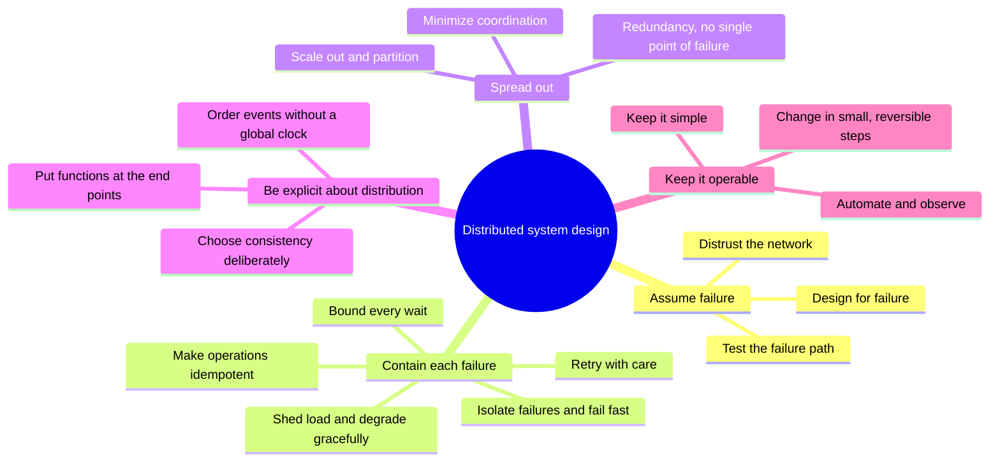

# What are the common design tenets and principles for distributed systems?

## 1. Abstract

Engineers designing a service that spans many machines need a short list of principles that keeps it working when parts of it fail. The sources agree on one starting point: expect failure, because it is certain. From there, contain each failure at the call where it happens, spread work and data so no single part matters, decide on purpose what to give up when the network splits, and keep the system simple and automated enough to operate.

**Key takeaways:**

- Design for failure: it is normal, not exceptional.
- Bound every remote call: timeouts, careful retries, idempotent operations.
- Shed load and degrade gracefully instead of collapsing.
- Choose consistency or availability per operation, not once.
- Simplicity and automation are reliability principles too.

## 2. Terminology

| Term | Definition |
|---|---|
| **Partition** | A network fault that splits nodes into groups that cannot reach each other. |
| **Idempotent** | An operation that has the same effect whether it runs once or several times. |
| **SPOF** | Single point of failure: a part whose fault takes down the whole system. |
| **Backoff, jitter** | Waiting longer between successive retries; adding randomness to that wait. |
| **Graceful degradation** | Serving a cheaper or partial result under stress instead of failing outright. |
| **SLO, SLA** | Service-level objective, a target such as a share of requests answered in time; service-level agreement, a contract around an SLO. |
| **CAP** | Consistency, availability, partition tolerance: during a partition a system must trade the first two. |
| **[→]** | Our own reasoning, after a statement or on a section's heading: a conclusion, comparison or example no cited source states. |
| **[?]** | A gap: something the question needs that the sources don't answer. |

## 3. Overview

Any service with more than one machine behind it has parts that fail independently, and a caller often cannot tell what failed; [What is a distributed system?](what-is-a-distributed-system.md) explains why. This narrative covers the principles used to build such services anyway. Distributed bugs often surface long after deployment and can spread across the whole system [\[1\]](../sources/distributed-system-design-aws-challenges-distributed-systems.md#summary-of-problems-in-distributed-systems).

**The running example.** An online shop's checkout service calls a payment service to charge a card. Without these principles, a slow payment service ties up checkout, a retried charge bills the customer twice, and one overloaded server takes the shop down [→].

**How the items were chosen.** They were checked against five lists: Hoffman's tenets and Hamilton's practices for internet-scale services, [\[2\]](../sources/distributed-system-design-hamilton-internet-scale-services.md#page-1) Azure's design principles, [\[3\]](../sources/distributed-system-design-azure-design-principles.md#core-principles) AWS's reliability principles, [\[4\]](../sources/distributed-system-design-aws-well-architected-reliability-principles.md#design-principles) van Steen and Tanenbaum's design goals, [\[5\]](../sources/distributed-systems-van-steen-tanenbaum-brief-intro.md#3-design-goals) and the fallacies of distributed computing [\[6\]](../sources/distributed-system-design-wikipedia-fallacies.md#the-fallacies). An item is in when several lists state it, or a classic paper makes it its subject (Saltzer, Brewer, Lamport) [→].

**Left out.** Cost and platform choices: commodity hardware, single-version software, multi-tenancy, [\[7\]](../sources/distributed-system-design-hamilton-internet-scale-services.md#page-3) managed services and identity services [\[8\]](../sources/distributed-system-design-azure-design-principles.md#operational-principles). Resource sharing and openness say what a system offers, not how it survives failure [→]. Security, a fallacy of its own, is not covered: no source read gives principles for it [?].

## 4. The map

Five groups: a stance, two groups of mechanisms that follow from it, then choices and people [→].

*Figure 4-1: The five groups of principles and their items; ordered from the shared stance to day-to-day practice.*

## 5. The main items

### 5.1 Assume failure

These items set the stance the others rest on: failure is the normal case, so design, code and tests must start from it [→].

#### 5.1.1 Design for failure

Past 10,000 servers and 50,000 disks, failures happen several times a day, so the service must survive them without a human [\[9\]](../sources/distributed-system-design-hamilton-internet-scale-services.md#page-2). "Expect failures" is Hoffman's first tenet; [\[2\]](../sources/distributed-system-design-hamilton-internet-scale-services.md#page-1) Azure's first principle is to detect failures and recover automatically [\[3\]](../sources/distributed-system-design-azure-design-principles.md#core-principles). Since faults can never be made impossible, distributed systems aim for fault tolerance: working despite up to some number of faults [\[10\]](../sources/distributed-systems-kleppmann-cambridge-notes.md#fault-tolerance-and-high-availability). A crashed payment server must not stop checkout [→].

#### 5.1.2 Distrust the network

The fallacies [of distributed computing](what-is-a-distributed-system.md) list what newcomers wrongly assume: a reliable, secure, homogeneous network with zero latency, infinite bandwidth, fixed topology, one administrator and free transport [\[6\]](../sources/distributed-system-design-wikipedia-fallacies.md#the-fallacies). Believing the first gives software that waits forever on a network error [\[11\]](../sources/distributed-system-design-wikipedia-fallacies.md#the-effects-of-the-fallacies). AWS says to distrust everything that might touch the network, [\[12\]](../sources/distributed-system-design-aws-challenges-distributed-systems.md#handling-unknown-unknowns) since any remote call can end UNKNOWN [\[1\]](../sources/distributed-system-design-aws-challenges-distributed-systems.md#summary-of-problems-in-distributed-systems). A timed-out charge may or may not have taken the money [→].

#### 5.1.3 Test the failure path

Failure paths that are rarely used don't work when needed, so hard-fail services rather than shut them down cleanly [\[9\]](../sources/distributed-system-design-hamilton-internet-scale-services.md#page-2). Take down servers, racks and data centers on purpose, [\[13\]](../sources/distributed-system-design-hamilton-internet-scale-services.md#page-5) simulate failures to test recovery, [\[4\]](../sources/distributed-system-design-aws-well-architected-reliability-principles.md#design-principles) and load test each component until it breaks [\[14\]](../sources/distributed-system-design-google-sre-cascading-failures.md#test-until-failure-and-beyond). Azure adds failure mode analysis at design time [\[15\]](../sources/distributed-system-design-azure-design-principles.md#strategic-principles).

### 5.2 Contain each failure

These items act on each remote call and each server, so one slow or failed part does not drag down its callers [→].

#### 5.2.1 Bound every wait

Set a timeout on every remote call, chosen from the callee's latency, such as its 99.9th percentile for a 0.1% false-timeout rate [\[16\]](../sources/distributed-system-design-aws-timeouts-retries-backoff.md#timeouts). Without one, waiting clients hold resources until the server runs out [\[17\]](../sources/distributed-system-design-aws-timeouts-retries-backoff.md#failures-happen). With deadline propagation, every call below the first inherits what is left of one deadline, so a server can drop an abandoned request [\[18\]](../sources/distributed-system-design-google-sre-cascading-failures.md#deadline-propagation). Checkout's call to payment gets what remains of the customer's deadline [→].

#### 5.2.2 Retry with care

Retries mask transient failures but are "selfish": they spend the server's time to raise one client's chances, and under overload they make things worse [\[19\]](../sources/distributed-system-design-aws-timeouts-retries-backoff.md#retries-and-backoff). So back off exponentially with a cap, [\[19\]](../sources/distributed-system-design-aws-timeouts-retries-backoff.md#retries-and-backoff) add jitter so retries do not arrive together, [\[20\]](../sources/distributed-system-design-aws-timeouts-retries-backoff.md#jitter) limit retries per request, keep a retry budget, retry at few layers, and do not retry errors that cannot succeed [\[21\]](../sources/distributed-system-design-google-sre-cascading-failures.md#retries). Retrying at every layer multiplies: three layers of four attempts make 64 database calls per user action [\[21\]](../sources/distributed-system-design-google-sre-cascading-failures.md#retries).

#### 5.2.3 Make operations idempotent

A retry after a timeout may repeat a side effect that already happened, so APIs with side effects are safe to retry only when idempotent; EC2's RunInstances takes a client token for this [\[19\]](../sources/distributed-system-design-aws-timeouts-retries-backoff.md#retries-and-backoff). Adding to a set is idempotent where incrementing a counter is not; idempotence or deduplication turns at-least-once retries into exactly-once effects [\[22\]](../sources/distributed-systems-kleppmann-cambridge-notes.md#manipulating-remote-state). The shop sends a payment ID with each charge, so a retry charges once [→].

#### 5.2.4 Isolate failures and fail fast

When a dependency fails, mark it down and stop calling it rather than tie up threads waiting, and keep working in a degraded mode where possible [\[23\]](../sources/distributed-system-design-hamilton-internet-scale-services.md#page-6). Pods or clusters should be nearly independent, so one cannot take another down [\[7\]](../sources/distributed-system-design-hamilton-internet-scale-services.md#page-3). Azure names circuit breakers and bulkheads; [\[3\]](../sources/distributed-system-design-azure-design-principles.md#core-principles) AWS finds circuit breakers' modal behaviour hard to test and limits retries with a token bucket instead [\[19\]](../sources/distributed-system-design-aws-timeouts-retries-backoff.md#retries-and-backoff).

#### 5.2.5 Shed load and degrade gracefully

Overload is the most common cause of cascading failures: one cluster fails, its traffic moves to the next, which fails in turn [\[24\]](../sources/distributed-system-design-google-sre-cascading-failures.md#server-overload). The defence is to admit only the work the system can do: admission control at every major boundary, [\[25\]](../sources/distributed-system-design-hamilton-internet-scale-services.md#page-4) rejecting requests past a limit, keeping queues short, and serving cheaper results when overloaded [\[26\]](../sources/distributed-system-design-google-sre-cascading-failures.md#load-shedding-and-graceful-degradation). Hamilton adds a tested, reversible "big red switch" that sheds non-critical work, and a knob to let users back in slowly after an outage [\[27\]](../sources/distributed-system-design-hamilton-internet-scale-services.md#page-11). The shop could turn off recommendations to keep checkout alive [→].

### 5.3 Spread out

These items remove any part whose loss or limits would decide the whole system's fate [→].

#### 5.3.1 Redundancy, no single point of failure

Make everything redundant, with multiple instances, replicas and zones, sized to the business's risk tolerance [\[3\]](../sources/distributed-system-design-azure-design-principles.md#core-principles). Replace one large resource with many small ones that share no common point of failure [\[4\]](../sources/distributed-system-design-aws-well-architected-reliability-principles.md#design-principles). The Internet is designed to have no single point of failure [\[10\]](../sources/distributed-systems-kleppmann-cambridge-notes.md#fault-tolerance-and-high-availability). Consensus algorithms such as Raft make replicas act as one reliable machine while a majority is up: five servers tolerate two failures [\[28\]](../sources/distributed-system-design-ongaro-raft-consensus.md#page-2).

#### 5.3.2 Scale out and partition

Scale out by adding machines; the techniques are hiding latency, partitioning work and replicating [\[29\]](../sources/distributed-systems-van-steen-tanenbaum-brief-intro.md#342-scaling-techniques). Prefer stateless, interchangeable servers, and partition data finely, by user rather than company, through a lookup table so partitions can move [\[25\]](../sources/distributed-system-design-hamilton-internet-scale-services.md#page-4). Choose partition keys that avoid hotspots and autoscale on live metrics [\[3\]](../sources/distributed-system-design-azure-design-principles.md#core-principles).

#### 5.3.3 Minimize coordination

Use decoupled components that talk asynchronously, and eventual consistency where it fits [\[3\]](../sources/distributed-system-design-azure-design-principles.md#core-principles). Asynchronous calls hide latency by doing other work while a reply is pending [\[29\]](../sources/distributed-systems-van-steen-tanenbaum-brief-intro.md#342-scaling-techniques). Decoupling also limits failure: reusing a session key avoids a login storm after a network blip [\[23\]](../sources/distributed-system-design-hamilton-internet-scale-services.md#page-6). The shop can confirm the order and send the receipt email from a queue [→].

### 5.4 Be explicit about distribution

These items come from the classic papers: what a network forces on a design, and why hiding it does not work [→].

#### 5.4.1 Choose consistency deliberately

During a partition, a node must either refuse an operation, losing availability, or proceed and risk inconsistency [\[30\]](../sources/distributed-system-design-brewer-cap-twelve-years-later.md#cap-latency-connection). Brewer calls the "2 of 3" reading misleading: partitions are rare, the choice can differ per operation or data item, and all three properties are matters of degree [\[31\]](../sources/distributed-system-design-brewer-cap-twelve-years-later.md#why-2-of-3-is-missleading). Manage partitions explicitly: detect them, limit some operations, record history, then restore consistency and compensate for mistakes [\[32\]](../sources/distributed-system-design-brewer-cap-twelve-years-later.md#managing-partitions). Charging a card can be recorded as intent and done after recovery [\[33\]](../sources/distributed-system-design-brewer-cap-twelve-years-later.md#which-operations-should-proceed).

#### 5.4.2 Order events without a global clock

In a distributed system one cannot always say which of two events came first: "happened before" is only a partial order, and problems arise when people forget it [\[34\]](../sources/distributed-system-design-lamport-time-clocks.md#page-1). Logical clocks give a consistent order without synchronized time [\[34\]](../sources/distributed-system-design-lamport-time-clocks.md#page-1). Replicas tag writes with logical timestamps to tell newer from older; last-writer-wins is simple but loses concurrent writes [\[22\]](../sources/distributed-systems-kleppmann-cambridge-notes.md#manipulating-remote-state).

#### 5.4.3 Put functions at the end points

The end-to-end argument: a function such as reliable delivery can be done completely and correctly only by the application at the end points, so the network cannot provide it; a lower-level version is only a performance aid [\[35\]](../sources/distributed-system-design-saltzer-end-to-end-arguments.md#introduction). Duplicate suppression is the classic case: the application creates its own duplicates when it retries, so it must detect them anyway [\[36\]](../sources/distributed-system-design-saltzer-end-to-end-arguments.md#duplicate-message-suppression). The same reasoning warns against hiding distribution: a remote call behaves differently from a local one over a faulty link, so the price of full transparency can be surprisingly high [\[37\]](../sources/distributed-systems-van-steen-tanenbaum-brief-intro.md#322-degree-of-distribution-transparency). The shop checks the charge with the payment ID, whatever the network promised [→].

### 5.5 Keep it operable

These items treat people as part of the system: designs that are simple, automated and observable fail less and recover faster [→].

#### 5.5.1 Keep it simple

"Complexity breeds problems", says Hoffman's second tenet [\[2\]](../sources/distributed-system-design-hamilton-internet-scale-services.md#page-1). Simple and nearly stupid is almost always better at high scale; only order-of-magnitude optimizations are worth their complexity [\[7\]](../sources/distributed-system-design-hamilton-internet-scale-services.md#page-3). Google warns that complex load shedding can itself trip into degraded mode at the wrong time [\[26\]](../sources/distributed-system-design-google-sre-cascading-failures.md#load-shedding-and-graceful-degradation). Raft was designed for understandability first, and students learned it better than Paxos [\[38\]](../sources/distributed-system-design-ongaro-raft-consensus.md#page-1).

#### 5.5.2 Automate and observe

"Automate everything", the third tenet, because people make mistakes, need sleep and forget; [\[2\]](../sources/distributed-system-design-hamilton-internet-scale-services.md#page-1) under pressure, operators err about 20% of the time [\[25\]](../sources/distributed-system-design-hamilton-internet-scale-services.md#page-4). Make changes through tracked, reviewed automation [\[4\]](../sources/distributed-system-design-aws-well-architected-reliability-principles.md#design-principles). Build in logging, distributed tracing and standard metrics, [\[8\]](../sources/distributed-system-design-azure-design-principles.md#operational-principles) audit every configuration change, and alert only on real problems [\[39\]](../sources/distributed-system-design-hamilton-internet-scale-services.md#page-9).

#### 5.5.3 Change in small, reversible steps

Expect versions n and n+1 to run side by side during a rollout [\[25\]](../sources/distributed-system-design-hamilton-internet-scale-services.md#page-4). Roll out in stages, one system, then each data center, then global, with a tested roll-back: big-bang deployments are very dangerous [\[23\]](../sources/distributed-system-design-hamilton-internet-scale-services.md#page-6). Azure's design for evolution asks for loose coupling and versioned APIs, [\[15\]](../sources/distributed-system-design-azure-design-principles.md#strategic-principles) and Richards and Ford add "versioning is simple" to the fallacies [\[40\]](../sources/distributed-system-design-wikipedia-fallacies.md#history).

## 6. Tensions and trade-offs

**Retries versus overload.** Retries mask transient faults but amplify overload, so AWS retries only while the dependency is healthy [\[41\]](../sources/distributed-system-design-aws-timeouts-retries-backoff.md#conclusion). More generally, retries, caches and load shifting improve the normal case yet can raise the risk of a full outage [\[42\]](../sources/distributed-system-design-google-sre-cascading-failures.md#closing-remarks).

**Consistency versus availability and latency.** Replication improves availability and performance but brings consistency problems, and keeping replicas strongly consistent may not scale [\[29\]](../sources/distributed-systems-van-steen-tanenbaum-brief-intro.md#342-scaling-techniques). Choosing availability has a hidden cost: designers must know every invariant to restore it [\[43\]](../sources/distributed-system-design-brewer-cap-twelve-years-later.md#cap-confusion).

**Automation versus speed.** Synchronous replication costs latency and throughput, but makes failover a simple decision a script can take [\[13\]](../sources/distributed-system-design-hamilton-internet-scale-services.md#page-5).

**Availability versus cost.** Beyond some point, more nines cost more than occasional downtime, so the target comes from the business [\[10\]](../sources/distributed-systems-kleppmann-cambridge-notes.md#fault-tolerance-and-high-availability). Azure starts from recovery-time objectives, SLAs and SLOs [\[15\]](../sources/distributed-system-design-azure-design-principles.md#strategic-principles).

**Flexibility versus simplicity.** Separating policy from mechanism makes a system adaptable, but leads to hundreds of configuration parameters [\[44\]](../sources/distributed-systems-van-steen-tanenbaum-brief-intro.md#332-separating-policy-from-mechanism).

## 7. Classic case studies

**amazon.com and the full disk.** One catalog server's disk filled; it returned empty responses very fast, and the load balancer, seeing the fastest server, sent it a huge share of the traffic, taking amazon.com down [\[45\]](../sources/distributed-system-design-aws-challenges-distributed-systems.md#distributed-bugs-spread-epidemically). It shows why to distrust everything and isolate failures [→].

**The MIT gateway.** Programmers trusted per-hop checksums; one gateway swapped byte pairs in memory, corrupting source files [\[46\]](../sources/distributed-system-design-saltzer-end-to-end-arguments.md#a-too-real-example). It is the end-to-end argument's founding example [→].

**ATM stand-in mode.** During a partition, ATMs allow withdrawals up to a limit, then reconcile and charge overdraft fees [\[47\]](../sources/distributed-system-design-brewer-cap-twelve-years-later.md#compensation-issues-in-an-automated-teller-machine). It shows choosing availability and compensating later [→].

**News sites on 9/11.** Most news services melted down; serving a subset of articles reliably would have been better [\[27\]](../sources/distributed-system-design-hamilton-internet-scale-services.md#page-11). It shows graceful degradation [→].

## 8. Applying them [→]

Learn the groups in the map's order. Then ask of a design:

- What happens when each dependency is down, slow, or returns UNKNOWN?
- Does every remote call have a timeout, bounded retries with jitter, and an idempotent operation behind it?
- Which part, if lost, takes everything down?
- At what load does each component break, and what does it do past that point?
- During a partition, which operations proceed, and how are mistakes compensated?
- Can a change be rolled out to one server and rolled back?

## 9. Where to go next

- [What is a distributed system?](what-is-a-distributed-system.md): why these principles are needed.
- Not yet narratives: How should timeouts, retries and backoff be set? How do services avoid cascading failures? How are partitions managed under CAP? How does Raft reach consensus? How do logical clocks order events? What is the end-to-end argument?
- Why shouldn't distribution be transparent? Waldo et al. argue it, but the wiki keeps only a link to their paper, so it was not read [?].

## 10. References

### 10.1 Sources read

- [distributed-system-design-hamilton-internet-scale-services](../sources/distributed-system-design-hamilton-internet-scale-services.md): Hoffman's three tenets and most operational items.
- [distributed-system-design-azure-design-principles](../sources/distributed-system-design-azure-design-principles.md): a vendor's list of core, operational and strategic principles.
- [distributed-system-design-aws-well-architected-reliability-principles](../sources/distributed-system-design-aws-well-architected-reliability-principles.md): five reliability principles.
- [distributed-system-design-wikipedia-fallacies](../sources/distributed-system-design-wikipedia-fallacies.md): the fallacies and their effects.
- [distributed-system-design-aws-timeouts-retries-backoff](../sources/distributed-system-design-aws-timeouts-retries-backoff.md): timeouts, retries, backoff, jitter and idempotency.
- [distributed-system-design-aws-challenges-distributed-systems](../sources/distributed-system-design-aws-challenges-distributed-systems.md): unknown outcomes, distrust everything, the amazon.com case.
- [distributed-system-design-google-sre-cascading-failures](../sources/distributed-system-design-google-sre-cascading-failures.md): overload, load shedding, retries, deadlines, testing to failure.
- [distributed-system-design-saltzer-end-to-end-arguments](../sources/distributed-system-design-saltzer-end-to-end-arguments.md): the end-to-end argument and the MIT gateway.
- [distributed-system-design-brewer-cap-twelve-years-later](../sources/distributed-system-design-brewer-cap-twelve-years-later.md): CAP, managing partitions, the ATM.
- [distributed-systems-van-steen-tanenbaum-brief-intro](../sources/distributed-systems-van-steen-tanenbaum-brief-intro.md): design goals, scaling techniques, limits of transparency.
- [distributed-systems-kleppmann-cambridge-notes](../sources/distributed-systems-kleppmann-cambridge-notes.md): fault tolerance, SPOF, idempotence, timestamps.
- [distributed-system-design-ongaro-raft-consensus](../sources/distributed-system-design-ongaro-raft-consensus.md): replicated state machines and understandability.
- [distributed-system-design-lamport-time-clocks](../sources/distributed-system-design-lamport-time-clocks.md): the partial order of events.

### 10.2 Citations

1. [distributed-system-design-aws-challenges-distributed-systems: Summary of problems in distributed systems](../sources/distributed-system-design-aws-challenges-distributed-systems.md#summary-of-problems-in-distributed-systems)
2. [distributed-system-design-hamilton-internet-scale-services: Page 1](../sources/distributed-system-design-hamilton-internet-scale-services.md#page-1)
3. [distributed-system-design-azure-design-principles: Core principles](../sources/distributed-system-design-azure-design-principles.md#core-principles)
4. [distributed-system-design-aws-well-architected-reliability-principles: Design principles](../sources/distributed-system-design-aws-well-architected-reliability-principles.md#design-principles)
5. [distributed-systems-van-steen-tanenbaum-brief-intro: 3 Design goals](../sources/distributed-systems-van-steen-tanenbaum-brief-intro.md#3-design-goals)
6. [distributed-system-design-wikipedia-fallacies: The fallacies](../sources/distributed-system-design-wikipedia-fallacies.md#the-fallacies)
7. [distributed-system-design-hamilton-internet-scale-services: Page 3](../sources/distributed-system-design-hamilton-internet-scale-services.md#page-3)
8. [distributed-system-design-azure-design-principles: Operational principles](../sources/distributed-system-design-azure-design-principles.md#operational-principles)
9. [distributed-system-design-hamilton-internet-scale-services: Page 2](../sources/distributed-system-design-hamilton-internet-scale-services.md#page-2)
10. [distributed-systems-kleppmann-cambridge-notes: Fault tolerance and high availability](../sources/distributed-systems-kleppmann-cambridge-notes.md#fault-tolerance-and-high-availability)
11. [distributed-system-design-wikipedia-fallacies: The effects of the fallacies](../sources/distributed-system-design-wikipedia-fallacies.md#the-effects-of-the-fallacies)
12. [distributed-system-design-aws-challenges-distributed-systems: Handling unknown unknowns](../sources/distributed-system-design-aws-challenges-distributed-systems.md#handling-unknown-unknowns)
13. [distributed-system-design-hamilton-internet-scale-services: Page 5](../sources/distributed-system-design-hamilton-internet-scale-services.md#page-5)
14. [distributed-system-design-google-sre-cascading-failures: Test Until Failure and Beyond](../sources/distributed-system-design-google-sre-cascading-failures.md#test-until-failure-and-beyond)
15. [distributed-system-design-azure-design-principles: Strategic principles](../sources/distributed-system-design-azure-design-principles.md#strategic-principles)
16. [distributed-system-design-aws-timeouts-retries-backoff: Timeouts](../sources/distributed-system-design-aws-timeouts-retries-backoff.md#timeouts)
17. [distributed-system-design-aws-timeouts-retries-backoff: Failures Happen](../sources/distributed-system-design-aws-timeouts-retries-backoff.md#failures-happen)
18. [distributed-system-design-google-sre-cascading-failures: Deadline propagation](../sources/distributed-system-design-google-sre-cascading-failures.md#deadline-propagation)
19. [distributed-system-design-aws-timeouts-retries-backoff: Retries and backoff](../sources/distributed-system-design-aws-timeouts-retries-backoff.md#retries-and-backoff)
20. [distributed-system-design-aws-timeouts-retries-backoff: Jitter](../sources/distributed-system-design-aws-timeouts-retries-backoff.md#jitter)
21. [distributed-system-design-google-sre-cascading-failures: Retries](../sources/distributed-system-design-google-sre-cascading-failures.md#retries)
22. [distributed-systems-kleppmann-cambridge-notes: Manipulating remote state](../sources/distributed-systems-kleppmann-cambridge-notes.md#manipulating-remote-state)
23. [distributed-system-design-hamilton-internet-scale-services: Page 6](../sources/distributed-system-design-hamilton-internet-scale-services.md#page-6)
24. [distributed-system-design-google-sre-cascading-failures: Server Overload](../sources/distributed-system-design-google-sre-cascading-failures.md#server-overload)
25. [distributed-system-design-hamilton-internet-scale-services: Page 4](../sources/distributed-system-design-hamilton-internet-scale-services.md#page-4)
26. [distributed-system-design-google-sre-cascading-failures: Load Shedding and Graceful Degradation](../sources/distributed-system-design-google-sre-cascading-failures.md#load-shedding-and-graceful-degradation)
27. [distributed-system-design-hamilton-internet-scale-services: Page 11](../sources/distributed-system-design-hamilton-internet-scale-services.md#page-11)
28. [distributed-system-design-ongaro-raft-consensus: Page 2](../sources/distributed-system-design-ongaro-raft-consensus.md#page-2)
29. [distributed-systems-van-steen-tanenbaum-brief-intro: 3.4.2 Scaling techniques](../sources/distributed-systems-van-steen-tanenbaum-brief-intro.md#342-scaling-techniques)
30. [distributed-system-design-brewer-cap-twelve-years-later: Cap-latency connection](../sources/distributed-system-design-brewer-cap-twelve-years-later.md#cap-latency-connection)
31. [distributed-system-design-brewer-cap-twelve-years-later: Why "2 of 3" is missleading](../sources/distributed-system-design-brewer-cap-twelve-years-later.md#why-2-of-3-is-missleading)
32. [distributed-system-design-brewer-cap-twelve-years-later: Managing partitions](../sources/distributed-system-design-brewer-cap-twelve-years-later.md#managing-partitions)
33. [distributed-system-design-brewer-cap-twelve-years-later: Which operations should proceed?](../sources/distributed-system-design-brewer-cap-twelve-years-later.md#which-operations-should-proceed)
34. [distributed-system-design-lamport-time-clocks: Page 1](../sources/distributed-system-design-lamport-time-clocks.md#page-1)
35. [distributed-system-design-saltzer-end-to-end-arguments: Introduction](../sources/distributed-system-design-saltzer-end-to-end-arguments.md#introduction)
36. [distributed-system-design-saltzer-end-to-end-arguments: Duplicate message suppression](../sources/distributed-system-design-saltzer-end-to-end-arguments.md#duplicate-message-suppression)
37. [distributed-systems-van-steen-tanenbaum-brief-intro: 3.2.2 Degree of distribution transparency](../sources/distributed-systems-van-steen-tanenbaum-brief-intro.md#322-degree-of-distribution-transparency)
38. [distributed-system-design-ongaro-raft-consensus: Page 1](../sources/distributed-system-design-ongaro-raft-consensus.md#page-1)
39. [distributed-system-design-hamilton-internet-scale-services: Page 9](../sources/distributed-system-design-hamilton-internet-scale-services.md#page-9)
40. [distributed-system-design-wikipedia-fallacies: History](../sources/distributed-system-design-wikipedia-fallacies.md#history)
41. [distributed-system-design-aws-timeouts-retries-backoff: Conclusion](../sources/distributed-system-design-aws-timeouts-retries-backoff.md#conclusion)
42. [distributed-system-design-google-sre-cascading-failures: Closing Remarks](../sources/distributed-system-design-google-sre-cascading-failures.md#closing-remarks)
43. [distributed-system-design-brewer-cap-twelve-years-later: Cap confusion](../sources/distributed-system-design-brewer-cap-twelve-years-later.md#cap-confusion)
44. [distributed-systems-van-steen-tanenbaum-brief-intro: 3.3.2 Separating policy from mechanism](../sources/distributed-systems-van-steen-tanenbaum-brief-intro.md#332-separating-policy-from-mechanism)
45. [distributed-system-design-aws-challenges-distributed-systems: Distributed bugs spread epidemically](../sources/distributed-system-design-aws-challenges-distributed-systems.md#distributed-bugs-spread-epidemically)
46. [distributed-system-design-saltzer-end-to-end-arguments: A too-real example](../sources/distributed-system-design-saltzer-end-to-end-arguments.md#a-too-real-example)
47. [distributed-system-design-brewer-cap-twelve-years-later: Compensation issues in an automated teller machine](../sources/distributed-system-design-brewer-cap-twelve-years-later.md#compensation-issues-in-an-automated-teller-machine)

## 11. Metadata

- **Version:** 1.0
- **Template:** survey
- **Created:** 2026-10-23
- **Last modified:** 2026-10-23
- **History:**
  - 1.0 (2026-10-23): First version.
- **Reading plan:**
  1. `distributed-system-design-lamport-time-clocks`, in full: medium relevance, authority A, 1978-07-01
  2. `distributed-system-design-ongaro-raft-consensus`, in full: medium relevance, authority A, 2014-06-19
  3. `distributed-systems-kleppmann-cambridge-notes`, in full: medium relevance, authority A, 2021-10-01
  4. `distributed-system-design-wikipedia-fallacies`, in full: high relevance, authority B, undated
  5. `distributed-system-design-aws-timeouts-retries-backoff`, in full: high relevance, authority A, undated
  6. `distributed-system-design-aws-challenges-distributed-systems`, in full: high relevance, authority A, undated
  7. `distributed-system-design-aws-well-architected-reliability-principles`, in full: high relevance, authority A, undated
  8. `distributed-system-design-azure-design-principles`, in full: high relevance, authority A, undated
  9. `distributed-system-design-saltzer-end-to-end-arguments`, in full: high relevance, authority A, 1984-11-01
  10. `distributed-system-design-hamilton-internet-scale-services`, in full: high relevance, authority A, 2007-11-01
  11. `distributed-system-design-brewer-cap-twelve-years-later`, in full: high relevance, authority A, 2012-05-30
  12. `distributed-system-design-google-sre-cascading-failures`, in full: high relevance, authority A, 2016-04-01
  13. `distributed-systems-van-steen-tanenbaum-brief-intro`, in full: high relevance, authority A, 2016-09-01
  14. `what-is-a-distributed-system`, in full: existing narrative, high relevance: built on
  15. `ewma-linkerd-beyond-round-robin`, abstract only: low relevance
  16. `distributed-systems-lamport-definition-email`, abstract only: low relevance
  17. `distributed-systems-wikipedia-distributed-computing`, abstract only: low relevance
  18. `distributed-system-design-waldo-note-on-distributed-computing`, not read: a link, no saved copy
