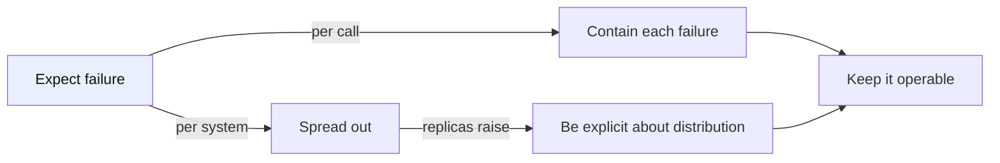

# What are the common design tenets and principles for distributed systems?

## 1. Abstract

Engineers who build a service on many machines need a short list of principles that keeps it working while parts of it break. The authoritative lists start from one stance: faults are normal, so design for them. Four groups follow from it: contain each failure at the call where it happens; spread work and data so no single part matters; decide on purpose what replicas show and in what order; and keep the system operable through rehearsal, automation and small changes.

**Key takeaways:**

- Faults are normal: the whole must survive broken parts.
- Bound every remote call, and make a repeated call harmless.
- Remove single points of failure, and coordinate as little as possible.
- Choose consistency or availability per operation, not once for the system.
- Rehearse failure, automate, observe, and change in small steps.

## 2. Terminology

| Term | Definition |
|---|---|
| **Fault** | One part of the system not working, such as a node or a network link [\[1\]](../sources/distributed-systems-kleppmann-cambridge-notes.md#fault-tolerance-and-high-availability). |
| **Failure** | The system as a whole not working [\[1\]](../sources/distributed-systems-kleppmann-cambridge-notes.md#fault-tolerance-and-high-availability). Established names, such as failure detector, keep the word by convention even where one part's fault is meant [\[1\]](../sources/distributed-systems-kleppmann-cambridge-notes.md#fault-tolerance-and-high-availability). |
| **Partition** | A network fault that cuts groups of nodes off from each other for an extended time [\[2\]](../sources/distributed-systems-kleppmann-cambridge-notes.md#describing-nodes-and-network-behaviour). |
| **Majority** | More than half of the nodes: 2 of 3, or 3 of 5 [\[3\]](../sources/distributed-systems-kleppmann-cambridge-notes.md#introduction-to-consensus). |
| **Idempotent** | Having the same effect whether it runs once or several times [\[4\]](../sources/distributed-systems-kleppmann-cambridge-notes.md#manipulating-remote-state). |
| **Coordination** | A protocol in which machines jointly decide and wait on each other, such as Paxos or two-phase commit [\[5\]](../sources/calm-theorem-keeping-calm.md#11-the-high-cost-of-coordination). |
| **CAP** | Consistency, availability, partition tolerance: a distributed data store can guarantee at most two of the three [\[6\]](../sources/distributed-system-design-wikipedia-cap-theorem.md#cap-theorem---wikipedia). |
| **PACELC** | CAP extended: if a partition happens, availability trades against consistency; else, latency does [\[7\]](../sources/distributed-system-design-wikipedia-cap-theorem.md#history). |
| **SLO** | Service-level objective, such as "99.9% of requests in a day get a response in 200 ms" [\[1\]](../sources/distributed-systems-kleppmann-cambridge-notes.md#fault-tolerance-and-high-availability). |
| **[→]** | Our own reasoning, after a statement or on a section's heading: a conclusion, comparison or example no cited source states. |
| **[?]** | A gap, after a statement or on a heading: something the question needs that the sources don't answer. |

## 3. Overview

A service whose machines work on one task by sending each other messages is a distributed system, as [What is a distributed system?](what-is-a-distributed-system.md#4-definition) defines it. Its parts fail independently, and a caller often cannot tell what failed; [What is a distributed system?](what-is-a-distributed-system.md#5-key-ideas) explains why. Design principles are the rules that keep such a service working anyway, and cloud vendors publish them [\[8\]](../sources/distributed-system-design-azure-design-principles.md#core-principles), [\[9\]](../sources/distributed-system-design-aws-well-architected-reliability-principles.md#design-principles). They matter because faults are routine: a cloud replaces failed hardware automatically, and brief faults come with that [\[10\]](../sources/distributed-system-design-azure-transient-fault-handling.md#why-do-transient-faults-occur-in-the-cloud).

**The running example.** An online shop wants to sell around the clock, because every outage loses money [\[1\]](../sources/distributed-systems-kleppmann-cambridge-notes.md#fault-tolerance-and-high-availability). Its checkout service calls a payment service over the network, for example to charge 3.99 to a card [\[11\]](../sources/distributed-systems-kleppmann-cambridge-notes.md#example-remote-procedure-calls-rpc). Checkout also calls an inventory service, which keeps stock counts in the stock database, copied to three servers, its replicas [→]. Every service runs on three servers, and product pages show recommendations [→]. Without the principles below, a slow payment service ties up checkout, and a retried charge bills a customer twice. A sale-day spike takes the shop down, and two replicas sell the last item twice [→]. The [failure-modes survey](what-are-the-classic-failure-modes-of-large-scale-distributed-systems-and-their-mitigations.md) shows how each of these failures happens, on a shop much like this one.

**How the items were chosen.** They were checked against four lists: Azure's design principles [\[8\]](../sources/distributed-system-design-azure-design-principles.md#core-principles), AWS's reliability principles [\[9\]](../sources/distributed-system-design-aws-well-architected-reliability-principles.md#design-principles), van Steen and Tanenbaum's design goals [\[12\]](../sources/distributed-systems-van-steen-tanenbaum-brief-intro.md#3-design-goals), and the fallacies of distributed computing [\[13\]](../sources/distributed-system-design-wikipedia-fallacies.md#the-fallacies). Behind them stand Microsoft's resilience patterns, Kleppmann's lecture notes, and the CAP, end-to-end and CALM ideas. An item is in when two lists state it, or when a classic idea makes it its subject [→].

**Left out.** Azure also recommends managed services and an identity service [\[14\]](../sources/distributed-system-design-azure-design-principles.md#operational-principles). Managed services and an identity service are product choices, not design principles [→]. Van Steen and Tanenbaum's goals of resource sharing and openness are left out too: they say what a system offers, not how it survives faults [→]. Security is not covered beyond the end points (5.4.3) and Azure's identity service: the sources read give no fuller set of security principles [?]. Simplicity is often named as a principle, but no source this wiki keeps states it [?].

The map comes next; then each group's items, the tensions between them, three classic cases, and questions to ask of a design.

## 4. The map

*Figure 4-1: The stance that faults are normal (shaded) and the four groups of principles that follow from it; an arrow shows which group's choices raise the next group's questions [→].*

| Group | What holds it together | Items |
|---|---|---|
| Expect failure | Failure is normal | Design for failure; distrust the network |
| Contain each failure | Each remote call | Bound every remote call; make operations idempotent; isolate failures and shed load |
| Spread out | The whole system | Remove single points of failure; scale out; minimize coordination |
| Be explicit about distribution | Replicas and messages | Choose consistency deliberately; order events without a global clock; check at the end points |
| Keep it operable | People and changes | Test recovery before you need it; automate and observe; change in small steps |

## 5. The main items

### 5.1 Expect failure

These two items set the stance the others build on: parts and the network will fail [→].

#### 5.1.1 Design for failure

Both vendors put it first. Azure asks for self-healing: detect failures, respond gracefully and recover automatically, because failures are inevitable [\[8\]](../sources/distributed-system-design-azure-design-principles.md#core-principles). AWS asks for automatic recovery when monitoring sees a threshold breached [\[9\]](../sources/distributed-system-design-aws-well-architected-reliability-principles.md#design-principles). Faults can be made rarer but never impossible [\[1\]](../sources/distributed-systems-kleppmann-cambridge-notes.md#fault-tolerance-and-high-availability). So distributed systems aim for fault tolerance: the whole keeps working despite some maximum number of faults [\[1\]](../sources/distributed-systems-kleppmann-cambridge-notes.md#fault-tolerance-and-high-availability). In the shop, one crashed payment server must not stop checkout [→].

#### 5.1.2 Distrust the network

The fallacies of distributed computing are what newcomers wrongly assume, starting with a reliable network, zero latency and infinite bandwidth [\[13\]](../sources/distributed-system-design-wikipedia-fallacies.md#the-fallacies). Code that trusts the network may wait forever during an outage, holding memory [\[15\]](../sources/distributed-system-design-wikipedia-fallacies.md#the-effects-of-the-fallacies). A remote call is not a local one: when no reply comes, the caller cannot know whether the server did the work [\[11\]](../sources/distributed-systems-kleppmann-cambridge-notes.md#example-remote-procedure-calls-rpc). Hiding distribution completely therefore has a price, and it can be surprisingly high [\[16\]](../sources/distributed-systems-van-steen-tanenbaum-brief-intro.md#322-degree-of-distribution-transparency). In the shop, a charge that times out may or may not have taken the money [→].

### 5.2 Contain each failure

These items act on each remote call, so one slow or failed service does not drag its callers down. The failure-modes survey covers each mechanism under the failure it prevents [→].

#### 5.2.1 Bound every remote call

Set a timeout on every outbound call before adding retries. Too long a timeout lets threads and connections pile up; too short a one fails calls that would succeed [\[17\]](../sources/distributed-system-design-azure-transient-fault-handling.md#determine-an-appropriate-retry-count-and-interval). Retry transient faults, which usually clear on their own [\[18\]](../sources/distributed-system-design-azure-retry-pattern.md#context-and-problem). Back off exponentially, and add jitter, a small random delay, so clients do not retry in step [\[17\]](../sources/distributed-system-design-azure-transient-fault-handling.md#determine-an-appropriate-retry-count-and-interval). Retry at one layer only, and cap retries to each dependency with a budget, such as 60 a minute [\[19\]](../sources/distributed-system-design-azure-transient-fault-handling.md#avoid-antipatterns). In the shop, a customer waits on checkout, so its call to payment gets a short timeout and few retries [\[17\]](../sources/distributed-system-design-azure-transient-fault-handling.md#determine-an-appropriate-retry-count-and-interval). [Retries pile onto a struggling service](what-are-the-classic-failure-modes-of-large-scale-distributed-systems-and-their-mitigations.md#533-retries-pile-onto-a-struggling-service) goes deeper.

#### 5.2.2 Make operations idempotent

A service may do the work and then lose its reply. The retry repeats the operation, which is safe only if it is idempotent [\[20\]](../sources/distributed-system-design-azure-retry-pattern.md#idempotency). Adding a user to a set of likes is idempotent; incrementing a like counter is not [\[4\]](../sources/distributed-systems-kleppmann-cambridge-notes.md#manipulating-remote-state). A retry plus idempotence, or plus deduplication of requests already seen, gives an exactly-once effect [\[4\]](../sources/distributed-systems-kleppmann-cambridge-notes.md#manipulating-remote-state). In the shop, checkout sends the same payment ID with every retry, and payment ignores an ID it has seen [→].

#### 5.2.3 Isolate failures and shed load

A request blocked on a slow service holds memory, threads and connections, and running out of them can fail unrelated parts [\[21\]](../sources/distributed-system-design-azure-circuit-breaker-pattern.md#context-and-problem). Three patterns stop one failure from spreading: a circuit breaker fails calls at once after repeated failures [\[22\]](../sources/distributed-system-design-azure-circuit-breaker-pattern.md#solution); a bulkhead gives each dependency its own resources, such as a connection pool [\[23\]](../sources/distributed-system-design-azure-bulkhead-pattern.md#solution); and throttling sheds load, for example by turning off non-essential features [\[24\]](../sources/distributed-system-design-azure-throttling-pattern.md#solution). In the shop, turning off recommendations keeps checkout alive on a sale day [→]. [A failure cascades from part to part](what-are-the-classic-failure-modes-of-large-scale-distributed-systems-and-their-mitigations.md#532-a-failure-cascades-from-part-to-part) and [Overload exceeds capacity](what-are-the-classic-failure-modes-of-large-scale-distributed-systems-and-their-mitigations.md#531-overload-exceeds-capacity) explain each.

### 5.3 Spread out

These items remove any part whose loss or limits would decide the fate of the whole [→].

#### 5.3.1 Remove single points of failure

A single point of failure is a part whose fault brings the whole system down; fault-tolerant systems try to have none [\[1\]](../sources/distributed-systems-kleppmann-cambridge-notes.md#fault-tolerance-and-high-availability). Azure asks for redundancy everywhere, sized to the business's tolerance for risk [\[8\]](../sources/distributed-system-design-azure-design-principles.md#core-principles). AWS asks for many small resources instead of one large one, so one loss matters less [\[9\]](../sources/distributed-system-design-aws-well-architected-reliability-principles.md#design-principles). Replicas that must agree commonly use a majority: with 3 replicas, a majority is 2, so 3 − 2 = 1 replica may be down and the stock database still works [\[25\]](../sources/distributed-systems-kleppmann-cambridge-notes.md#quorums). The [Raft narrative](how-does-raft-elect-a-leader-and-keep-every-servers-log-consistent.md) shows a majority at work.

#### 5.3.2 Scale out

Scaling out adds machines instead of buying a bigger one; its three techniques are hiding latency, splitting work, and replicating [\[26\]](../sources/distributed-systems-van-steen-tanenbaum-brief-intro.md#342-scaling-techniques). Azure and AWS ask for adding and removing resources as demand changes [\[8\]](../sources/distributed-system-design-azure-design-principles.md#core-principles), [\[9\]](../sources/distributed-system-design-aws-well-architected-reliability-principles.md#design-principles), and Azure for splitting data by a key that avoids hotspots [\[8\]](../sources/distributed-system-design-azure-design-principles.md#core-principles). Both sources call this splitting partitioning, which is unrelated to a network partition [→]. The Internet's Domain Name System is the classic case: its names are split into zones, each with its own name server [\[26\]](../sources/distributed-systems-van-steen-tanenbaum-brief-intro.md#342-scaling-techniques). In the shop, orders could be split across databases by customer [→].

#### 5.3.3 Minimize coordination

Coordination is costly: multiprocessor key-value stores can spend 90% of their time waiting for it [\[5\]](../sources/calm-theorem-keeping-calm.md#11-the-high-cost-of-coordination). Azure asks for decoupled components that talk asynchronously, with eventual consistency where it fits [\[8\]](../sources/distributed-system-design-azure-design-principles.md#core-principles). The CALM theorem says when coordination can go entirely: a program has a consistent, coordination-free implementation if and only if it is monotonic [\[27\]](../sources/calm-theorem-keeping-calm.md#14-the-crux-of-consistency-monotonicity). Monotonic means more input never retracts an earlier output [\[27\]](../sources/calm-theorem-keeping-calm.md#14-the-crux-of-consistency-monotonicity). In the shop, the receipt email can leave through a queue, without checkout waiting [→]. The [CALM primer](what-does-keeping-calm-argue-and-is-it-worth-reading-in-full.md#63-monotonic-programs-need-no-coordination) goes deeper.

### 5.4 Be explicit about distribution

Spreading out creates replicas and messages. The network then forces choices about what each replica shows, and in what order; these items make them on purpose [→].

#### 5.4.1 Choose consistency deliberately

A partition cuts groups of nodes off from each other for an extended time [\[2\]](../sources/distributed-systems-kleppmann-cambridge-notes.md#describing-nodes-and-network-behaviour). No system is safe from partitions, so during one it must choose [\[28\]](../sources/distributed-system-design-wikipedia-cap-theorem.md#explanation). Choosing consistency, it returns an error or a timeout when it cannot guarantee up-to-date data. Choosing availability, it answers with the most recent version it has [\[28\]](../sources/distributed-system-design-wikipedia-cap-theorem.md#explanation). Brewer later stressed that consistency or availability is given up only during a partition [\[7\]](../sources/distributed-system-design-wikipedia-cap-theorem.md#history). PACELC adds that without a partition, stronger consistency costs latency [\[7\]](../sources/distributed-system-design-wikipedia-cap-theorem.md#history). The choice belongs to each application, and can differ between its operations [\[29\]](../sources/calm-theorem-keeping-calm.md#31-cap-and-calm-going-positive), [\[30\]](../sources/calm-theorem-keeping-calm.md#34-coordination-in-its-place). In the shop, showing a stock count can answer from any replica, while selling the last item needs a majority [→]. Raft makes the consistent choice, as [its limitations](how-does-raft-elect-a-leader-and-keep-every-servers-log-consistent.md#7-limitations-and-failure-modes) show.

#### 5.4.2 Order events without a global clock

Nodes share no clock, and even synchronized clocks can stamp a reply earlier than the message it answers [\[31\]](../sources/distributed-systems-kleppmann-cambridge-notes.md#causality-and-happens-before). The order that matters is happens-before. Event a happens before event b when [\[31\]](../sources/distributed-systems-kleppmann-cambridge-notes.md#causality-and-happens-before):

- both occur at one node, and a comes first;
- a sends a message that b receives; or
- a chain of these links them.

Events with no such chain are concurrent [\[31\]](../sources/distributed-systems-kleppmann-cambridge-notes.md#causality-and-happens-before). Logical clocks count events instead of seconds, so their timestamps respect that order [\[32\]](../sources/distributed-systems-kleppmann-cambridge-notes.md#logical-time). Replicas tag each write with one to tell newer from older; last-writer-wins then loses one of two concurrent writes [\[4\]](../sources/distributed-systems-kleppmann-cambridge-notes.md#manipulating-remote-state). In the shop, a retried stock update keeps its original timestamp, so it cannot overwrite a later update [→].

#### 5.4.3 Check at the end points

The end-to-end principle says the network offers only best-effort delivery, so reliability and security must live at the end points [\[33\]](../sources/distributed-system-design-wikipedia-end-to-end-principle.md#concept). A fully reliable file transfer needs a checksum over the whole stream, checked by the two ends; checks inside the network only improve performance [\[34\]](../sources/distributed-system-design-wikipedia-end-to-end-principle.md#file-transfer). In the shop, checkout confirms each charge with payment by its payment ID, whatever the network promised [→].

### 5.5 Keep it operable

These items treat operators and changes as part of the design [→].

#### 5.5.1 Test recovery before you need it

AWS asks to test how a workload fails, and to validate recovery by simulating failures [\[9\]](../sources/distributed-system-design-aws-well-architected-reliability-principles.md#design-principles). Azure asks for failure mode analysis during design: find each failure point, rate it by risk and impact, and plan its recovery [\[35\]](../sources/distributed-system-design-azure-design-principles.md#strategic-principles). In the shop, a test can stop one payment server under load and check that checkout keeps going [→].

#### 5.5.2 Automate and observe

Make changes through automation, and review changes to the automation too [\[9\]](../sources/distributed-system-design-aws-well-architected-reliability-principles.md#design-principles). Build in logging, distributed tracing and standard metrics [\[14\]](../sources/distributed-system-design-azure-design-principles.md#operational-principles). Log transient faults as warnings: a rising number of retries usually signals a coming problem [\[36\]](../sources/distributed-system-design-azure-transient-fault-handling.md#log-and-track-transient-and-nontransient-faults). In the shop, an alert on retries per payment call warns before payment goes down [→].

#### 5.5.3 Change in small steps

A service that tolerates one of three nodes being down can roll out an upgrade one node at a time, without clients noticing [\[1\]](../sources/distributed-systems-kleppmann-cambridge-notes.md#fault-tolerance-and-high-availability). Azure asks for loose coupling and versioned interfaces, so services change independently [\[35\]](../sources/distributed-system-design-azure-design-principles.md#strategic-principles). In the shop, a new checkout release reaches one of its three servers first [→]. [A bad change takes down what was working](what-are-the-classic-failure-modes-of-large-scale-distributed-systems-and-their-mitigations.md#541-a-bad-change-takes-down-what-was-working) goes deeper.

## 6. Tensions and trade-offs

**Retries against overload.** Retries ride out transient faults, but aggressive retries keep an overloaded service from recovering [\[17\]](../sources/distributed-system-design-azure-transient-fault-handling.md#determine-an-appropriate-retry-count-and-interval). A retry budget and a circuit breaker bound them [\[19\]](../sources/distributed-system-design-azure-transient-fault-handling.md#avoid-antipatterns), [\[37\]](../sources/distributed-system-design-azure-transient-fault-handling.md#manage-operations-that-continually-fail); [the failure-modes survey](what-are-the-classic-failure-modes-of-large-scale-distributed-systems-and-their-mitigations.md#6-tensions-and-trade-offs) weighs them.

**More replicas against more faults.** Say each replica is faulty with probability 0.01, independently [\[25\]](../sources/distributed-systems-kleppmann-cambridge-notes.md#quorums). For the shop's 3 stock replicas, the chance that the database fails depends on its rule [\[25\]](../sources/distributed-systems-kleppmann-cambridge-notes.md#quorums):

| Rule | Fails when | Probability |
|---|---|---|
| Needs every replica | at least 1 is faulty | 1 − 0.99³ = 0.0297 ≈ 0.03 |
| Needs a majority | 2 or 3 are faulty | 3 × 0.01² × 0.99 + 0.01³ = 0.000298 ≈ 0.0003 |

Without fault tolerance, more replicas make reliability worse: 0.03 against 0.01 for one replica [\[25\]](../sources/distributed-systems-kleppmann-cambridge-notes.md#quorums). With a majority, the database fails about 0.01 ÷ 0.000298 ≈ 34 times less often than one replica [\[25\]](../sources/distributed-systems-kleppmann-cambridge-notes.md#quorums).

**Consistency against availability and latency.** Replication improves availability and performance, but strong consistency among replicas may not scale [\[26\]](../sources/distributed-systems-van-steen-tanenbaum-brief-intro.md#342-scaling-techniques). Even without a partition, it costs latency [\[7\]](../sources/distributed-system-design-wikipedia-cap-theorem.md#history).

**Availability against cost.** Beyond some point, more availability costs more than occasional downtime [\[1\]](../sources/distributed-systems-kleppmann-cambridge-notes.md#fault-tolerance-and-high-availability). Three nines, 99.9% uptime, still allows 0.001 × 365 × 24 h ≈ 8.8 hours down a year [\[1\]](../sources/distributed-systems-kleppmann-cambridge-notes.md#fault-tolerance-and-high-availability). Azure starts from business requirements, such as recovery-time objectives and SLOs [\[35\]](../sources/distributed-system-design-azure-design-principles.md#strategic-principles).

## 7. Classic case studies

**Gmail, December 2012.** A faulty load-balancer update cut 40% of Gmail worldwide for 18 minutes, until fully updating a single node fixed it [\[38\]](../sources/distributed-system-design-wikipedia-cascading-failure.md#example). It shows why changes go out in small steps [→]; [a bad change takes down what was working](what-are-the-classic-failure-modes-of-large-scale-distributed-systems-and-their-mitigations.md#541-a-bad-change-takes-down-what-was-working) tells the story.

**The ARPANET.** Packets could arrive out of order or twice, so reordering and duplicate detection had to live at the end points [\[39\]](../sources/distributed-system-design-wikipedia-end-to-end-principle.md#arpanet). It is the end-to-end principle in a real network [→].

**Dynamo's shopping cart.** Amazon's cart replicas receive adds and deletes in different orders, without coordination, yet reach the same final state; only checkout needs coordination [\[40\]](../sources/calm-theorem-keeping-calm.md#21-program-consistency-confluence). It shows minimizing coordination, and choosing consistency per operation [→]. The [CALM primer](what-does-keeping-calm-argue-and-is-it-worth-reading-in-full.md#66-only-the-non-monotonic-steps-need-coordination) works it through.

## 8. Applying them [→]

Learn the groups in the map's order. Then ask of a design like the shop's:

1. What happens when each dependency is down, slow, or never answers?
2. Does every remote call have a timeout, bounded retries with jitter, and an idempotent operation behind it?
3. Which part, if lost, takes everything down?
4. During a partition, which operations stay available, and which refuse?
5. Can a change reach one server first?

## 9. Where to go next

- [What is a distributed system?](what-is-a-distributed-system.md): why these principles are needed.
- [The failure-modes survey](what-are-the-classic-failure-modes-of-large-scale-distributed-systems-and-their-mitigations.md): each failure the first two groups and the last one defend against, with its remedies.
- [How Raft elects a leader](how-does-raft-elect-a-leader-and-keep-every-servers-log-consistent.md): a majority keeping replicas consistent through a partition.
- [The CALM primer](what-does-keeping-calm-argue-and-is-it-worth-reading-in-full.md): when coordination can be avoided altogether.
- Not yet narratives: How are partitions managed and recovered from? How do Lamport and vector clocks order events? How do teams run failure mode analysis?

## 10. References

### 10.1 Sources read

- [distributed-system-design-azure-design-principles](../sources/distributed-system-design-azure-design-principles.md): a vendor's core, operational and strategic principles.
- [distributed-system-design-aws-well-architected-reliability-principles](../sources/distributed-system-design-aws-well-architected-reliability-principles.md): five reliability principles.
- [distributed-system-design-azure-transient-fault-handling](../sources/distributed-system-design-azure-transient-fault-handling.md), [distributed-system-design-azure-retry-pattern](../sources/distributed-system-design-azure-retry-pattern.md), [distributed-system-design-azure-circuit-breaker-pattern](../sources/distributed-system-design-azure-circuit-breaker-pattern.md), [distributed-system-design-azure-bulkhead-pattern](../sources/distributed-system-design-azure-bulkhead-pattern.md), [distributed-system-design-azure-throttling-pattern](../sources/distributed-system-design-azure-throttling-pattern.md): timeouts, retries, backoff and jitter, idempotency, circuit breakers, bulkheads, throttling and fault logging.
- [distributed-system-design-wikipedia-fallacies](../sources/distributed-system-design-wikipedia-fallacies.md): the fallacies, their effects and later additions.
- [distributed-system-design-wikipedia-cap-theorem](../sources/distributed-system-design-wikipedia-cap-theorem.md), [distributed-system-design-wikipedia-end-to-end-principle](../sources/distributed-system-design-wikipedia-end-to-end-principle.md), [distributed-system-design-wikipedia-cascading-failure](../sources/distributed-system-design-wikipedia-cascading-failure.md): CAP and PACELC, the end-to-end principle and the ARPANET, the Gmail outage.
- [distributed-systems-van-steen-tanenbaum-brief-intro](../sources/distributed-systems-van-steen-tanenbaum-brief-intro.md): design goals, scaling techniques, the limits of transparency.
- [distributed-systems-kleppmann-cambridge-notes](../sources/distributed-systems-kleppmann-cambridge-notes.md): faults, failures and fault tolerance, majorities and replica fault probabilities, idempotence, happens-before and logical time, rolling upgrades.
- [calm-theorem-keeping-calm](../sources/calm-theorem-keeping-calm.md): the cost of coordination, the CALM theorem, CAP from CALM's side, and Dynamo's shopping cart.

### 10.2 Citations

1. [distributed-systems-kleppmann-cambridge-notes: Fault tolerance and high availability](../sources/distributed-systems-kleppmann-cambridge-notes.md#fault-tolerance-and-high-availability)
2. [distributed-systems-kleppmann-cambridge-notes: Describing nodes and network behaviour](../sources/distributed-systems-kleppmann-cambridge-notes.md#describing-nodes-and-network-behaviour)
3. [distributed-systems-kleppmann-cambridge-notes: Introduction to consensus](../sources/distributed-systems-kleppmann-cambridge-notes.md#introduction-to-consensus)
4. [distributed-systems-kleppmann-cambridge-notes: Manipulating remote state](../sources/distributed-systems-kleppmann-cambridge-notes.md#manipulating-remote-state)
5. [calm-theorem-keeping-calm: 1.1 The High Cost of Coordination](../sources/calm-theorem-keeping-calm.md#11-the-high-cost-of-coordination)
6. [distributed-system-design-wikipedia-cap-theorem: CAP theorem - Wikipedia](../sources/distributed-system-design-wikipedia-cap-theorem.md#cap-theorem---wikipedia)
7. [distributed-system-design-wikipedia-cap-theorem: History](../sources/distributed-system-design-wikipedia-cap-theorem.md#history)
8. [distributed-system-design-azure-design-principles: Core principles](../sources/distributed-system-design-azure-design-principles.md#core-principles)
9. [distributed-system-design-aws-well-architected-reliability-principles: Design principles](../sources/distributed-system-design-aws-well-architected-reliability-principles.md#design-principles)
10. [distributed-system-design-azure-transient-fault-handling: Why do transient faults occur in the cloud?](../sources/distributed-system-design-azure-transient-fault-handling.md#why-do-transient-faults-occur-in-the-cloud)
11. [distributed-systems-kleppmann-cambridge-notes: Example: Remote Procedure Calls (RPC)](../sources/distributed-systems-kleppmann-cambridge-notes.md#example-remote-procedure-calls-rpc)
12. [distributed-systems-van-steen-tanenbaum-brief-intro: 3 Design goals](../sources/distributed-systems-van-steen-tanenbaum-brief-intro.md#3-design-goals)
13. [distributed-system-design-wikipedia-fallacies: The fallacies](../sources/distributed-system-design-wikipedia-fallacies.md#the-fallacies)
14. [distributed-system-design-azure-design-principles: Operational principles](../sources/distributed-system-design-azure-design-principles.md#operational-principles)
15. [distributed-system-design-wikipedia-fallacies: The effects of the fallacies](../sources/distributed-system-design-wikipedia-fallacies.md#the-effects-of-the-fallacies)
16. [distributed-systems-van-steen-tanenbaum-brief-intro: 3.2.2 Degree of distribution transparency](../sources/distributed-systems-van-steen-tanenbaum-brief-intro.md#322-degree-of-distribution-transparency)
17. [distributed-system-design-azure-transient-fault-handling: Determine an appropriate retry count and interval](../sources/distributed-system-design-azure-transient-fault-handling.md#determine-an-appropriate-retry-count-and-interval)
18. [distributed-system-design-azure-retry-pattern: Context and problem](../sources/distributed-system-design-azure-retry-pattern.md#context-and-problem)
19. [distributed-system-design-azure-transient-fault-handling: Avoid antipatterns](../sources/distributed-system-design-azure-transient-fault-handling.md#avoid-antipatterns)
20. [distributed-system-design-azure-retry-pattern: Idempotency](../sources/distributed-system-design-azure-retry-pattern.md#idempotency)
21. [distributed-system-design-azure-circuit-breaker-pattern: Context and problem](../sources/distributed-system-design-azure-circuit-breaker-pattern.md#context-and-problem)
22. [distributed-system-design-azure-circuit-breaker-pattern: Solution](../sources/distributed-system-design-azure-circuit-breaker-pattern.md#solution)
23. [distributed-system-design-azure-bulkhead-pattern: Solution](../sources/distributed-system-design-azure-bulkhead-pattern.md#solution)
24. [distributed-system-design-azure-throttling-pattern: Solution](../sources/distributed-system-design-azure-throttling-pattern.md#solution)
25. [distributed-systems-kleppmann-cambridge-notes: Quorums](../sources/distributed-systems-kleppmann-cambridge-notes.md#quorums)
26. [distributed-systems-van-steen-tanenbaum-brief-intro: 3.4.2 Scaling techniques](../sources/distributed-systems-van-steen-tanenbaum-brief-intro.md#342-scaling-techniques)
27. [calm-theorem-keeping-calm: 1.4 The Crux of Consistency: Monotonicity](../sources/calm-theorem-keeping-calm.md#14-the-crux-of-consistency-monotonicity)
28. [distributed-system-design-wikipedia-cap-theorem: Explanation](../sources/distributed-system-design-wikipedia-cap-theorem.md#explanation)
29. [calm-theorem-keeping-calm: 3.1 CAP and CALM: Going Positive](../sources/calm-theorem-keeping-calm.md#31-cap-and-calm-going-positive)
30. [calm-theorem-keeping-calm: 3.4 Coordination In Its Place](../sources/calm-theorem-keeping-calm.md#34-coordination-in-its-place)
31. [distributed-systems-kleppmann-cambridge-notes: Causality and happens-before](../sources/distributed-systems-kleppmann-cambridge-notes.md#causality-and-happens-before)
32. [distributed-systems-kleppmann-cambridge-notes: Logical time](../sources/distributed-systems-kleppmann-cambridge-notes.md#logical-time)
33. [distributed-system-design-wikipedia-end-to-end-principle: Concept](../sources/distributed-system-design-wikipedia-end-to-end-principle.md#concept)
34. [distributed-system-design-wikipedia-end-to-end-principle: File transfer](../sources/distributed-system-design-wikipedia-end-to-end-principle.md#file-transfer)
35. [distributed-system-design-azure-design-principles: Strategic principles](../sources/distributed-system-design-azure-design-principles.md#strategic-principles)
36. [distributed-system-design-azure-transient-fault-handling: Log and track transient and nontransient faults](../sources/distributed-system-design-azure-transient-fault-handling.md#log-and-track-transient-and-nontransient-faults)
37. [distributed-system-design-azure-transient-fault-handling: manage-operations-that-continually-fail](../sources/distributed-system-design-azure-transient-fault-handling.md#manage-operations-that-continually-fail)
38. [distributed-system-design-wikipedia-cascading-failure: Example](../sources/distributed-system-design-wikipedia-cascading-failure.md#example)
39. [distributed-system-design-wikipedia-end-to-end-principle: ARPANET](../sources/distributed-system-design-wikipedia-end-to-end-principle.md#arpanet)
40. [calm-theorem-keeping-calm: 2.1 Program Consistency: Confluence](../sources/calm-theorem-keeping-calm.md#21-program-consistency-confluence)

## 11. Metadata

- **Version:** 3.1
- **Template:** survey
- **Language:** en
- **Model:** claude-opus-5-5
- **Created:** 2026-10-23
- **Last modified:** 2026-11-24
- **Words:** 2,760 (about 12 min)
- **History:**
  - 3.1 (2026-11-24): Lint: retries and failure containment named and linked to the failure-modes survey rather than re-explained; one layer of retries, not a budget, answers layered retries; faults, not failures, are normal; the shop's stock example no longer uses the method the item warns against; change in small steps, as the sources say; partition worded as the other narratives word it
  - 3.0 (2026-11-24): Regenerated under sllmwiki 1.4.0's guides: a new spine on the shop's checkout; five groups in a map before the items; mechanisms the failure-modes survey covers linked instead of repeated; worked tensions (replicas against faults, nines against cost); statement headings, with the two linked headings kept
  - 2.2 (2026-10-27): Lint: Where to go next links the new failure-modes survey.
  - 2.1 (2026-10-27): Lint: Where to go next links the new Raft narrative instead of listing it as not yet written.
  - 2.0 (2026-10-25): Rebuilt on openly licensed sources only, for a public demo: Hamilton, the AWS Builders' Library, Google SRE, Brewer, Saltzer, Raft and Lamport (now links) replaced by Microsoft's resilience patterns, Wikipedia on CAP, the end-to-end principle and cascading failures, Kleppmann's notes and the CALM paper; Keep it simple dropped (no open source states it); new case studies: Gmail 2012, the ARPANET, Dynamo's cart
  - 1.0 (2026-10-23): First version.
- **Reading plan:**
  1. `what-is-a-distributed-system`, in full: existing narrative, background
  2. `what-does-keeping-calm-argue-and-is-it-worth-reading-in-full`, in full: existing narrative, background
  3. `how-does-raft-elect-a-leader-and-keep-every-servers-log-consistent`, in full: existing narrative, background
  4. `calm-theorem-keeping-calm`, in full: medium relevance, authority A, 2019-01-26
  5. `distributed-system-design-wikipedia-fallacies`, in full: high relevance, authority C, undated
  6. `distributed-system-design-wikipedia-cap-theorem`, in full: high relevance, authority C, undated
  7. `distributed-system-design-wikipedia-end-to-end-principle`, in full: high relevance, authority C, undated
  8. `distributed-system-design-wikipedia-cascading-failure`, in full: high relevance, authority C, undated
  9. `distributed-system-design-aws-well-architected-reliability-principles`, in full: high relevance, authority A, undated
  10. `distributed-system-design-azure-design-principles`, in full: high relevance, authority A, undated
  11. `distributed-system-design-azure-retry-pattern`, in full: high relevance, authority A, undated
  12. `distributed-system-design-azure-circuit-breaker-pattern`, in full: high relevance, authority A, undated
  13. `distributed-system-design-azure-bulkhead-pattern`, in full: high relevance, authority A, undated
  14. `distributed-system-design-azure-throttling-pattern`, in full: high relevance, authority A, undated
  15. `distributed-system-design-azure-transient-fault-handling`, in full: high relevance, authority A, undated
  16. `distributed-systems-van-steen-tanenbaum-brief-intro`, in full: high relevance, authority A, 2016-09-01
  17. `distributed-systems-kleppmann-cambridge-notes`, in full: high relevance, authority A, 2021-10-01
  18. `distributed-systems-wikipedia-distributed-computing`, abstract only: low relevance
  19. `ewma-linkerd-beyond-round-robin`, not read: a link, no saved copy
  20. `distributed-system-design-waldo-note-on-distributed-computing`, not read: a link, no saved copy
  21. `distributed-system-design-hamilton-internet-scale-services`, not read: a link, no saved copy
  22. `distributed-system-design-aws-timeouts-retries-backoff`, not read: a link, no saved copy
  23. `distributed-system-design-aws-challenges-distributed-systems`, not read: a link, no saved copy
  24. `distributed-system-design-google-sre-cascading-failures`, not read: a link, no saved copy
  25. `distributed-system-design-brewer-cap-twelve-years-later`, not read: a link, no saved copy
  26. `distributed-system-design-ongaro-raft-consensus`, not read: a link, no saved copy
  27. `distributed-system-design-lamport-time-clocks`, not read: a link, no saved copy
  28. `distributed-system-design-saltzer-end-to-end-arguments`, not read: a link, no saved copy
  29. `distributed-systems-lamport-definition-email`, not read: a link, no saved copy
