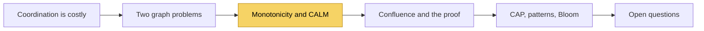

# What does "Keeping CALM: When Distributed Consistency is Easy" argue, and is it worth reading in full?

## 1. Abstract

Engineers who meet the CALM theorem need to know whether Hellerstein and Alvaro's nine-page account of it is worth a full read. The paper argues that a program can run consistently without coordination exactly when it is monotonic, meaning more input never retracts an output. It argues from two graph problems, then relates the result to CAP and to familiar design patterns. Read it in full if you design replicated services; otherwise this primer covers it.

**Key takeaways:**

- CALM: consistent and coordination-free if and only if monotonic.
- Consistency here means the same program outcome, not ordered storage.
- Monotonic programs can have all three CAP properties.
- It says what is possible, not how to build it.

## 2. Terminology

| Term | Definition |
|---|---|
| **Coordination** | A protocol in which machines wait for each other to agree, such as Paxos or two-phase commit [\[1\]](../sources/calm-theorem-keeping-calm.md#11-the-high-cost-of-coordination). |
| **Monotonic program** | A program whose output on any set of inputs is contained in its output on every larger set [\[2\]](../sources/calm-theorem-keeping-calm.md#14-the-crux-of-consistency-monotonicity). |
| **Confluence** | Producing the same outputs whatever the order and batching of the inputs: the paper's meaning of consistency [\[3\]](../sources/calm-theorem-keeping-calm.md#21-program-consistency-confluence). |
| **CALM** | Consistency As Logical Monotonicity, the theorem the paper explains [\[2\]](../sources/calm-theorem-keeping-calm.md#14-the-crux-of-consistency-monotonicity). |
| **CRDT** | Conflict-free replicated data type: a data type whose state only grows, so replicas converge [\[4\]](../sources/calm-theorem-keeping-calm.md#32-distributed-design-patterns). |
| **[→]** | Our own reasoning, after a statement or on a section's heading: a conclusion, comparison or example no cited source states. |

## 3. At a glance

| | |
|---|---|
| **Kind** | An explanatory paper: it states the CALM theorem, sketches its published proof and draws practical consequences [\[2\]](../sources/calm-theorem-keeping-calm.md#14-the-crux-of-consistency-monotonicity), [\[5\]](../sources/calm-theorem-keeping-calm.md#22-a-sketch-of-the-proof), [\[6\]](../sources/calm-theorem-keeping-calm.md#3-calm-perspective-on-the-state-of-the-art). |
| **Authors** | Joseph M. Hellerstein (UC Berkeley) and Peter Alvaro (UC Santa Cruz) [\[7\]](../sources/calm-theorem-keeping-calm.md#keeping-calm-when-distributed-consistency-is-easy). |
| **Published** | arXiv 1901.01930v2, 26 January 2019 [\[8\]](../sources/calm-theorem-keeping-calm.md#12-stay-in-your-lane-the-perfect-freeway). |
| **Length** | 9 pages, about 8,500 words: about 37 minutes to read in full [→]. |
| **The question** | "What is the family of problems that can be consistently computed in a distributed fashion without coordination, and what problems lie outside that family?" [\[2\]](../sources/calm-theorem-keeping-calm.md#14-the-crux-of-consistency-monotonicity) |
| **The claim** | A program has a consistent, coordination-free distributed implementation if and only if it is monotonic [\[2\]](../sources/calm-theorem-keeping-calm.md#14-the-crux-of-consistency-monotonicity). |

## 4. Context

Coordination protocols such as Paxos, two-phase commit and the global barriers of bulk synchronous processing are how distributed systems have bought consistency, and they are also its cost: the paper cites multiprocessor key-value stores that spend 90% of their time waiting for coordination, and a coordination-free store, Anna, that ran over two orders of magnitude faster [\[1\]](../sources/calm-theorem-keeping-calm.md#11-the-high-cost-of-coordination). Practitioners already avoid coordination where they can; the paper opens with James Hamilton's advice to "batter the consistency mechanisms down to a minimum" [\[1\]](../sources/calm-theorem-keeping-calm.md#11-the-high-cost-of-coordination). The demo's [design tenets narrative](what-are-the-common-design-tenets-and-principles-for-distributed-systems.md) gives the same advice as choosing consistency or availability per operation.

What was missing, the paper argues, is a rule for when avoiding coordination is possible at all: the question stayed open because research looked at storage semantics, reads and writes, instead of what the program computes [\[1\]](../sources/calm-theorem-keeping-calm.md#11-the-high-cost-of-coordination). Two results frame the answer. CAP is a negative result over all programs, and CALM draws the line inside it [\[9\]](../sources/calm-theorem-keeping-calm.md#31-cap-and-calm-going-positive). Linearizability and serializability promise recency and order of storage operations, and CALM replaces them with one question: is the program's outcome deterministic [\[3\]](../sources/calm-theorem-keeping-calm.md#21-program-consistency-confluence)?

What the paper adds is a property of the program itself, monotonicity, that decides the question and can be checked by analyzing the program, not by enforcing order at runtime [\[10\]](../sources/calm-theorem-keeping-calm.md#6-conclusion).

## 5. The arc

The paper moves from intuition to definition, then to proof, practice and limits [→]:

1. **Introduction:** the cost of coordination [\[1\]](../sources/calm-theorem-keeping-calm.md#11-the-high-cost-of-coordination); a freeway analogy, in which coordination is a stop light that an overpass can remove [\[8\]](../sources/calm-theorem-keeping-calm.md#12-stay-in-your-lane-the-perfect-freeway); two graph problems, one that needs coordination and one that doesn't [\[11\]](../sources/calm-theorem-keeping-calm.md#13-cruising-and-stalling-on-graphs); and the question and the theorem [\[2\]](../sources/calm-theorem-keeping-calm.md#14-the-crux-of-consistency-monotonicity).
2. **Proof sketch:** consistency defined as confluence, with Dynamo's shopping cart [\[3\]](../sources/calm-theorem-keeping-calm.md#21-program-consistency-confluence), then the structure of Ameloot et al.'s proof [\[5\]](../sources/calm-theorem-keeping-calm.md#22-a-sketch-of-the-proof).
3. **Practice:** CALM against CAP [\[9\]](../sources/calm-theorem-keeping-calm.md#31-cap-and-calm-going-positive), monotonic design patterns [\[4\]](../sources/calm-theorem-keeping-calm.md#32-distributed-design-patterns), the authors' Bloom language [\[12\]](../sources/calm-theorem-keeping-calm.md#33-the-bloom-programming-language), and keeping coordination off the critical path [\[13\]](../sources/calm-theorem-keeping-calm.md#34-coordination-in-its-place).
4. **Limits:** open questions [\[14\]](../sources/calm-theorem-keeping-calm.md#4-questions), related results [\[15\]](../sources/calm-theorem-keeping-calm.md#5-additional-results) and the conclusion [\[10\]](../sources/calm-theorem-keeping-calm.md#6-conclusion).

*Figure 5-1: The paper's line of argument, with its key part highlighted.*

## 6. The key part

The paper stands on one result, the CALM theorem, and on the pair of examples that makes it intuitive.

### 6.1 Two problems, one difference

In **distributed deadlock detection**, each machine holds part of a waits-for graph of transactions, and machines exchange edges; whenever a machine sees a cycle, it declares a deadlock [\[11\]](../sources/calm-theorem-keeping-calm.md#13-cruising-and-stalling-on-graphs). No coordination is needed: a cycle found on partial information stays a cycle, new edges can only reveal more cycles, so the output grows with the input, and once every edge is shared every machine agrees [\[11\]](../sources/calm-theorem-keeping-calm.md#13-cruising-and-stalling-on-graphs).

In **distributed garbage collection**, machines exchange edges of the object-reference graph the same way, looking for objects unreachable from the root [\[11\]](../sources/calm-theorem-keeping-calm.md#13-cruising-and-stalling-on-graphs). Here coordination is required: a machine that decides an object is unreachable can be proven wrong by edges that arrive later, so its answer would have to be retracted; to be sure, it must know it has heard everything, and only coordinating with every other machine establishes that [\[11\]](../sources/calm-theorem-keeping-calm.md#13-cruising-and-stalling-on-graphs).

The two differ in one point: a deadlock is the existence of a path, garbage the non-existence of one [\[2\]](../sources/calm-theorem-keeping-calm.md#14-the-crux-of-consistency-monotonicity).

### 6.2 The theorem

The paper defines a program $P$ as monotonic when, for any input sets $S$ and $T$, $S \subseteq T$ implies $P(S) \subseteq P(T)$ [\[2\]](../sources/calm-theorem-keeping-calm.md#14-the-crux-of-consistency-monotonicity). The theorem: "A program has a consistent, coordination-free distributed implementation if and only if it is monotonic." [\[2\]](../sources/calm-theorem-keeping-calm.md#14-the-crux-of-consistency-monotonicity)

Why it holds, intuitively: a monotonic program is safe with missing information, since more input only adds to what it has output, so it can act at once; a non-monotonic program may have to change its mind, so it cannot act until all the information has arrived, and waiting for that is coordination [\[2\]](../sources/calm-theorem-keeping-calm.md#14-the-crux-of-consistency-monotonicity). Non-monotonic programs are also order-sensitive, while a monotonic program's output depends only on what it received, not when [\[2\]](../sources/calm-theorem-keeping-calm.md#14-the-crux-of-consistency-monotonicity).

### 6.3 What consistency and coordination mean here

Consistency is **confluence**: an operation produces the same outputs for any ordering and batching of its inputs, confluent operations compose, and a program built only from them is confluent by construction [\[3\]](../sources/calm-theorem-keeping-calm.md#21-program-consistency-confluence). Confluence promises nothing about recency or the order of writes, so storage-level anomalies are allowed as long as they don't change the outcome [\[3\]](../sources/calm-theorem-keeping-calm.md#21-program-consistency-confluence).

Coordination gets a precise meaning in the proof: messages a program must send under every way of partitioning the data, even with all of it on one machine; a garbage collector holding all the data must still ask the others whether they have more edges [\[5\]](../sources/calm-theorem-keeping-calm.md#22-a-sketch-of-the-proof). The "if" direction is straightforward, the "only if" harder, since it must rule out every scheme for avoiding coordination [\[5\]](../sources/calm-theorem-keeping-calm.md#22-a-sketch-of-the-proof). In a query language, monotonic means selection, projection, intersection, join and transitive closure, but not set difference; in logic, no universal quantifier, the "everything there is to hear" that garbage collection needs [\[5\]](../sources/calm-theorem-keeping-calm.md#22-a-sketch-of-the-proof).

### 6.4 What follows

Coordination-freeness is equivalent to availability under partition, so a monotonic program can be consistent, available and partition-tolerant at once, and only non-monotonic programs face CAP's trade-off [\[9\]](../sources/calm-theorem-keeping-calm.md#31-cap-and-calm-going-positive).

The shopping cart shows the design move. Adding items commutes when the cart is a set, and replicas merge by union; deletes don't, so they become a second insert-only set; checkout still doesn't commute, so coordination is confined to checkout, which is Dynamo's design; later work made checkout monotonic too, by sending the IDs of all earlier updates with it [\[3\]](../sources/calm-theorem-keeping-calm.md#21-program-consistency-confluence). Immutable variables, tombstones and CRDTs are the same pattern [\[4\]](../sources/calm-theorem-keeping-calm.md#32-distributed-design-patterns). Where a full monotonic design is out of reach, coordination moves off the critical path, as with reclaiming tombstones in the background, or is replaced by compensation, such as an apology and a coupon when an item turns out to be out of stock [\[13\]](../sources/calm-theorem-keeping-calm.md#34-coordination-in-its-place).

The test a reader takes away: for each decision a system makes, ask whether information arriving later could ever retract it; if not, it needs no coordination [→].

## 7. How strong is it

The theorem is proven, but not in this paper: it sketches Ameloot et al.'s formalization on relational transducers and sends readers to those papers for the proof [\[2\]](../sources/calm-theorem-keeping-calm.md#14-the-crux-of-consistency-monotonicity), [\[5\]](../sources/calm-theorem-keeping-calm.md#22-a-sketch-of-the-proof). The sketch says it leaves out exceptions and many aspects of the original [\[5\]](../sources/calm-theorem-keeping-calm.md#22-a-sketch-of-the-proof).

The practical case rests on examples and the authors' own systems: the Dynamo cart, the Anna speedup, and Bloom with its tools [\[1\]](../sources/calm-theorem-keeping-calm.md#11-the-high-cost-of-coordination), [\[3\]](../sources/calm-theorem-keeping-calm.md#21-program-consistency-confluence), [\[12\]](../sources/calm-theorem-keeping-calm.md#33-the-bloom-programming-language). The paper reports no new experiments [→].

The authors name the limits. CALM is not constructive: it doesn't say how to find a monotonic specification or how to implement one [\[10\]](../sources/calm-theorem-keeping-calm.md#6-conclusion). The expressive power of monotonic distributed programs is open [\[16\]](../sources/calm-theorem-keeping-calm.md#41-expressiveness). Confluence doesn't capture coordinated non-monotonic programs, because Paxos makes one run's decisions uniform without making different runs agree [\[17\]](../sources/calm-theorem-keeping-calm.md#43-analyzing-non-monotonic-code). Statistical results such as Hogwild!'s convergence fall outside it [\[18\]](../sources/calm-theorem-keeping-calm.md#44-stochastic-calm).

In this primer's reading, the practice section leans toward the authors' own language-based work, and the related work gets a single page [→].

## 8. Should you read it

A reading path through the paper:

- **Read** the Introduction in full: the freeway and the two graph problems give the whole intuition [\[19\]](../sources/calm-theorem-keeping-calm.md#1-introduction).
- **Read** the section on confluence, with the shopping cart [\[3\]](../sources/calm-theorem-keeping-calm.md#21-program-consistency-confluence), and the sections on CAP [\[9\]](../sources/calm-theorem-keeping-calm.md#31-cap-and-calm-going-positive) and on keeping coordination in its place [\[13\]](../sources/calm-theorem-keeping-calm.md#34-coordination-in-its-place).
- **Skim** the proof sketch, unless you want the proof's structure [\[5\]](../sources/calm-theorem-keeping-calm.md#22-a-sketch-of-the-proof), and the design patterns and Bloom sections, if you know CRDTs and don't use Bloom [\[4\]](../sources/calm-theorem-keeping-calm.md#32-distributed-design-patterns), [\[12\]](../sources/calm-theorem-keeping-calm.md#33-the-bloom-programming-language).
- **Skip** the open questions and additional results unless you work on this theory [\[14\]](../sources/calm-theorem-keeping-calm.md#4-questions), [\[15\]](../sources/calm-theorem-keeping-calm.md#5-additional-results).

Read it in full if you design replicated services or storage and want a principled test for when coordination can go; it is short, and its examples carry the argument [→]. Skip it if you already know CRDTs and the CALM statement: this primer and the Introduction cover what's new [→]. For the proof itself, go to Ameloot et al.'s papers, which it cites [→].

## 9. References

### 9.1 Sources read

- [calm-theorem-keeping-calm](../sources/calm-theorem-keeping-calm.md): the whole work.

### 9.2 Citations

1. [calm-theorem-keeping-calm: 1.1 The High Cost of Coordination](../sources/calm-theorem-keeping-calm.md#11-the-high-cost-of-coordination)
2. [calm-theorem-keeping-calm: 1.4 The Crux of Consistency: Monotonicity](../sources/calm-theorem-keeping-calm.md#14-the-crux-of-consistency-monotonicity)
3. [calm-theorem-keeping-calm: 2.1 Program Consistency: Confluence](../sources/calm-theorem-keeping-calm.md#21-program-consistency-confluence)
4. [calm-theorem-keeping-calm: 3.2 Distributed Design Patterns](../sources/calm-theorem-keeping-calm.md#32-distributed-design-patterns)
5. [calm-theorem-keeping-calm: 2.2 A Sketch of The Proof](../sources/calm-theorem-keeping-calm.md#22-a-sketch-of-the-proof)
6. [calm-theorem-keeping-calm: 3 CALM Perspective on the State of the Art](../sources/calm-theorem-keeping-calm.md#3-calm-perspective-on-the-state-of-the-art)
7. [calm-theorem-keeping-calm: Keeping CALM](../sources/calm-theorem-keeping-calm.md#keeping-calm-when-distributed-consistency-is-easy)
8. [calm-theorem-keeping-calm: 1.2 Stay in Your Lane: The Perfect Freeway](../sources/calm-theorem-keeping-calm.md#12-stay-in-your-lane-the-perfect-freeway)
9. [calm-theorem-keeping-calm: 3.1 CAP and CALM: Going Positive](../sources/calm-theorem-keeping-calm.md#31-cap-and-calm-going-positive)
10. [calm-theorem-keeping-calm: 6 Conclusion](../sources/calm-theorem-keeping-calm.md#6-conclusion)
11. [calm-theorem-keeping-calm: 1.3 Cruising and Stalling on Graphs](../sources/calm-theorem-keeping-calm.md#13-cruising-and-stalling-on-graphs)
12. [calm-theorem-keeping-calm: 3.3 The Bloom Programming Language](../sources/calm-theorem-keeping-calm.md#33-the-bloom-programming-language)
13. [calm-theorem-keeping-calm: 3.4 Coordination In Its Place](../sources/calm-theorem-keeping-calm.md#34-coordination-in-its-place)
14. [calm-theorem-keeping-calm: 4 Questions](../sources/calm-theorem-keeping-calm.md#4-questions)
15. [calm-theorem-keeping-calm: 5 Additional Results](../sources/calm-theorem-keeping-calm.md#5-additional-results)
16. [calm-theorem-keeping-calm: 4.1 Expressiveness](../sources/calm-theorem-keeping-calm.md#41-expressiveness)
17. [calm-theorem-keeping-calm: 4.3 Analyzing Non-Monotonic Code](../sources/calm-theorem-keeping-calm.md#43-analyzing-non-monotonic-code)
18. [calm-theorem-keeping-calm: 4.4 Stochastic CALM](../sources/calm-theorem-keeping-calm.md#44-stochastic-calm)
19. [calm-theorem-keeping-calm: 1 Introduction](../sources/calm-theorem-keeping-calm.md#1-introduction)

## 10. Metadata

- **Version:** 1.0
- **Template:** skim_read
- **Language:** en
- **Model:** claude-opus-5-5
- **Created:** 2026-10-24
- **Last modified:** 2026-10-24
- **Words:** 1,662 (about 7 min)
- **History:**
  - 1.0 (2026-10-24): First version.
- **Reading plan:**
  1. `calm-theorem-keeping-calm`, in full: high relevance, authority A, 2019-01-26
