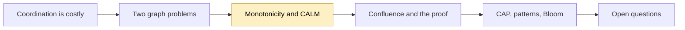
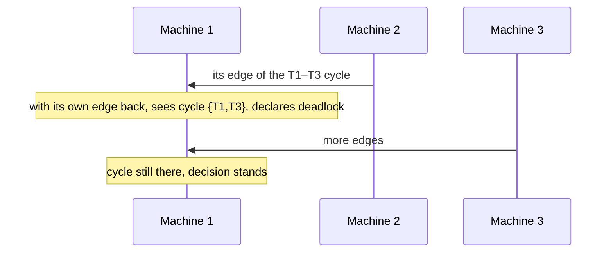
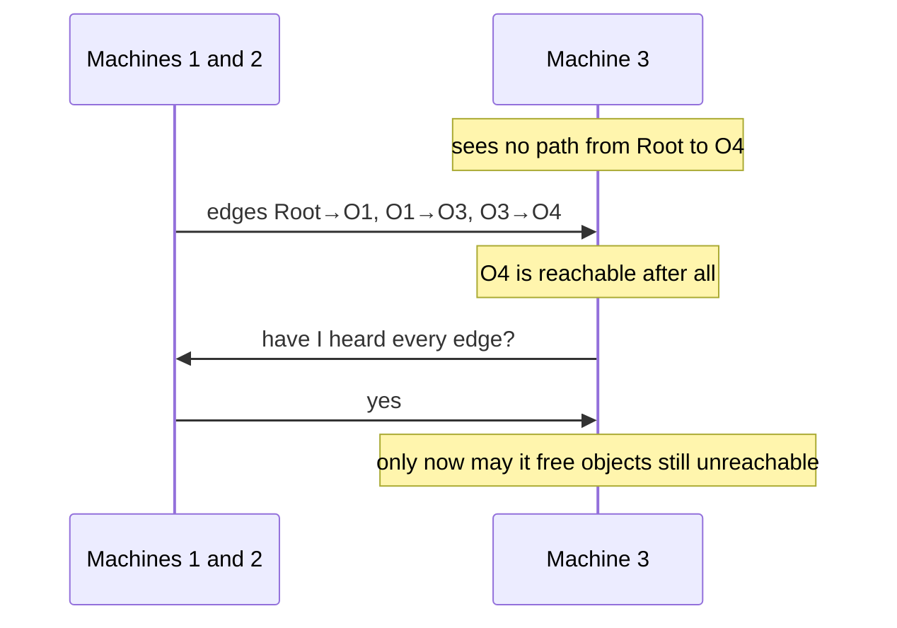

# What does "Keeping CALM: When Distributed Consistency is Easy" argue, and is it worth reading in full?

## 1. Abstract

Engineers who build replicated services pay for consistency with coordination, and need to know when they can skip it. Hellerstein and Alvaro's nine-page paper answers with the CALM theorem: a program can run consistently without coordination exactly when it is monotonic, so more input never retracts an earlier output. It argues from two graph problems, then draws consequences for CAP and design. Read it in full if you design replicated systems.

**Key takeaways:**

- CALM: consistent and coordination-free if and only if monotonic.
- Consistency here means the same program outcome, not ordered reads and writes.
- Monotonic programs keep all three CAP properties (consistency as confluence).
- The theorem says what is possible, not how to build it.

## 2. Terminology

| Term | Definition |
|---|---|
| **Coordination** | A protocol in which machines jointly decide and wait on each other, such as Paxos, two-phase commit or a global barrier [\[1\]](../sources/calm-theorem-keeping-calm.md#11-the-high-cost-of-coordination), [\[2\]](../sources/calm-theorem-keeping-calm.md#12-stay-in-your-lane-the-perfect-freeway); not any exchange of data, which both graph examples need without coordinating [\[3\]](../sources/calm-theorem-keeping-calm.md#22-a-sketch-of-the-proof). |
| **Monotonic program** | A program $P$ such that for any input sets $S \subseteq T$, $P(S) \subseteq P(T)$: more input only adds output [\[4\]](../sources/calm-theorem-keeping-calm.md#14-the-crux-of-consistency-monotonicity). |
| **Confluence** | Producing the same set of outputs for any ordering and batching of the inputs; the paper's meaning of consistency [\[5\]](../sources/calm-theorem-keeping-calm.md#21-program-consistency-confluence). |
| **CALM** | Consistency As Logical Monotonicity, the theorem the paper explains [\[4\]](../sources/calm-theorem-keeping-calm.md#14-the-crux-of-consistency-monotonicity). |
| **CAP** | Brewer's theorem that a system can have only two of consistency, availability and partition tolerance [\[6\]](../sources/calm-theorem-keeping-calm.md#31-cap-and-calm-going-positive). |
| **CRDT** | Conflict-free replicated data type: a data type whose state only moves up a partial order, such as a growing set, so replicas converge whatever the order of inputs [\[7\]](../sources/calm-theorem-keeping-calm.md#32-distributed-design-patterns). |
| **[→]** | Our own reasoning, after a statement or on a section's heading: a conclusion, comparison or example no cited source states. |

## 3. At a glance

| | |
|---|---|
| **Kind** | An explanatory research paper: it states the CALM theorem, sketches its published proof and draws practical consequences [\[4\]](../sources/calm-theorem-keeping-calm.md#14-the-crux-of-consistency-monotonicity), [\[3\]](../sources/calm-theorem-keeping-calm.md#22-a-sketch-of-the-proof), [\[8\]](../sources/calm-theorem-keeping-calm.md#3-calm-perspective-on-the-state-of-the-art). |
| **Authors** | Joseph M. Hellerstein (UC Berkeley) and Peter Alvaro (UC Santa Cruz) [\[9\]](../sources/calm-theorem-keeping-calm.md#keeping-calm-when-distributed-consistency-is-easy). |
| **Published** | arXiv 1901.01930v2, 26 January 2019 [\[2\]](../sources/calm-theorem-keeping-calm.md#12-stay-in-your-lane-the-perfect-freeway). |
| **Length** | 9 pages, about 7,240 words before the references: 7,240 / 240 words a minute = 30 minutes [→]. |
| **The question** | "What is the family of problems that can be consistently computed in a distributed fashion without coordination, and what problems lie outside that family?" [\[4\]](../sources/calm-theorem-keeping-calm.md#14-the-crux-of-consistency-monotonicity) |
| **The claim** | A program has a consistent, coordination-free distributed implementation if and only if it is monotonic [\[4\]](../sources/calm-theorem-keeping-calm.md#14-the-crux-of-consistency-monotonicity). |

## 4. Context

Coordination protocols let machines jointly decide, for example, who accesses shared memory first [\[1\]](../sources/calm-theorem-keeping-calm.md#11-the-high-cost-of-coordination). They are also slow [\[1\]](../sources/calm-theorem-keeping-calm.md#11-the-high-cost-of-coordination). Multiprocessor key-value stores were measured spending 90% of their time waiting on coordination, and Anna, a store without it, ran over two orders of magnitude faster [\[1\]](../sources/calm-theorem-keeping-calm.md#11-the-high-cost-of-coordination). Practitioners already avoid it where they can: James Hamilton's advice is to "batter the consistency mechanisms down to a minimum", his name for coordination [\[1\]](../sources/calm-theorem-keeping-calm.md#11-the-high-cost-of-coordination). The wiki's design tenets say the same: [minimize coordination](what-are-the-common-design-tenets-and-principles-for-distributed-systems.md#533-minimize-coordination).

What was missing, the paper argues, is a rule for when avoiding coordination is possible at all. It stayed open because research looked at storage semantics rather than at what the program computes [\[1\]](../sources/calm-theorem-keeping-calm.md#11-the-high-cost-of-coordination). CAP is a negative result: it says what consistency cannot be had in general [\[6\]](../sources/calm-theorem-keeping-calm.md#31-cap-and-calm-going-positive).

What the paper adds is a property of the program itself, monotonicity, that decides the question. It can be checked by analyzing the program instead of enforced at run time [\[10\]](../sources/calm-theorem-keeping-calm.md#6-conclusion).

The paper carries this argument on two graph problems, which this primer uses throughout [→]. In each, three machines hold parts of one graph, and each machine sends copies of its edges to the others [\[2\]](../sources/calm-theorem-keeping-calm.md#12-stay-in-your-lane-the-perfect-freeway), [\[11\]](../sources/calm-theorem-keeping-calm.md#13-cruising-and-stalling-on-graphs):

| | Deadlock detection | Garbage collection |
|---|---|---|
| **Nodes** | transactions, T1 to T6 in the paper's Figure 1 [\[2\]](../sources/calm-theorem-keeping-calm.md#12-stay-in-your-lane-the-perfect-freeway) | objects and a Root, O1 to O7 in Figure 2 [\[2\]](../sources/calm-theorem-keeping-calm.md#12-stay-in-your-lane-the-perfect-freeway) |
| **Edge** | one transaction waits for a lock another holds [\[11\]](../sources/calm-theorem-keeping-calm.md#13-cruising-and-stalling-on-graphs) | one object holds a reference to another [\[11\]](../sources/calm-theorem-keeping-calm.md#13-cruising-and-stalling-on-graphs) |
| **Answer sought** | the cycles: each is a deadlock [\[11\]](../sources/calm-theorem-keeping-calm.md#13-cruising-and-stalling-on-graphs) | the objects with no path from Root: each is garbage [\[11\]](../sources/calm-theorem-keeping-calm.md#13-cruising-and-stalling-on-graphs) |
| **The case** | cycles {T1,T2} on Machine 1 alone, and {T1,T3}, whose two edges, one each way, sit one on Machine 1 and one on Machine 2 [\[2\]](../sources/calm-theorem-keeping-calm.md#12-stay-in-your-lane-the-perfect-freeway) | O4 on Machine 3, reachable through edges Root→O1, O1→O3, O3→O4 held on the other machines [\[11\]](../sources/calm-theorem-keeping-calm.md#13-cruising-and-stalling-on-graphs); O5 and O6 are garbage [\[2\]](../sources/calm-theorem-keeping-calm.md#12-stay-in-your-lane-the-perfect-freeway) |

The two problems look nearly identical [\[11\]](../sources/calm-theorem-keeping-calm.md#13-cruising-and-stalling-on-graphs). Without a rule to tell them apart, a designer coordinates both and is slow, or neither and risks freeing O4 while in use [→].

## 5. The arc

The paper's own order [→]:

*Figure 5-1: The paper's line of argument, in its own order; the shaded box, the theorem, is its key part [→].*

1. **§1 Introduction** [\[12\]](../sources/calm-theorem-keeping-calm.md#1-introduction): the cost of coordination [\[1\]](../sources/calm-theorem-keeping-calm.md#11-the-high-cost-of-coordination); a freeway analogy, where an overpass removes the stop light [\[2\]](../sources/calm-theorem-keeping-calm.md#12-stay-in-your-lane-the-perfect-freeway); the two graph problems [\[11\]](../sources/calm-theorem-keeping-calm.md#13-cruising-and-stalling-on-graphs); the question and the theorem [\[4\]](../sources/calm-theorem-keeping-calm.md#14-the-crux-of-consistency-monotonicity).
2. **§2 Proof sketch** [\[13\]](../sources/calm-theorem-keeping-calm.md#2-calm-a-proof-sketch): consistency as confluence, with Dynamo's shopping cart [\[5\]](../sources/calm-theorem-keeping-calm.md#21-program-consistency-confluence); the structure of Ameloot et al.'s proof [\[3\]](../sources/calm-theorem-keeping-calm.md#22-a-sketch-of-the-proof).
3. **§3 Practice** [\[8\]](../sources/calm-theorem-keeping-calm.md#3-calm-perspective-on-the-state-of-the-art): CAP [\[6\]](../sources/calm-theorem-keeping-calm.md#31-cap-and-calm-going-positive), design patterns [\[7\]](../sources/calm-theorem-keeping-calm.md#32-distributed-design-patterns), the authors' Bloom language [\[14\]](../sources/calm-theorem-keeping-calm.md#33-the-bloom-programming-language), coordination off the critical path [\[15\]](../sources/calm-theorem-keeping-calm.md#34-coordination-in-its-place).
4. **§4–6 Questions, related results, conclusion** [\[16\]](../sources/calm-theorem-keeping-calm.md#4-questions): four open questions, related results [\[17\]](../sources/calm-theorem-keeping-calm.md#5-additional-results) and the conclusion [\[10\]](../sources/calm-theorem-keeping-calm.md#6-conclusion).

## 6. The key part

The paper stands on one result, the CALM theorem, and on the two graph problems that make it intuitive [\[4\]](../sources/calm-theorem-keeping-calm.md#14-the-crux-of-consistency-monotonicity). In order: the two problems, the property that splits them, the theorem, its terms, and what follows [→].

### 6.1 A deadlock found on partial edges stays found

Each machine declares a deadlock as soon as the edges it has received contain a cycle [\[11\]](../sources/calm-theorem-keeping-calm.md#13-cruising-and-stalling-on-graphs). No coordination is needed [\[11\]](../sources/calm-theorem-keeping-calm.md#13-cruising-and-stalling-on-graphs). Once Machines 1 and 2 jointly see the cycle {T1,T3}, nothing from Machine 3 can undo it [\[11\]](../sources/calm-theorem-keeping-calm.md#13-cruising-and-stalling-on-graphs). More edges can only reveal more cycles, so "the output grows monotonically with the input" [\[11\]](../sources/calm-theorem-keeping-calm.md#13-cruising-and-stalling-on-graphs). When every edge has reached every machine, all machines agree on the answer for the full graph [\[11\]](../sources/calm-theorem-keeping-calm.md#13-cruising-and-stalling-on-graphs).

*Figure 6-1: Deadlock detection: an answer reached on partial edges never needs taking back [\[11\]](../sources/calm-theorem-keeping-calm.md#13-cruising-and-stalling-on-graphs); which machine sends which edge is this primer's reconstruction [→].*

### 6.2 A garbage verdict on partial edges can be overturned

Garbage collection runs the same exchange, and here the answer differs: coordination is required [\[11\]](../sources/calm-theorem-keeping-calm.md#13-cruising-and-stalling-on-graphs). Machine 3 alone sees O4 with no path from Root. If it frees O4, the later edges Root→O1, O1→O3 and O3→O4 prove it wrong [\[11\]](../sources/calm-theorem-keeping-calm.md#13-cruising-and-stalling-on-graphs). A previous answer "may need to be retracted" [\[11\]](../sources/calm-theorem-keeping-calm.md#13-cruising-and-stalling-on-graphs). To be safe, Machine 3 must know it has heard everything before it decides [\[11\]](../sources/calm-theorem-keeping-calm.md#13-cruising-and-stalling-on-graphs). The only way to know that is to coordinate with all the other machines [\[11\]](../sources/calm-theorem-keeping-calm.md#13-cruising-and-stalling-on-graphs).

*Figure 6-2: Garbage collection: an answer reached on partial edges can be overturned, so the machine must first coordinate with every other machine [\[11\]](../sources/calm-theorem-keeping-calm.md#13-cruising-and-stalling-on-graphs); which machines send which edges, and the one-question round, are this primer's simplification [→].*

### 6.3 Monotonic programs need no coordination

Both problems are graph reachability. They differ in one point: a deadlock is the existence of a path, garbage its non-existence [\[4\]](../sources/calm-theorem-keeping-calm.md#14-the-crux-of-consistency-monotonicity). The set of paths that exist only grows as information arrives; the set that don't exist can shrink [\[4\]](../sources/calm-theorem-keeping-calm.md#14-the-crux-of-consistency-monotonicity). The paper names the first property:

$$
S \subseteq T \implies P(S) \subseteq P(T)
$$

A program $P$ with this property, for any input sets $S$ and $T$, is monotonic [\[4\]](../sources/calm-theorem-keeping-calm.md#14-the-crux-of-consistency-monotonicity). The theorem then reads: "A program has a consistent, coordination-free distributed implementation if and only if it is monotonic" [\[4\]](../sources/calm-theorem-keeping-calm.md#14-the-crux-of-consistency-monotonicity).

Why it holds, intuitively: a monotonic program is safe with missing information, so it can act at once [\[4\]](../sources/calm-theorem-keeping-calm.md#14-the-crux-of-consistency-monotonicity). A non-monotonic program may find a property's truth changed by new information. So it cannot act until all information has arrived, and learning that takes coordination [\[4\]](../sources/calm-theorem-keeping-calm.md#14-the-crux-of-consistency-monotonicity). Non-monotonic programs also change their minds, so arrival order decides their final state; monotonic programs only accumulate [\[4\]](../sources/calm-theorem-keeping-calm.md#14-the-crux-of-consistency-monotonicity).

### 6.4 Consistency means the same outcome, whatever the order

The theorem needs a meaning for "consistent". The paper takes confluence: an operation is confluent if it gives the same set of outputs for any ordering and batching of its inputs [\[5\]](../sources/calm-theorem-keeping-calm.md#21-program-consistency-confluence). Confluent operations compose, so a program built from them is confluent [\[5\]](../sources/calm-theorem-keeping-calm.md#21-program-consistency-confluence). Confluence promises nothing about recency or the order of writes at each replica. Storage-level anomalies are allowed, as long as they don't change the outcome [\[5\]](../sources/calm-theorem-keeping-calm.md#21-program-consistency-confluence). For the running example, consistency means every machine ends with the same deadlocks, or the same garbage, not that each saw edges in one order [→].

### 6.5 Coordination means messages no data placement avoids

The proof is Ameloot et al.'s; the paper reviews its structure [\[3\]](../sources/calm-theorem-keeping-calm.md#22-a-sketch-of-the-proof). Each machine is a relational transducer: a loop that takes in an unordered batch of inserts and deletes, queries its tables, and sends the results [\[3\]](../sources/calm-theorem-keeping-calm.md#22-a-sketch-of-the-proof). A monotonic program uses only monotonic operators: selection, projection, intersection, join and transitive closure, but not set difference [\[3\]](../sources/calm-theorem-keeping-calm.md#22-a-sketch-of-the-proof). In logic, it has no universal quantifier (∀) and no "there is no" (¬∃), the "everything there is to hear" that garbage collection needs [\[3\]](../sources/calm-theorem-keeping-calm.md#22-a-sketch-of-the-proof).

The "if" direction is straightforward: a monotonic network sends a deterministic set of messages and produces a deterministic output [\[3\]](../sources/calm-theorem-keeping-calm.md#22-a-sketch-of-the-proof). The "only if" direction is harder, since it must rule out every scheme for avoiding coordination [\[3\]](../sources/calm-theorem-keeping-calm.md#22-a-sketch-of-the-proof). The trick is to define coordination messages precisely [\[3\]](../sources/calm-theorem-keeping-calm.md#22-a-sketch-of-the-proof). Consider every way of placing the data on the machines at the start [\[3\]](../sources/calm-theorem-keeping-calm.md#22-a-sketch-of-the-proof). A message sent under every placement, even with all data on one machine, is a coordination message [\[3\]](../sources/calm-theorem-keeping-calm.md#22-a-sketch-of-the-proof). A garbage collector holding the whole graph must still ask the others whether they have more edges [\[3\]](../sources/calm-theorem-keeping-calm.md#22-a-sketch-of-the-proof). The proof shows that non-monotonic operations need such messages [\[3\]](../sources/calm-theorem-keeping-calm.md#22-a-sketch-of-the-proof).

### 6.6 Only the non-monotonic steps need coordination

The theorem has three practical consequences [→]. First, coordination-freeness, the paper observes, is equivalent to availability under partition: every machine keeps answering [\[6\]](../sources/calm-theorem-keeping-calm.md#31-cap-and-calm-going-positive). A partition is a network fault that splits the machines into groups, as the [design tenets](what-are-the-common-design-tenets-and-principles-for-distributed-systems.md#541-choose-consistency-deliberately) explain. A coordination-free program runs on each side and merges monotonically when the partition heals [\[6\]](../sources/calm-theorem-keeping-calm.md#31-cap-and-calm-going-positive). A program that coordinates stalls if the coordinating machines span the partition [\[6\]](../sources/calm-theorem-keeping-calm.md#31-cap-and-calm-going-positive). So monotonic programs can have all three CAP properties at once, reading consistency as confluence rather than the linearizability CAP's proof assumes; only non-monotonic programs face CAP's trade-off [\[6\]](../sources/calm-theorem-keeping-calm.md#31-cap-and-calm-going-positive).

Second, a design move, shown on Dynamo's shopping cart. Adding items commutes when the cart is a set, and replicas reconcile by union [\[5\]](../sources/calm-theorem-keeping-calm.md#21-program-consistency-confluence). Deletes are not monotonic, so they become a second insert-only set [\[5\]](../sources/calm-theorem-keeping-calm.md#21-program-consistency-confluence). Checkout still doesn't commute with updates, so coordination is confined to checkout, which is Dynamo's design [\[5\]](../sources/calm-theorem-keeping-calm.md#21-program-consistency-confluence). Tombstones and CRDTs follow the same pattern [\[7\]](../sources/calm-theorem-keeping-calm.md#32-distributed-design-patterns).

Where a monotonic design is out of reach, coordination moves off the critical path: the running example's garbage collection can run in the background [\[15\]](../sources/calm-theorem-keeping-calm.md#34-coordination-in-its-place). Or the system compensates, say with an apology and a coupon for an item out of stock [\[15\]](../sources/calm-theorem-keeping-calm.md#34-coordination-in-its-place).

The test a reader takes away: for each decision, ask whether an input arriving later could ever retract it; if not, the decision needs no coordination [→].

## 7. How strong is it

The theorem is proven, but not in this paper. It sketches Ameloot et al.'s formalization and sends readers to those papers for the proof [\[4\]](../sources/calm-theorem-keeping-calm.md#14-the-crux-of-consistency-monotonicity), [\[3\]](../sources/calm-theorem-keeping-calm.md#22-a-sketch-of-the-proof). The sketch says it omits exceptions and many aspects of the original [\[3\]](../sources/calm-theorem-keeping-calm.md#22-a-sketch-of-the-proof).

The practical case rests on examples and the authors' own systems: Dynamo's cart, the Anna measurement, and Bloom with its tools [\[1\]](../sources/calm-theorem-keeping-calm.md#11-the-high-cost-of-coordination), [\[5\]](../sources/calm-theorem-keeping-calm.md#21-program-consistency-confluence), [\[14\]](../sources/calm-theorem-keeping-calm.md#33-the-bloom-programming-language). It reports no new experiments [→].

The authors name the limits. CALM is not constructive: it doesn't say how to find a monotonic specification or how to implement one [\[10\]](../sources/calm-theorem-keeping-calm.md#6-conclusion). The expressive power of monotonic distributed programs is open [\[18\]](../sources/calm-theorem-keeping-calm.md#41-expressiveness). Confluence doesn't capture coordinated non-monotonic programs: Paxos makes one run's decisions uniform, but another run may decide differently [\[19\]](../sources/calm-theorem-keeping-calm.md#43-analyzing-non-monotonic-code). Statistical results such as Hogwild!'s convergence fall outside it [\[20\]](../sources/calm-theorem-keeping-calm.md#44-stochastic-calm).

Beyond what the authors admit, in this primer's reading [→]:

- The graph problems are pure set computations, where the running example stops being representative: most applications mix in non-monotonic steps, like decrementing inventory at purchase.
- The deadlock argument assumes every edge eventually reaches every machine; lost messages and machines that never return go undiscussed.
- The practice section leans on the authors' own Bloom work; related work gets a few paragraphs.

## 8. Should you read it

A reading path through the paper:

- **Read** the Introduction in full: the freeway and the two graph problems give the whole intuition [\[12\]](../sources/calm-theorem-keeping-calm.md#1-introduction).
- **Read** §2.1 on confluence and the cart [\[5\]](../sources/calm-theorem-keeping-calm.md#21-program-consistency-confluence), §3.1 on CAP [\[6\]](../sources/calm-theorem-keeping-calm.md#31-cap-and-calm-going-positive) and §3.4 on coordination in its place [\[15\]](../sources/calm-theorem-keeping-calm.md#34-coordination-in-its-place).
- **Skim** the proof sketch, unless you want the proof's structure [\[3\]](../sources/calm-theorem-keeping-calm.md#22-a-sketch-of-the-proof). Skim design patterns and Bloom if you know CRDTs [\[7\]](../sources/calm-theorem-keeping-calm.md#32-distributed-design-patterns), [\[14\]](../sources/calm-theorem-keeping-calm.md#33-the-bloom-programming-language).
- **Skip** the open questions and additional results unless you work on this theory [\[16\]](../sources/calm-theorem-keeping-calm.md#4-questions), [\[17\]](../sources/calm-theorem-keeping-calm.md#5-additional-results).

The verdict [→]: read it, following the path above, if you design replicated services or storage and want a principled test for when coordination can go; it is short, and its examples carry the argument. Skip it if you know CRDTs and the CALM statement already. For the proof itself, read Ameloot et al.

## 9. References

### 9.1 Sources read

- [calm-theorem-keeping-calm](../sources/calm-theorem-keeping-calm.md): the whole work.

### 9.2 Citations

1. [calm-theorem-keeping-calm: 1.1 The High Cost of Coordination](../sources/calm-theorem-keeping-calm.md#11-the-high-cost-of-coordination)
2. [calm-theorem-keeping-calm: 1.2 Stay in Your Lane: The Perfect Freeway](../sources/calm-theorem-keeping-calm.md#12-stay-in-your-lane-the-perfect-freeway)
3. [calm-theorem-keeping-calm: 2.2 A Sketch of The Proof](../sources/calm-theorem-keeping-calm.md#22-a-sketch-of-the-proof)
4. [calm-theorem-keeping-calm: 1.4 The Crux of Consistency: Monotonicity](../sources/calm-theorem-keeping-calm.md#14-the-crux-of-consistency-monotonicity)
5. [calm-theorem-keeping-calm: 2.1 Program Consistency: Confluence](../sources/calm-theorem-keeping-calm.md#21-program-consistency-confluence)
6. [calm-theorem-keeping-calm: 3.1 CAP and CALM: Going Positive](../sources/calm-theorem-keeping-calm.md#31-cap-and-calm-going-positive)
7. [calm-theorem-keeping-calm: 3.2 Distributed Design Patterns](../sources/calm-theorem-keeping-calm.md#32-distributed-design-patterns)
8. [calm-theorem-keeping-calm: 3 CALM Perspective on the State of the Art](../sources/calm-theorem-keeping-calm.md#3-calm-perspective-on-the-state-of-the-art)
9. [calm-theorem-keeping-calm: Keeping CALM: When Distributed Consistency is Easy](../sources/calm-theorem-keeping-calm.md#keeping-calm-when-distributed-consistency-is-easy)
10. [calm-theorem-keeping-calm: 6 Conclusion](../sources/calm-theorem-keeping-calm.md#6-conclusion)
11. [calm-theorem-keeping-calm: 1.3 Cruising and Stalling on Graphs](../sources/calm-theorem-keeping-calm.md#13-cruising-and-stalling-on-graphs)
12. [calm-theorem-keeping-calm: 1 Introduction](../sources/calm-theorem-keeping-calm.md#1-introduction)
13. [calm-theorem-keeping-calm: 2 CALM: A Proof Sketch](../sources/calm-theorem-keeping-calm.md#2-calm-a-proof-sketch)
14. [calm-theorem-keeping-calm: 3.3 The Bloom Programming Language](../sources/calm-theorem-keeping-calm.md#33-the-bloom-programming-language)
15. [calm-theorem-keeping-calm: 3.4 Coordination In Its Place](../sources/calm-theorem-keeping-calm.md#34-coordination-in-its-place)
16. [calm-theorem-keeping-calm: 4 Questions](../sources/calm-theorem-keeping-calm.md#4-questions)
17. [calm-theorem-keeping-calm: 5 Additional Results](../sources/calm-theorem-keeping-calm.md#5-additional-results)
18. [calm-theorem-keeping-calm: 4.1 Expressiveness](../sources/calm-theorem-keeping-calm.md#41-expressiveness)
19. [calm-theorem-keeping-calm: 4.3 Analyzing Non-Monotonic Code](../sources/calm-theorem-keeping-calm.md#43-analyzing-non-monotonic-code)
20. [calm-theorem-keeping-calm: 4.4 Stochastic CALM](../sources/calm-theorem-keeping-calm.md#44-stochastic-calm)

## 10. Metadata

- **Version:** 2.1
- **Template:** skim_read
- **Language:** en
- **Model:** claude-opus-5-5
- **Created:** 2026-10-24
- **Last modified:** 2026-11-24
- **Words:** 2,209 (about 10 min)
- **History:**
  - 2.1 (2026-11-24): Lint: CAP's consistency (linearizability) kept apart from CALM's (confluence); checkout no longer the example of a step that stays non-monotonic; coordination defined as more than data exchange; the deadlock example's two edges stated; the arc labelled by the paper's sections; uncited statements of the paper cited
  - 2.0 (2026-11-24): Regenerated under sllmwiki 1.4.0's guides: a new spine following the paper's argument on its own two graph examples, set up once; the key part rebuilt around why a deadlock verdict stays found and a garbage verdict can be overturned; statement headings; the reading time recomputed
  - 1.1 (2026-10-24): Lint: relational algebra, as the paper says; the related work's length.
  - 1.0 (2026-10-24): First version.
- **Reading plan:**
  1. `what-are-the-common-design-tenets-and-principles-for-distributed-systems`, in full: existing narrative, background
  2. `calm-theorem-keeping-calm`, in full: high relevance, authority A, 2019-01-26
