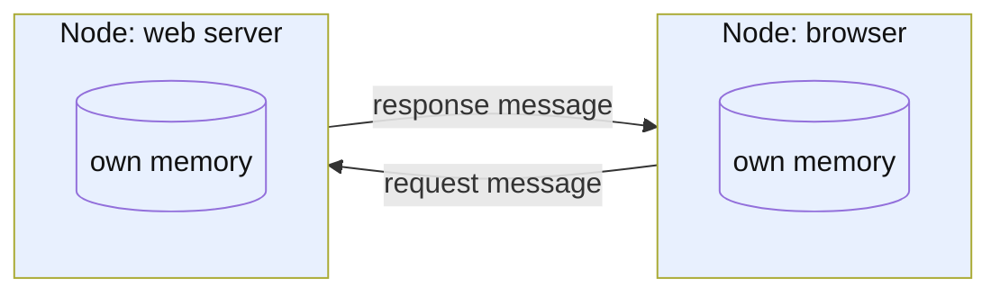

# What is a distributed system?

## 1. Abstract

Anyone who builds or runs software that spans more than one machine needs to know what makes it a distributed system, because that is what decides which problems they will face. A distributed system is a set of independent computers, each with its own memory, that work toward a shared task by sending each other messages over a network. What sets it apart from one computer is that its parts fail independently, and a node often cannot tell whether a message, or another node, has failed.

**Key takeaways:**

- Independent nodes, private memory, coordination only by message passing.
- There is no single agreed definition; the wiki uses van Steen and Tanenbaum's, with its two characteristics.
- Partial failure is the defining difficulty: some parts fail while the rest keep running.
- A request over the network can end in an unknown outcome.
- There is no global clock.

## 2. Terminology

| Term | Definition |
|---|---|
| **Node** | One computing element of a distributed system: a device or a software process. |
| **Message passing** | Communication by sending and receiving messages over a network, with no shared memory. |
| **Partial failure** | Some nodes or links fail while the others keep running. |
| **Fault tolerance** | The system as a whole keeps working despite a fault in one of its parts. |
| **[→]** | Our own reasoning, after a statement or on a section's heading: a conclusion, comparison or example no cited source states. |

## 3. Overview

Loading a web page is a distributed system at work. Your browser, a client, sends a request message to a web server, and the server sends back a response message with the page [\[1\]](../sources/distributed-systems-kleppmann-cambridge-notes.md#distributed-systems-and-computer-networking). Two computers that share nothing but a network cooperate to do one thing for you [→].

You meet distributed systems whenever a service has more than one machine behind it: paying in an online shop sends a request to a payments service, which talks to a card network, which talks to your bank [\[2\]](../sources/distributed-systems-kleppmann-cambridge-notes.md#example-remote-procedure-calls-rpc). They matter because they behave unlike a single program. A remote call looks like a local one, but the service may crash during the call, and a message may be lost or delayed; if no response comes back, the caller doesn't know whether the server received and processed the request [\[2\]](../sources/distributed-systems-kleppmann-cambridge-notes.md#example-remote-procedure-calls-rpc). Leslie Lamport defined a distributed system by its failures, as "a system in which the failure of a computer you didn’t even know existed can render your own computer unusable" [\[3\]](../sources/distributed-systems-kleppmann-cambridge-notes.md#introduction).

## 4. Definition

### 4.1 In short

A distributed system is multiple computers, called nodes, communicating via a network and trying to achieve some task together [\[3\]](../sources/distributed-systems-kleppmann-cambridge-notes.md#introduction). Each node has its own memory, so the nodes can coordinate only by passing messages [\[4\]](../sources/distributed-systems-wikipedia-distributed-computing.md#introduction). In the running example, the browser and the server are the nodes, and the HTTP request and response are the messages [→].

*Figure 4-1: Two nodes, each with private memory, that cooperate only by exchanging messages over a network.*

### 4.2 Precisely

The field has no single agreed definition. Van Steen and Tanenbaum note that the literature's definitions are neither satisfactory nor in agreement, and give a loose characterization instead: [\[5\]](../sources/distributed-systems-van-steen-tanenbaum-brief-intro.md#2-what-is-a-distributed-system)

> "A distributed system is a collection of autonomous computing elements that appears to its users as a single coherent system." [\[5\]](../sources/distributed-systems-van-steen-tanenbaum-brief-intro.md#2-what-is-a-distributed-system)

This wiki works with it, read through its two characteristics [→].

- **Autonomous computing elements.** Each node can act on its own, yet the nodes are programmed toward common goals, which they reach by exchanging messages [\[6\]](../sources/distributed-systems-van-steen-tanenbaum-brief-intro.md#21-characteristic-1-collection-of-autonomous-computing-elements). A node may be a hardware device or a software process, and the definition assumes nothing about the kind of nodes or how they are connected [\[5\]](../sources/distributed-systems-van-steen-tanenbaum-brief-intro.md#2-what-is-a-distributed-system).
- **A single coherent system.** Users, people or applications, believe they deal with one system, so the nodes must collaborate [\[5\]](../sources/distributed-systems-van-steen-tanenbaum-brief-intro.md#2-what-is-a-distributed-system). The authors ask only that it *appear* coherent, behaving as its users expect no matter where, when and how they interact with it, because a full single-system view is often asking too much [\[7\]](../sources/distributed-systems-van-steen-tanenbaum-brief-intro.md#22-characteristic-2-single-coherent-system).

Three nuances matter beyond the short version. First, a node need not be a whole computer: the word "distributed" now also covers autonomous processes on one physical computer that interact by message passing [\[4\]](../sources/distributed-systems-wikipedia-distributed-computing.md#introduction). Second, coherence is a goal, not a test: Wikipedia adds that each computer may instead have its own user, with the system coordinating shared resources or providing communication between them [\[4\]](../sources/distributed-systems-wikipedia-distributed-computing.md#introduction). The web fits that second reading better than the first: you know the page comes from elsewhere [→]. Third, message passing describes most practical systems, not all: some supercomputers offer limited distributed shared memory, and remote direct memory access (RDMA) lets computers access each other's memory over a network [\[3\]](../sources/distributed-systems-kleppmann-cambridge-notes.md#introduction).

## 5. Key ideas

**Partial failure.** Because nodes are networked and independent, at any moment only part of the system may have failed, and in a distributed system such failures are particularly hard to hide [\[7\]](../sources/distributed-systems-van-steen-tanenbaum-brief-intro.md#22-characteristic-2-single-coherent-system). On a single computer a failing part usually crashes the whole machine, so software needn't handle it; a distributed system often wants the rest to keep working, and dealing with faults is what makes distributed computing fundamentally different, and often harder [\[8\]](../sources/distributed-systems-kleppmann-cambridge-notes.md#about-distributed-systems). In a remote call, the service, the messages and the network can each go wrong on their own [\[2\]](../sources/distributed-systems-kleppmann-cambridge-notes.md#example-remote-procedure-calls-rpc).

**Unknown outcomes.** A failure may go unnoticed: communication may fail and processes may crash without the others knowing, nondeterministically [\[8\]](../sources/distributed-systems-kleppmann-cambridge-notes.md#about-distributed-systems). So a request that gets no response has an unknown outcome: the client can resend it, but that may perform it twice, such as charging a card twice, and since it can't wait forever, it gives up after a timeout [\[2\]](../sources/distributed-systems-kleppmann-cambridge-notes.md#example-remote-procedure-calls-rpc). If the page never loads, the browser cannot tell a lost request from a lost reply [→].

**No global clock.** Each independent node has its own notion of time, which raises fundamental questions of synchronization and coordination [\[6\]](../sources/distributed-systems-van-steen-tanenbaum-brief-intro.md#21-characteristic-1-collection-of-autonomous-computing-elements).

**A limited view.** The system's structure, its topology, latency and number of computers, is not known in advance and may change while it runs, and each computer sees only part of it [\[4\]](../sources/distributed-systems-wikipedia-distributed-computing.md#introduction).

**Why build one anyway.** Some tasks are inherently distributed, such as messaging a friend's phone; more nodes can be more reliable than one, serve users from nearby, and handle problems too big for one machine [\[8\]](../sources/distributed-systems-kleppmann-cambridge-notes.md#about-distributed-systems).

## 6. Boundaries

**Parallel computing.** The two overlap with no clear line, but a rough rule separates them: parallel processors may share memory, while distributed processors each have private memory and exchange messages [\[9\]](../sources/distributed-systems-wikipedia-distributed-computing.md#parallel-and-distributed-computing). Threads in one process are therefore out: they share an address space [\[3\]](../sources/distributed-systems-kleppmann-cambridge-notes.md#introduction).

**Computer networking.** Networking gets messages to their destination; distributed systems build on that and decide what messages to send and how to process them [\[1\]](../sources/distributed-systems-kleppmann-cambridge-notes.md#distributed-systems-and-computer-networking). To a distributed system, the HTTP request is one message however many TCP packets carry it [\[1\]](../sources/distributed-systems-kleppmann-cambridge-notes.md#distributed-systems-and-computer-networking).

**The common mistake.** Newcomers assume the network is reliable, secure and homogeneous, that the topology does not change, that latency and transport cost are zero, that bandwidth is infinite and that there is one administrator [\[10\]](../sources/distributed-systems-van-steen-tanenbaum-brief-intro.md#35-pitfalls). These are Peter Deutsch's false assumptions, and ignoring them at design time leads to flaws patched later [\[10\]](../sources/distributed-systems-van-steen-tanenbaum-brief-intro.md#35-pitfalls). The principles that answer them are in [What are the common design tenets and principles for distributed systems?](what-are-the-common-design-tenets-and-principles-for-distributed-systems.md).

## 7. Where to go next

- How should a distributed system handle failures: timeouts, retries and backoff?
- How do nodes order events without a global clock?
- How do nodes agree on one value: consensus and Raft?
- What trade-off does the CAP theorem describe?

## 8. References

### 8.1 Sources read

- [distributed-systems-kleppmann-cambridge-notes](../sources/distributed-systems-kleppmann-cambridge-notes.md): the short definition, Lamport's definition by failure, a remote call and its unknown outcome, reasons to distribute, partial failure, and the line between distributed systems and networking.
- [distributed-systems-van-steen-tanenbaum-brief-intro](../sources/distributed-systems-van-steen-tanenbaum-brief-intro.md): the definition the wiki works with, its two characteristics, no global clock, and the false assumptions.
- [distributed-systems-wikipedia-distributed-computing](../sources/distributed-systems-wikipedia-distributed-computing.md): the commonly cited properties and the parallel versus distributed criterion.

### 8.2 Citations

1. [distributed-systems-kleppmann-cambridge-notes: Distributed systems and computer networking](../sources/distributed-systems-kleppmann-cambridge-notes.md#distributed-systems-and-computer-networking)
2. [distributed-systems-kleppmann-cambridge-notes: Example: Remote Procedure Calls (RPC)](../sources/distributed-systems-kleppmann-cambridge-notes.md#example-remote-procedure-calls-rpc)
3. [distributed-systems-kleppmann-cambridge-notes: Introduction](../sources/distributed-systems-kleppmann-cambridge-notes.md#introduction)
4. [distributed-systems-wikipedia-distributed-computing: Introduction](../sources/distributed-systems-wikipedia-distributed-computing.md#introduction)
5. [distributed-systems-van-steen-tanenbaum-brief-intro: 2 What is a distributed system?](../sources/distributed-systems-van-steen-tanenbaum-brief-intro.md#2-what-is-a-distributed-system)
6. [distributed-systems-van-steen-tanenbaum-brief-intro: 2.1 Characteristic 1: collection of autonomous computing elements](../sources/distributed-systems-van-steen-tanenbaum-brief-intro.md#21-characteristic-1-collection-of-autonomous-computing-elements)
7. [distributed-systems-van-steen-tanenbaum-brief-intro: 2.2 Characteristic 2: single coherent system](../sources/distributed-systems-van-steen-tanenbaum-brief-intro.md#22-characteristic-2-single-coherent-system)
8. [distributed-systems-kleppmann-cambridge-notes: About distributed systems](../sources/distributed-systems-kleppmann-cambridge-notes.md#about-distributed-systems)
9. [distributed-systems-wikipedia-distributed-computing: Parallel and distributed computing](../sources/distributed-systems-wikipedia-distributed-computing.md#parallel-and-distributed-computing)
10. [distributed-systems-van-steen-tanenbaum-brief-intro: 3.5 Pitfalls](../sources/distributed-systems-van-steen-tanenbaum-brief-intro.md#35-pitfalls)

## 9. Metadata

- **Version:** 1.1
- **Template:** concept_brief_overview
- **Language:** en
- **Model:** claude-opus-5-5
- **Created:** 2026-10-23
- **Last modified:** 2026-10-25
- **Words:** 1,243 (about 5 min)
- **History:**
  - 1.1 (2026-10-25): Openly licensed sources only, for a public demo: the AWS article's claims re-cited to Kleppmann's notes (a remote call and its unknown outcome) and Lamport's definition to his quotation there; the batch-cluster boundary removed
  - 1.0 (2026-10-23): First version.
- **Reading plan:**
  1. `what-are-the-common-design-tenets-and-principles-for-distributed-systems`, in full: existing narrative, medium relevance
  2. `distributed-systems-wikipedia-distributed-computing`, in full: medium relevance, authority B, undated
  3. `distributed-systems-van-steen-tanenbaum-brief-intro`, in full: high relevance, authority A, 2016-09-01
  4. `distributed-systems-kleppmann-cambridge-notes`, in full: high relevance, authority A, 2021-10-01
  5. `distributed-system-design-wikipedia-fallacies`, abstract only: low relevance
  6. `distributed-system-design-aws-well-architected-reliability-principles`, abstract only: low relevance
  7. `ewma-linkerd-beyond-round-robin`, abstract only: low relevance
  8. `distributed-system-design-azure-design-principles`, abstract only: low relevance
  9. `distributed-system-design-azure-retry-pattern`, abstract only: low relevance
  10. `distributed-system-design-azure-circuit-breaker-pattern`, abstract only: low relevance
  11. `distributed-system-design-azure-bulkhead-pattern`, abstract only: low relevance
  12. `distributed-system-design-azure-throttling-pattern`, abstract only: low relevance
  13. `distributed-system-design-azure-transient-fault-handling`, abstract only: low relevance
  14. `distributed-system-design-wikipedia-cap-theorem`, abstract only: low relevance
  15. `distributed-system-design-wikipedia-end-to-end-principle`, abstract only: low relevance
  16. `distributed-system-design-wikipedia-cascading-failure`, abstract only: low relevance
  17. `distributed-system-design-waldo-note-on-distributed-computing`, not read: a link, no saved copy
  18. `distributed-systems-lamport-definition-email`, not read: a link, no saved copy
  19. `distributed-system-design-aws-challenges-distributed-systems`, not read: a link, no saved copy
  20. `distributed-system-design-hamilton-internet-scale-services`, not read: a link, no saved copy
  21. `distributed-system-design-aws-timeouts-retries-backoff`, not read: a link, no saved copy
  22. `distributed-system-design-google-sre-cascading-failures`, not read: a link, no saved copy
  23. `distributed-system-design-brewer-cap-twelve-years-later`, not read: a link, no saved copy
  24. `distributed-system-design-ongaro-raft-consensus`, not read: a link, no saved copy
  25. `distributed-system-design-lamport-time-clocks`, not read: a link, no saved copy
  26. `distributed-system-design-saltzer-end-to-end-arguments`, not read: a link, no saved copy
