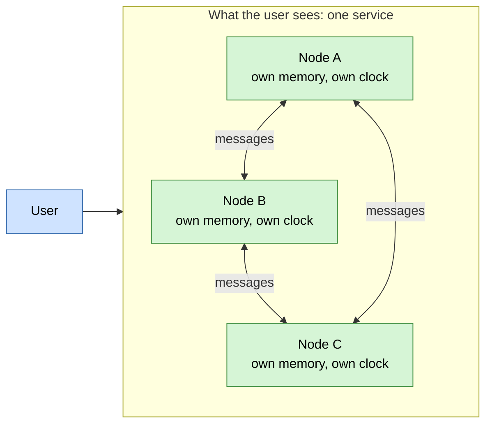
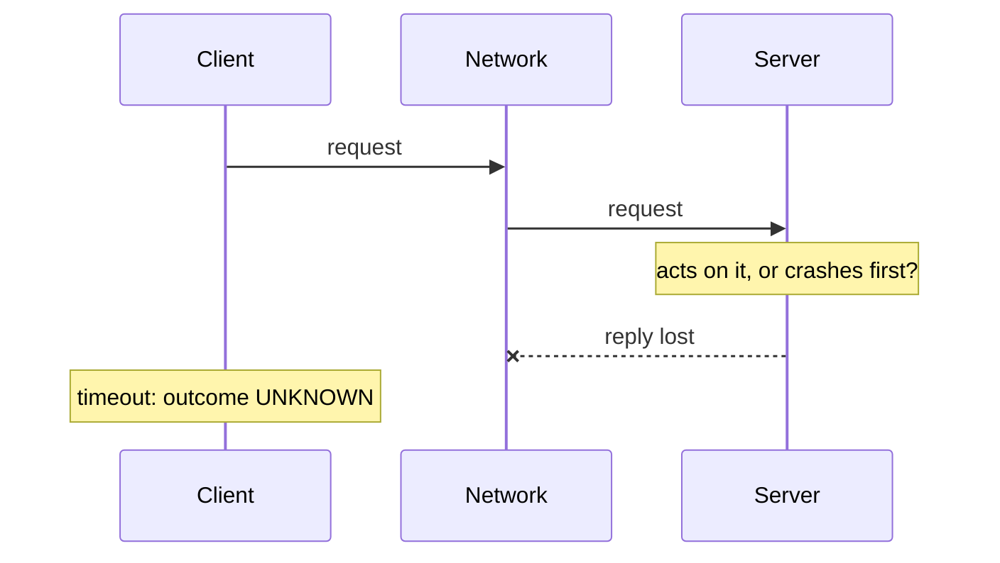

# What is a distributed system?

## 1. Abstract

A distributed system is a set of independent computers that cooperate over a network by passing messages, and that look to their users like one system. Van Steen and Tanenbaum define it as "a collection of autonomous computing elements that appears to its users as a single coherent system", and admit that no definition is universally agreed. Kleppmann puts it as several computers communicating via a network, trying to achieve some task together. Three things follow from these definitions and set a distributed system apart from a program on one computer. There is no shared memory and no global clock, so each node sees only part of the system and keeps its own time. Parts fail independently, so some of the system can be down while the rest runs. And a sender often can't tell whether a remote action happened, because a timed-out request leaves its outcome unknown. Lamport's 1987 quip gives the user's side: a computer you didn't know existed can stop yours from working. People accept these difficulties for reliability, speed near the user, and problems too big for one machine. This narrative stays at definition level; the design principles that answer these difficulties have a narrative of their own.

## 2. Terminology

| Term | Definition |
|---|---|
| **Node** | One autonomous computing element of the system: a computer, a phone, a server or a process. |
| **Message passing** | Nodes cooperating by sending each other messages over a network, rather than by sharing memory. |
| **Shared memory** | Memory that several threads or processors can all read and write, as on one computer. |
| **Global clock** | A single time reference that every node agrees on; distributed systems don't have one. |
| **Partial failure** | Some nodes or links fail while the rest keep running. |
| **Fault tolerance** | The system as a whole keeps working although some of its parts are faulty. |
| **Timeout** | Giving up on a reply after waiting a set time. |
| **Distribution transparency** | Hiding from users that processes and data are spread across machines. |
| **Middleware** | The software layer that gives a distributed system's applications common services, as an operating system does for one computer. |
| **Load balancer** | A component that spreads incoming requests across several servers doing the same job. |
| **Latency** | The delay from sending a message until it arrives. |
| **Bandwidth** | The volume of data a channel carries per unit of time. |
| **[sllmwiki_reasoning]** | The narrative's own reasoning: a conclusion, comparison or reconstruction no cited source states. |

## 3. Definition

Van Steen and Tanenbaum, after noting that the literature has no satisfactory, agreed definition, give a loose one: "A distributed system is a collection of autonomous computing elements that appears to its users as a single coherent system." [\[1\]](../sources/distributed-systems-van-steen-tanenbaum-brief-intro.md#2-what-is-a-distributed-system) Kleppmann's course notes say the same more simply: multiple computers communicating via a network, trying to achieve some task together. [\[2\]](../sources/distributed-systems-kleppmann-cambridge-notes.md#introduction) Wikipedia adds the mechanism: the components sit on different networked computers and coordinate "by passing messages to one another in order to achieve a common goal." [\[3\]](../sources/distributed-systems-wikipedia-distributed-computing.md#distributed-computing---wikipedia)

In plain words: several computers, each running on its own, work together over a network, and the people using them see one service.

[sllmwiki_reasoning] The user (blue) reaches one service; inside it, independent nodes (green), each with its own memory and clock, cooperate only by messages.

## 4. Why it matters

Lamport gave the user's view in a 1987 email at DEC's research centre: "A distributed system is one in which the failure of a computer you didn't even know existed can render your own computer unusable." [\[4\]](../sources/distributed-systems-lamport-definition-email.md) He wrote it because workstations had grown dependent on programs running elsewhere, so a server outage left users waiting an hour or two. [\[4\]](../sources/distributed-systems-lamport-definition-email.md)

The web is an everyday example: a browser sends a request message to a web server, which replies with a message holding the page. [\[5\]](../sources/distributed-systems-kleppmann-cambridge-notes.md#distributed-systems-and-computer-networking) It also shows the risk, in an outage at Amazon. The amazon.com website doesn't hold its product information itself: it asks a remote catalog service, a group of servers, and a load balancer between the website and those servers decides which one gets each request. [\[6\]](../sources/distributed-system-design-aws-challenges-distributed-systems.md#distributed-bugs-spread-epidemically) [sllmwiki_reasoning] Sending more requests to the servers that answer fastest keeps pages quick, as long as a fast answer is also a correct one. One catalog server's disk filled up, and because the error was mishandled it began answering every request at once with an empty response. The load balancer didn't notice the responses were empty, only that they were much faster than the other servers', so it sent that server a huge share of the traffic, and the whole website went down because one server couldn't supply product information. [\[6\]](../sources/distributed-system-design-aws-challenges-distributed-systems.md#distributed-bugs-spread-epidemically)

## 5. Key ideas

**Autonomous nodes, joined by messages.** A node can be any communicating device, from a datacenter server to a phone or a car. [\[2\]](../sources/distributed-systems-kleppmann-cambridge-notes.md#introduction) Nodes act independently but are programmed toward common goals, which they reach by exchanging messages. [\[7\]](../sources/distributed-systems-van-steen-tanenbaum-brief-intro.md#21-characteristic-1-collection-of-autonomous-computing-elements) Each computer has its own address space, so unlike threads on one machine they can't share memory; most practical distributed systems are message-passing. [\[2\]](../sources/distributed-systems-kleppmann-cambridge-notes.md#introduction) Each computer therefore has only a limited, incomplete view of the system. [\[8\]](../sources/distributed-systems-wikipedia-distributed-computing.md#introduction)

**No global clock.** Because nodes are independent, each keeps its own time; "we cannot assume that there is something like a global clock", which makes synchronization and coordination fundamental problems. [\[7\]](../sources/distributed-systems-van-steen-tanenbaum-brief-intro.md#21-characteristic-1-collection-of-autonomous-computing-elements)

**Partial failure.** On one computer a faulty part usually crashes the whole machine, but a distributed system often should keep working when some nodes have crashed. [\[9\]](../sources/distributed-systems-kleppmann-cambridge-notes.md#about-distributed-systems) Since the system is many networked nodes, "it is inevitable that at any time only a part of the system fails". [\[10\]](../sources/distributed-systems-van-steen-tanenbaum-brief-intro.md#22-characteristic-2-single-coherent-system) Client, server and network each fail on their own, rather than sharing fate as they do on one machine. [\[11\]](../sources/distributed-system-design-aws-challenges-distributed-systems.md#requestreply-messaging-across-a-network) Dealing with such faults is what makes distributed computing fundamentally different, and often harder. [\[9\]](../sources/distributed-systems-kleppmann-cambridge-notes.md#about-distributed-systems)

**Unknown outcomes.** Every request and reply crosses the network in several steps, each of which can fail. When a request times out, the client can't tell whether the server acted on it: the result is UNKNOWN. [\[12\]](../sources/distributed-system-design-aws-challenges-distributed-systems.md#handling-failure-modes-in-hard-real-time-distributed-systems) Nor can a system tell a dead process from one responding very slowly. [\[13\]](../sources/distributed-systems-van-steen-tanenbaum-brief-intro.md#321-types-of-distribution-transparency)

[sllmwiki_reasoning] The client sees the same silence whichever step failed.

**One coherent system.** "Coherent" means the system behaves as its users expect, whatever node they reach; ideally they can't tell where a process runs or where data is stored, which is called distribution transparency. [\[10\]](../sources/distributed-systems-van-steen-tanenbaum-brief-intro.md#22-characteristic-2-single-coherent-system) Middleware often provides it, playing the role an operating system plays for one computer. [\[14\]](../sources/distributed-systems-van-steen-tanenbaum-brief-intro.md#23-middleware-and-distributed-systems)

**Why distribute.** Some applications are inherently distributed, such as sending a message between two phones; others distribute for reliability, for performance by serving users from a nearby node, or because the problem is too big for one machine. [\[9\]](../sources/distributed-systems-kleppmann-cambridge-notes.md#about-distributed-systems)

## 6. Boundaries

**Not computer networking.** Networking gets a message to its destination, which a distributed system sees only as a channel with some latency and bandwidth; distributed systems study how nodes coordinate, deciding what messages to send and how to handle them. [\[5\]](../sources/distributed-systems-kleppmann-cambridge-notes.md#distributed-systems-and-computer-networking)

**Not parallel computing.** In parallel computing, processors may share memory; in distributed computing each has private memory and they exchange messages. The line between them is fuzzy. [\[15\]](../sources/distributed-systems-wikipedia-distributed-computing.md#parallel-and-distributed-computing)

[sllmwiki_reasoning] Nor is every set of networked machines one: machines each doing their own job lack the shared task and single face to users that the definitions require.

**Not one kind of system.** Van Steen and Tanenbaum group them into high-performance computing (clusters, grids, clouds), distributed information systems, and pervasive systems (mobile and sensor networks). [\[16\]](../sources/distributed-systems-van-steen-tanenbaum-brief-intro.md#4-types-of-distributed-systems)

## 7. Where to go next

- [What are the common design tenets and principles for distributed systems?](what-are-the-common-design-tenets-and-principles-for-distributed-systems.md)
- How do distributed systems reach consensus, and why is it hard? (not yet in the wiki)
- How do nodes order events without a global clock? (not yet in the wiki)

## 8. References

### 8.1 Sources read

- [distributed-systems-van-steen-tanenbaum-brief-intro](../sources/distributed-systems-van-steen-tanenbaum-brief-intro.md): the definition, its characteristics, middleware, transparency limits and the types of distributed systems.
- [distributed-systems-kleppmann-cambridge-notes](../sources/distributed-systems-kleppmann-cambridge-notes.md): a plain definition, nodes and message passing, partial failure, reasons to distribute, and the line against networking.
- [distributed-systems-lamport-definition-email](../sources/distributed-systems-lamport-definition-email.md): Lamport's 1987 definition and its context.
- [distributed-systems-wikipedia-distributed-computing](../sources/distributed-systems-wikipedia-distributed-computing.md): the message-passing definition, the incomplete view, and parallel versus distributed.
- [distributed-system-design-aws-challenges-distributed-systems](../sources/distributed-system-design-aws-challenges-distributed-systems.md): independent failure, the unknown outcome of a request, and the amazon.com example.

### 8.2 Citations

1. [distributed-systems-van-steen-tanenbaum-brief-intro: 2 What is a distributed system?](../sources/distributed-systems-van-steen-tanenbaum-brief-intro.md#2-what-is-a-distributed-system)
2. [distributed-systems-kleppmann-cambridge-notes: Introduction](../sources/distributed-systems-kleppmann-cambridge-notes.md#introduction)
3. [distributed-systems-wikipedia-distributed-computing: lead](../sources/distributed-systems-wikipedia-distributed-computing.md#distributed-computing---wikipedia)
4. [distributed-systems-lamport-definition-email](../sources/distributed-systems-lamport-definition-email.md)
5. [distributed-systems-kleppmann-cambridge-notes: Distributed systems and computer networking](../sources/distributed-systems-kleppmann-cambridge-notes.md#distributed-systems-and-computer-networking)
6. [distributed-system-design-aws-challenges-distributed-systems: Distributed bugs spread epidemically](../sources/distributed-system-design-aws-challenges-distributed-systems.md#distributed-bugs-spread-epidemically)
7. [distributed-systems-van-steen-tanenbaum-brief-intro: 2.1 Characteristic 1](../sources/distributed-systems-van-steen-tanenbaum-brief-intro.md#21-characteristic-1-collection-of-autonomous-computing-elements)
8. [distributed-systems-wikipedia-distributed-computing: Introduction](../sources/distributed-systems-wikipedia-distributed-computing.md#introduction)
9. [distributed-systems-kleppmann-cambridge-notes: About distributed systems](../sources/distributed-systems-kleppmann-cambridge-notes.md#about-distributed-systems)
10. [distributed-systems-van-steen-tanenbaum-brief-intro: 2.2 Characteristic 2](../sources/distributed-systems-van-steen-tanenbaum-brief-intro.md#22-characteristic-2-single-coherent-system)
11. [distributed-system-design-aws-challenges-distributed-systems: Request/reply messaging across a network](../sources/distributed-system-design-aws-challenges-distributed-systems.md#requestreply-messaging-across-a-network)
12. [distributed-system-design-aws-challenges-distributed-systems: Handling failure modes](../sources/distributed-system-design-aws-challenges-distributed-systems.md#handling-failure-modes-in-hard-real-time-distributed-systems)
13. [distributed-systems-van-steen-tanenbaum-brief-intro: 3.2.1 Types of distribution transparency](../sources/distributed-systems-van-steen-tanenbaum-brief-intro.md#321-types-of-distribution-transparency)
14. [distributed-systems-van-steen-tanenbaum-brief-intro: 2.3 Middleware](../sources/distributed-systems-van-steen-tanenbaum-brief-intro.md#23-middleware-and-distributed-systems)
15. [distributed-systems-wikipedia-distributed-computing: Parallel and distributed computing](../sources/distributed-systems-wikipedia-distributed-computing.md#parallel-and-distributed-computing)
16. [distributed-systems-van-steen-tanenbaum-brief-intro: 4 Types of distributed systems](../sources/distributed-systems-van-steen-tanenbaum-brief-intro.md#4-types-of-distributed-systems)

## 9. Metadata

- **Version:** 1.3
- **Template:** concept_brief_overview
- **Model:** claude-opus-5-5
- **Created:** 2026-10-20
- **Last modified:** 2026-10-21
- **History:**
  - 1.3 (2026-10-21): Examples rule: set the scene of the amazon.com outage (the catalog service and the load balancer) before telling it; added a Load balancer Terminology row.
  - 1.2 (2026-10-21): Lint: the amazon.com outage is Amazon's, not AWS's; Lamport's 'an hour or two' wait; parallel computing processors 'may' share memory.
  - 1.1 (2026-10-21): Reworked under the current template and writing guide: added Kleppmann's course notes (plain definition, message passing, partial failure, why distribute, distributed systems versus networking), a flowchart of the definition and a sequence diagram of the unknown outcome, and new Terminology rows.
  - 1.0 (2026-10-20): First version.
- **Reading plan:**
  1. `distributed-systems-wikipedia-distributed-computing`, in full: medium relevance, authority C, undated
  2. `distributed-system-design-aws-challenges-distributed-systems`, in full: medium relevance, authority C, undated
  3. `distributed-systems-van-steen-tanenbaum-brief-intro`, in full: high relevance, authority B, 2016-09-01
  4. `distributed-systems-kleppmann-cambridge-notes`, in full: high relevance, authority B, 2021-10-01
  5. `distributed-systems-lamport-definition-email`, in full: high relevance, authority A, 1987-05-28
  6. `distributed-system-design-waldo-note-on-distributed-computing`, not read: a link, no saved copy
