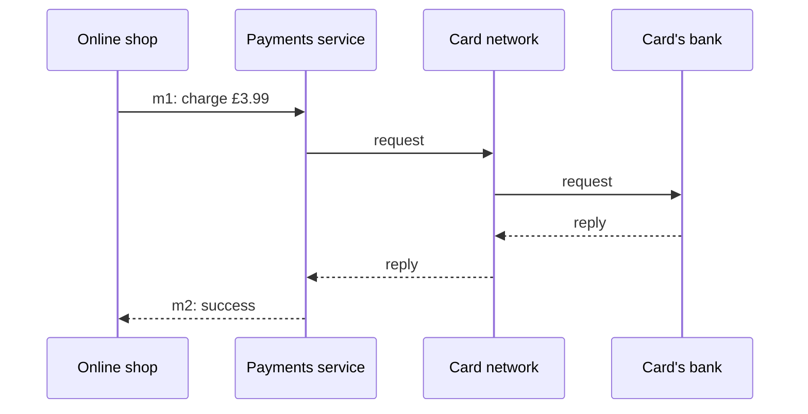
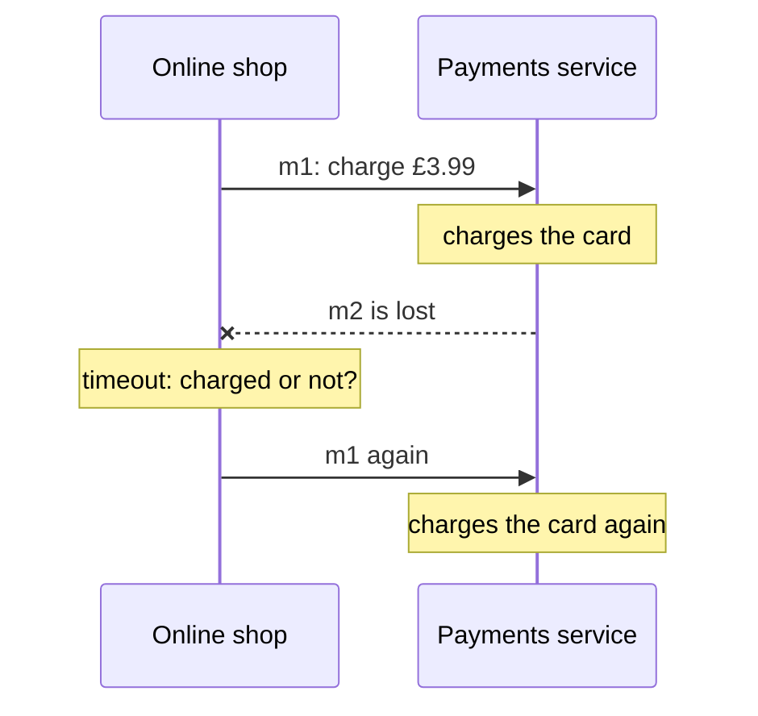

# What is a distributed system?

## 1. Abstract

Anyone who builds software that runs on more than one machine needs to know what makes it a distributed system, because that decides which problems they will meet. A distributed system is a set of independent nodes, each with its own memory, that work on one task by sending each other messages over a network. Its parts fail independently, and a node that gets no reply cannot tell what happened at the other end.

**Key takeaways:**

- Nodes with private memory work on one task, coordinating only by messages.
- There is no single agreed definition; the wiki works with van Steen and Tanenbaum's.
- Partial failure is the defining difficulty: one part breaks, the rest run on.
- A request that gets no reply has an unknown outcome.
- The nodes share no clock, and none sees the whole system.

## 2. Terminology

| Term | Definition |
|---|---|
| **Node** | One computing element of a distributed system: a hardware device or a software process [\[1\]](../sources/distributed-systems-van-steen-tanenbaum-brief-intro.md#2-what-is-a-distributed-system). |
| **Message passing** | Communication by sending messages over a network, with no shared memory [\[2\]](../sources/distributed-systems-kleppmann-cambridge-notes.md#introduction). |
| **Fault** | One part of the system, such as a node or a network link, not working [\[3\]](../sources/distributed-systems-kleppmann-cambridge-notes.md#fault-tolerance-and-high-availability). |
| **Failure** | The system as a whole not working [\[3\]](../sources/distributed-systems-kleppmann-cambridge-notes.md#fault-tolerance-and-high-availability). |
| **Partial failure** | Some parts of the system have a fault while the rest keep running [\[4\]](../sources/distributed-systems-kleppmann-cambridge-notes.md#about-distributed-systems). |
| **RDMA** | Remote direct memory access: computers access each other's memory over a network [\[2\]](../sources/distributed-systems-kleppmann-cambridge-notes.md#introduction). |
| **TCP** | The network protocol that splits a large message into small packets and reassembles them at the recipient [\[5\]](../sources/distributed-systems-kleppmann-cambridge-notes.md#distributed-systems-and-computer-networking). |
| **[→]** | Our own reasoning, after a statement or on a section's heading: a conclusion, comparison or example no cited source states. |

## 3. Overview

A distributed system is what you have once one job runs on several computers that talk over a network [\[2\]](../sources/distributed-systems-kleppmann-cambridge-notes.md#introduction). The web is one you use every day [\[5\]](../sources/distributed-systems-kleppmann-cambridge-notes.md#distributed-systems-and-computer-networking). It matters because its parts break on their own, and the software must cope [\[4\]](../sources/distributed-systems-kleppmann-cambridge-notes.md#about-distributed-systems). People build them anyway: some jobs are distributed by nature, and several nodes can be more reliable, nearer their users and able to hold more data than one machine [\[4\]](../sources/distributed-systems-kleppmann-cambridge-notes.md#about-distributed-systems).

The running example: a customer pays £3.99 by card in an online shop. The shop's server sends a payment request to a payments service run by another company, which goes through a card network, such as Visa, to the card's bank [\[6\]](../sources/distributed-systems-kleppmann-cambridge-notes.md#example-remote-procedure-calls-rpc). In the shop's code, the payment looks like a local function call [\[6\]](../sources/distributed-systems-kleppmann-cambridge-notes.md#example-remote-procedure-calls-rpc). Behind it, the shop sends a request message, m1, and waits for the response, m2: "success" [\[6\]](../sources/distributed-systems-kleppmann-cambridge-notes.md#example-remote-procedure-calls-rpc). Figure 3-1 shows the four machines and their messages.

*Figure 3-1: One payment crosses four machines; each arrow is a message, the only way they share anything [\[6\]](../sources/distributed-systems-kleppmann-cambridge-notes.md#example-remote-procedure-calls-rpc), [\[2\]](../sources/distributed-systems-kleppmann-cambridge-notes.md#introduction).*

Ideally, a remote call looks the same as a local one [\[6\]](../sources/distributed-systems-kleppmann-cambridge-notes.md#example-remote-procedure-calls-rpc). In practice it does not: the payments service may crash during the call, and m1 or m2 may be lost or delayed [\[6\]](../sources/distributed-systems-kleppmann-cambridge-notes.md#example-remote-procedure-calls-rpc).

## 4. Definition

### 4.1 In short

A distributed system is several computers, called nodes, that communicate over a network and try to achieve a task together [\[2\]](../sources/distributed-systems-kleppmann-cambridge-notes.md#introduction). Each node has its own memory, so the nodes coordinate only by passing messages [\[7\]](../sources/distributed-systems-wikipedia-distributed-computing.md#introduction). In the payment, the four machines are the nodes, m1 and m2 are messages, and taking the payment is the task [→].

### 4.2 Precisely

The field has no single agreed definition [\[7\]](../sources/distributed-systems-wikipedia-distributed-computing.md#introduction). Van Steen and Tanenbaum, finding the literature's definitions unsatisfactory and in disagreement, give a loose characterization [\[1\]](../sources/distributed-systems-van-steen-tanenbaum-brief-intro.md#2-what-is-a-distributed-system):

> "A distributed system is a collection of autonomous computing elements that appears to its users as a single coherent system." [\[1\]](../sources/distributed-systems-van-steen-tanenbaum-brief-intro.md#2-what-is-a-distributed-system)

This wiki works with it, through its two characteristics [→].

- **Autonomous computing elements.** Each node can act on its own, but the nodes are programmed toward common goals, which they reach by exchanging messages [\[8\]](../sources/distributed-systems-van-steen-tanenbaum-brief-intro.md#21-characteristic-1-collection-of-autonomous-computing-elements). The definition assumes nothing about the kind of nodes or how they are connected [\[1\]](../sources/distributed-systems-van-steen-tanenbaum-brief-intro.md#2-what-is-a-distributed-system).
- **A single coherent system.** Users, people or applications, believe they deal with one system, so the nodes must collaborate [\[1\]](../sources/distributed-systems-van-steen-tanenbaum-brief-intro.md#2-what-is-a-distributed-system). The authors ask only that it *appear* coherent, behaving as users expect wherever, whenever and however they use it; a full single-system view is often too much to ask [\[9\]](../sources/distributed-systems-van-steen-tanenbaum-brief-intro.md#22-characteristic-2-single-coherent-system). The customer sees one checkout page, not four organizations [→].

Three nuances go beyond the short version.

1. **A node need not be a computer.** The short version says computers [\[2\]](../sources/distributed-systems-kleppmann-cambridge-notes.md#introduction), but van Steen and Tanenbaum's node can be a software process [\[1\]](../sources/distributed-systems-van-steen-tanenbaum-brief-intro.md#2-what-is-a-distributed-system). The word "distributed" now also covers autonomous processes on one physical computer that interact by message passing [\[7\]](../sources/distributed-systems-wikipedia-distributed-computing.md#introduction). So what decides membership is private memory and messages, not separate machines [→].
2. **Coherence is a goal, not a test.** In another kind of distributed system, each computer has its own user, and the system coordinates shared resources or communication between them [\[7\]](../sources/distributed-systems-wikipedia-distributed-computing.md#introduction). Two phones exchanging a message form one, though neither user sees a single system [→].
3. **Message passing is the rule, not a law.** Some supercomputers offer limited distributed shared memory, and RDMA lets computers reach each other's memory, yet most practical distributed systems use message passing [\[2\]](../sources/distributed-systems-kleppmann-cambridge-notes.md#introduction).

## 5. Key ideas

**Parts fail independently.** On one computer, a faulty part usually crashes the whole machine, so software need not handle it [\[4\]](../sources/distributed-systems-kleppmann-cambridge-notes.md#about-distributed-systems). In a distributed system, a node can crash or slow down, and the network can fail, at any moment [\[4\]](../sources/distributed-systems-kleppmann-cambridge-notes.md#about-distributed-systems). A fault in one part while the rest keep running is a partial failure, which is hard to hide from users [\[4\]](../sources/distributed-systems-kleppmann-cambridge-notes.md#about-distributed-systems), [\[9\]](../sources/distributed-systems-van-steen-tanenbaum-brief-intro.md#22-characteristic-2-single-coherent-system). Leslie Lamport put it this way: a computer you never knew existed can fail and make yours unusable [\[9\]](../sources/distributed-systems-van-steen-tanenbaum-brief-intro.md#22-characteristic-2-single-coherent-system). In the payment, the bank can be down while the shop's server runs on [→]. Systems therefore aim for fault tolerance: the whole keeps working despite faults, up to a maximum number, such as fewer than half of the nodes crashed [\[3\]](../sources/distributed-systems-kleppmann-cambridge-notes.md#fault-tolerance-and-high-availability).

**A missing reply has an unknown outcome.** Messages may be lost and nodes may crash without the others knowing [\[4\]](../sources/distributed-systems-kleppmann-cambridge-notes.md#about-distributed-systems). If the shop sends m1 and no m2 arrives, the shop cannot tell whether the payments service received and processed the request [\[6\]](../sources/distributed-systems-kleppmann-cambridge-notes.md#example-remote-procedure-calls-rpc). Resending m1 may charge the card twice, as Figure 5-1 shows [\[6\]](../sources/distributed-systems-kleppmann-cambridge-notes.md#example-remote-procedure-calls-rpc). The shop cannot wait forever, so it gives up after a timeout [\[6\]](../sources/distributed-systems-kleppmann-cambridge-notes.md#example-remote-procedure-calls-rpc).

*Figure 5-1: When m2 is lost, the shop cannot know whether the payment happened, and resending m1 can charge the card twice [\[6\]](../sources/distributed-systems-kleppmann-cambridge-notes.md#example-remote-procedure-calls-rpc).*

**No node sees the whole system.** Each node has its own notion of time: there is no global clock, which makes synchronization and coordination hard [\[8\]](../sources/distributed-systems-van-steen-tanenbaum-brief-intro.md#21-characteristic-1-collection-of-autonomous-computing-elements). Each computer also sees only part of the system [\[7\]](../sources/distributed-systems-wikipedia-distributed-computing.md#introduction). Its topology, latency and number of computers are not known in advance and may change while it runs [\[7\]](../sources/distributed-systems-wikipedia-distributed-computing.md#introduction). The shop knows the bank only through the replies that reach it [→].

## 6. Boundaries

Three cases test the edge of the definition.

| Case | In or out | Why |
|---|---|---|
| The payments service runs as processes on one machine that exchange messages | In | In the wider sense, autonomous processes on one computer that pass messages form a distributed system [\[7\]](../sources/distributed-systems-wikipedia-distributed-computing.md#introduction). |
| The payments service runs as threads in one process | Out | Threads in one process share an address space, so they pass data through memory, not messages [\[2\]](../sources/distributed-systems-kleppmann-cambridge-notes.md#introduction). |
| A multiprocessor whose processors share memory | Out, roughly | Parallel and distributed computing overlap with no clear line; roughly, parallel processors may share memory, distributed ones have private memory and exchange messages [\[10\]](../sources/distributed-systems-wikipedia-distributed-computing.md#parallel-and-distributed-computing). |

**Computer networking is the layer below.** Networking gets messages to their destination; distributed systems build on it and decide what messages to send and how to process them [\[5\]](../sources/distributed-systems-kleppmann-cambridge-notes.md#distributed-systems-and-computer-networking). To the payment, m1 is one message, however many TCP packets carry it [\[5\]](../sources/distributed-systems-kleppmann-cambridge-notes.md#distributed-systems-and-computer-networking).

**The common mistake is to trust the network.** Peter Deutsch listed the false assumptions newcomers make: a reliable, secure, homogeneous network with fixed topology, zero latency and transport cost, infinite bandwidth and one administrator [\[11\]](../sources/distributed-systems-van-steen-tanenbaum-brief-intro.md#35-pitfalls). Ignoring them at design time gives flaws patched later [\[11\]](../sources/distributed-systems-van-steen-tanenbaum-brief-intro.md#35-pitfalls). [Distrust the network](what-are-the-common-design-tenets-and-principles-for-distributed-systems.md#512-distrust-the-network) answers them.

## 7. Where to go next

- [Can a timeout tell a slow node from a dead one?](what-are-the-classic-failure-modes-of-large-scale-distributed-systems-and-their-mitigations.md#512-a-slow-node-looks-like-a-dead-one)
- [How can a resent payment avoid charging twice?](what-are-the-common-design-tenets-and-principles-for-distributed-systems.md#522-make-operations-idempotent)
- [How do nodes order events without a global clock?](what-are-the-common-design-tenets-and-principles-for-distributed-systems.md#542-order-events-without-a-global-clock)
- [How do nodes agree on one history despite faults?](how-does-raft-elect-a-leader-and-keep-every-servers-log-consistent.md)
- [What does a system give up when a partition splits it?](what-are-the-common-design-tenets-and-principles-for-distributed-systems.md#541-choose-consistency-deliberately)

## 8. References

### 8.1 Sources read

- [distributed-systems-kleppmann-cambridge-notes](../sources/distributed-systems-kleppmann-cambridge-notes.md): the short definition, the payment example and its unknown outcome, why to distribute, partial failure, fault and failure, fault tolerance, and the line between distributed systems and networking.
- [distributed-systems-van-steen-tanenbaum-brief-intro](../sources/distributed-systems-van-steen-tanenbaum-brief-intro.md): the definition the wiki works with, its two characteristics, no global clock, Lamport's description, and Deutsch's false assumptions.
- [distributed-systems-wikipedia-distributed-computing](../sources/distributed-systems-wikipedia-distributed-computing.md): the commonly cited properties, the wider sense of "distributed", and the rough line between parallel and distributed computing.

### 8.2 Citations

1. [distributed-systems-van-steen-tanenbaum-brief-intro: 2 What is a distributed system?](../sources/distributed-systems-van-steen-tanenbaum-brief-intro.md#2-what-is-a-distributed-system)
2. [distributed-systems-kleppmann-cambridge-notes: Introduction](../sources/distributed-systems-kleppmann-cambridge-notes.md#introduction)
3. [distributed-systems-kleppmann-cambridge-notes: Fault tolerance and high availability](../sources/distributed-systems-kleppmann-cambridge-notes.md#fault-tolerance-and-high-availability)
4. [distributed-systems-kleppmann-cambridge-notes: About distributed systems](../sources/distributed-systems-kleppmann-cambridge-notes.md#about-distributed-systems)
5. [distributed-systems-kleppmann-cambridge-notes: Distributed systems and computer networking](../sources/distributed-systems-kleppmann-cambridge-notes.md#distributed-systems-and-computer-networking)
6. [distributed-systems-kleppmann-cambridge-notes: Example: Remote Procedure Calls (RPC)](../sources/distributed-systems-kleppmann-cambridge-notes.md#example-remote-procedure-calls-rpc)
7. [distributed-systems-wikipedia-distributed-computing: Introduction](../sources/distributed-systems-wikipedia-distributed-computing.md#introduction)
8. [distributed-systems-van-steen-tanenbaum-brief-intro: 2.1 Characteristic 1: collection of autonomous computing elements](../sources/distributed-systems-van-steen-tanenbaum-brief-intro.md#21-characteristic-1-collection-of-autonomous-computing-elements)
9. [distributed-systems-van-steen-tanenbaum-brief-intro: 2.2 Characteristic 2: single coherent system](../sources/distributed-systems-van-steen-tanenbaum-brief-intro.md#22-characteristic-2-single-coherent-system)
10. [distributed-systems-wikipedia-distributed-computing: Parallel and distributed computing](../sources/distributed-systems-wikipedia-distributed-computing.md#parallel-and-distributed-computing)
11. [distributed-systems-van-steen-tanenbaum-brief-intro: 3.5 Pitfalls](../sources/distributed-systems-van-steen-tanenbaum-brief-intro.md#35-pitfalls)

## 9. Metadata

- **Version:** 2.0
- **Template:** concept_brief_overview
- **Language:** en
- **Model:** claude-opus-5-5
- **Created:** 2026-10-23
- **Last modified:** 2026-11-24
- **Words:** 1,393 (about 6 min)
- **History:**
  - 2.0 (2026-11-24): Regenerated under sllmwiki 1.4.0's guides: a new spine on one card payment, set up once; fault and failure named as the failure-modes survey names them; a lost reply's unknown outcome drawn as a sequence; boundaries with parallel computing and networking in one table
  - 1.1 (2026-10-25): Openly licensed sources only, for a public demo: the AWS article's claims re-cited to Kleppmann's notes (a remote call and its unknown outcome) and Lamport's definition to his quotation there; the batch-cluster boundary removed
  - 1.0 (2026-10-23): First version.
- **Reading plan:**
  1. `what-are-the-common-design-tenets-and-principles-for-distributed-systems`, in full: existing narrative, background
  2. `how-does-raft-elect-a-leader-and-keep-every-servers-log-consistent`, in full: existing narrative, background
  3. `distributed-systems-wikipedia-distributed-computing`, in full: medium relevance, authority B, undated
  4. `distributed-systems-van-steen-tanenbaum-brief-intro`, in full: high relevance, authority A, 2016-09-01
  5. `distributed-systems-kleppmann-cambridge-notes`, in full: high relevance, authority A, 2021-10-01
  6. `distributed-system-design-wikipedia-fallacies`, abstract only: low relevance
  7. `distributed-system-design-aws-well-architected-reliability-principles`, abstract only: low relevance
  8. `distributed-system-design-azure-design-principles`, abstract only: low relevance
  9. `distributed-system-design-azure-retry-pattern`, abstract only: low relevance
  10. `distributed-system-design-azure-circuit-breaker-pattern`, abstract only: low relevance
  11. `distributed-system-design-azure-bulkhead-pattern`, abstract only: low relevance
  12. `distributed-system-design-azure-throttling-pattern`, abstract only: low relevance
  13. `distributed-system-design-azure-transient-fault-handling`, abstract only: low relevance
  14. `distributed-system-design-wikipedia-cap-theorem`, abstract only: low relevance
  15. `distributed-system-design-wikipedia-end-to-end-principle`, abstract only: low relevance
  16. `distributed-system-design-wikipedia-cascading-failure`, abstract only: low relevance
  17. `distributed-system-design-waldo-note-on-distributed-computing`, not read: a link, no saved copy
  18. `distributed-systems-lamport-definition-email`, not read: a link, no saved copy
  19. `distributed-system-design-aws-challenges-distributed-systems`, not read: a link, no saved copy
  20. `ewma-linkerd-beyond-round-robin`, not read: a link, no saved copy
  21. `distributed-system-design-hamilton-internet-scale-services`, not read: a link, no saved copy
  22. `distributed-system-design-aws-timeouts-retries-backoff`, not read: a link, no saved copy
  23. `distributed-system-design-google-sre-cascading-failures`, not read: a link, no saved copy
  24. `distributed-system-design-brewer-cap-twelve-years-later`, not read: a link, no saved copy
  25. `distributed-system-design-ongaro-raft-consensus`, not read: a link, no saved copy
  26. `distributed-system-design-lamport-time-clocks`, not read: a link, no saved copy
  27. `distributed-system-design-saltzer-end-to-end-arguments`, not read: a link, no saved copy
