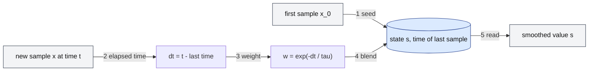

# What is an EWMA (exponentially weighted moving average), and how does it work?

## 1. Abstract

Anyone turning a noisy stream of measurements, such as request latencies, into one steady number needs a cheap average that follows changes. An EWMA is that average: each new sample pulls the estimate part of the way toward itself, so past samples keep weights that shrink exponentially with age. It stores one number, and one parameter, a smoothing factor or a time constant, trades smoothness against speed.

**Key takeaways:**

- The whole algorithm is one line: $s_t = \alpha x_t + (1-\alpha) s_{t-1}$.
- A sample $j$ steps old carries weight $\alpha (1-\alpha)^j$: older data fades but never drops out.
- Small α: smooth but slow; large α: fast but noisy. Memory is about $1/\alpha$ samples.
- With a time constant τ, the weight comes from the time between samples, so irregular samples work.
- Peak EWMA, used in load balancing, jumps to spikes and decays slowly.

## 2. Terminology

| Term | Definition |
|---|---|
| **EWMA** | Exponentially weighted moving average, also called the exponential moving average (EMA) or simple exponential smoothing. |
| **$x_t$, $s_t$** | The sample at step $t$; the EWMA's state, the smoothed value, after it. |
| **α (smoothing factor)** | The weight, $0 < \alpha \le 1$, of each new sample. |
| **τ (time constant, decay time)** | The time a step input takes to reach 63.2% of its new level; Finagle calls it `decayTime`. |
| **RTT** | Round-trip time: how long a request takes to get its response. |
| **P2C** | Power of two choices: pick two endpoints at random and send to the less loaded. |
| **SMA** | Simple moving average: the unweighted mean of the last $k$ samples. |
| **[→]** | Our own reasoning, after a statement or on a section's heading: a conclusion, comparison or example no cited source states. |

## 3. Background

An EWMA is an average that weights each observation by a factor that decreases exponentially with its age; in signal processing it is a first-order infinite impulse response filter [\[1\]](../sources/moving-averages-wikipedia-moving-average.md#exponential-moving-average). You meet it in forecasting, as simple exponential smoothing, [\[2\]](../sources/ewma-wikipedia-exponential-smoothing.md#basic-simple-exponential-smoothing) in quality control, as the EWMA chart, [\[3\]](../sources/ewma-wikipedia-ewma-chart.md#ewma-chart---wikipedia) in electronics, as the discrete form of an RC low-pass filter, [\[4\]](../sources/ewma-wikipedia-low-pass-filter.md#simple-infinite-impulse-response-filter) and in systems code: Unix load averages are EWMAs of the number of runnable processes [\[5\]](../sources/ewma-wikipedia-load-computing.md#load-average).

**The running example** is a client of a replicated service, which must choose for each request one of several interchangeable servers. In Twitter's Finagle library, the client's load balancer does this in two parts: each server keeps a *load metric*, and a *distributor* uses it to choose [\[6\]](../sources/ewma-finagle-clients-docs.md#load-balancing). The default distributor, P2C, picks two servers at random and sends to the less loaded [\[7\]](../sources/ewma-finagle-clients-docs.md#power-of-two-choices-p2c--least-loaded). To prefer fast servers, the load metric should track each server's latency. Using the last RTT alone makes it jump with every outlier; averaging every RTT equally never forgets that a server was slow an hour ago [→].

A simple moving average over the last $k$ samples is [the usual alternative](when-should-software-use-an-ewma-instead-of-other-moving-averages.md): it keeps $k$ samples and weights them equally [\[8\]](../sources/moving-averages-wikipedia-moving-average.md#simple-moving-average). The EWMA keeps only its last value [\[9\]](../sources/ewma-wikipedia-exponential-smoothing.md#comparison-with-moving-average).

## 4. The core idea

Treat the current average as the best guess, and let each new sample pull it part of the way toward itself: the new state is a weighted average of the sample and the old state, with weight α on the sample [\[2\]](../sources/ewma-wikipedia-exponential-smoothing.md#basic-simple-exponential-smoothing).

$$
s_t = \alpha x_t + (1-\alpha) s_{t-1}
$$

When samples arrive at irregular times, as requests do, α comes from the time since the last sample: Finagle's `Ema` computes $w = e^{-\Delta t/\tau}$, the weight kept by the old state, and sets the new state to $x(1-w) + s\,w$ [\[10\]](../sources/ewma-finagle-ema-source.md#L29-L43). That $1-w$ is exactly the α that the time-constant formula gives for an interval $\Delta t$ [\[11\]](../sources/ewma-wikipedia-exponential-smoothing.md#time-constant).

*Figure 4-1: One time-decayed EWMA update. Only the state and the time of its last sample (blue) are stored; each sample is blended in with a weight set by the time since the previous one.*

## 5. How does it work?

Each step is one arrow of Figure 4-1, worked on one server's latency with τ = 10 s, Finagle's default `decayTime`, [\[12\]](../sources/ewma-finagle-clients-docs.md#power-of-two-choices-p2c--peak-ewma-2) and an RTT sample each second: 100, 104, 96, 300, 100, 100 ms [→].

1. **Seed.** The first sample becomes the state [\[13\]](../sources/ewma-finagle-ema-source.md#L29-L33). Here $s_0 = 100$.
2. **Elapsed time.** For each new sample, take the time since the last one, from a monotonic clock [\[10\]](../sources/ewma-finagle-ema-source.md#L29-L43). Here it is 1 s each time [→].
3. **Weight.** Compute $w = e^{-\Delta t/\tau}$ [\[10\]](../sources/ewma-finagle-ema-source.md#L29-L43): $e^{-0.1} = 0.905$, so each sample gets weight $1 - w = 0.095$ [→].
4. **Blend.** The new state is $x(1-w) + s\,w$ [\[10\]](../sources/ewma-finagle-ema-source.md#L29-L43).
5. **Read.** The state is the smoothed value, ready after every sample [\[14\]](../sources/ewma-finagle-ema-source.md#L45-L50): unlike an SMA, the EWMA needs no minimum number of samples first [\[2\]](../sources/ewma-wikipedia-exponential-smoothing.md#basic-simple-exponential-smoothing).

| Time (s) | Sample $x$ (ms) | State $s$ (ms) |
|---|---|---|
| 0 | 100 | 100.00 (seed) |
| 1 | 104 | 100.38 |
| 2 | 96 | 99.96 |
| 3 | 300 | 119.00 |
| 4 | 100 | 117.19 |
| 5 | 100 | 115.56 |

The table follows from the update [\[10\]](../sources/ewma-finagle-ema-source.md#L29-L43). A 4 ms wobble moves the state by 0.4 ms, and one 300 ms outlier lifts it by 19 ms, not to 300; after the spike, each 100 ms sample removes about a tenth of the excess [→].

**Why it is "exponential".** Substituting the update into itself shows that a sample $j$ steps old carries weight $\alpha(1-\alpha)^j$, a geometric series, the discrete form of an exponential, which gives the method its name [\[15\]](../sources/ewma-wikipedia-exponential-smoothing.md#exponential-naming). No weight ever reaches zero [\[1\]](../sources/moving-averages-wikipedia-moving-average.md#exponential-moving-average). The same recurrence is what an RC low-pass filter becomes when sampled at intervals $\Delta_T$, with $\alpha = \Delta_T/(RC + \Delta_T)$ [\[4\]](../sources/ewma-wikipedia-low-pass-filter.md#simple-infinite-impulse-response-filter).

**How long it remembers.** The time constant τ, the time for a step input to reach 63.2% of its new level, relates to α and the sampling interval by $\alpha = 1 - e^{-\Delta T/\tau}$, about $\Delta T/\tau$ when samples are frequent [\[11\]](../sources/ewma-wikipedia-exponential-smoothing.md#time-constant). Finagle calls τ the mean lifetime, with a half-life of $\tau \ln 2$ [\[16\]](../sources/ewma-finagle-peak-ewma-source.md#L38-L45): about 7 s for the default 10 s [→]. When samples arrive evenly, as the load average's do every 5 seconds, α is a constant chosen once [\[17\]](../sources/ewma-wikipedia-load-computing.md#linux-as-an-example), [\[11\]](../sources/ewma-wikipedia-exponential-smoothing.md#time-constant).

**How it runs in integers.** The Linux kernel updates its load averages every 5 seconds in fixed point with 11 fractional bits, keeping $e^{-5\text{s}/1\text{min}}$ as the constant 1884, and the 5- and 15-minute averages as 2014 and 2037 [\[17\]](../sources/ewma-wikipedia-load-computing.md#linux-as-an-example). That is a weight of about 0.08 per update on each new value for the 1-minute average [→].

## 6. Variants

**Peak EWMA.** Finagle's load metric for P2C is an EWMA of RTT that is "hyper-sensitive to latent endpoints": it reacts quickly to latency spikes and recovers only cautiously [\[18\]](../sources/ewma-finagle-peak-ewma-source.md#L11-L18). Any sample above the current average resets the average to that sample, and the load reported to the distributor is the average times one more than the requests still outstanding [\[19\]](../sources/ewma-finagle-peak-ewma-source.md#L54-L67), [\[20\]](../sources/ewma-finagle-peak-ewma-source.md#L69-L79). On the example, the 104 ms sample resets the state to 104 at once, the 300 ms spike to 300, and the two 100 ms samples then bring it down only to 281 and 264 ms [→]. The docs say it reacts to slow servers faster than counting outstanding requests alone [\[12\]](../sources/ewma-finagle-clients-docs.md#power-of-two-choices-p2c--peak-ewma-2).

## 7. Design decisions and trade-offs

**The time constant or smoothing factor.** A larger τ, or smaller α, is smoother but slower to follow a real change; a smaller one follows quickly but passes noise through [→]. Finagle defaults to a 10 s `decayTime` and its docs show 100 s [\[12\]](../sources/ewma-finagle-clients-docs.md#power-of-two-choices-p2c--peak-ewma-2). Control charts use λ between 0.05 and 0.25 [\[3\]](../sources/ewma-wikipedia-ewma-chart.md#ewma-chart---wikipedia). With history, estimate α by minimizing the sum of squared one-step forecast errors [\[21\]](../sources/ewma-wikipedia-exponential-smoothing.md#optimization).

**Time-based or per-sample weights.** Finagle derives each weight from the time since the last sample, because observations of a server arrive unevenly [\[22\]](../sources/ewma-finagle-peak-ewma-source.md#L47-L53). A fixed α counts memory in samples, so a server that answers more often would forget faster [→].

**The starting value.** Seeding with the first sample is common; the smaller α, the longer the choice matters [\[23\]](../sources/ewma-wikipedia-exponential-smoothing.md#choosing-the-initial-smoothed-value). Finagle seeds with the first sample, and treats a server it has no latency history for, with requests pending, as heavily loaded [\[13\]](../sources/ewma-finagle-ema-source.md#L29-L33), [\[20\]](../sources/ewma-finagle-peak-ewma-source.md#L69-L79).

## 8. Limitations and failure modes

- **Lag.** An EWMA trails a changing input, and unlike a symmetric moving average its lag can't be removed by shifting the output a fixed number of samples [\[9\]](../sources/ewma-wikipedia-exponential-smoothing.md#comparison-with-moving-average). Two seconds after the spike, the example still reads 116 ms [→].
- **Trends.** Simple exponential smoothing does poorly on data with a trend, which Holt's double exponential smoothing adds a term for [\[24\]](../sources/ewma-wikipedia-exponential-smoothing.md#double-exponential-smoothing-holt-linear).
- **Peak EWMA's assumption.** It assumes a loaded server takes time to recover, so history is a fair guide; with long-polling clients that assumption breaks down [\[12\]](../sources/ewma-finagle-clients-docs.md#power-of-two-choices-p2c--peak-ewma-2). A footnote in Finagle's docs calls the configuration experimental, its API subject to change [\[25\]](../sources/ewma-finagle-clients-docs.md#partition-aware-client).

## 9. Where to go next

- [When should software use an EWMA instead of other moving averages?](when-should-software-use-an-ewma-instead-of-other-moving-averages.md)
- How does power-of-two-choices load balancing work? (not yet a narrative)
- What do Unix load averages measure? (not yet a narrative)

## 10. References

### 10.1 Sources read

- [ewma-finagle-ema-source](../sources/ewma-finagle-ema-source.md): the time-decayed EWMA update, seeding and reading.
- [ewma-finagle-peak-ewma-source](../sources/ewma-finagle-peak-ewma-source.md): peak EWMA, its time constant and the load it reports.
- [ewma-finagle-clients-docs](../sources/ewma-finagle-clients-docs.md): load metrics and distributors, P2C, peak EWMA's defaults and limits.
- [ewma-wikipedia-exponential-smoothing](../sources/ewma-wikipedia-exponential-smoothing.md): the definition, the time constant, initialisation, optimisation, the naming and the comparison with moving averages.
- [moving-averages-wikipedia-moving-average](../sources/moving-averages-wikipedia-moving-average.md): the EMA as an IIR filter, and the SMA.
- [ewma-wikipedia-low-pass-filter](../sources/ewma-wikipedia-low-pass-filter.md): the EWMA as a discretized RC filter.
- [ewma-wikipedia-load-computing](../sources/ewma-wikipedia-load-computing.md): load averages and Linux's fixed-point update.
- [ewma-wikipedia-ewma-chart](../sources/ewma-wikipedia-ewma-chart.md): EWMA control charts.

### 10.2 Citations

1. [moving-averages-wikipedia-moving-average: Exponential moving average](../sources/moving-averages-wikipedia-moving-average.md#exponential-moving-average)
2. [ewma-wikipedia-exponential-smoothing: Basic (simple) exponential smoothing](../sources/ewma-wikipedia-exponential-smoothing.md#basic-simple-exponential-smoothing)
3. [ewma-wikipedia-ewma-chart: EWMA chart - Wikipedia](../sources/ewma-wikipedia-ewma-chart.md#ewma-chart---wikipedia)
4. [ewma-wikipedia-low-pass-filter: Simple infinite impulse response filter](../sources/ewma-wikipedia-low-pass-filter.md#simple-infinite-impulse-response-filter)
5. [ewma-wikipedia-load-computing: Load average](../sources/ewma-wikipedia-load-computing.md#load-average)
6. [ewma-finagle-clients-docs: Load Balancing¶](../sources/ewma-finagle-clients-docs.md#load-balancing)
7. [ewma-finagle-clients-docs: Power of Two Choices (P2C) + Least Loaded¶](../sources/ewma-finagle-clients-docs.md#power-of-two-choices-p2c--least-loaded)
8. [moving-averages-wikipedia-moving-average: Simple moving average](../sources/moving-averages-wikipedia-moving-average.md#simple-moving-average)
9. [ewma-wikipedia-exponential-smoothing: Comparison with moving average](../sources/ewma-wikipedia-exponential-smoothing.md#comparison-with-moving-average)
10. [ewma-finagle-ema-source: L29-L43](../sources/ewma-finagle-ema-source.md#L29-L43)
11. [ewma-wikipedia-exponential-smoothing: Time constant](../sources/ewma-wikipedia-exponential-smoothing.md#time-constant)
12. [ewma-finagle-clients-docs: Power of Two Choices (P2C) + Peak EWMA 2¶](../sources/ewma-finagle-clients-docs.md#power-of-two-choices-p2c--peak-ewma-2)
13. [ewma-finagle-ema-source: L29-L33](../sources/ewma-finagle-ema-source.md#L29-L33)
14. [ewma-finagle-ema-source: L45-L50](../sources/ewma-finagle-ema-source.md#L45-L50)
15. [ewma-wikipedia-exponential-smoothing: "Exponential" naming](../sources/ewma-wikipedia-exponential-smoothing.md#exponential-naming)
16. [ewma-finagle-peak-ewma-source: L38-L45](../sources/ewma-finagle-peak-ewma-source.md#L38-L45)
17. [ewma-wikipedia-load-computing: Linux as an example](../sources/ewma-wikipedia-load-computing.md#linux-as-an-example)
18. [ewma-finagle-peak-ewma-source: L11-L18](../sources/ewma-finagle-peak-ewma-source.md#L11-L18)
19. [ewma-finagle-peak-ewma-source: L54-L67](../sources/ewma-finagle-peak-ewma-source.md#L54-L67)
20. [ewma-finagle-peak-ewma-source: L69-L79](../sources/ewma-finagle-peak-ewma-source.md#L69-L79)
21. [ewma-wikipedia-exponential-smoothing: Optimization](../sources/ewma-wikipedia-exponential-smoothing.md#optimization)
22. [ewma-finagle-peak-ewma-source: L47-L53](../sources/ewma-finagle-peak-ewma-source.md#L47-L53)
23. [ewma-wikipedia-exponential-smoothing: Choosing the initial smoothed value](../sources/ewma-wikipedia-exponential-smoothing.md#choosing-the-initial-smoothed-value)
24. [ewma-wikipedia-exponential-smoothing: Double exponential smoothing (Holt linear)](../sources/ewma-wikipedia-exponential-smoothing.md#double-exponential-smoothing-holt-linear)
25. [ewma-finagle-clients-docs: Partition Aware Client¶](../sources/ewma-finagle-clients-docs.md#partition-aware-client)

## 11. Metadata

- **Version:** 2.0
- **Template:** technical_brief_overview
- **Language:** en
- **Model:** claude-opus-5-5
- **Created:** 2026-10-23
- **Last modified:** 2026-10-25
- **Words:** 1,508 (about 7 min)
- **History:**
  - 2.0 (2026-10-25): Rebuilt on openly licensed sources only, for a public demo: the running example is now a load balancer smoothing each backend's latency (Finagle's time-decayed EWMA, from its Apache-2.0 code), with peak EWMA as the variant; TCP's estimator, Jacobson, the Linux kernel helper, NIST, FPP3, Finch and the DSP Guide (now links) replaced by Finagle's code and docs and Wikipedia on exponential smoothing, low-pass filters, load averages and EWMA charts
  - 1.0 (2026-10-23): First version.
- **Reading plan:**
  1. `when-should-software-use-an-ewma-instead-of-other-moving-averages`, in full: existing narrative, medium relevance
  2. `moving-averages-wikipedia-moving-average`, in full: medium relevance, authority B, undated
  3. `ewma-wikipedia-load-computing`, in full: medium relevance, authority B, undated
  4. `ewma-wikipedia-ewma-chart`, in full: medium relevance, authority B, undated
  5. `ewma-wikipedia-low-pass-filter`, in full: medium relevance, authority B, undated
  6. `ewma-wikipedia-exponential-smoothing`, in full: high relevance, authority B, undated
  7. `ewma-finagle-ema-source`, in full: high relevance, authority A, undated
  8. `ewma-finagle-peak-ewma-source`, in full: high relevance, authority A, undated
  9. `ewma-finagle-clients-docs`, in full: high relevance, authority A, undated
  10. `ewma-nist-ewma-control-charts`, not read: a link, no saved copy
  11. `ewma-nist-single-exponential-smoothing`, not read: a link, no saved copy
  12. `moving-averages-nist-single-moving-average`, not read: a link, no saved copy
  13. `ewma-rfc6298-tcp-retransmission-timer`, not read: a link, no saved copy
  14. `ewma-linkerd-beyond-round-robin`, not read: a link, no saved copy
  15. `ewma-brendan-gregg-linux-load-averages`, not read: a link, no saved copy
  16. `ewma-fpp3-simple-exponential-smoothing`, not read: a link, no saved copy
  17. `ewma-jacobson-congestion-avoidance`, not read: a link, no saved copy
  18. `ewma-finch-incremental-weighted-mean-variance`, not read: a link, no saved copy
  19. `ewma-smith-dspguide-recursive-filters`, not read: a link, no saved copy
  20. `ewma-linux-kernel-average-h-source`, not read: a link, no saved copy
  21. `moving-averages-smith-dspguide-moving-average-filters`, not read: a link, no saved copy
