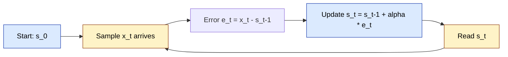
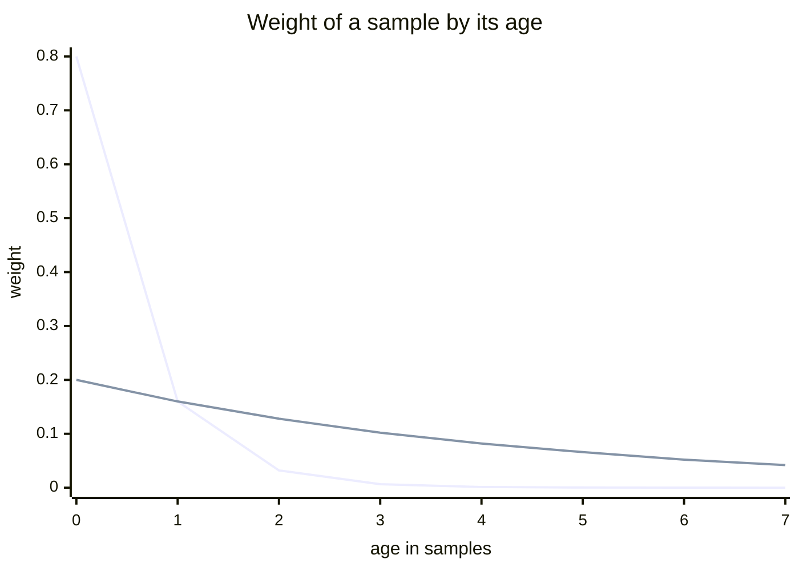

# What is an EWMA (exponentially weighted moving average), and how does it work?

## 1. Abstract

An exponentially weighted moving average (EWMA) smooths a stream of measurements by keeping one number, the current average, and moving it a fixed fraction of the way toward each new sample: $s_t = s_{t-1} + \alpha (x_t - s_{t-1})$. Unrolled, the update gives every past sample a weight that shrinks geometrically with its age, and the weights always sum to one, so the average covers all history but is dominated by the recent past. The smoothing factor $\alpha$ sets the trade-off: near 1, the average follows the data closely; near 0, it smooths heavily but lags. In signal-processing terms it is a single-pole low-pass filter, and $\alpha$ maps to a time constant and a cutoff frequency. The same recurrence tracks spread: TCP's retransmission timer, from Jacobson's 1988 work, keeps an EWMA of the round-trip time ($\alpha = 1/8$) and of its mean deviation ($1/4$), and an EWMA variance needs one more line. Production code often runs it in fixed point: the Linux kernel's `DECLARE_EWMA` restricts $\alpha$ to $1/2^k$, so each update is shifts and adds. Its costs are lag, a starting value that matters when $\alpha$ is small, a memory measured in samples rather than seconds, and flat forecasts on data that trend.

## 2. Terminology

| Term | Definition |
|---|---|
| **EWMA** | Exponentially weighted moving average; also an exponential moving average (EMA) or simple exponential smoothing. |
| **$t$** | The step index: one per sample, an integer from 1. |
| **$x_t$** | The sample (measurement) at step $t$, a number. |
| **$s_t$** | The EWMA after taking in $x_t$, a number. |
| **$s_0$** | The starting value of the average. |
| **$\alpha$** | The smoothing factor, $0 < \alpha \le 1$: the weight of the newest sample. Control charts call it $\lambda$; Jacobson calls it the gain $g$. |
| **$e_t$** | The prediction error $x_t - s_{t-1}$. |
| **$v_t$** | An EWMA of the spread: a mean deviation or a variance, by variant. |
| **$\beta$** | The smoothing factor of the spread's EWMA. |
| **$\Delta T$** | The time between two samples. |
| **$\tau$** | The time constant: the time for the average to cover about 63% of a step. |
| **$d$** | The time constant in samples, $\tau / \Delta T$. |
| **$f_c$** | The cutoff frequency, in cycles per sample (0 to 0.5). |
| **$p$, $k$, $S_t$** | Fixed-point form: $p$ fractional bits, $\alpha = 1/2^k$, and the stored integer $S_t = 2^p s_t$. |
| **RTT, SRTT, RTTVAR, RTO** | TCP's round-trip time, its smoothed value, its smoothed variation, and the retransmission timeout. |
| **IIR filter** | Infinite impulse response filter: each output depends on earlier outputs, so one input affects all later outputs. |
| **SMA** | Simple moving average: the plain mean of the last $N$ samples. |
| **$x$, $y[n]$ (Smith)** | In Smith's filter notation, $x$ is the decay between samples and $y[n]$ the output; used only where his formula is quoted. |
| **[sllmwiki_reasoning]** | The narrative's own reasoning: a conclusion, comparison or reconstruction no cited source states. |

## 3. Background

Suppose a client times each reply from a server: 100 ms, 100 ms, then one slow reply of 400 ms. It wants one number for "how slow is this server now", to set a timeout or pick a server. [sllmwiki_reasoning] The latest sample jumps with every outlier, the mean of all samples barely moves when the server really slows down, and the estimate must be cheap enough to update on every request.

Forecasting texts frame the same gap: simple exponential smoothing sits between the naive method, all weight on the last observation, and the average method, equal weights on all. [\[1\]](../sources/ewma-fpp3-simple-exponential-smoothing.md#81-simple-exponential-smoothing) TCP meets it in its retransmission timer, where Jacobson calls a good round-trip-time estimator the single most important feature of a protocol implementation that must survive heavy load. [\[2\]](../sources/ewma-jacobson-congestion-avoidance.md#conservation-at-equilibrium-round-trip-timing) The only prerequisite is a weighted average: a sum of values times weights that add up to one.

## 4. What is an EWMA?

NIST describes the EWMA as a statistic that "averages the data in a way that gives less and less weight to data as they are further removed in time". [\[3\]](../sources/ewma-nist-ewma-control-charts.md#6324-ewma-control-charts) It is a special case of the incremental normalised weighted mean, [\[4\]](../sources/ewma-finch-incremental-weighted-mean-variance.md#page-1) and, as a recursive formula, a first-order IIR filter. [\[5\]](../sources/moving-averages-wikipedia-moving-average.md#exponential-moving-average)

## 5. How does it work?

The idea: keep one value, treat it as the prediction of the next sample, and when the sample arrives, move the prediction a fraction $\alpha$ of the way toward it. Jacobson reads TCP's estimator exactly so: the new prediction is the old one plus a fraction of the prediction error. [\[6\]](../sources/ewma-jacobson-congestion-avoidance.md#theory) In the diagram, blue boxes hold the state and yellow boxes are what enters and leaves it.



1. **Start → sample.** The average needs a starting value: the first sample, a target, or the mean of the first few samples. [\[7\]](../sources/ewma-nist-single-exponential-smoothing.md#6431-single-exponential-smoothing) TCP seeds SRTT with the first RTT measurement. [\[8\]](../sources/ewma-rfc6298-tcp-retransmission-timer.md#2-the-basic-algorithm)
2. **Sample → error.** The error is how far the sample lies from the current prediction.
3. **Error → update.** The average moves by $\alpha$ times the error. [\[6\]](../sources/ewma-jacobson-congestion-avoidance.md#theory) Collected, it is the usual form:

$$
s_t = \alpha x_t + (1 - \alpha) s_{t-1}
$$

4. **Update → read.** $s_t$ is the current estimate, the value compared with control limits, or the forecast for the next step. [\[9\]](../sources/ewma-fpp3-simple-exponential-smoothing.md#component-form)
5. **Read → next sample.** Nothing else is kept: an EWMA stores only its latest value, where a $k$-point moving average stores $k$ points. [\[10\]](../sources/ewma-wikipedia-exponential-smoothing.md#comparison-with-moving-average)

[sllmwiki_reasoning] In the latency example, with $\alpha = 1/8$ and $s_0$ the first sample, the average reads 100, 100, then $100 + (400 - 100)/8 = 137.5$ ms. The procedure below follows Finch's incremental form, [\[11\]](../sources/ewma-finch-incremental-weighted-mean-variance.md#page-7) seeding from the first sample as TCP does. [\[8\]](../sources/ewma-rfc6298-tcp-retransmission-timer.md#2-the-basic-algorithm)

```text
state: s (unset)
on sample x:
    if s is unset: s := x
    else:          s := s + alpha * (x - s)
    return s
```

**Why "exponential".** Substituting the update into itself writes $s_t$ as a weighted sum of every sample and the starting value: [\[12\]](../sources/ewma-finch-incremental-weighted-mean-variance.md#page-8) [\[13\]](../sources/ewma-fpp3-simple-exponential-smoothing.md#weighted-average-form)

$$
s_t = (1 - \alpha)^t s_0 + \sum_{i=1}^{t} \alpha (1 - \alpha)^{t-i} x_i
$$

The weights fall geometrically with age and always sum to one. [\[12\]](../sources/ewma-finch-incremental-weighted-mean-variance.md#page-8) With $\alpha = 0.2$ the newest sample weighs 0.2, the one before 0.16, then 0.128; with $\alpha = 0.8$, 0.8, 0.16, then 0.032. [\[1\]](../sources/ewma-fpp3-simple-exponential-smoothing.md#81-simple-exponential-smoothing) [sllmwiki_reasoning] The chart plots those weights, computed from the formula, for the eight newest samples (age 0 is $x_t$): a large $\alpha$ forgets fast, a small one spreads its weight far back.



**Variant: tracking the spread as well.** TCP needs the variation of the round-trip time, not just its mean: a timer of twice the mean adapts to loads of at most 30%, and above that retransmits packets that were only delayed. [\[2\]](../sources/ewma-jacobson-congestion-avoidance.md#conservation-at-equilibrium-round-trip-timing) Jacobson keeps a second EWMA, of the mean deviation $\lvert e_t \rvert$, because variance needs a multiply and a square root; the mean deviation is a slightly larger, more conservative estimate, about 1.25 times the standard deviation for normal errors. [\[6\]](../sources/ewma-jacobson-congestion-avoidance.md#theory) RFC 6298 makes this the standard, with $\alpha = 1/8$, $\beta = 1/4$, and RTO equal to SRTT plus the larger of the clock granularity and four times RTTVAR. [\[8\]](../sources/ewma-rfc6298-tcp-retransmission-timer.md#2-the-basic-algorithm) In this narrative's notation, following the RFC:

```text
on RTT measurement r:
    if first:  s := r;  v := r / 2
    else:      v := (1 - beta) * v + beta * |s - r|
               s := (1 - alpha) * s + alpha * r
    rto := s + max(G, 4 * v)
```

When the true variance is wanted, Finch derives an EWMA variance from the same incremental weighted mean; [\[12\]](../sources/ewma-finch-incremental-weighted-mean-variance.md#page-8) written here with $s$ and $v$:

```text
on sample x:
    e := x - s
    s := s + alpha * e
    v := (1 - alpha) * (v + alpha * e * e)
```

**Variant: fixed point.** Jacobson picks $\alpha = 1/2^k$ so that integer shifts replace the division, and keeps the scaled estimate to limit round-off. [\[14\]](../sources/ewma-jacobson-congestion-avoidance.md#practice) The Linux kernel's `DECLARE_EWMA` does the same: $p$ fractional bits, new values weighted $1/2^k$ and the old state the rest, with $2^k$ a power of two for efficiency. [\[15\]](../sources/ewma-linux-kernel-average-h-source.md#L10-L27) Its add helper computes

$$
S_t = \left( 2^k S_{t-1} - S_{t-1} + 2^p x_t \right) / 2^k
$$

with shifts, seeding the state with the first value while it is still zero; [\[16\]](../sources/ewma-linux-kernel-average-h-source.md#L54-L70) reading shifts out the fractional bits. [\[17\]](../sources/ewma-linux-kernel-average-h-source.md#L45-L53) Following the kernel:

```text
state: S = 0                      # holds s * 2^p
on sample x:
    if S == 0: S := x << p
    else:      S := ((S << k) - S + (x << p)) >> k
read: return S >> p
```

## 6. Design decisions and trade-offs

**Choosing $\alpha$.** Larger $\alpha$ means less smoothing; $\alpha = 1$ returns the raw series. [\[18\]](../sources/ewma-wikipedia-exponential-smoothing.md#basic-simple-exponential-smoothing) Jacobson explains the trade-off: a large gain corrects a wrong estimate fast, a small one damps the noise, the estimate's own standard deviation is $\alpha$ times the samples', and it converges with a time constant of $1/\alpha$ samples. Because the correction happens whatever the gain, a gain too small is almost always better than one too large. [\[6\]](../sources/ewma-jacobson-congestion-avoidance.md#theory) Rules of thumb:

- typical gains: 0.1 to 0.2, after a long look at the raw data; [\[6\]](../sources/ewma-jacobson-congestion-avoidance.md#theory)
- control charts: $\lambda$ "usually set between 0.2 and 0.3"; [\[3\]](../sources/ewma-nist-ewma-control-charts.md#6324-ewma-control-charts)
- TCP: $1/8$ for the mean, $1/4$ for the deviation, the larger gain making the timer rise quickly when the RTT changes; [\[8\]](../sources/ewma-rfc6298-tcp-retransmission-timer.md#2-the-basic-algorithm) [\[14\]](../sources/ewma-jacobson-congestion-avoidance.md#practice)
- forecasting: fit $\alpha$ by minimising the squared one-step errors; [\[19\]](../sources/ewma-fpp3-simple-exponential-smoothing.md#optimisation)
- matching an $N$-sample SMA: $\alpha = 2/(N + 1)$. [\[10\]](../sources/ewma-wikipedia-exponential-smoothing.md#comparison-with-moving-average)

Too high, and the average chases noise; too low, and a step takes about $3/\alpha$ samples to reach 95% of its new level. [\[18\]](../sources/ewma-wikipedia-exponential-smoothing.md#basic-simple-exponential-smoothing)

**Choosing $\alpha$ from time.** With samples $\Delta T$ apart, a time constant $\tau$ gives [\[20\]](../sources/ewma-wikipedia-exponential-smoothing.md#time-constant)

$$
\alpha = 1 - e^{-\Delta T / \tau}
$$

The filter view says the same: a single-pole low-pass filter with decay $1 - \alpha$ per sample has a time constant of $d$ samples when $1 - \alpha = e^{-1/d}$, and a $-3$ dB cutoff $f_c$ when $1 - \alpha = e^{-2 \pi f_c}$. [\[21\]](../sources/ewma-smith-dspguide-recursive-filters.md#page-6) Smith writes the filter as $y[n] = (1 - x)\,x[n] + x\,y[n-1]$, with $x$ the decay between samples. [\[22\]](../sources/ewma-smith-dspguide-recursive-filters.md#page-5) [sllmwiki_reasoning] That is the EWMA with $\alpha = 1 - x$. The Unix load average is built this way: every 5 seconds it decays by a precomputed $e^{-5/\tau}$ with $\tau$ of 1, 5 and 15 minutes. [\[23\]](../sources/ewma-brendan-gregg-linux-load-averages.md#history)

**Choosing $s_0$.** The starting value's weight $(1 - \alpha)^t$ fades slowly when $\alpha$ is small, so it matters more then; [\[7\]](../sources/ewma-nist-single-exponential-smoothing.md#6431-single-exponential-smoothing) starting from the first sample gives it a large effect on early values, and averaging the first few samples is one remedy. [\[24\]](../sources/ewma-wikipedia-exponential-smoothing.md#choosing-the-initial-smoothed-value)

**Floating or fixed point.** Single-precision floating point suits simple recursive filters; integers are possible but harder, as round-off can degrade the response or make the filter unstable. [\[25\]](../sources/ewma-smith-dspguide-recursive-filters.md#page-14) Fixed point buys shift-only updates at the cost of $\alpha$ restricted to powers of two and at most 30 fractional bits. [\[15\]](../sources/ewma-linux-kernel-average-h-source.md#L10-L27) [\[16\]](../sources/ewma-linux-kernel-average-h-source.md#L54-L70)

## 7. Limitations and failure modes

- **Lag and phase.** Every moving average lags, and an EWMA's lag can't be removed by a fixed shift, as its weights are asymmetric. [\[10\]](../sources/ewma-wikipedia-exponential-smoothing.md#comparison-with-moving-average) A recursive filter's phase is nonlinear, so a pulse's rising and falling edges come out looking different. [\[26\]](../sources/ewma-smith-dspguide-recursive-filters.md#page-10)
- **History lingers.** The "one minute" load average reaches only about 0.62 of a new steady load after a minute, and the three averages reflect load well beyond their nominal windows. [\[27\]](../sources/ewma-brendan-gregg-linux-load-averages.md#the-three-numbers)
- **Trends and seasons.** Simple exponential smoothing gives flat forecasts, suitable only for series with no trend or seasonal pattern; [\[28\]](../sources/ewma-fpp3-simple-exponential-smoothing.md#flat-forecasts) Holt's method adds a trend and Holt-Winters a season. [\[29\]](../sources/ewma-wikipedia-exponential-smoothing.md#double-exponential-smoothing-holt-linear)
- **Sample rate.** A per-sample $\alpha$ remembers a number of samples, not a span of time: RFC 6298 warns that with many samples per round trip its gains "may keep an inadequate RTT history", an open research question. [\[30\]](../sources/ewma-rfc6298-tcp-retransmission-timer.md#3-taking-rtt-samples) [sllmwiki_reasoning] Deriving $\alpha$ from $\Delta T$, as in section 6, fixes the memory in time when samples arrive irregularly.
- **Stale state.** An estimate can go wrong and stay wrong; TCP may clear SRTT and RTTVAR after repeated back-offs. [\[31\]](../sources/ewma-rfc6298-tcp-retransmission-timer.md#5-managing-the-rto-timer)
- **Fixed-point bias.** Truncation biases each of Jacobson's scaled estimates by about half a clock tick, which his timeout calculation compensates. [\[14\]](../sources/ewma-jacobson-congestion-avoidance.md#practice) [sllmwiki_reasoning] The kernel's zero test also means a state that decays to exactly zero is reseeded by the next sample rather than averaged.

## 8. FAQ

**Is an EWMA the same as exponential smoothing?** Yes: simple exponential smoothing is also called an exponentially weighted moving average. [\[18\]](../sources/ewma-wikipedia-exponential-smoothing.md#basic-simple-exponential-smoothing)

**Does it reduce noise?** Yes: for independent data its variance settles at $\lambda / (2 - \lambda)$ times the data's. [\[3\]](../sources/ewma-nist-ewma-control-charts.md#6324-ewma-control-charts)

**How does it compare with a simple moving average?** A question of its own: [When should software use an EWMA instead of other moving averages?](when-should-software-use-an-ewma-instead-of-other-moving-averages.md)

## 9. References

### 9.1 Sources read

- [ewma-nist-ewma-control-charts](../sources/ewma-nist-ewma-control-charts.md): the definition, the control-chart range of $\lambda$, the EWMA's variance.
- [ewma-nist-single-exponential-smoothing](../sources/ewma-nist-single-exponential-smoothing.md): initialisation, and the starting value's weight.
- [ewma-fpp3-simple-exponential-smoothing](../sources/ewma-fpp3-simple-exponential-smoothing.md): the weighted-average and component forms, weights by $\alpha$, fitting $\alpha$, flat forecasts.
- [ewma-wikipedia-exponential-smoothing](../sources/ewma-wikipedia-exponential-smoothing.md): $\alpha$'s effect, the time constant, initial values, comparison with the SMA, Holt.
- [ewma-finch-incremental-weighted-mean-variance](../sources/ewma-finch-incremental-weighted-mean-variance.md): the EWMA as a normalised weighted mean, its explicit weights, the EWMA variance.
- [ewma-jacobson-congestion-avoidance](../sources/ewma-jacobson-congestion-avoidance.md): the EWMA as a prediction-error estimator, the gain trade-off, mean deviation, shifts.
- [ewma-rfc6298-tcp-retransmission-timer](../sources/ewma-rfc6298-tcp-retransmission-timer.md): SRTT, RTTVAR and RTO, their gains and caveats.
- [ewma-linux-kernel-average-h-source](../sources/ewma-linux-kernel-average-h-source.md): the fixed-point EWMA in production code.
- [ewma-smith-dspguide-recursive-filters](../sources/ewma-smith-dspguide-recursive-filters.md): the single-pole filter: time constant, cutoff, phase, integer arithmetic.
- [ewma-brendan-gregg-linux-load-averages](../sources/ewma-brendan-gregg-linux-load-averages.md): the load average as a time-constant EWMA, and its lag.
- [moving-averages-wikipedia-moving-average](../sources/moving-averages-wikipedia-moving-average.md): the EWMA as a first-order IIR filter.

### 9.2 Citations

1. [ewma-fpp3-simple-exponential-smoothing: 8.1 Simple exponential smoothing](../sources/ewma-fpp3-simple-exponential-smoothing.md#81-simple-exponential-smoothing)
2. [ewma-jacobson-congestion-avoidance: Conservation at equilibrium: round-trip timing](../sources/ewma-jacobson-congestion-avoidance.md#conservation-at-equilibrium-round-trip-timing)
3. [ewma-nist-ewma-control-charts: 6.3.2.4 EWMA control charts](../sources/ewma-nist-ewma-control-charts.md#6324-ewma-control-charts)
4. [ewma-finch-incremental-weighted-mean-variance: Page 1](../sources/ewma-finch-incremental-weighted-mean-variance.md#page-1)
5. [moving-averages-wikipedia-moving-average: Exponential moving average](../sources/moving-averages-wikipedia-moving-average.md#exponential-moving-average)
6. [ewma-jacobson-congestion-avoidance: A.1 Theory](../sources/ewma-jacobson-congestion-avoidance.md#theory)
7. [ewma-nist-single-exponential-smoothing: 6.4.3.1 Single exponential smoothing](../sources/ewma-nist-single-exponential-smoothing.md#6431-single-exponential-smoothing)
8. [ewma-rfc6298-tcp-retransmission-timer: 2 The basic algorithm](../sources/ewma-rfc6298-tcp-retransmission-timer.md#2-the-basic-algorithm)
9. [ewma-fpp3-simple-exponential-smoothing: Component form](../sources/ewma-fpp3-simple-exponential-smoothing.md#component-form)
10. [ewma-wikipedia-exponential-smoothing: Comparison with moving average](../sources/ewma-wikipedia-exponential-smoothing.md#comparison-with-moving-average)
11. [ewma-finch-incremental-weighted-mean-variance: Page 7](../sources/ewma-finch-incremental-weighted-mean-variance.md#page-7)
12. [ewma-finch-incremental-weighted-mean-variance: Page 8](../sources/ewma-finch-incremental-weighted-mean-variance.md#page-8)
13. [ewma-fpp3-simple-exponential-smoothing: Weighted average form](../sources/ewma-fpp3-simple-exponential-smoothing.md#weighted-average-form)
14. [ewma-jacobson-congestion-avoidance: A.2 Practice](../sources/ewma-jacobson-congestion-avoidance.md#practice)
15. [ewma-linux-kernel-average-h-source: lines 10-27, the header comment](../sources/ewma-linux-kernel-average-h-source.md#L10-L27)
16. [ewma-linux-kernel-average-h-source: lines 54-70, the add helper](../sources/ewma-linux-kernel-average-h-source.md#L54-L70)
17. [ewma-linux-kernel-average-h-source: lines 45-53, the read helper](../sources/ewma-linux-kernel-average-h-source.md#L45-L53)
18. [ewma-wikipedia-exponential-smoothing: Basic (simple) exponential smoothing](../sources/ewma-wikipedia-exponential-smoothing.md#basic-simple-exponential-smoothing)
19. [ewma-fpp3-simple-exponential-smoothing: Optimisation](../sources/ewma-fpp3-simple-exponential-smoothing.md#optimisation)
20. [ewma-wikipedia-exponential-smoothing: Time constant](../sources/ewma-wikipedia-exponential-smoothing.md#time-constant)
21. [ewma-smith-dspguide-recursive-filters: Page 6](../sources/ewma-smith-dspguide-recursive-filters.md#page-6)
22. [ewma-smith-dspguide-recursive-filters: Page 5](../sources/ewma-smith-dspguide-recursive-filters.md#page-5)
23. [ewma-brendan-gregg-linux-load-averages: History](../sources/ewma-brendan-gregg-linux-load-averages.md#history)
24. [ewma-wikipedia-exponential-smoothing: Choosing the initial smoothed value](../sources/ewma-wikipedia-exponential-smoothing.md#choosing-the-initial-smoothed-value)
25. [ewma-smith-dspguide-recursive-filters: Page 14](../sources/ewma-smith-dspguide-recursive-filters.md#page-14)
26. [ewma-smith-dspguide-recursive-filters: Page 10](../sources/ewma-smith-dspguide-recursive-filters.md#page-10)
27. [ewma-brendan-gregg-linux-load-averages: The three numbers](../sources/ewma-brendan-gregg-linux-load-averages.md#the-three-numbers)
28. [ewma-fpp3-simple-exponential-smoothing: Flat forecasts](../sources/ewma-fpp3-simple-exponential-smoothing.md#flat-forecasts)
29. [ewma-wikipedia-exponential-smoothing: Double exponential smoothing (Holt linear)](../sources/ewma-wikipedia-exponential-smoothing.md#double-exponential-smoothing-holt-linear)
30. [ewma-rfc6298-tcp-retransmission-timer: 3 Taking RTT samples](../sources/ewma-rfc6298-tcp-retransmission-timer.md#3-taking-rtt-samples)
31. [ewma-rfc6298-tcp-retransmission-timer: 5 Managing the RTO timer](../sources/ewma-rfc6298-tcp-retransmission-timer.md#5-managing-the-rto-timer)

## 10. Metadata

- **Version:** 1.3
- **Template:** technical_brief_overview
- **Model:** claude-opus-5-5
- **Created:** 2026-10-20
- **Last modified:** 2026-10-21
- **History:**
  - 1.3 (2026-10-21): Rework under the current template and writing guide: adds Jacobson's prediction-error reading of the update, the explicit weights (Finch), a weights chart, pseudocode for the basic update, mean deviation (RFC 6298), EWMA variance and fixed-point (Linux kernel) variants, the single-pole filter's time constant and cutoff, and phase and fixed-point limitations.
  - 1.2 (2026-10-21): Lint: TCP's timeout formula now includes the clock-granularity floor; the update's alpha range left to Terminology.
  - 1.1 (2026-10-21): The flowchart's labels are plain text, as not every renderer draws math in a diagram.
  - 1.0 (2026-10-20): First version.
- **Reading plan:**
  1. `when-should-software-use-an-ewma-instead-of-other-moving-averages`, in full: existing narrative, background
  2. `moving-averages-wikipedia-moving-average`, in full: medium relevance, authority C, undated
  3. `ewma-brendan-gregg-linux-load-averages`, in full: medium relevance, authority C, 2017-08-08
  4. `ewma-smith-dspguide-recursive-filters`, in full: medium relevance, authority B, 1997-01-01
  5. `ewma-wikipedia-exponential-smoothing`, in full: high relevance, authority C, undated
  6. `ewma-nist-ewma-control-charts`, in full: high relevance, authority B, undated
  7. `ewma-nist-single-exponential-smoothing`, in full: high relevance, authority B, undated
  8. `ewma-fpp3-simple-exponential-smoothing`, in full: high relevance, authority B, undated
  9. `ewma-finch-incremental-weighted-mean-variance`, in full: high relevance, authority B, 2009-02-01
  10. `ewma-linux-kernel-average-h-source`, in full: high relevance, authority A, undated
  11. `ewma-jacobson-congestion-avoidance`, in full: high relevance, authority A, 1988-11-01
  12. `ewma-rfc6298-tcp-retransmission-timer`, in full: high relevance, authority A, 2011-06-01
  13. `moving-averages-nist-single-moving-average`, abstract only: low relevance
  14. `ewma-linkerd-beyond-round-robin`, abstract only: low relevance
