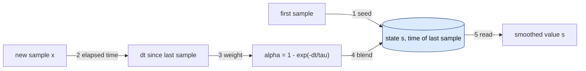
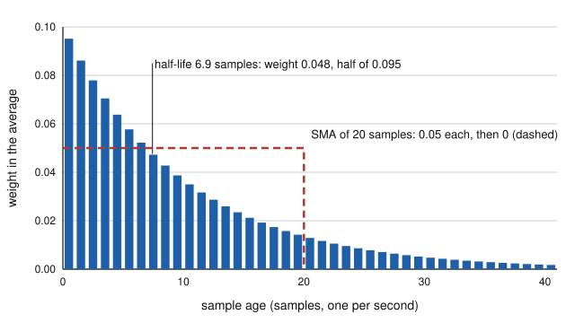
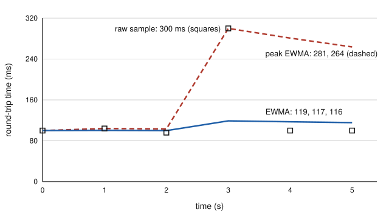

# What is an EWMA (exponentially weighted moving average), and how does it work?

## 1. Abstract

Software that turns a noisy stream of measurements, such as a server's request latencies, into one steady number needs an average that is cheap and follows change. An EWMA is that average: each new sample moves the average a fixed fraction of the way toward itself. Older samples therefore keep weights that shrink exponentially with age, and the EWMA stores only one number. One parameter, the smoothing factor or a time constant, trades smoothness against speed.

**Key takeaways:**

- The whole algorithm is one line: $s_t = \alpha x_t + (1-\alpha) s_{t-1}$.
- A sample $j$ steps old weighs $\alpha(1-\alpha)^j$: it fades but never drops out.
- A larger smoothing factor follows change faster and smooths less.
- With a time constant, each weight comes from the time since the last sample, so uneven samples work.

## 2. Terminology

| Term | Definition |
|---|---|
| **EWMA** | Exponentially weighted moving average, also called exponential moving average (EMA) or simple exponential smoothing [\[1\]](../sources/ewma-wikipedia-exponential-smoothing.md#basic-simple-exponential-smoothing), [\[2\]](../sources/moving-averages-wikipedia-moving-average.md#exponential-moving-average). |
| **$x_t$, $s_t$** | Sample $t$, and the EWMA's state, the smoothed value, after it [\[1\]](../sources/ewma-wikipedia-exponential-smoothing.md#basic-simple-exponential-smoothing). |
| **smoothing factor $\alpha$** | The weight of the newest sample, between 0 and 1 [\[1\]](../sources/ewma-wikipedia-exponential-smoothing.md#basic-simple-exponential-smoothing). |
| **time constant $\tau$** | The time a step input takes to reach 63.2% of its new level [\[3\]](../sources/ewma-wikipedia-exponential-smoothing.md#time-constant); Finagle's `decayTime` [\[4\]](../sources/ewma-finagle-peak-ewma-source.md#L38-L45). |
| **$\Delta t$** | The time between two consecutive samples [\[3\]](../sources/ewma-wikipedia-exponential-smoothing.md#time-constant). |
| **SMA** | Simple moving average: the unweighted mean of the last $k$ samples [\[5\]](../sources/moving-averages-wikipedia-moving-average.md#simple-moving-average). |
| **RTT** | Round-trip time: how long a request takes to get its response [\[6\]](../sources/ewma-finagle-clients-docs.md#power-of-two-choices-p2c--peak-ewma-2). |
| **P2C** | Power of two choices: pick two servers at random, send to the less loaded [\[7\]](../sources/ewma-finagle-clients-docs.md#power-of-two-choices-p2c--least-loaded). |
| **[→]** | Our own reasoning: a conclusion or worked example no cited source states. |
| **[?]** | A gap: something the question needs that the sources don't answer. |

## 3. Background

An EWMA is an average whose weights fall exponentially with each observation's age [\[2\]](../sources/moving-averages-wikipedia-moving-average.md#exponential-moving-average). Forecasters call it simple exponential smoothing [\[1\]](../sources/ewma-wikipedia-exponential-smoothing.md#basic-simple-exponential-smoothing). Quality engineers plot it as the EWMA control chart [\[8\]](../sources/ewma-wikipedia-ewma-chart.md#ewma-chart---wikipedia). In electronics it is an RC low-pass filter sampled at even intervals [\[9\]](../sources/ewma-wikipedia-low-pass-filter.md#simple-infinite-impulse-response-filter). In operating systems, Unix load averages are EWMAs of the number of runnable processes [\[10\]](../sources/ewma-wikipedia-load-computing.md#load-average). Whoever must react to a measured value, without reacting to every wobble in it, meets one [→].

### 3.1 A load balancer must rank servers by recent latency

The running example is a client of a replicated service, built with Twitter's Finagle library. For each request, the client picks one of several interchangeable servers. Finagle's load balancer splits this job into two parts: each server keeps a *load metric*, and a *distributor* uses the metrics to choose [\[11\]](../sources/ewma-finagle-clients-docs.md#load-balancing). The default distributor, P2C, picks two servers at random and sends to the less loaded [\[7\]](../sources/ewma-finagle-clients-docs.md#power-of-two-choices-p2c--least-loaded). Latency is an effective feedback signal for these metrics [\[11\]](../sources/ewma-finagle-clients-docs.md#load-balancing).

We follow one server, which we call server A. Its six RTT samples, one per second, are set by hand to teach [→]:

| Time (s) | 0 | 1 | 2 | 3 | 4 | 5 |
|---|---|---|---|---|---|---|
| RTT sample $x_t$ (ms) | 100 | 104 | 96 | 300 | 100 | 100 |

The 4 ms wobbles are jitter, and the 300 ms sample is one outlier [→]. At 5 s, two of server A's requests are still outstanding [→]. The time constant is $\tau = 10$ s, Finagle's default `decayTime` [\[6\]](../sources/ewma-finagle-clients-docs.md#power-of-two-choices-p2c--peak-ewma-2).

Two naive metrics fail here. The last sample alone jumps to 300 ms on the outlier. The mean of all samples since start never forgets a slowdown an hour old [→]. The usual middle ground, an SMA of the last $k$ samples, must keep all $k$ samples [\[5\]](../sources/moving-averages-wikipedia-moving-average.md#simple-moving-average). The EWMA keeps only its last value [\[12\]](../sources/ewma-wikipedia-exponential-smoothing.md#comparison-with-moving-average). The choice between these averages is the subject of [When should software use an EWMA instead of other moving averages?](when-should-software-use-an-ewma-instead-of-other-moving-averages.md); here we explain how the EWMA works.

## 4. The core idea

Treat the current average as your best guess. When a sample arrives, move the guess part of the way toward it: a fixed fraction $\alpha$ of the gap [\[1\]](../sources/ewma-wikipedia-exponential-smoothing.md#basic-simple-exponential-smoothing). The new state is thus a weighted average of the new sample and the old state [\[1\]](../sources/ewma-wikipedia-exponential-smoothing.md#basic-simple-exponential-smoothing):

$$
s_t = \alpha x_t + (1-\alpha) s_{t-1}
$$

Finagle's samples arrive at uneven times, so its `Ema` class sets the fraction from the time since the last sample [\[13\]](../sources/ewma-finagle-peak-ewma-source.md#L47-L53), [\[14\]](../sources/ewma-finagle-ema-source.md#L29-L43):

$$
\alpha = 1 - e^{-\Delta t/\tau}
$$

The same formula links the smoothing factor and the time constant in exponential smoothing generally [\[3\]](../sources/ewma-wikipedia-exponential-smoothing.md#time-constant).

*Figure 4-1: Finagle's `Ema` stores only the state and the time of its last sample (blue); each new sample is blended in with a weight set by the time since the previous one [\[14\]](../sources/ewma-finagle-ema-source.md#L29-L43), [\[15\]](../sources/ewma-finagle-ema-source.md#L45-L50).*

## 5. How does it work?

The process has two phases. Once, the first sample seeds the state. Then, for every sample, the EWMA measures the elapsed time, turns it into a weight and blends the sample in. Anyone may read the state at any time [\[14\]](../sources/ewma-finagle-ema-source.md#L29-L43), [\[15\]](../sources/ewma-finagle-ema-source.md#L45-L50).

Four ideas are new here: the smoothing factor, the exponential weights, the time constant and the weight from elapsed time. A toy small enough to compute by hand builds them one at a time.

### 5.1 A toy shows each sample moving the state halfway

The toy has $\alpha = 0.5$, chosen to teach, and samples 10, 20, 20, 20, one per second [→]. The first sample seeds the state, $s_0 = 10$ [\[16\]](../sources/ewma-wikipedia-exponential-smoothing.md#choosing-the-initial-smoothed-value). Each later step applies $s_t = 0.5 x_t + 0.5 s_{t-1}$ [\[1\]](../sources/ewma-wikipedia-exponential-smoothing.md#basic-simple-exponential-smoothing):

| Step $t$ | $x_t$ | $s_t$ |
|---|---|---|
| 0 | 10 | 10 (seed) |
| 1 | 20 | $0.5 \cdot 20 + 0.5 \cdot 10 = 15$ |
| 2 | 20 | $0.5 \cdot 20 + 0.5 \cdot 15 = 17.5$ |
| 3 | 20 | $0.5 \cdot 20 + 0.5 \cdot 17.5 = 18.75$ |

Each step closes half of the remaining gap to 20: 10, then 5, then 2.5 [\[1\]](../sources/ewma-wikipedia-exponential-smoothing.md#basic-simple-exponential-smoothing).

### 5.2 Old samples fade by a constant factor

Why call this average exponential? Substitute the update into itself [\[17\]](../sources/ewma-wikipedia-exponential-smoothing.md#exponential-naming). One hop gives $s_3 = 0.5 x_3 + 0.5 (0.5 x_2 + 0.5 s_1)$. Unrolled to the seed, it gives:

$$
s_3 = 0.5 x_3 + 0.25 x_2 + 0.125 x_1 + 0.125 x_0
$$

Check: $0.5 \cdot 20 + 0.25 \cdot 20 + 0.125 \cdot 20 + 0.125 \cdot 10 = 10 + 5 + 2.5 + 1.25 = 18.75$, as in the table. In general a sample $j$ steps old weighs $\alpha(1-\alpha)^j$ [\[17\]](../sources/ewma-wikipedia-exponential-smoothing.md#exponential-naming). These weights form a geometric progression, the discrete form of an exponential, hence the name [\[17\]](../sources/ewma-wikipedia-exponential-smoothing.md#exponential-naming). No weight ever reaches zero [\[2\]](../sources/moving-averages-wikipedia-moving-average.md#exponential-moving-average).

### 5.3 The time constant measures memory in seconds

A smoothing factor counts memory in samples; a time constant counts it in seconds. The time constant $\tau$ is the time the state takes to cover 63.2%, that is $1 - 1/e$, of a step [\[3\]](../sources/ewma-wikipedia-exponential-smoothing.md#time-constant). With samples $\Delta t$ apart, $\alpha = 1 - e^{-\Delta t/\tau}$, so $\tau = -\Delta t / \ln(1-\alpha)$ [\[3\]](../sources/ewma-wikipedia-exponential-smoothing.md#time-constant). For the toy, $\tau = -1\text{ s} / \ln 0.5 = 1\text{ s} / 0.693 = 1.44$ s [\[3\]](../sources/ewma-wikipedia-exponential-smoothing.md#time-constant). Check against the table: the step from 10 to 20 is 50% covered at 1 s and 75% at 2 s, so 63.2% falls between them [→]. When $\Delta t$ is much smaller than $\tau$, $\alpha \approx \Delta t / \tau$ [\[3\]](../sources/ewma-wikipedia-exponential-smoothing.md#time-constant).

### 5.4 Uneven gaps set each weight from the elapsed time

Suppose the toy's sample at step 2 came 2 s after step 1, not 1 s [→]. The weight becomes $\alpha = 1 - e^{-2/1.44} = 1 - 0.25 = 0.75$ [\[3\]](../sources/ewma-wikipedia-exponential-smoothing.md#time-constant). The state is then $0.75 \cdot 20 + 0.25 \cdot 15 = 18.75$. That equals two 1-second steps toward 20, as at step 3 of the table. So the state's memory fades with time, not with the number of samples [→]. Finagle uses this rule because a server's samples form an unevenly spaced time series [\[13\]](../sources/ewma-finagle-peak-ewma-source.md#L47-L53).

### 5.5 From the toy to server A

| Part | Toy | Server A |
|---|---|---|
| Samples | 10, 20, 20, 20 | RTTs of 100 to 300 ms |
| Time constant $\tau$ | 1.44 s | 10 s [\[6\]](../sources/ewma-finagle-clients-docs.md#power-of-two-choices-p2c--peak-ewma-2) |
| Gap $\Delta t$ | 1 s, or 2 s | measured on a monotonic clock [\[18\]](../sources/ewma-finagle-ema-source.md#L63-L91) |
| Smoothing factor $\alpha$ | 0.5, then 0.75 | $1 - e^{-1/10} = 0.095$ per 1 s gap [\[3\]](../sources/ewma-wikipedia-exponential-smoothing.md#time-constant) |

With $\alpha = 0.095$, the newest of server A's samples weighs 0.095 and one 10 s old weighs $0.095 \cdot 0.905^{10} = 0.035$ [\[17\]](../sources/ewma-wikipedia-exponential-smoothing.md#exponential-naming). Finagle's comment calls $\tau$ the mean lifetime and puts the half-life at $\tau \ln 2$ [\[4\]](../sources/ewma-finagle-peak-ewma-source.md#L38-L45): $10 \cdot 0.693 = 6.9$ s. An SMA of $k$ samples has about the same forecast error when $\alpha = 2/(k+1)$ [\[12\]](../sources/ewma-wikipedia-exponential-smoothing.md#comparison-with-moving-average). For server A, $k = 2/0.095 - 1 = 20$ samples [\[12\]](../sources/ewma-wikipedia-exponential-smoothing.md#comparison-with-moving-average).

*Figure 5-1: On server A, a sample's weight halves every 6.9 s and never reaches zero; an SMA of 20 samples stops at a hard edge [\[17\]](../sources/ewma-wikipedia-exponential-smoothing.md#exponential-naming), [\[4\]](../sources/ewma-finagle-peak-ewma-source.md#L38-L45), [\[12\]](../sources/ewma-wikipedia-exponential-smoothing.md#comparison-with-moving-average).*

### 5.6 The update runs on server A, one arrow at a time

Each step is one arrow of Figure 4-1, run by Finagle's `Ema` for server A.

1. **Seed.** `Ema` receives server A's first RTT and its timestamp, finds no earlier time, and stores both: $s_0 = 100$ ms [\[19\]](../sources/ewma-finagle-ema-source.md#L29-L33).
2. **Elapsed time.** At the next sample, `Ema` subtracts the stored time from the new timestamp: $\Delta t = 1$ s. The timestamps must come from a monotonic clock, and a backwards step fails an assertion [\[20\]](../sources/ewma-finagle-ema-source.md#L1-L15), [\[14\]](../sources/ewma-finagle-ema-source.md#L29-L43).
3. **Weight.** From $\Delta t$, `Ema` computes $e^{-\Delta t/\tau} = e^{-0.1} = 0.905$, the weight the old state keeps [\[21\]](../sources/ewma-finagle-ema-source.md#L35-L41). The new sample gets $\alpha = 1 - 0.905 = 0.095$.
4. **Blend.** `Ema` sets the state to $0.095 x_t + 0.905 s_{t-1}$ and stores the new time [\[21\]](../sources/ewma-finagle-ema-source.md#L35-L41). At 1 s: $0.095 \cdot 104 + 0.905 \cdot 100 = 100.38$ ms.
5. **Read.** The load balancer reads the state whenever it wants, without locking [\[15\]](../sources/ewma-finagle-ema-source.md#L45-L50). A value exists from the first sample on; an SMA must first fill its window [\[1\]](../sources/ewma-wikipedia-exponential-smoothing.md#basic-simple-exponential-smoothing).

Steps 2 to 4 repeat for each sample [\[14\]](../sources/ewma-finagle-ema-source.md#L29-L43):

| Time (s) | $x_t$ (ms) | $s_t$ (ms) | Change (ms) |
|---|---|---|---|
| 0 | 100 | 100.00 | seed |
| 1 | 104 | 100.38 | +0.38 |
| 2 | 96 | 99.96 | −0.42 |
| 3 | 300 | 119.00 | +19.04 |
| 4 | 100 | 117.19 | −1.81 |
| 5 | 100 | 115.56 | −1.63 |

A 4 ms wobble moves the state by 0.4 ms. The 300 ms outlier lifts it by 19 ms, not to 300 ms. Afterwards each 100 ms sample removes 9.5% of the excess: at 4 s, $0.095 \cdot 19.00 = 1.81$ ms [\[21\]](../sources/ewma-finagle-ema-source.md#L35-L41).

| In the story | Field term |
|---|---|
| fraction moved toward each sample | smoothing factor $\alpha$ [\[1\]](../sources/ewma-wikipedia-exponential-smoothing.md#basic-simple-exponential-smoothing) |
| seconds to cover 63.2% of a step | time constant $\tau$ [\[3\]](../sources/ewma-wikipedia-exponential-smoothing.md#time-constant) |
| the stored number | smoothed statistic $s_t$ [\[1\]](../sources/ewma-wikipedia-exponential-smoothing.md#basic-simple-exponential-smoothing) |
| the first sample used as the state | initial smoothed value $s_0$ [\[16\]](../sources/ewma-wikipedia-exponential-smoothing.md#choosing-the-initial-smoothed-value) |

## 6. Variants

### 6.1 Peak EWMA jumps to spikes and recovers slowly

Finagle's latency-aware load metric, peak EWMA, is an EWMA of RTT that reacts quickly to latency spikes and recovers only cautiously [\[22\]](../sources/ewma-finagle-peak-ewma-source.md#L11-L18). Two changes make it so [\[23\]](../sources/ewma-finagle-peak-ewma-source.md#L54-L67), [\[24\]](../sources/ewma-finagle-peak-ewma-source.md#L69-L79):

- Any sample above the current state resets the EWMA, so the sample becomes the new state.
- The load it reports is the state times one more than the requests outstanding.

On server A, 104 ms resets the state to 104 [\[23\]](../sources/ewma-finagle-peak-ewma-source.md#L54-L67). The 96 ms sample blends normally, to $0.095 \cdot 96 + 0.905 \cdot 104 = 103.24$ ms [\[21\]](../sources/ewma-finagle-ema-source.md#L35-L41). The 300 ms sample resets it to 300 ms, and the two 100 ms samples bring it down only to 280.97 and then 263.75 ms [\[23\]](../sources/ewma-finagle-peak-ewma-source.md#L54-L67), [\[21\]](../sources/ewma-finagle-ema-source.md#L35-L41). With two requests outstanding at 5 s, the reported load is $263.75 \cdot 3 = 791$ [\[24\]](../sources/ewma-finagle-peak-ewma-source.md#L69-L79). These numbers assume no load reads between samples [→]. Each read first blends in a zero-RTT sample for the time elapsed [\[24\]](../sources/ewma-finagle-peak-ewma-source.md#L69-L79). An idle server's cost therefore decays toward zero between requests [→]. A server with no RTT yet and requests pending gets a large penalty [\[24\]](../sources/ewma-finagle-peak-ewma-source.md#L69-L79). The docs say peak EWMA reacts to slow servers faster than counting outstanding requests [\[6\]](../sources/ewma-finagle-clients-docs.md#power-of-two-choices-p2c--peak-ewma-2).

*Figure 6-1: On the same samples, the EWMA rises 19 ms on the outlier and the peak EWMA jumps to it and keeps most of it [\[14\]](../sources/ewma-finagle-ema-source.md#L29-L43), [\[23\]](../sources/ewma-finagle-peak-ewma-source.md#L54-L67).*

### 6.2 A fixed sampling interval lets α be a constant

When samples arrive evenly, $\alpha$ is computed once [\[3\]](../sources/ewma-wikipedia-exponential-smoothing.md#time-constant). Linux updates its load averages about every 5 s, in fixed point with 11 fractional bits, so 1.0 is 2048 [\[25\]](../sources/ewma-wikipedia-load-computing.md#linux-as-an-example). It keeps $e^{-5/60}$, the old state's weight for the 1-minute average, as 1884 [\[25\]](../sources/ewma-wikipedia-load-computing.md#linux-as-an-example). Check: $e^{-5/60} = 0.920$, and $0.920 \cdot 2048 = 1884$. The new sample's weight is $1 - 1884/2048 = 0.08$. The 5- and 15-minute averages use 2014 and 2037 [\[25\]](../sources/ewma-wikipedia-load-computing.md#linux-as-an-example).

## 7. Design decisions and trade-offs

**The time constant, or smoothing factor.** A larger $\alpha$, or smaller $\tau$, follows recent changes faster and smooths less; a smaller $\alpha$ smooths more and responds less [\[1\]](../sources/ewma-wikipedia-exponential-smoothing.md#basic-simple-exponential-smoothing).

- *Typical values:* Finagle's `decayTime` defaults to 10 s [\[6\]](../sources/ewma-finagle-clients-docs.md#power-of-two-choices-p2c--peak-ewma-2); its docs' 100 s only demonstrates the API [\[26\]](../sources/ewma-finagle-clients-docs.md#partition-aware-client). Control charts use $\alpha$ (written $\lambda$) of 0.05 to 0.25 per one textbook, 0.1 to 0.3 per one journal article [\[8\]](../sources/ewma-wikipedia-ewma-chart.md#ewma-chart---wikipedia).
- *How to choose:* a constant input takes about $3/\alpha$ samples to reach 95% [\[1\]](../sources/ewma-wikipedia-exponential-smoothing.md#basic-simple-exponential-smoothing). For server A that is $3 / 0.095 \approx 32$ samples, about 32 s [\[1\]](../sources/ewma-wikipedia-exponential-smoothing.md#basic-simple-exponential-smoothing). With past data, choose $\alpha$ to minimize the sum of squared one-step forecast errors [\[27\]](../sources/ewma-wikipedia-exponential-smoothing.md#optimization). How to tune `decayTime` for a given service, the sources don't say [?].
- *Too small a $\tau$:* the metric chases jitter, and P2C ranks servers by noise [→]. *Too large:* a server that slowed down a minute ago still looks fast [→].

**Time-based or per-sample weights.** A fixed $\alpha$ counts memory in samples. A busy server would then forget faster than a quiet one [→]. Finagle weighs by elapsed time for that reason [\[13\]](../sources/ewma-finagle-peak-ewma-source.md#L47-L53). The cost is a clock read per sample, with a monotonic clock [\[18\]](../sources/ewma-finagle-ema-source.md#L63-L91).

**The starting value.** Seeding with the first sample gives that sample a large effect on early values; the smaller $\alpha$, the longer it lasts [\[16\]](../sources/ewma-wikipedia-exponential-smoothing.md#choosing-the-initial-smoothed-value). One remedy averages the first 10 or more samples instead [\[16\]](../sources/ewma-wikipedia-exponential-smoothing.md#choosing-the-initial-smoothed-value). Finagle seeds with the first sample [\[19\]](../sources/ewma-finagle-ema-source.md#L29-L33).

## 8. Limitations and failure modes

- **Lag.** An EWMA trails a changing input. Unlike a symmetric moving average, no fixed shift in samples removes its lag [\[12\]](../sources/ewma-wikipedia-exponential-smoothing.md#comparison-with-moving-average). Two seconds after server A's outlier, the state still reads 115.56 ms [\[14\]](../sources/ewma-finagle-ema-source.md#L29-L43).
- **Trends.** Simple exponential smoothing does poorly on data with a trend. Holt's double exponential smoothing adds a trend term for it [\[28\]](../sources/ewma-wikipedia-exponential-smoothing.md#double-exponential-smoothing-holt-linear).
- **Outliers still count.** Server A's single outlier holds the EWMA 15.6 ms high at 5 s [\[14\]](../sources/ewma-finagle-ema-source.md#L29-L43). Peak EWMA assumes a loaded server takes time to recover, which breaks with long-polling clients [\[6\]](../sources/ewma-finagle-clients-docs.md#power-of-two-choices-p2c--peak-ewma-2). Finagle calls the configuration experimental, its API subject to change [\[26\]](../sources/ewma-finagle-clients-docs.md#partition-aware-client).

## 9. Misconceptions

- **Larger is not smoother.** A larger smoothing factor smooths less, so the name is something of a misnomer; $\alpha = 1$ just returns the latest sample [\[1\]](../sources/ewma-wikipedia-exponential-smoothing.md#basic-simple-exponential-smoothing).
- **A 1-minute load average is not a 1-minute window.** It covers all data since start; the last minute contributes about 63% [\[10\]](../sources/ewma-wikipedia-load-computing.md#load-average).

## 10. Where to go next

- [When should software use an EWMA instead of other moving averages?](when-should-software-use-an-ewma-instead-of-other-moving-averages.md)
- How does power-of-two-choices load balancing work? (not yet a narrative)
- How do EWMA control charts set their limits? (not yet a narrative)

## 11. References

### 11.1 Sources read

- [ewma-finagle-ema-source](../sources/ewma-finagle-ema-source.md): the time-decayed update, seeding, reading and the monotonic clock.
- [ewma-finagle-peak-ewma-source](../sources/ewma-finagle-peak-ewma-source.md): peak EWMA, its time constant and half-life, and the load it reports.
- [ewma-finagle-clients-docs](../sources/ewma-finagle-clients-docs.md): load metrics and distributors, P2C, peak EWMA's default and limits.
- [ewma-wikipedia-exponential-smoothing](../sources/ewma-wikipedia-exponential-smoothing.md): the definition, the time constant, the start value, optimization, the naming, the comparison with an SMA, Holt's method.
- [moving-averages-wikipedia-moving-average](../sources/moving-averages-wikipedia-moving-average.md): the EWMA as an IIR filter, and the SMA.
- [ewma-wikipedia-low-pass-filter](../sources/ewma-wikipedia-low-pass-filter.md): the EWMA as a sampled RC filter.
- [ewma-wikipedia-load-computing](../sources/ewma-wikipedia-load-computing.md): load averages and Linux's fixed-point update.
- [ewma-wikipedia-ewma-chart](../sources/ewma-wikipedia-ewma-chart.md): EWMA control charts and their typical smoothing factors.

### 11.2 Citations

1. [ewma-wikipedia-exponential-smoothing: Basic (simple) exponential smoothing](../sources/ewma-wikipedia-exponential-smoothing.md#basic-simple-exponential-smoothing)
2. [moving-averages-wikipedia-moving-average: Exponential moving average](../sources/moving-averages-wikipedia-moving-average.md#exponential-moving-average)
3. [ewma-wikipedia-exponential-smoothing: Time constant](../sources/ewma-wikipedia-exponential-smoothing.md#time-constant)
4. [ewma-finagle-peak-ewma-source: L38-L45](../sources/ewma-finagle-peak-ewma-source.md#L38-L45)
5. [moving-averages-wikipedia-moving-average: Simple moving average](../sources/moving-averages-wikipedia-moving-average.md#simple-moving-average)
6. [ewma-finagle-clients-docs: Power of Two Choices (P2C) + Peak EWMA 2¶](../sources/ewma-finagle-clients-docs.md#power-of-two-choices-p2c--peak-ewma-2)
7. [ewma-finagle-clients-docs: Power of Two Choices (P2C) + Least Loaded¶](../sources/ewma-finagle-clients-docs.md#power-of-two-choices-p2c--least-loaded)
8. [ewma-wikipedia-ewma-chart: EWMA chart - Wikipedia](../sources/ewma-wikipedia-ewma-chart.md#ewma-chart---wikipedia)
9. [ewma-wikipedia-low-pass-filter: Simple infinite impulse response filter](../sources/ewma-wikipedia-low-pass-filter.md#simple-infinite-impulse-response-filter)
10. [ewma-wikipedia-load-computing: Load average](../sources/ewma-wikipedia-load-computing.md#load-average)
11. [ewma-finagle-clients-docs: Load Balancing¶](../sources/ewma-finagle-clients-docs.md#load-balancing)
12. [ewma-wikipedia-exponential-smoothing: Comparison with moving average](../sources/ewma-wikipedia-exponential-smoothing.md#comparison-with-moving-average)
13. [ewma-finagle-peak-ewma-source: L47-L53](../sources/ewma-finagle-peak-ewma-source.md#L47-L53)
14. [ewma-finagle-ema-source: L29-L43](../sources/ewma-finagle-ema-source.md#L29-L43)
15. [ewma-finagle-ema-source: L45-L50](../sources/ewma-finagle-ema-source.md#L45-L50)
16. [ewma-wikipedia-exponential-smoothing: Choosing the initial smoothed value](../sources/ewma-wikipedia-exponential-smoothing.md#choosing-the-initial-smoothed-value)
17. [ewma-wikipedia-exponential-smoothing: "Exponential" naming](../sources/ewma-wikipedia-exponential-smoothing.md#exponential-naming)
18. [ewma-finagle-ema-source: L63-L91](../sources/ewma-finagle-ema-source.md#L63-L91)
19. [ewma-finagle-ema-source: L29-L33](../sources/ewma-finagle-ema-source.md#L29-L33)
20. [ewma-finagle-ema-source: L1-L15](../sources/ewma-finagle-ema-source.md#L1-L15)
21. [ewma-finagle-ema-source: L35-L41](../sources/ewma-finagle-ema-source.md#L35-L41)
22. [ewma-finagle-peak-ewma-source: L11-L18](../sources/ewma-finagle-peak-ewma-source.md#L11-L18)
23. [ewma-finagle-peak-ewma-source: L54-L67](../sources/ewma-finagle-peak-ewma-source.md#L54-L67)
24. [ewma-finagle-peak-ewma-source: L69-L79](../sources/ewma-finagle-peak-ewma-source.md#L69-L79)
25. [ewma-wikipedia-load-computing: Linux as an example](../sources/ewma-wikipedia-load-computing.md#linux-as-an-example)
26. [ewma-finagle-clients-docs: Partition Aware Client¶](../sources/ewma-finagle-clients-docs.md#partition-aware-client)
27. [ewma-wikipedia-exponential-smoothing: Optimization](../sources/ewma-wikipedia-exponential-smoothing.md#optimization)
28. [ewma-wikipedia-exponential-smoothing: Double exponential smoothing (Holt linear)](../sources/ewma-wikipedia-exponential-smoothing.md#double-exponential-smoothing-holt-linear)

## 12. Metadata

- **Version:** 3.0
- **Template:** technical_brief_overview
- **Language:** en
- **Model:** claude-opus-5-5
- **Created:** 2026-10-23
- **Last modified:** 2026-11-24
- **Words:** 2,679 (about 12 min)
- **History:**
  - 3.0 (2026-11-24): Regenerated under sllmwiki 1.4.0's guides: a new spine on one load balancer ranking servers by latency; a hand-computed toy before server A; the time constant and uneven gaps worked out; Peak EWMA with the code's zero-RTT blend on each read; two SVG charts of the weights and of an outlier
  - 2.1 (2026-10-25): Lint: the control-chart range of λ is one textbook's recommendation, not a rule
  - 2.0 (2026-10-25): Rebuilt on openly licensed sources only, for a public demo: the running example is now a load balancer smoothing each backend's latency (Finagle's time-decayed EWMA, from its Apache-2.0 code), with peak EWMA as the variant; TCP's estimator, Jacobson, the Linux kernel helper, NIST, FPP3, Finch and the DSP Guide (now links) replaced by Finagle's code and docs and Wikipedia on exponential smoothing, low-pass filters, load averages and EWMA charts
  - 1.0 (2026-10-23): First version.
- **Reading plan:**
  1. `when-should-software-use-an-ewma-instead-of-other-moving-averages`, in full: existing narrative, background
  2. `moving-averages-wikipedia-moving-average`, in full: medium relevance, authority C, undated
  3. `ewma-wikipedia-load-computing`, in full: medium relevance, authority C, undated
  4. `ewma-wikipedia-ewma-chart`, in full: medium relevance, authority C, undated
  5. `ewma-wikipedia-low-pass-filter`, in full: medium relevance, authority C, undated
  6. `ewma-wikipedia-exponential-smoothing`, in full: high relevance, authority C, undated
  7. `ewma-finagle-ema-source`, in full: high relevance, authority A, undated
  8. `ewma-finagle-peak-ewma-source`, in full: high relevance, authority A, undated
  9. `ewma-finagle-clients-docs`, in full: high relevance, authority A, undated
  10. `ewma-nist-ewma-control-charts`, not read: a link, no saved copy
  11. `ewma-nist-single-exponential-smoothing`, not read: a link, no saved copy
  12. `moving-averages-nist-single-moving-average`, not read: a link, no saved copy
  13. `ewma-rfc6298-tcp-retransmission-timer`, not read: a link, no saved copy
  14. `ewma-linkerd-beyond-round-robin`, not read: a link, no saved copy
  15. `ewma-brendan-gregg-linux-load-averages`, not read: a link, no saved copy
  16. `ewma-fpp3-simple-exponential-smoothing`, not read: a link, no saved copy
  17. `ewma-jacobson-congestion-avoidance`, not read: a link, no saved copy
  18. `ewma-finch-incremental-weighted-mean-variance`, not read: a link, no saved copy
  19. `ewma-smith-dspguide-recursive-filters`, not read: a link, no saved copy
  20. `ewma-linux-kernel-average-h-source`, not read: a link, no saved copy
  21. `moving-averages-smith-dspguide-moving-average-filters`, not read: a link, no saved copy
