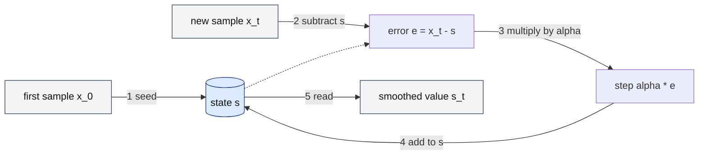

# What is an EWMA (exponentially weighted moving average), and how does it work?

## 1. Abstract

Anyone turning a noisy stream of measurements, such as round-trip times or latencies, into one steady number needs a cheap average that follows changes. An EWMA is that average: each sample moves the estimate a fixed fraction α of the way toward itself, so past samples keep weights that shrink geometrically with age. It stores one number, and α alone trades smoothness against speed.

**Key takeaways:**

- The whole algorithm is one line: $s_t = s_{t-1} + \alpha (x_t - s_{t-1})$.
- A sample $j$ steps old carries weight $\alpha (1-\alpha)^j$: older data fades but never drops out.
- Small α: smooth but slow; large α: fast but noisy. Memory is about $1/\alpha$ samples.
- The starting value matters, more so for small α.
- With $\alpha = 1/2^n$ it runs in integer shifts, as in TCP and the Linux kernel.

## 2. Terminology

| Term | Definition |
|---|---|
| **EWMA** | Exponentially weighted moving average, also called the exponential moving average (EMA) or simple exponential smoothing. |
| **$x_t$** | The sample (observation) at step $t$. |
| **$s_t$** | The EWMA's state after step $t$: the smoothed value. |
| **α (smoothing factor, gain)** | The fraction, $0 < \alpha \le 1$, of each prediction error added to the state; NIST writes it λ, Jacobson $g$. |
| **RTT, SRTT** | Round-trip time; the smoothed RTT a TCP sender keeps. |
| **RTO** | TCP's retransmission timeout. |
| **SMA** | Simple moving average: the unweighted mean of the last $k$ samples. |
| **IIR filter** | Infinite impulse response filter: one whose output feeds back into itself, so an input's effect decays but never ends. |
| **[→]** | Our own reasoning, after a statement or on a section's heading: a conclusion, comparison or example no cited source states. |

## 3. Background

An EWMA is a way of averaging a time series that gives "less and less weight to data as they are further removed in time" [\[1\]](../sources/ewma-nist-ewma-control-charts.md#6324-ewma-control-charts). You meet it in forecasting, where it is called simple exponential smoothing, [\[2\]](../sources/ewma-wikipedia-exponential-smoothing.md#exponential-smoothing---wikipedia) in quality control charts, [\[1\]](../sources/ewma-nist-ewma-control-charts.md#6324-ewma-control-charts) in signal processing, where it is a first-order IIR low-pass filter, [\[3\]](../sources/moving-averages-wikipedia-moving-average.md#exponential-moving-average) and throughout systems code: TCP's retransmission timer [\[4\]](../sources/ewma-rfc6298-tcp-retransmission-timer.md#2-the-basic-algorithm) and the Linux kernel's `DECLARE_EWMA` helper both use one [\[5\]](../sources/ewma-linux-kernel-average-h-source.md#L10-L27).

The running example is a TCP sender. It must decide how long to wait for an acknowledgement before it resends a segment, and it bases that timeout on the round-trip times it measures [\[4\]](../sources/ewma-rfc6298-tcp-retransmission-timer.md#2-the-basic-algorithm). Those samples jitter, and round-trip time and its variation grow quickly with load [\[6\]](../sources/ewma-jacobson-congestion-avoidance.md#conservation-at-equilibrium-round-trip-timing). Using the last sample alone makes the timeout jump with every outlier; averaging all samples equally never forgets an old network path [→]. The original TCP specification already used an EWMA, which it called a low-pass filter, with a gain of 0.9 on the old estimate, and today's standard keeps the same structure with α = 1/8 [\[6\]](../sources/ewma-jacobson-congestion-avoidance.md#conservation-at-equilibrium-round-trip-timing), [\[4\]](../sources/ewma-rfc6298-tcp-retransmission-timer.md#2-the-basic-algorithm).

A simple moving average over the last $k$ samples is [the usual alternative](when-should-software-use-an-ewma-instead-of-other-moving-averages.md): it must keep those $k$ samples in a buffer, and it weights each of them equally [\[7\]](../sources/moving-averages-wikipedia-moving-average.md#simple-moving-average). The EWMA instead keeps only its last value [\[8\]](../sources/ewma-wikipedia-exponential-smoothing.md#comparison-with-moving-average).

## 4. The core idea

Treat the current average as a prediction of the next sample. When a sample arrives, measure how wrong the prediction was and move the prediction a fixed fraction α of the way toward the sample. Jacobson describes exactly this: the new prediction is "the old prediction plus some fraction of the prediction error" [\[9\]](../sources/ewma-jacobson-congestion-avoidance.md#theory). For the TCP sender, each new round-trip time nudges SRTT by one eighth of the surprise [\[4\]](../sources/ewma-rfc6298-tcp-retransmission-timer.md#2-the-basic-algorithm).

$$
s_t = s_{t-1} + \alpha(x_t - s_{t-1}) = \alpha x_t + (1-\alpha)s_{t-1}
$$

The two forms are the same equation: the second, a weighted average of the new sample and the old state, is how NIST and the forecasting texts write it; the first is Jacobson's faster rearrangement [\[1\]](../sources/ewma-nist-ewma-control-charts.md#6324-ewma-control-charts), [\[9\]](../sources/ewma-jacobson-congestion-avoidance.md#theory), [\[10\]](../sources/ewma-finch-incremental-weighted-mean-variance.md#page-7).



*Figure 4-1: One EWMA update. The state (blue) is the only thing stored; each new sample corrects it by a fraction α of the error, and the dotted arrow is the state's value read into the error.*

## 5. How does it work?

Each step below is one arrow of Figure 4-1, worked on the TCP sender with α = 1/8 and the samples 100, 104, 96, 300, 100, 100 ms [→].

1. **Seed.** The first sample becomes the state: RFC 6298 sets SRTT to the first measurement, [\[4\]](../sources/ewma-rfc6298-tcp-retransmission-timer.md#2-the-basic-algorithm) and the kernel's helper does the same when its state is still zero [\[11\]](../sources/ewma-linux-kernel-average-h-source.md#L45-L70). Here $s_0 = 100$.
2. **Subtract.** For each new sample, compute the prediction error $e_t = x_t - s_{t-1}$ [\[9\]](../sources/ewma-jacobson-congestion-avoidance.md#theory).
3. **Multiply.** Scale it by α [\[9\]](../sources/ewma-jacobson-congestion-avoidance.md#theory).
4. **Add.** Add the step to the state [\[9\]](../sources/ewma-jacobson-congestion-avoidance.md#theory).
5. **Read.** The state is the smoothed value, ready after every sample: unlike an SMA, the EWMA needs no minimum number of samples before it produces output [\[12\]](../sources/ewma-wikipedia-exponential-smoothing.md#basic-simple-exponential-smoothing).

| Sample $x_t$ (ms) | Error $e_t$ | Step $\alpha e_t$ | State $s_t$ |
|---|---|---|---|
| 100 | (seed) | | 100.00 |
| 104 | +4.00 | +0.50 | 100.50 |
| 96 | −4.50 | −0.56 | 99.94 |
| 300 | +200.06 | +25.01 | 124.95 |
| 100 | −24.95 | −3.12 | 121.83 |
| 100 | −21.83 | −2.73 | 119.10 |

The table follows from the update formula [\[9\]](../sources/ewma-jacobson-congestion-avoidance.md#theory). A 4 ms wobble moves SRTT by half a millisecond, and a single 300 ms outlier lifts it by 25 ms, not to 300. After the spike, each sample of 100 ms removes one eighth of the remaining excess, so the excess decays as $(7/8)^n$: 25.0, 21.8, 19.1 ms [→].

**Why it is "exponential".** Substituting the update into itself shows what the state really is: [\[13\]](../sources/ewma-wikipedia-exponential-smoothing.md#exponential-naming), [\[14\]](../sources/ewma-finch-incremental-weighted-mean-variance.md#page-8)

$$
s_t = \sum_{j=0}^{t-1} \alpha (1-\alpha)^j x_{t-j} + (1-\alpha)^t s_0
$$

A sample $j$ steps old carries weight $\alpha(1-\alpha)^j$, a geometric series, the discrete form of an exponential, which gives the method its name [\[13\]](../sources/ewma-wikipedia-exponential-smoothing.md#exponential-naming). The weights, including the seed's $(1-\alpha)^t$, always sum to exactly one, so the EWMA is a true weighted mean that renormalises itself at every step [\[14\]](../sources/ewma-finch-incremental-weighted-mean-variance.md#page-8). No weight ever reaches zero [\[3\]](../sources/moving-averages-wikipedia-moving-average.md#exponential-moving-average). In signal-processing terms this is the single-pole low-pass recursive filter $y[n] = a_0 x[n] + b_1 y[n-1]$ with $a_0 = 1 - x$ and $b_1 = x$, where $x$ is the decay between adjacent samples; [\[15\]](../sources/ewma-smith-dspguide-recursive-filters.md#page-5) an EWMA is that filter with $x = 1 - \alpha$ [→]. Such recursive filters get a long, exponentially decaying impulse response from a few coefficients, without a long convolution [\[16\]](../sources/ewma-smith-dspguide-recursive-filters.md#page-2).

**How long it remembers.** The time constant τ, the time a step input takes to reach 63.2% of its new level, relates to α and the sampling interval ΔT by: [\[17\]](../sources/ewma-wikipedia-exponential-smoothing.md#time-constant)

$$
\alpha = 1 - e^{-\Delta T/\tau} \approx \frac{\Delta T}{\tau}
$$

So the memory is about $1/\alpha$ samples: [\[17\]](../sources/ewma-wikipedia-exponential-smoothing.md#time-constant) Jacobson gives the same time constant, $1/g$ [\[9\]](../sources/ewma-jacobson-congestion-avoidance.md#theory). A constant signal takes about $3/\alpha$ samples to reach 95% of its value [\[12\]](../sources/ewma-wikipedia-exponential-smoothing.md#basic-simple-exponential-smoothing). For the TCP sender that is about 8 samples to 63% and 24 to 95% [\[17\]](../sources/ewma-wikipedia-exponential-smoothing.md#time-constant), [\[12\]](../sources/ewma-wikipedia-exponential-smoothing.md#basic-simple-exponential-smoothing).

**How it runs in integers.** Jacobson picks $g = 1/2^n$ so that the scaling is a shift, and keeps the state scaled by $2^n$ to limit round-off; with $g = 1/8$ the average update is two lines of C, a shift, a subtract and an add [\[18\]](../sources/ewma-jacobson-congestion-avoidance.md#practice). The Linux kernel goes one step further: its state holds the average with `precision` fractional bits, the weight reciprocal must be a power of two, and the update is [\[5\]](../sources/ewma-linux-kernel-average-h-source.md#L10-L27), [\[11\]](../sources/ewma-linux-kernel-average-h-source.md#L45-L70)

```text
on add(x):
    if state == 0:                       # nothing seen yet: seed
        state = x << precision
    else:                                # state * (1 - 1/2^k) + x / 2^k
        state = ((state << k) - state + (x << precision)) >> k
on read():
    return state >> precision            # drop the fractional bits
```

With $k = 3$ (α = 1/8) and 4 fractional bits, the first sample 100 seeds the state at 1600, and 104 gives $(12800 - 1600 + 1664) \gg 3 = 1608$, which is 100.5 in fixed point; a read returns 100 [\[11\]](../sources/ewma-linux-kernel-average-h-source.md#L45-L70).

## 6. Variants

**An EWMA of the spread.** A mean alone can't set a timeout: RFC 793's rule of a fixed multiple of the mean breaks above about 30% load, when delayed packets get retransmitted [\[6\]](../sources/ewma-jacobson-congestion-avoidance.md#conservation-at-equilibrium-round-trip-timing). Jacobson's fix runs a second EWMA, of the absolute error $|x_t - s_{t-1}|$, the mean deviation, which needs no multiply or square root and approximates the standard deviation well [\[9\]](../sources/ewma-jacobson-congestion-avoidance.md#theory). RFC 6298 makes it the rule: RTTVAR is updated with β = 1/4 before SRTT, and RTO = SRTT + 4·RTTVAR (or the clock granularity, if larger) [\[4\]](../sources/ewma-rfc6298-tcp-retransmission-timer.md#2-the-basic-algorithm). When you need the variance itself, Finch derives a one-pass exponentially weighted variance that updates alongside the mean [\[14\]](../sources/ewma-finch-incremental-weighted-mean-variance.md#page-8).

**Time-based α.** When samples arrive at known intervals ΔT, choose the time constant τ you want and derive α from it with the formula above [\[17\]](../sources/ewma-wikipedia-exponential-smoothing.md#time-constant). For irregular arrivals, recomputing α from each sample's own ΔT is our extension [→].

## 7. Design decisions and trade-offs

**The smoothing factor α.** A large α corrects estimation error quickly but lets measurement noise through; a small α is steadier but slower to reach the true level [\[9\]](../sources/ewma-jacobson-congestion-avoidance.md#theory). Because the error correction happens whatever the gain, a gain that is too small is almost always better than one that is too large [\[9\]](../sources/ewma-jacobson-congestion-avoidance.md#theory). Typical values differ by field: 0.1–0.2 for an RTT estimator, [\[9\]](../sources/ewma-jacobson-congestion-avoidance.md#theory) 1/8 for TCP's SRTT, [\[4\]](../sources/ewma-rfc6298-tcp-retransmission-timer.md#2-the-basic-algorithm) and 0.2–0.3 for a control chart, where α = 1 turns the chart back into a Shewhart chart that sees only the latest point [\[1\]](../sources/ewma-nist-ewma-control-charts.md#6324-ewma-control-charts). When you have history, choose α by minimising the squared one-step forecast errors, by grid search or a nonlinear optimiser [\[19\]](../sources/ewma-nist-single-exponential-smoothing.md#6431-single-exponential-smoothing), [\[20\]](../sources/ewma-fpp3-simple-exponential-smoothing.md#optimisation), [\[12\]](../sources/ewma-wikipedia-exponential-smoothing.md#basic-simple-exponential-smoothing).

**The starting value.** The seed's weight is $(1-\alpha)^t$, so it lingers [\[14\]](../sources/ewma-finch-incremental-weighted-mean-variance.md#page-8). Options are the first sample (TCP, the kernel), [\[4\]](../sources/ewma-rfc6298-tcp-retransmission-timer.md#2-the-basic-algorithm), [\[11\]](../sources/ewma-linux-kernel-average-h-source.md#L45-L70) a known target or historical mean (control charts), [\[1\]](../sources/ewma-nist-ewma-control-charts.md#6324-ewma-control-charts) or the average of the first few samples, [\[19\]](../sources/ewma-nist-single-exponential-smoothing.md#6431-single-exponential-smoothing) or estimating it with α [\[20\]](../sources/ewma-fpp3-simple-exponential-smoothing.md#optimisation). The smaller α, the more the choice matters [\[19\]](../sources/ewma-nist-single-exponential-smoothing.md#6431-single-exponential-smoothing), [\[21\]](../sources/ewma-wikipedia-exponential-smoothing.md#choosing-the-initial-smoothed-value).

**The arithmetic.** Fixed point with $\alpha = 1/2^k$ needs only shifts and adds, [\[18\]](../sources/ewma-jacobson-congestion-avoidance.md#practice), [\[11\]](../sources/ewma-linux-kernel-average-h-source.md#L45-L70) and its truncation leaves a small bias, which Jacobson folds into TCP's timer rounding [\[18\]](../sources/ewma-jacobson-congestion-avoidance.md#practice). The price is that α can only be 1/2, 1/4, 1/8 and so on; floating point lets you pick any α, at a multiply per sample [→].

## 8. Limitations and failure modes

- **Lag.** An EWMA trails a changing input, like a moving average, but unlike a symmetric moving average its lag can't be undone by shifting the output a fixed number of samples, because its delay varies with frequency [\[8\]](../sources/ewma-wikipedia-exponential-smoothing.md#comparison-with-moving-average). In the example, two samples after the network returned to 100 ms, SRTT still reads 119 ms [→].
- **Trends.** Simple exponential smoothing suits data with no clear trend or seasonality and forecasts a flat line; [\[22\]](../sources/ewma-fpp3-simple-exponential-smoothing.md#81-simple-exponential-smoothing) on trending data it does poorly, which is what Holt's double exponential smoothing adds a trend term for [\[23\]](../sources/ewma-wikipedia-exponential-smoothing.md#double-exponential-smoothing-holt-linear).
- **α is per sample, not per second.** Its memory is measured in samples, so sampling faster shortens it in time: when TCP takes many RTT samples per round trip, the standard α and β may keep an inadequate RTT history, and how to adjust them is an open research question [\[24\]](../sources/ewma-rfc6298-tcp-retransmission-timer.md#3-taking-rtt-samples).

## 9. Misconceptions

- **Old samples drop out after a while?** They never do; their weight only shrinks [\[3\]](../sources/moving-averages-wikipedia-moving-average.md#exponential-moving-average). To reconstruct the input you would need every past stage [\[12\]](../sources/ewma-wikipedia-exponential-smoothing.md#basic-simple-exponential-smoothing).
- **An EWMA with α = 2/(k+1) is a k-sample moving average?** Not quite: the two have about the same forecast error distribution then, but the EWMA still weights all past data and the SMA only the last $k$ [\[8\]](../sources/ewma-wikipedia-exponential-smoothing.md#comparison-with-moving-average).

## 10. Where to go next

- How does TCP compute its retransmission timeout? (not yet a narrative)
- How do Holt and Holt-Winters exponential smoothing handle trends and seasons? (not yet a narrative)
- How does peak-EWMA load balancing pick a backend? (not yet a narrative)
- What do Linux load averages measure? (not yet a narrative)

## 11. References

### 11.1 Sources read

- [ewma-wikipedia-exponential-smoothing](../sources/ewma-wikipedia-exponential-smoothing.md): the definition, the time constant, initialisation, the naming and the comparison with moving averages.
- [ewma-nist-ewma-control-charts](../sources/ewma-nist-ewma-control-charts.md): the EWMA statistic, its weighting factor and its use in control charts.
- [ewma-nist-single-exponential-smoothing](../sources/ewma-nist-single-exponential-smoothing.md): initialisation and choosing α by minimising the mean squared error.
- [ewma-finch-incremental-weighted-mean-variance](../sources/ewma-finch-incremental-weighted-mean-variance.md): the EWMA as a normalised weighted mean, its explicit weights and its variance.
- [ewma-jacobson-congestion-avoidance](../sources/ewma-jacobson-congestion-avoidance.md): the prediction-error view, the gain trade-off, the mean deviation and the integer implementation.
- [ewma-rfc6298-tcp-retransmission-timer](../sources/ewma-rfc6298-tcp-retransmission-timer.md): SRTT and RTTVAR, their constants and the sampling caveat.
- [ewma-linux-kernel-average-h-source](../sources/ewma-linux-kernel-average-h-source.md): a fixed-point EWMA in production code.
- [ewma-smith-dspguide-recursive-filters](../sources/ewma-smith-dspguide-recursive-filters.md): the EWMA as a single-pole recursive low-pass filter.
- [ewma-fpp3-simple-exponential-smoothing](../sources/ewma-fpp3-simple-exponential-smoothing.md): simple exponential smoothing, its scope and its parameter estimation.
- [moving-averages-wikipedia-moving-average](../sources/moving-averages-wikipedia-moving-average.md): the simple moving average and the EWMA as an IIR filter.

### 11.2 Citations

1. [ewma-nist-ewma-control-charts: 6324-ewma-control-charts](../sources/ewma-nist-ewma-control-charts.md#6324-ewma-control-charts)
2. [ewma-wikipedia-exponential-smoothing: exponential-smoothing---wikipedia](../sources/ewma-wikipedia-exponential-smoothing.md#exponential-smoothing---wikipedia)
3. [moving-averages-wikipedia-moving-average: exponential-moving-average](../sources/moving-averages-wikipedia-moving-average.md#exponential-moving-average)
4. [ewma-rfc6298-tcp-retransmission-timer: 2-the-basic-algorithm](../sources/ewma-rfc6298-tcp-retransmission-timer.md#2-the-basic-algorithm)
5. [ewma-linux-kernel-average-h-source: L10-L27](../sources/ewma-linux-kernel-average-h-source.md#L10-L27)
6. [ewma-jacobson-congestion-avoidance: conservation-at-equilibrium-round-trip-timing](../sources/ewma-jacobson-congestion-avoidance.md#conservation-at-equilibrium-round-trip-timing)
7. [moving-averages-wikipedia-moving-average: simple-moving-average](../sources/moving-averages-wikipedia-moving-average.md#simple-moving-average)
8. [ewma-wikipedia-exponential-smoothing: comparison-with-moving-average](../sources/ewma-wikipedia-exponential-smoothing.md#comparison-with-moving-average)
9. [ewma-jacobson-congestion-avoidance: theory](../sources/ewma-jacobson-congestion-avoidance.md#theory)
10. [ewma-finch-incremental-weighted-mean-variance: page-7](../sources/ewma-finch-incremental-weighted-mean-variance.md#page-7)
11. [ewma-linux-kernel-average-h-source: L45-L70](../sources/ewma-linux-kernel-average-h-source.md#L45-L70)
12. [ewma-wikipedia-exponential-smoothing: basic-simple-exponential-smoothing](../sources/ewma-wikipedia-exponential-smoothing.md#basic-simple-exponential-smoothing)
13. [ewma-wikipedia-exponential-smoothing: exponential-naming](../sources/ewma-wikipedia-exponential-smoothing.md#exponential-naming)
14. [ewma-finch-incremental-weighted-mean-variance: page-8](../sources/ewma-finch-incremental-weighted-mean-variance.md#page-8)
15. [ewma-smith-dspguide-recursive-filters: page-5](../sources/ewma-smith-dspguide-recursive-filters.md#page-5)
16. [ewma-smith-dspguide-recursive-filters: page-2](../sources/ewma-smith-dspguide-recursive-filters.md#page-2)
17. [ewma-wikipedia-exponential-smoothing: time-constant](../sources/ewma-wikipedia-exponential-smoothing.md#time-constant)
18. [ewma-jacobson-congestion-avoidance: practice](../sources/ewma-jacobson-congestion-avoidance.md#practice)
19. [ewma-nist-single-exponential-smoothing: 6431-single-exponential-smoothing](../sources/ewma-nist-single-exponential-smoothing.md#6431-single-exponential-smoothing)
20. [ewma-fpp3-simple-exponential-smoothing: optimisation](../sources/ewma-fpp3-simple-exponential-smoothing.md#optimisation)
21. [ewma-wikipedia-exponential-smoothing: choosing-the-initial-smoothed-value](../sources/ewma-wikipedia-exponential-smoothing.md#choosing-the-initial-smoothed-value)
22. [ewma-fpp3-simple-exponential-smoothing: 81-simple-exponential-smoothing](../sources/ewma-fpp3-simple-exponential-smoothing.md#81-simple-exponential-smoothing)
23. [ewma-wikipedia-exponential-smoothing: double-exponential-smoothing-holt-linear](../sources/ewma-wikipedia-exponential-smoothing.md#double-exponential-smoothing-holt-linear)
24. [ewma-rfc6298-tcp-retransmission-timer: 3-taking-rtt-samples](../sources/ewma-rfc6298-tcp-retransmission-timer.md#3-taking-rtt-samples)

## 12. Metadata

- **Version:** 1.0
- **Template:** technical_brief_overview
- **Created:** 2026-10-23
- **Last modified:** 2026-10-23
- **History:**
  - 1.0 (2026-10-23): First version.
- **Reading plan:**
  1. `moving-averages-wikipedia-moving-average`, in full: medium relevance, authority B, undated
  2. `ewma-fpp3-simple-exponential-smoothing`, in full: medium relevance, authority A, undated
  3. `ewma-linux-kernel-average-h-source`, in full: medium relevance, authority A, undated
  4. `ewma-jacobson-congestion-avoidance`, in full: medium relevance, authority A, 1988-11-01
  5. `ewma-smith-dspguide-recursive-filters`, in full: medium relevance, authority A, 1997-01-01
  6. `ewma-rfc6298-tcp-retransmission-timer`, in full: medium relevance, authority A, 2011-06-01
  7. `ewma-wikipedia-exponential-smoothing`, in full: high relevance, authority B, undated
  8. `ewma-finch-incremental-weighted-mean-variance`, in full: high relevance, authority B, 2009-02-01
  9. `ewma-nist-ewma-control-charts`, in full: high relevance, authority A, undated
  10. `ewma-nist-single-exponential-smoothing`, in full: high relevance, authority A, undated
  11. `moving-averages-nist-single-moving-average`, abstract only: low relevance
  12. `ewma-linkerd-beyond-round-robin`, abstract only: low relevance
  13. `ewma-brendan-gregg-linux-load-averages`, abstract only: low relevance
  14. `moving-averages-smith-dspguide-moving-average-filters`, abstract only: low relevance
