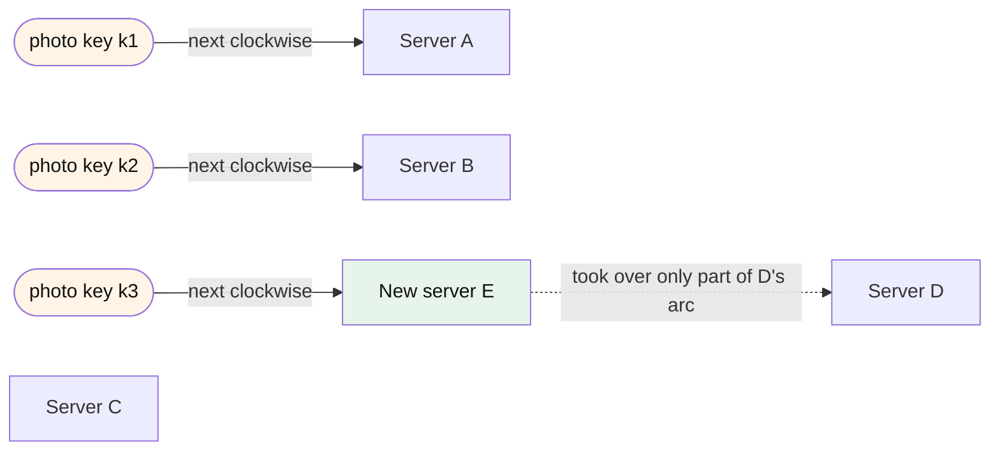

# What is consistent hashing?

## 1. Abstract

Anyone who spreads keys over a changing set of servers (caches, storage shards, backends) must pick each key's server without reshuffling everything when one joins or leaves. Consistent hashing assigns keys to servers so that a change in the set of servers moves only the keys needed to keep the load balanced, and no key moves between two servers that both stayed. The usual construction places servers and keys on a circle and gives each key to the next server clockwise.

**Key takeaways:**

- Plain `hash(key) mod n` remaps almost every key when `n` changes; consistent hashing moves about `1/n` of them.
- The defining property is monotonicity: keys move only to a new server, or off a removed one.
- The ring with many points per server is the classic construction, not the definition.
- It balances keys, not traffic: hot keys need other remedies.

## 2. Terminology

| Term | Definition |
|---|---|
| **Bucket** | Whatever a key is assigned to: a cache server, a shard, a backend. |
| **View** | The set of buckets one client knows about and hashes into. |
| **Ring** | The hash output range treated as a circle, on which buckets and keys are placed. |
| **Virtual node** | One of several points on the ring that all belong to the same physical bucket. |
| **Monotonicity** | When buckets are added, a key may move from an old bucket to a new one, never from one old bucket to another. |
| **Balance** | Each bucket receives about the same share of keys. |
| **[→]** | Our own reasoning, after a statement or on a section's heading: a conclusion, comparison or example no cited source states. |

## 3. Overview

Picture a photo-sharing site with four cache servers in front of its storage. Each photo's key is hashed to pick a cache, so every request for that photo hits the same server and finds it cached [→]. On a busy evening the team adds a fifth server. With the usual `hash(key) mod n`, changing `n` from 4 to 5 sends a key to a new server unless its hash happens to give the same remainder under both, which holds for only 4 of every 20 hash values: 80% of the photos change server at once, and almost every request misses [→]. Modular placement in general remaps nearly all keys when the number of slots changes [\[1\]](../sources/consistent-hashing-wikipedia.md#consistent-hashing---wikipedia), [\[2\]](../sources/data-partitioning-cassandra-dynamo-architecture.md#consistent-hashing-using-a-token-ring), and for a cache it means that suddenly all cached data is useless [\[3\]](../sources/consistent-hashing-karger-stoc1997.md#page-6).

Consistent hashing was invented to remove that cliff. Karger and colleagues at MIT introduced it in 1997 to spread web requests among a changing population of caches and relieve hot spots [\[4\]](../sources/consistent-hashing-wikipedia.md#history), [\[5\]](../sources/consistent-hashing-karger-stoc1997.md#page-1). It is now the partitioning layer of many distributed stores and load balancers: Amazon's Dynamo, Cassandra, Riak, Couchbase, OpenStack Swift and Akamai's content delivery network among them [\[6\]](../sources/consistent-hashing-wikipedia.md#examples). It answers a problem every [distributed system](what-is-a-distributed-system.md) with several storage nodes faces: nodes come and go [→].

## 4. Definition

### 4.1 In short

Consistent hashing is a hash function from keys to a set of buckets that changes as little as possible when the set of buckets changes [\[5\]](../sources/consistent-hashing-karger-stoc1997.md#page-1): when a bucket is added or removed, the expected fraction of keys that move is the minimum needed to keep the load balanced, about `1/n` of them for the `n`-th bucket [\[3\]](../sources/consistent-hashing-karger-stoc1997.md#page-6), [\[7\]](../sources/consistent-hashing-wikipedia.md#basic-technique). In the photo cache, the fifth server takes about a fifth of the photos, instead of four fifths moving everywhere [→].

The usual construction maps both servers and keys onto a circle and assigns each key to the next server clockwise [\[7\]](../sources/consistent-hashing-wikipedia.md#basic-technique). A new server takes over only the arc just before it, and a departing server's keys go to its clockwise neighbor, so a change affects only the server's immediate neighbors on the ring [\[8\]](../sources/amazon-dynamo-decandia-dynamo-sosp2007.md#page-6).

*Figure 4-1: Each key goes to the next server clockwise on the ring; a new server (green) takes keys only from the arc it lands in, here from server D, and no other assignment changes. Keys are orange.*

### 4.2 Precisely

Karger et al. define consistent hashing as a family of ranged hash functions, each taking a view (the set of buckets a client knows) and an item, and returning a bucket in that view [\[3\]](../sources/consistent-hashing-karger-stoc1997.md#page-6). They ask for four properties [\[3\]](../sources/consistent-hashing-karger-stoc1997.md#page-6):

- **Balance:** for a given view, each bucket receives about a `1/|V|` share of the items, with high probability;
- **Monotonicity:** when new buckets are added, "an item may move from an old bucket to a new bucket, but not from one old bucket to another";
- **Spread:** across all clients' views, an item is assigned to only a few different buckets;
- **Load:** across all views, a bucket is assigned only a few different items.

Their construction maps buckets and items to random points of the unit interval and sends each item to the closest bucket; each bucket gets about `log C` points, `C` an upper bound on the number of buckets [\[3\]](../sources/consistent-hashing-karger-stoc1997.md#page-6), the scheme Dynamo cites for its virtual nodes [\[8\]](../sources/amazon-dynamo-decandia-dynamo-sosp2007.md#page-6).

Three nuances:

- **Monotonicity is the core; spread and load are about inconsistent views.** Spread and load exist because each web client may know a different subset of caches. In a storage system where every client sees the same shards, only balance and monotonicity matter [\[9\]](../sources/consistent-hashing-lamping-veach-jump-hash.md#page-3). A scheme can therefore be a consistent hash without a ring at all [→].
- **Changes may come in any order.** Earlier schemes such as linear hashing let buckets be added only in sequence, while consistent hashing allows them to be added in an arbitrary order [\[10\]](../sources/consistent-hashing-karger-stoc1997.md#page-2), [\[4\]](../sources/consistent-hashing-wikipedia.md#history).
- **Balance is probabilistic.** A single random point per server leaves arcs of very different sizes; the guarantee needs many points per server, the virtual nodes [\[3\]](../sources/consistent-hashing-karger-stoc1997.md#page-6), [\[11\]](../sources/consistent-hashing-wikipedia.md#variance-reduction).

## 5. Key ideas

**Failure handling becomes a view change.** Once a client decides a server is down, it simply removes it from its view, and the hash function reassigns that server's work to the others [\[12\]](../sources/consistent-hashing-karger-stoc1997.md#page-9). When cache server C in the photo cache dies, only C's photos miss [→].

**Virtual nodes turn balance from luck into a parameter.** Giving each server many points on the ring evens out the arcs, and the number of points a server gets acts as its weight [\[11\]](../sources/consistent-hashing-wikipedia.md#variance-reduction). Chord, a peer-to-peer lookup service, reports that running "virtual nodes" per physical node reduces the load imbalance to a small constant factor [\[13\]](../sources/consistent-hashing-stoica-chord.md#page-4). Virtual nodes also spread a failed server's keys over many survivors instead of doubling the load of one neighbor [\[14\]](../sources/consistent-hashing-wikipedia.md#practical-extensions).

**Lookups cost a search, not a division.** On the ring, finding a key's server is a binary search over the sorted server points, `O(log N)` instead of the `O(1)` of a modulo, and adding a server costs about `K/N` key moves instead of nearly all `K` [\[15\]](../sources/consistent-hashing-wikipedia.md#complexity).

**It balances keys, not traffic.** Equal shares of keys give equal load only when requests spread evenly over keys; a single hot photo still lands on one server, and the scheme needs extensions such as placing hot items on several consecutive servers [\[14\]](../sources/consistent-hashing-wikipedia.md#practical-extensions).

## 6. Boundaries

- **Rendezvous (highest-random-weight) hashing is in.** Each key scores every server with a hash and picks the highest score. It meets the same minimal-disruption property without a ring, and the ring is in fact a special case of it [\[16\]](../sources/consistent-hashing-wikipedia-rendezvous-hashing.md#consistent-hashing-is-a-special-case-of-rendezvous-hashing). Karger et al. already call this construction consistent but slow, since it scores every bucket [\[17\]](../sources/consistent-hashing-karger-stoc1997.md#page-8).
- **Jump consistent hash is in, with a limit.** It is balanced and monotone with no stored state, but buckets must be numbered sequentially, so only the last one can be removed [\[18\]](../sources/consistent-hashing-lamping-veach-jump-hash.md#page-1). It suits storage shards better than the photo cache, where any server may fail [→].
- **Modulo hashing is out.** It balances keys, but changing the number of servers rearranges nearly all of them [\[18\]](../sources/consistent-hashing-lamping-veach-jump-hash.md#page-1).
- **A distributed hash table is a neighbor, not a synonym.** Chord uses consistent hashing to decide which node holds a key, and adds the routing that lets a node find that holder without knowing every other node [\[19\]](../sources/consistent-hashing-stoica-chord.md#page-1).

## 7. Where to go next

- [How do the ways of hashing keys to servers compare: modulo, ring, rendezvous, jump, Maglev and bounded loads?](how-do-the-ways-of-hashing-keys-to-servers-compare.md)
- [How does a consistent hashing ring work, and what are its weaknesses and tuning knobs?](how-does-a-consistent-hashing-ring-work-and-what-are-its-weaknesses-and-tuning-knobs.md)
- [How did Amazon's Dynamo use consistent hashing, and what did DynamoDB keep of it?](how-did-amazons-dynamo-use-consistent-hashing-and-what-did-dynamodb-keep-of-it.md)

## 8. References

### 8.1 Sources read

- [consistent-hashing-karger-stoc1997](../sources/consistent-hashing-karger-stoc1997.md): the original definition and its four properties
- [consistent-hashing-wikipedia](../sources/consistent-hashing-wikipedia.md): the basic ring, virtual nodes, complexity, users
- [consistent-hashing-wikipedia-rendezvous-hashing](../sources/consistent-hashing-wikipedia-rendezvous-hashing.md): rendezvous hashing and the ring as its special case
- [consistent-hashing-lamping-veach-jump-hash](../sources/consistent-hashing-lamping-veach-jump-hash.md): the modulo example, which properties storage needs, jump hash's limit
- [consistent-hashing-stoica-chord](../sources/consistent-hashing-stoica-chord.md): virtual nodes and consistent hashing inside a DHT
- [data-partitioning-cassandra-dynamo-architecture](../sources/data-partitioning-cassandra-dynamo-architecture.md): naive hashing's failure
- [amazon-dynamo-decandia-dynamo-sosp2007](../sources/amazon-dynamo-decandia-dynamo-sosp2007.md): the neighbor-only effect of a change

### 8.2 Citations

1. [consistent-hashing-wikipedia: Consistent hashing - Wikipedia](../sources/consistent-hashing-wikipedia.md#consistent-hashing---wikipedia)
2. [data-partitioning-cassandra-dynamo-architecture: Consistent Hashing using a Token Ring](../sources/data-partitioning-cassandra-dynamo-architecture.md#consistent-hashing-using-a-token-ring)
3. [consistent-hashing-karger-stoc1997: Page 6](../sources/consistent-hashing-karger-stoc1997.md#page-6)
4. [consistent-hashing-wikipedia: History](../sources/consistent-hashing-wikipedia.md#history)
5. [consistent-hashing-karger-stoc1997: Page 1](../sources/consistent-hashing-karger-stoc1997.md#page-1)
6. [consistent-hashing-wikipedia: Examples](../sources/consistent-hashing-wikipedia.md#examples)
7. [consistent-hashing-wikipedia: Basic technique](../sources/consistent-hashing-wikipedia.md#basic-technique)
8. [amazon-dynamo-decandia-dynamo-sosp2007: Page 6](../sources/amazon-dynamo-decandia-dynamo-sosp2007.md#page-6)
9. [consistent-hashing-lamping-veach-jump-hash: Page 3](../sources/consistent-hashing-lamping-veach-jump-hash.md#page-3)
10. [consistent-hashing-karger-stoc1997: Page 2](../sources/consistent-hashing-karger-stoc1997.md#page-2)
11. [consistent-hashing-wikipedia: Variance reduction](../sources/consistent-hashing-wikipedia.md#variance-reduction)
12. [consistent-hashing-karger-stoc1997: Page 9](../sources/consistent-hashing-karger-stoc1997.md#page-9)
13. [consistent-hashing-stoica-chord: Page 4](../sources/consistent-hashing-stoica-chord.md#page-4)
14. [consistent-hashing-wikipedia: Practical extensions](../sources/consistent-hashing-wikipedia.md#practical-extensions)
15. [consistent-hashing-wikipedia: Complexity](../sources/consistent-hashing-wikipedia.md#complexity)
16. [consistent-hashing-wikipedia-rendezvous-hashing: Consistent hashing is a special case of Rendezvous hashing](../sources/consistent-hashing-wikipedia-rendezvous-hashing.md#consistent-hashing-is-a-special-case-of-rendezvous-hashing)
17. [consistent-hashing-karger-stoc1997: Page 8](../sources/consistent-hashing-karger-stoc1997.md#page-8)
18. [consistent-hashing-lamping-veach-jump-hash: Page 1](../sources/consistent-hashing-lamping-veach-jump-hash.md#page-1)
19. [consistent-hashing-stoica-chord: Page 1](../sources/consistent-hashing-stoica-chord.md#page-1)

## 9. Metadata

- **Version:** 1.1
- **Template:** concept_brief_overview
- **Model:** claude-opus-5-5
- **Created:** 2026-10-23
- **Last modified:** 2026-10-23
- **History:**
  - 1.1 (2026-10-23): Lint: virtual nodes' origin cited to Dynamo; Where to go next links the three narratives; body trimmed to its budget
  - 1.0 (2026-10-23): First version.
- **Reading plan:**
  1. `consistent-hashing-wikipedia-rendezvous-hashing`, in full: medium relevance, authority C, undated
  2. `data-partitioning-cassandra-dynamo-architecture`, in full: medium relevance, authority A, undated
  3. `consistent-hashing-stoica-chord`, in full: medium relevance, authority A, 2001-08-27
  4. `amazon-dynamo-decandia-dynamo-sosp2007`, in full: medium relevance, authority A, 2007-10-14
  5. `consistent-hashing-lamping-veach-jump-hash`, in full: medium relevance, authority A, 2014-06-09
  6. `consistent-hashing-wikipedia`, in full: high relevance, authority C, undated
  7. `consistent-hashing-karger-stoc1997`, in full: high relevance, authority A, 1997-05-04
  8. `consistent-hashing-mirrokni-bounded-loads`, abstract only: low relevance
  9. `consistent-hashing-eisenbud-maglev`, abstract only: low relevance
  10. `amazon-dynamo-elhemali-dynamodb-atc2022`, abstract only: low relevance
  11. `amazon-dynamo-aws-dynamodb-partitions`, abstract only: low relevance
  12. `consistent-hashing-gryski-algorithmic-tradeoffs`, not read: a link, no saved copy
