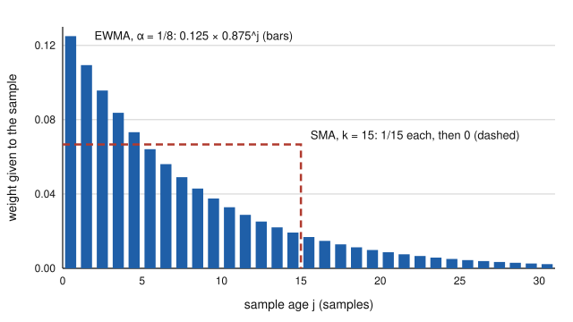
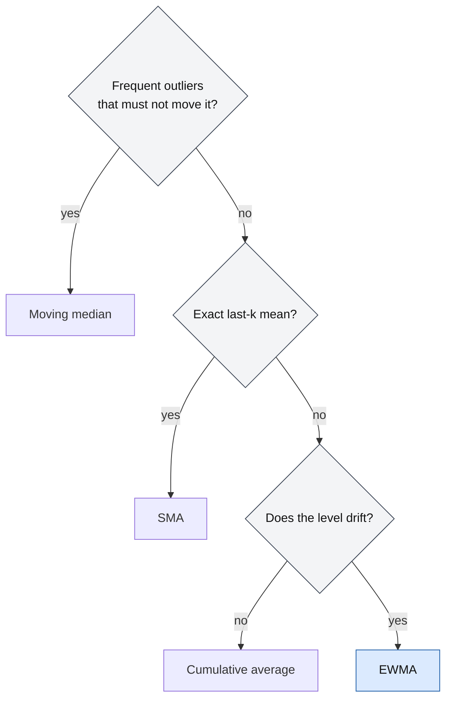
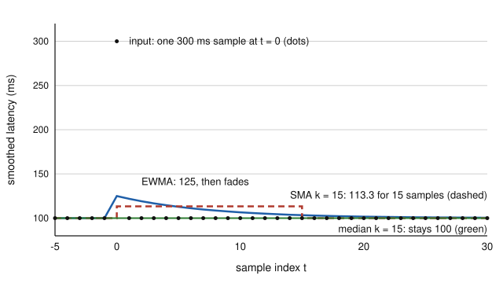
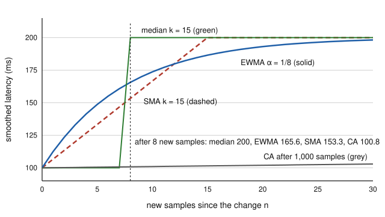

# When should software use an EWMA instead of other moving averages?

## 1. Abstract

Software that smooths a noisy measurement stream, such as per-backend latencies, must pick a moving average. The pick sets its memory, its lag and how far outliers move it. Pick an exponentially weighted moving average (EWMA) when it runs online over many streams whose level drifts: it stores one number per stream. Pick a simple moving average when the contract is the mean of exactly the last $k$ samples. Pick a moving median when frequent outliers must not move the value, and a cumulative average when the level never drifts.

**Key takeaways:**

- An EWMA stores one number per stream; a $k$-sample window stores $k$ samples.
- With $\alpha = 2/(k+1)$, an EWMA forecasts about as well as a $k$-sample simple moving average.
- Outliers move every mean; a moving median only once they fill half its window.
- A "1-minute" EWMA is not a 1-minute window.

## 2. Terminology

| Term | Definition |
|---|---|
| **$x_t$, $s_t$** | The sample at step $t$; the EWMA's output after it [\[1\]](../sources/ewma-wikipedia-exponential-smoothing.md#basic-simple-exponential-smoothing). |
| **EWMA** | Exponentially weighted moving average: $s_t = \alpha x_t + (1-\alpha) s_{t-1}$ [\[1\]](../sources/ewma-wikipedia-exponential-smoothing.md#basic-simple-exponential-smoothing). |
| **α (smoothing factor)** | The weight, $0 \le \alpha \le 1$, of each new sample in an EWMA; a larger α smooths less [\[1\]](../sources/ewma-wikipedia-exponential-smoothing.md#basic-simple-exponential-smoothing). |
| **τ (time constant)** | The time an EWMA takes to reach 63.2% of a step in its input [\[2\]](../sources/ewma-wikipedia-exponential-smoothing.md#time-constant). |
| **SMA** | Simple moving average: the unweighted mean of the last $k$ samples [\[3\]](../sources/moving-averages-wikipedia-moving-average.md#simple-moving-average). |
| **$k$** | A window's length, in samples [\[3\]](../sources/moving-averages-wikipedia-moving-average.md#simple-moving-average). |
| **CA** | Cumulative average: the mean of every sample so far [\[4\]](../sources/moving-averages-wikipedia-moving-average.md#cumulative-average). |
| **[→]** | Our own reasoning, after a statement or on a heading: a conclusion, comparison or example no cited source states. |
| **[?]** | A gap: something the question needs that the sources don't answer. |

## 3. The choices

A load balancer ranking backends, or a latency dashboard, smooths each measurement before using it. Each mean gives past samples its own weights [\[5\]](../sources/moving-averages-wikipedia-moving-average.md#weighted-moving-average); the moving median takes their middle value instead [\[6\]](../sources/moving-averages-wikipedia-moving-average.md#moving-median). Those weights fix how fast the value follows a real change, how far one bad sample moves it, and what each stream costs to keep [→].

**The base scenario** [→]. A client library sends requests to 10,000 backends and keeps a smoothed latency for each. It uses that value to route requests and to draw a dashboard. Samples arrive one per request, near 100 ms, with a few milliseconds of jitter and a rare 300 ms outlier. The level drifts: a backend can slow to 200 ms and stay there. The library needs:

- a value after every sample, from the first;
- at least half of a real slowdown shown within 8 samples;
- as little state per backend as possible.

Each subsection below changes one condition until its candidate wins.

### 3.1 An EWMA keeps one number and wins the base scenario

Each new sample moves the EWMA a fraction α of the way toward itself; [What is an EWMA, and how does it work?](what-is-an-ewma-exponentially-weighted-moving-average-and-how-does-it-work.md) explains the mechanism. A sample $j$ steps old carries weight $\alpha(1-\alpha)^j$, so old samples fade but never reach zero [\[7\]](../sources/ewma-wikipedia-exponential-smoothing.md#exponential-naming), [\[8\]](../sources/moving-averages-wikipedia-moving-average.md#exponential-moving-average). The EWMA stores only its last output [\[9\]](../sources/ewma-wikipedia-exponential-smoothing.md#comparison-with-moving-average), and gives a value without a minimum number of samples [\[1\]](../sources/ewma-wikipedia-exponential-smoothing.md#basic-simple-exponential-smoothing).

Its subtle difference from the SMA: with $\alpha = 2/(k+1)$ the two have about the same forecast error, yet the EWMA weights all past data [\[9\]](../sources/ewma-wikipedia-exponential-smoothing.md#comparison-with-moving-average). For $k = 15$, that gives $\alpha = 2/16 = 1/8$ [\[9\]](../sources/ewma-wikipedia-exponential-smoothing.md#comparison-with-moving-average). After 8 samples of a step, this EWMA shows $1 - (7/8)^8 = 66\%$ of it [\[1\]](../sources/ewma-wikipedia-exponential-smoothing.md#basic-simple-exponential-smoothing).

**It wins the base scenario as it stands:** the SMA and the moving median also meet the lag condition, but each stores 15 samples per backend; the CA keeps two numbers but shows under 1% of a slowdown after 8 samples [→].

### 3.2 An SMA wins when the window is the contract

**Changed condition** [→]: a service-level report defines latency as the mean of exactly the last 15 requests.

The SMA weights each of the last $k$ samples by $1/k$ [\[3\]](../sources/moving-averages-wikipedia-moving-average.md#simple-moving-average). It updates from a circular buffer, adding the new sample and dropping the oldest [\[3\]](../sources/moving-averages-wikipedia-moving-average.md#simple-moving-average). Its subtle difference from the EWMA is the hard edge (Figure 3-1). A sample counts fully for $k$ steps, then not at all, so the value also moves when an old sample leaves [\[3\]](../sources/moving-averages-wikipedia-moving-average.md#simple-moving-average). With $k = 15$, it shows $8/15 = 53\%$ of a step after 8 samples [\[3\]](../sources/moving-averages-wikipedia-moving-average.md#simple-moving-average).

*Figure 3-1: A 15-sample SMA's weights stop at age 15; an EWMA's, with α = 1/8, fade and never reach zero [\[3\]](../sources/moving-averages-wikipedia-moving-average.md#simple-moving-average), [\[7\]](../sources/ewma-wikipedia-exponential-smoothing.md#exponential-naming).*

A weighted moving average (WMA) tapers its weights linearly to zero but still stores $k$ samples [\[5\]](../sources/moving-averages-wikipedia-moving-average.md#weighted-moving-average).

### 3.3 A moving median wins when outliers are frequent

**Changed condition** [→]: one sample in ten is a 300 ms pause, and the routing value must not move with these pauses.

The moving median takes the median of the last $k$ samples instead of their mean [\[6\]](../sources/moving-averages-wikipedia-moving-average.md#moving-median). Its subtle difference from the SMA: it is not an average, so a rare huge sample barely moves it [\[6\]](../sources/moving-averages-wikipedia-moving-average.md#moving-median). Here every mean settles near $100 + 0.1 \times 200 = 120$ ms, while a 15-sample moving median stays near 100 ms unless 8 of its 15 samples are pauses [→]. A mean is optimal when deviations are normal, a median when they are heavy-tailed (Laplace) [\[6\]](../sources/moving-averages-wikipedia-moving-average.md#moving-median).

### 3.4 A cumulative average wins when the level never drifts

**Changed condition** [→]: the level never drifts, and the wanted number is the mean latency over a whole benchmark run.

The CA is the mean of every sample so far, updated from the previous mean and a count [\[4\]](../sources/moving-averages-wikipedia-moving-average.md#cumulative-average). Its subtle difference from the EWMA: after $n$ samples, the CA's step toward the next one, $1/(n+1)$ of the gap, shrinks forever, while α stays fixed [\[4\]](../sources/moving-averages-wikipedia-moving-average.md#cumulative-average), [\[1\]](../sources/ewma-wikipedia-exponential-smoothing.md#basic-simple-exponential-smoothing). After 1,000 samples at 100 ms, 8 samples at 200 ms move it by $8 \times 100 / 1008 = 0.8$ ms [\[4\]](../sources/moving-averages-wikipedia-moving-average.md#cumulative-average).

## 4. When to choose which

The conditions the scenarios changed decide the choice (Figure 4-1).

*Figure 4-1: Three questions decide the choice; blue marks the base scenario's answer, the EWMA [→].*

- **Use an EWMA** online when the level drifts; its one value per stream counts most over many streams (see Memory and cost per update) [→]. Set $\alpha = 2/(k+1)$ for the window $k$ you would accept [\[9\]](../sources/ewma-wikipedia-exponential-smoothing.md#comparison-with-moving-average). It then reaches 63% of a step in about $1/\alpha$ samples and 95% in about $3/\alpha$, for small α: 8 and 24 for $\alpha = 1/8$ (7.5 and 22 exactly) [\[2\]](../sources/ewma-wikipedia-exponential-smoothing.md#time-constant), [\[1\]](../sources/ewma-wikipedia-exponential-smoothing.md#basic-simple-exponential-smoothing).
- **Use an SMA** when the last $k$ samples are the contract [→]. It also tolerates skipped samples [\[1\]](../sources/ewma-wikipedia-exponential-smoothing.md#basic-simple-exponential-smoothing).
- **Use a moving median** when frequent outliers must not move the value (see Effect of one outlier) [→].
- **Use a CA** when the level doesn't drift [→]. Once it drifts, switch to an EWMA: the CA's step keeps shrinking [\[4\]](../sources/moving-averages-wikipedia-moving-average.md#cumulative-average).

## 5. At a glance

| Dimension | SMA ($k = 15$) | EWMA ($\alpha = 1/8$) | CA | Moving median ($k = 15$) |
|---|---|---|---|---|
| Memory and cost per update | $k$ samples; 3 arithmetic steps [\[3\]](../sources/moving-averages-wikipedia-moving-average.md#simple-moving-average) | one value [\[9\]](../sources/ewma-wikipedia-exponential-smoothing.md#comparison-with-moving-average) | mean and count [\[4\]](../sources/moving-averages-wikipedia-moving-average.md#cumulative-average) | $k$ samples and an ordered index [\[6\]](../sources/moving-averages-wikipedia-moving-average.md#moving-median) |
| Effect of one outlier | +13.3 ms for 15 samples, then gone at once [\[3\]](../sources/moving-averages-wikipedia-moving-average.md#simple-moving-average) | +25 ms, shrinking by 7/8 per sample [\[1\]](../sources/ewma-wikipedia-exponential-smoothing.md#basic-simple-exponential-smoothing) | +0.2 ms after 1,000 samples, then fading as 200/n [\[4\]](../sources/moving-averages-wikipedia-moving-average.md#cumulative-average) | barely moves [\[6\]](../sources/moving-averages-wikipedia-moving-average.md#moving-median) |
| Lag after a real change | about $k/2$ samples; centring removes it offline [\[3\]](../sources/moving-averages-wikipedia-moving-average.md#simple-moving-average) | differs by frequency; no shift removes it [\[9\]](../sources/ewma-wikipedia-exponential-smoothing.md#comparison-with-moving-average) | its weights' mean age, $(n-1)/2$ samples, grows with every sample [\[4\]](../sources/moving-averages-wikipedia-moving-average.md#cumulative-average) | jumps once 8 of 15 samples are new [→] |
| Missed and uneven samples | a skipped sample loses less [\[1\]](../sources/ewma-wikipedia-exponential-smoothing.md#basic-simple-exponential-smoothing) | a skipped sample loses more; α can follow the time between samples [\[1\]](../sources/ewma-wikipedia-exponential-smoothing.md#basic-simple-exponential-smoothing), [\[2\]](../sources/ewma-wikipedia-exponential-smoothing.md#time-constant) | a missed sample only goes uncounted [→] | not in the sources [?] |
| Tuning and labels | one integer, $k$ [\[3\]](../sources/moving-averages-wikipedia-moving-average.md#simple-moving-average) | α or τ, fittable to history [\[10\]](../sources/ewma-wikipedia-exponential-smoothing.md#optimization) | nothing to tune [\[4\]](../sources/moving-averages-wikipedia-moving-average.md#cumulative-average) | one integer, $k$ [\[6\]](../sources/moving-averages-wikipedia-moving-average.md#moving-median) |

## 6. Dimensions to think through

### 6.1 Memory and cost per update

In the base scenario, each backend's state is multiplied by 10,000 [→]. With $k = 15$, an SMA or a moving median stores $10{,}000 \times 15 = 150{,}000$ samples [\[3\]](../sources/moving-averages-wikipedia-moving-average.md#simple-moving-average), [\[6\]](../sources/moving-averages-wikipedia-moving-average.md#moving-median); a CA, a mean and a count each [\[4\]](../sources/moving-averages-wikipedia-moving-average.md#cumulative-average); an EWMA, 10,000 values [\[9\]](../sources/ewma-wikipedia-exponential-smoothing.md#comparison-with-moving-average).

### 6.2 Effect of one outlier

One 300 ms sample should not drive traffic from a healthy backend for long [→]. In Figure 6-1, a 15-sample SMA rises by $200/15 = 13.3$ ms, holds for 15 samples, then drops at once when the outlier leaves [\[3\]](../sources/moving-averages-wikipedia-moving-average.md#simple-moving-average). An EWMA with $\alpha = 1/8$ rises by $200/8 = 25$ ms, then the excess shrinks by $7/8$ per sample: $25 \times (7/8)^{15} = 3.4$ ms remains 15 samples later [\[1\]](../sources/ewma-wikipedia-exponential-smoothing.md#basic-simple-exponential-smoothing). A moving median barely moves [\[6\]](../sources/moving-averages-wikipedia-moving-average.md#moving-median). A CA after 1,000 samples rises by $200/1001 = 0.2$ ms, then fades only as $200/n$ ms after $n$ samples [\[4\]](../sources/moving-averages-wikipedia-moving-average.md#cumulative-average).

*Figure 6-1: After one 300 ms outlier, the 15-sample SMA steps up and falls back at once, the EWMA with α = 1/8 jumps higher and fades, and the moving median stays put [\[3\]](../sources/moving-averages-wikipedia-moving-average.md#simple-moving-average), [\[1\]](../sources/ewma-wikipedia-exponential-smoothing.md#basic-simple-exponential-smoothing), [\[6\]](../sources/moving-averages-wikipedia-moving-average.md#moving-median).*

Finagle's load balancer does the opposite on purpose. Its Peak EWMA resets when a round-trip time exceeds the current value, so a spike counts in full {ewma-finagle-ema-source#L29-L43}, [\[11\]](../sources/ewma-finagle-peak-ewma-source.md#L61-L66). The design reacts to slow backends quickly [\[12\]](../sources/ewma-finagle-clients-docs.md#power-of-two-choices-p2c--peak-ewma-2).

### 6.3 Lag after a real change

The base scenario needs half of a slowdown within 8 samples [→]. Figure 6-2 sets the step results of Sections 3.1, 3.2 and 3.4 side by side, and adds the moving median: it jumps to 200 ms once 8 of its 15 samples are new [→]. A trailing SMA lags by about half its window [\[3\]](../sources/moving-averages-wikipedia-moving-average.md#simple-moving-average): its weights' mean age is $(0 + 1 + \dots + 14)/15 = 7$ samples [→]. The EWMA's weights have mean age $\sum_j j\,\alpha(1-\alpha)^j = (1-\alpha)/\alpha = 7$ samples too [\[7\]](../sources/ewma-wikipedia-exponential-smoothing.md#exponential-naming); equal lag is what $\alpha = 2/(k+1)$ matches [→]. But its delay differs by frequency, so no single shift removes it [\[9\]](../sources/ewma-wikipedia-exponential-smoothing.md#comparison-with-moving-average).

*Figure 6-2: After a step from 100 to 200 ms, the EWMA with α = 1/8 is fastest at first. The moving median catches up at 8 samples, and the CA barely moves [\[1\]](../sources/ewma-wikipedia-exponential-smoothing.md#basic-simple-exponential-smoothing), [\[3\]](../sources/moving-averages-wikipedia-moving-average.md#simple-moving-average), [\[4\]](../sources/moving-averages-wikipedia-moving-average.md#cumulative-average), [\[6\]](../sources/moving-averages-wikipedia-moving-average.md#moving-median).*

### 6.4 Missed and uneven samples

Requests arrive unevenly and samples get lost, so an average that assumes even, complete samples drifts from the truth [→]. A skipped sample costs an EWMA more information than an SMA, whose equal weights let it skip some with less loss [\[1\]](../sources/ewma-wikipedia-exponential-smoothing.md#basic-simple-exponential-smoothing). For uneven timing, an EWMA can compute α from the time $\Delta t$ since the last sample, $\alpha = 1 - e^{-\Delta t/\tau}$ [\[2\]](../sources/ewma-wikipedia-exponential-smoothing.md#time-constant), {ewma-finagle-ema-source#L29-L43}. Finagle does this because its samples are unevenly spaced [\[13\]](../sources/ewma-finagle-peak-ewma-source.md#L47-L53). The sources don't say how an SMA or a moving median should handle uneven timing [?].

### 6.5 Tuning and labels

A wrong parameter ranks backends by noise or by stale data, and a wrong label misleads the dashboard's reader [→]. An SMA or a moving median takes one integer, $k$ [\[3\]](../sources/moving-averages-wikipedia-moving-average.md#simple-moving-average), [\[6\]](../sources/moving-averages-wikipedia-moving-average.md#moving-median). An EWMA takes α or τ; with history, α can be fitted by minimizing squared one-step forecast errors [\[10\]](../sources/ewma-wikipedia-exponential-smoothing.md#optimization). Its seed, usually the first sample, weighs heavily on early values, more so for small α [\[14\]](../sources/ewma-wikipedia-exponential-smoothing.md#choosing-the-initial-smoothed-value). Its labels mislead: Linux's "1-minute" load average takes 63% of its weight from the last minute and 37% from before [\[15\]](../sources/ewma-wikipedia-load-computing.md#load-average). So label an EWMA by its time constant, not as a window [→].

## 7. Where to go next

- [What is an EWMA, and how does it work?](what-is-an-ewma-exponentially-weighted-moving-average-and-how-does-it-work.md)
- How does Holt's double exponential smoothing follow a trend, where a plain EWMA does poorly [\[16\]](../sources/ewma-wikipedia-exponential-smoothing.md#double-exponential-smoothing-holt-linear)? (Not yet a narrative.)

## 8. References

### 8.1 Sources read

- [moving-averages-wikipedia-moving-average](../sources/moving-averages-wikipedia-moving-average.md): the SMA, WMA, cumulative average and moving median.
- [ewma-wikipedia-exponential-smoothing](../sources/ewma-wikipedia-exponential-smoothing.md): the EWMA's weights, time constant, seed and fitting, and its comparison with the SMA, lag and skipped samples included.
- [ewma-wikipedia-load-computing](../sources/ewma-wikipedia-load-computing.md): load averages as EWMAs, and what their "1-minute" label means.
- [ewma-finagle-clients-docs](../sources/ewma-finagle-clients-docs.md): the Peak EWMA load metric and what it is for.
- [ewma-finagle-peak-ewma-source](../sources/ewma-finagle-peak-ewma-source.md): the peak reset and the time-based weight.

### 8.2 Citations

1. [ewma-wikipedia-exponential-smoothing: Basic (simple) exponential smoothing](../sources/ewma-wikipedia-exponential-smoothing.md#basic-simple-exponential-smoothing)
2. [ewma-wikipedia-exponential-smoothing: Time constant](../sources/ewma-wikipedia-exponential-smoothing.md#time-constant)
3. [moving-averages-wikipedia-moving-average: Simple moving average](../sources/moving-averages-wikipedia-moving-average.md#simple-moving-average)
4. [moving-averages-wikipedia-moving-average: Cumulative average](../sources/moving-averages-wikipedia-moving-average.md#cumulative-average)
5. [moving-averages-wikipedia-moving-average: Weighted moving average](../sources/moving-averages-wikipedia-moving-average.md#weighted-moving-average)
6. [moving-averages-wikipedia-moving-average: Moving median](../sources/moving-averages-wikipedia-moving-average.md#moving-median)
7. [ewma-wikipedia-exponential-smoothing: "Exponential" naming](../sources/ewma-wikipedia-exponential-smoothing.md#exponential-naming)
8. [moving-averages-wikipedia-moving-average: Exponential moving average](../sources/moving-averages-wikipedia-moving-average.md#exponential-moving-average)
9. [ewma-wikipedia-exponential-smoothing: Comparison with moving average](../sources/ewma-wikipedia-exponential-smoothing.md#comparison-with-moving-average)
10. [ewma-wikipedia-exponential-smoothing: Optimization](../sources/ewma-wikipedia-exponential-smoothing.md#optimization)
11. [ewma-finagle-peak-ewma-source: L61-L66](../sources/ewma-finagle-peak-ewma-source.md#L61-L66)
12. [ewma-finagle-clients-docs: Power of Two Choices (P2C) + Peak EWMA 2¶](../sources/ewma-finagle-clients-docs.md#power-of-two-choices-p2c--peak-ewma-2)
13. [ewma-finagle-peak-ewma-source: L47-L53](../sources/ewma-finagle-peak-ewma-source.md#L47-L53)
14. [ewma-wikipedia-exponential-smoothing: Choosing the initial smoothed value](../sources/ewma-wikipedia-exponential-smoothing.md#choosing-the-initial-smoothed-value)
15. [ewma-wikipedia-load-computing: Load average](../sources/ewma-wikipedia-load-computing.md#load-average)
16. [ewma-wikipedia-exponential-smoothing: Double exponential smoothing (Holt linear)](../sources/ewma-wikipedia-exponential-smoothing.md#double-exponential-smoothing-holt-linear)

## 9. Metadata

- **Version:** 2.1
- **Template:** comparison
- **Language:** en
- **Model:** claude-opus-5-5
- **Created:** 2026-10-23
- **Last modified:** 2026-11-24
- **Words:** 2,050 (about 9 min)
- **History:**
  - 2.1 (2026-11-24): Lint: the CA's outlier effect fades as 200/n rather than staying; a skipped sample costs an EWMA information, not the ability to run; the base-scenario win stated by what separates the candidates; the diagram asks only conditions the scenarios change; equal lag of SMA and EWMA derived; the EWMA's blue used for its pick; delta t as in the EWMA narrative
  - 2.0 (2026-11-24): Regenerated under sllmwiki 1.4.0's guides: one base scenario, a latency per backend for 10,000 backends; each candidate wins when one condition changes; the decision diagram asks exactly those three conditions; three SVG charts of weights, one outlier and a step; every number recomputed
  - 1.1 (2026-10-25): Openly licensed sources only, for a public demo: the DSP Guide, NIST, FPP3, Jacobson, RFC 6298, the Linux kernel helper and Gregg (now links) replaced by Wikipedia and Finagle; the SMA's optimal-noise and recursive-phase claims, which no open source states, removed
  - 1.0 (2026-10-23): First version.
- **Reading plan:**
  1. `what-is-an-ewma-exponentially-weighted-moving-average-and-how-does-it-work`, in full: existing narrative, background
  2. `ewma-wikipedia-load-computing`, in full: medium relevance, authority C, undated
  3. `ewma-wikipedia-ewma-chart`, in full: medium relevance, authority C, undated
  4. `ewma-finagle-peak-ewma-source`, in full: medium relevance, authority A, undated
  5. `ewma-finagle-clients-docs`, in full: medium relevance, authority A, undated
  6. `moving-averages-wikipedia-moving-average`, in full: high relevance, authority C, undated
  7. `ewma-wikipedia-exponential-smoothing`, in full: high relevance, authority C, undated
  8. `ewma-finagle-ema-source`, abstract only: low relevance
  9. `ewma-wikipedia-low-pass-filter`, abstract only: low relevance
  10. `ewma-nist-ewma-control-charts`, not read: a link, no saved copy
  11. `ewma-nist-single-exponential-smoothing`, not read: a link, no saved copy
  12. `moving-averages-nist-single-moving-average`, not read: a link, no saved copy
  13. `ewma-rfc6298-tcp-retransmission-timer`, not read: a link, no saved copy
  14. `ewma-linkerd-beyond-round-robin`, not read: a link, no saved copy
  15. `ewma-brendan-gregg-linux-load-averages`, not read: a link, no saved copy
  16. `ewma-fpp3-simple-exponential-smoothing`, not read: a link, no saved copy
  17. `ewma-jacobson-congestion-avoidance`, not read: a link, no saved copy
  18. `ewma-finch-incremental-weighted-mean-variance`, not read: a link, no saved copy
  19. `ewma-smith-dspguide-recursive-filters`, not read: a link, no saved copy
  20. `ewma-linux-kernel-average-h-source`, not read: a link, no saved copy
  21. `moving-averages-smith-dspguide-moving-average-filters`, not read: a link, no saved copy
