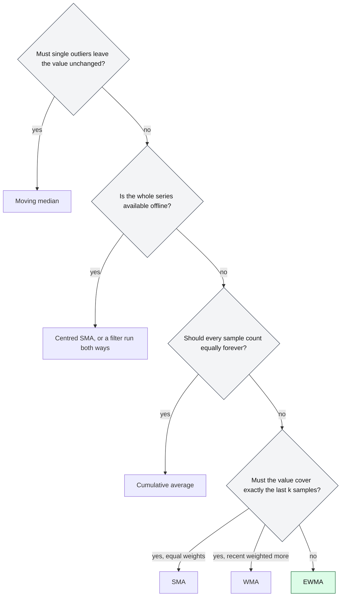

# When should software use an EWMA instead of other moving averages?

## 1. Abstract

Software that smooths a noisy measurement stream, such as latencies or round-trip times, must pick a moving average. Pick an EWMA when it runs online over many streams, should forget gradually, and may store one number per stream. Pick a simple moving average for an exact last-k window or offline smoothing, a moving median when outliers must not move the value, and a cumulative average when every sample counts forever.

**Key takeaways:**

- An EWMA stores one number per stream; a k-sample window stores k samples.
- An EWMA with α = 2/(k+1) forecasts about as well as a k-sample SMA.
- Neither mean resists outliers; a moving median does.
- An EWMA's lag can't be shifted away, and its "1-minute" label isn't a 1-minute window.

## 2. Terminology

| Term | Definition |
|---|---|
| **$x_t$** | The sample at step $t$. |
| **SMA** | Simple moving average: the unweighted mean of the last $k$ samples. |
| **WMA** | Weighted moving average with weights $k, k-1, \dots, 1$ over the last $k$ samples. |
| **EWMA** | Exponentially weighted moving average: $s_t = \alpha x_t + (1-\alpha) s_{t-1}$. |
| **CA** | Cumulative average: the mean of every sample so far. |
| **α** | The EWMA's smoothing factor, $0 < \alpha \le 1$; larger means less smoothing. |
| **$k$** | A window's length, in samples. |
| **FIR, IIR filter** | Finite or infinite impulse response: whether an input's effect on the output ends after a fixed number of steps or only decays. |
| **[→]** | Our own reasoning, after a statement or on a section's heading: a conclusion, comparison or example no cited source states. |
| **[?]** | A gap, after a statement or on a heading: something the question needs that the sources don't answer. |

## 3. The choices

Software that acts on a measurement smooths it first, and the rule decides how fast it notices change, how much one bad sample sways it, and what each stream costs [→]. The candidates sit between two extremes, trusting only the latest sample or weighting all samples equally, and the EWMA lies between them [\[1\]](../sources/ewma-fpp3-simple-exponential-smoothing.md#81-simple-exponential-smoothing).

**Base scenario.** A client library tracks the latency of each of thousands of backends, to route requests and to show a smoothed latency on a dashboard. Samples arrive around 100 ms, with a few milliseconds of jitter and the occasional 300 ms outlier. The library wants a value after every sample, little memory per backend, and to follow a real slowdown within about 15 samples [→].

### 3.1 Simple moving average (SMA)

The SMA is the mean of the last $k$ samples, each weighted $1/k$ [\[2\]](../sources/moving-averages-wikipedia-moving-average.md#simple-moving-average), [\[3\]](../sources/moving-averages-nist-single-moving-average.md#6421-single-moving-average). It updates in constant time from a buffer of the last $k$ samples. Its subtle difference from the EWMA is the hard edge: a sample counts fully for $k$ steps, then not at all, so the output also moves when old data drops out [\[2\]](../sources/moving-averages-wikipedia-moving-average.md#simple-moving-average).

**It wins when** the dashboard must show the mean of exactly the last $k$ requests, or the series is analysed offline: a centred SMA has no time shift, [\[2\]](../sources/moving-averages-wikipedia-moving-average.md#simple-moving-average) and among all linear filters the SMA gives the lowest noise for a given step sharpness [\[4\]](../sources/moving-averages-smith-dspguide-moving-average-filters.md#page-3).

### 3.2 Weighted moving average (WMA)

The WMA tapers its weights linearly to zero across the window, and ignores everything outside the window [\[5\]](../sources/moving-averages-wikipedia-moving-average.md#weighted-moving-average). It updates incrementally but still needs a buffer of the window [\[5\]](../sources/moving-averages-wikipedia-moving-average.md#weighted-moving-average). Its difference from the EWMA: the weights reach zero at a finite age instead of shrinking forever [\[6\]](../sources/moving-averages-wikipedia-moving-average.md#exponential-moving-average).

**It wins when** recent samples should dominate and the reader expects a strict horizon, as in financial charts [\[5\]](../sources/moving-averages-wikipedia-moving-average.md#weighted-moving-average).

### 3.3 Exponentially weighted moving average (EWMA)

Each sample moves the estimate a fraction α of the way toward itself, so a sample $j$ steps old carries weight $\alpha(1-\alpha)^j$; see [What is an EWMA, and how does it work?](what-is-an-ewma-exponentially-weighted-moving-average-and-how-does-it-work.md). It is a first-order IIR filter whose weights decay exponentially and never reach zero, [\[6\]](../sources/moving-averages-wikipedia-moving-average.md#exponential-moving-average) and it keeps only its latest value [\[7\]](../sources/ewma-wikipedia-exponential-smoothing.md#comparison-with-moving-average). Its difference from the SMA it most resembles: with $\alpha = 2/(k+1)$ the two have roughly the same forecast error, yet the EWMA still weights all past data [\[7\]](../sources/ewma-wikipedia-exponential-smoothing.md#comparison-with-moving-average).

**It wins in the base scenario:** thousands of streams at one number each, a value from the first sample on, [\[8\]](../sources/ewma-wikipedia-exponential-smoothing.md#basic-simple-exponential-smoothing) and an outlier that fades rather than vanishing all at once [→]. A control chart built on an EWMA catches small, gradual drifts that a rule watching only the latest point misses [\[9\]](../sources/ewma-nist-ewma-control-charts.md#6324-ewma-control-charts). TCP's smoothed round-trip time is one, [\[10\]](../sources/ewma-rfc6298-tcp-retransmission-timer.md#2-the-basic-algorithm) the Linux kernel ships one, [\[11\]](../sources/ewma-linux-kernel-average-h-source.md#L10-L27) and Linux load averages are exponentially damped sums [\[12\]](../sources/ewma-brendan-gregg-linux-load-averages.md#the-three-numbers).

### 3.4 Cumulative average (CA)

The CA is the mean of every sample so far, updated from the previous mean and a count; its difference from an EWMA is that its step size $1/(n+1)$ shrinks with each sample, while the EWMA's α stays fixed [\[13\]](../sources/moving-averages-wikipedia-moving-average.md#cumulative-average), [\[8\]](../sources/ewma-wikipedia-exponential-smoothing.md#basic-simple-exponential-smoothing).

**It wins when** the level doesn't drift and the long-run mean is wanted [→].

### 3.5 Moving median

The moving median takes the median of the last $k$ samples instead of their mean [\[14\]](../sources/moving-averages-wikipedia-moving-average.md#moving-median). Its difference: it is no average, so one huge sample barely drags it [\[14\]](../sources/moving-averages-wikipedia-moving-average.md#moving-median).

**It wins when** the base scenario's outliers are frequent and must not move the value [→]: a mean is sensitive to shocks, the median robust to them [\[14\]](../sources/moving-averages-wikipedia-moving-average.md#moving-median). It costs a window plus an ordered index [\[14\]](../sources/moving-averages-wikipedia-moving-average.md#moving-median).

Rarer averages are in the Appendix.

## 4. When to choose which

*Figure 4-1: The questions that decide the choice; green marks the base scenario's answer, the EWMA.*

The rules: [→]

- **Use an EWMA** online, over many streams, to follow a drifting level and forget gradually. Set α from the memory you want: about $1/\alpha$ samples to 63%, $3/\alpha$ to 95% [\[15\]](../sources/ewma-wikipedia-exponential-smoothing.md#time-constant), [\[8\]](../sources/ewma-wikipedia-exponential-smoothing.md#basic-simple-exponential-smoothing). Switch when readers expect a fixed window or outliers dominate.
- **Use an SMA** when the last $k$ samples are the contract, when samples may be skipped, [\[8\]](../sources/ewma-wikipedia-exponential-smoothing.md#basic-simple-exponential-smoothing) or offline, centred.
- **Use a WMA** only when a strict horizon and recency weighting are both required.
- **Use a cumulative average** when the level doesn't drift; once it drifts, switch to an EWMA, since the CA's weight on new samples keeps falling [\[13\]](../sources/moving-averages-wikipedia-moving-average.md#cumulative-average).
- **Use a moving median** when single bad samples must not move the answer.

## 5. At a glance

| Dimension | SMA | WMA | EWMA | CA | Moving median |
|---|---|---|---|---|---|
| Memory per stream | $k$ samples [\[2\]](../sources/moving-averages-wikipedia-moving-average.md#simple-moving-average) | $k$ samples [\[5\]](../sources/moving-averages-wikipedia-moving-average.md#weighted-moving-average) | one value [\[7\]](../sources/ewma-wikipedia-exponential-smoothing.md#comparison-with-moving-average) | mean and count [\[13\]](../sources/moving-averages-wikipedia-moving-average.md#cumulative-average) | $k$ samples and an index [\[14\]](../sources/moving-averages-wikipedia-moving-average.md#moving-median) |
| How old data leaves | all at once after $k$ steps [\[2\]](../sources/moving-averages-wikipedia-moving-average.md#simple-moving-average) | fades to zero at $k$ [\[5\]](../sources/moving-averages-wikipedia-moving-average.md#weighted-moving-average) | fades, never zero [\[6\]](../sources/moving-averages-wikipedia-moving-average.md#exponential-moving-average) | never [\[13\]](../sources/moving-averages-wikipedia-moving-average.md#cumulative-average) | after $k$ steps [\[14\]](../sources/moving-averages-wikipedia-moving-average.md#moving-median) |
| First output | after filling, or as a CA meanwhile [\[2\]](../sources/moving-averages-wikipedia-moving-average.md#simple-moving-average) | after filling [→] | first sample [\[8\]](../sources/ewma-wikipedia-exponential-smoothing.md#basic-simple-exponential-smoothing) | first sample [\[13\]](../sources/moving-averages-wikipedia-moving-average.md#cumulative-average) | after filling [→] |
| Lag and phase | about $k/2$ samples, removable by centring [\[2\]](../sources/moving-averages-wikipedia-moving-average.md#simple-moving-average) | not given in the sources [?] | frequency-dependent, not removable by a shift [\[7\]](../sources/ewma-wikipedia-exponential-smoothing.md#comparison-with-moving-average) | grows with $n$ [→] | not given in the sources [?] |
| Outliers | spread over $k$ samples [→] | spread, weighted by age [→] | spread with decaying weight [→] | diluted by $n$ [→] | resisted [\[14\]](../sources/moving-averages-wikipedia-moving-average.md#moving-median) |
| Integer arithmetic | exact, no drift [\[16\]](../sources/moving-averages-smith-dspguide-moving-average-filters.md#page-8) | possible [→] | shifts if $\alpha = 1/2^n$ [\[17\]](../sources/ewma-linux-kernel-average-h-source.md#L54-L70) | divide per update [\[13\]](../sources/moving-averages-wikipedia-moving-average.md#cumulative-average) | comparisons only [→] |

## 6. Dimensions to think through

### 6.1 Memory and cost per update

The SMA beats other digital filters, one addition and one subtraction per point whatever $k$, [\[16\]](../sources/moving-averages-smith-dspguide-moving-average-filters.md#page-8) but it needs the last $k$ samples; the EWMA needs only its last value [\[7\]](../sources/ewma-wikipedia-exponential-smoothing.md#comparison-with-moving-average). With $k = 15$, that is 15 stored samples per backend against one, at about the same forecast error with $\alpha = 2/16 = 1/8$ [\[7\]](../sources/ewma-wikipedia-exponential-smoothing.md#comparison-with-moving-average).

### 6.2 How old data leaves

Take one 300 ms outlier among 100 ms samples. A 15-sample SMA rises by $200/15 \approx 13.3$ ms, holds there for 15 samples, then drops 13.3 ms at once when the outlier leaves [\[2\]](../sources/moving-averages-wikipedia-moving-average.md#simple-moving-average). An EWMA with α = 1/8 rises by 25 ms and loses one eighth of the excess with every sample after [\[18\]](../sources/ewma-jacobson-congestion-avoidance.md#theory).

### 6.3 Lag and phase

A trailing SMA lags by half its window, and centring removes that shift offline; [\[2\]](../sources/moving-averages-wikipedia-moving-average.md#simple-moving-average) the EWMA's kernel is asymmetric, so different frequencies are delayed differently and no shift corrects it [\[7\]](../sources/ewma-wikipedia-exponential-smoothing.md#comparison-with-moving-average). Recursive filters have nonlinear phase, so rising and falling edges look different, [\[19\]](../sources/ewma-smith-dspguide-recursive-filters.md#page-10) though offline a recursive filter run forward and backward has zero phase [\[20\]](../sources/ewma-smith-dspguide-recursive-filters.md#page-13). Online, both lag; the choice is how much [→].

### 6.4 Noise against responsiveness

The SMA reduces white noise by $\sqrt{k}$ and gives the sharpest step for that noise; [\[4\]](../sources/moving-averages-smith-dspguide-moving-average-filters.md#page-3) the single-pole filter an EWMA is also performs well in time and poorly in frequency [\[21\]](../sources/ewma-smith-dspguide-recursive-filters.md#page-7). For the EWMA, a large α corrects quickly but passes noise, and a gain too small is almost always better than one too large [\[18\]](../sources/ewma-jacobson-congestion-avoidance.md#theory). The EWMA suits series without trend; on trending data a trend method is needed [\[1\]](../sources/ewma-fpp3-simple-exponential-smoothing.md#81-simple-exponential-smoothing).

### 6.5 Outliers

Every mean here is pulled by a shock; the moving median less so, and it is optimal when deviations are heavy-tailed (Laplace) rather than normal [\[14\]](../sources/moving-averages-wikipedia-moving-average.md#moving-median).

### 6.6 Arithmetic

The SMA works exactly in integers, while floating point accumulates drift unless the accumulator is double precision [\[16\]](../sources/moving-averages-smith-dspguide-moving-average-filters.md#page-8). General recursive filters are harder in integers, so Smith advises trying the SMA first [\[22\]](../sources/ewma-smith-dspguide-recursive-filters.md#page-14). An EWMA restricted to $\alpha = 1/2^n$ escapes that: the kernel's update is shifts, a subtraction and an addition [\[17\]](../sources/ewma-linux-kernel-average-h-source.md#L54-L70), [\[23\]](../sources/ewma-jacobson-congestion-avoidance.md#practice).

## 7. Pitfalls

- **Naming an EWMA by a window.** Linux's one-minute load average reaches only about 0.62 after a minute of constant load of 1, because it is an exponentially damped sum, not a one-minute mean [\[12\]](../sources/ewma-brendan-gregg-linux-load-averages.md#the-three-numbers). Label an EWMA by its time constant [→].
- **α per sample, not per second.** Sampling faster shortens an EWMA's memory in time [→]; TCP notes its α may keep too little history with many samples per round trip [\[24\]](../sources/ewma-rfc6298-tcp-retransmission-timer.md#3-taking-rtt-samples).

## 8. Where to go next

- [What is an EWMA, and how does it work?](what-is-an-ewma-exponentially-weighted-moving-average-and-how-does-it-work.md)
- How do Holt and Holt-Winters exponential smoothing handle trends and seasons? (not yet a narrative)

## 9. Appendix

### 9.1 Rarer averages

Gaussian and Blackman kernels and multiple-pass SMAs filter frequencies better than the SMA at higher cost; [\[25\]](../sources/moving-averages-smith-dspguide-moving-average-filters.md#page-6) a power-law average keeps distant samples comparably weighted but takes $O(n \log n)$ where the EWMA updates in $O(1)$ [\[26\]](../sources/moving-averages-wikipedia-moving-average.md#power-law-moving-average).

## 10. References

### 10.1 Sources read

- [moving-averages-wikipedia-moving-average](../sources/moving-averages-wikipedia-moving-average.md): the SMA, WMA, cumulative average, moving median and power-law average.
- [ewma-wikipedia-exponential-smoothing](../sources/ewma-wikipedia-exponential-smoothing.md): the EWMA against the moving average, its time constant, warm-up and seed.
- [moving-averages-smith-dspguide-moving-average-filters](../sources/moving-averages-smith-dspguide-moving-average-filters.md): the SMA's optimal noise reduction, its relatives, recursive and integer implementation.
- [ewma-smith-dspguide-recursive-filters](../sources/ewma-smith-dspguide-recursive-filters.md): the single-pole filter's phase, bidirectional filtering and integer difficulty.
- [moving-averages-nist-single-moving-average](../sources/moving-averages-nist-single-moving-average.md): the SMA's definition.
- [ewma-nist-ewma-control-charts](../sources/ewma-nist-ewma-control-charts.md): the EWMA's sensitivity to gradual drift against a last-point (Shewhart) rule.
- [ewma-fpp3-simple-exponential-smoothing](../sources/ewma-fpp3-simple-exponential-smoothing.md): the EWMA between the naive and average methods, and its scope.
- [ewma-jacobson-congestion-avoidance](../sources/ewma-jacobson-congestion-avoidance.md): the gain trade-off and the integer EWMA.
- [ewma-linux-kernel-average-h-source](../sources/ewma-linux-kernel-average-h-source.md): a fixed-point EWMA in production.
- [ewma-brendan-gregg-linux-load-averages](../sources/ewma-brendan-gregg-linux-load-averages.md): load averages as exponentially damped sums.

### 10.2 Citations

1. [ewma-fpp3-simple-exponential-smoothing: 81-simple-exponential-smoothing](../sources/ewma-fpp3-simple-exponential-smoothing.md#81-simple-exponential-smoothing)
2. [moving-averages-wikipedia-moving-average: simple-moving-average](../sources/moving-averages-wikipedia-moving-average.md#simple-moving-average)
3. [moving-averages-nist-single-moving-average: 6421-single-moving-average](../sources/moving-averages-nist-single-moving-average.md#6421-single-moving-average)
4. [moving-averages-smith-dspguide-moving-average-filters: page-3](../sources/moving-averages-smith-dspguide-moving-average-filters.md#page-3)
5. [moving-averages-wikipedia-moving-average: weighted-moving-average](../sources/moving-averages-wikipedia-moving-average.md#weighted-moving-average)
6. [moving-averages-wikipedia-moving-average: exponential-moving-average](../sources/moving-averages-wikipedia-moving-average.md#exponential-moving-average)
7. [ewma-wikipedia-exponential-smoothing: comparison-with-moving-average](../sources/ewma-wikipedia-exponential-smoothing.md#comparison-with-moving-average)
8. [ewma-wikipedia-exponential-smoothing: basic-simple-exponential-smoothing](../sources/ewma-wikipedia-exponential-smoothing.md#basic-simple-exponential-smoothing)
9. [ewma-nist-ewma-control-charts: 6324-ewma-control-charts](../sources/ewma-nist-ewma-control-charts.md#6324-ewma-control-charts)
10. [ewma-rfc6298-tcp-retransmission-timer: 2-the-basic-algorithm](../sources/ewma-rfc6298-tcp-retransmission-timer.md#2-the-basic-algorithm)
11. [ewma-linux-kernel-average-h-source: L10-L27](../sources/ewma-linux-kernel-average-h-source.md#L10-L27)
12. [ewma-brendan-gregg-linux-load-averages: the-three-numbers](../sources/ewma-brendan-gregg-linux-load-averages.md#the-three-numbers)
13. [moving-averages-wikipedia-moving-average: cumulative-average](../sources/moving-averages-wikipedia-moving-average.md#cumulative-average)
14. [moving-averages-wikipedia-moving-average: moving-median](../sources/moving-averages-wikipedia-moving-average.md#moving-median)
15. [ewma-wikipedia-exponential-smoothing: time-constant](../sources/ewma-wikipedia-exponential-smoothing.md#time-constant)
16. [moving-averages-smith-dspguide-moving-average-filters: page-8](../sources/moving-averages-smith-dspguide-moving-average-filters.md#page-8)
17. [ewma-linux-kernel-average-h-source: L54-L70](../sources/ewma-linux-kernel-average-h-source.md#L54-L70)
18. [ewma-jacobson-congestion-avoidance: theory](../sources/ewma-jacobson-congestion-avoidance.md#theory)
19. [ewma-smith-dspguide-recursive-filters: page-10](../sources/ewma-smith-dspguide-recursive-filters.md#page-10)
20. [ewma-smith-dspguide-recursive-filters: page-13](../sources/ewma-smith-dspguide-recursive-filters.md#page-13)
21. [ewma-smith-dspguide-recursive-filters: page-7](../sources/ewma-smith-dspguide-recursive-filters.md#page-7)
22. [ewma-smith-dspguide-recursive-filters: page-14](../sources/ewma-smith-dspguide-recursive-filters.md#page-14)
23. [ewma-jacobson-congestion-avoidance: practice](../sources/ewma-jacobson-congestion-avoidance.md#practice)
24. [ewma-rfc6298-tcp-retransmission-timer: 3-taking-rtt-samples](../sources/ewma-rfc6298-tcp-retransmission-timer.md#3-taking-rtt-samples)
25. [moving-averages-smith-dspguide-moving-average-filters: page-6](../sources/moving-averages-smith-dspguide-moving-average-filters.md#page-6)
26. [moving-averages-wikipedia-moving-average: power-law-moving-average](../sources/moving-averages-wikipedia-moving-average.md#power-law-moving-average)

## 11. Metadata

- **Version:** 1.0
- **Template:** comparison
- **Language:** en
- **Created:** 2026-10-23
- **Last modified:** 2026-10-25
- **Words:** 1,710 (about 7 min)
- **History:**
  - 1.0 (2026-10-23): First version.
- **Reading plan:**
  1. `ewma-brendan-gregg-linux-load-averages`, in full: medium relevance, authority B, 2017-08-08
  2. `ewma-nist-ewma-control-charts`, in full: medium relevance, authority A, undated
  3. `moving-averages-nist-single-moving-average`, in full: medium relevance, authority A, undated
  4. `ewma-fpp3-simple-exponential-smoothing`, in full: medium relevance, authority A, undated
  5. `ewma-linux-kernel-average-h-source`, in full: medium relevance, authority A, undated
  6. `ewma-jacobson-congestion-avoidance`, in full: medium relevance, authority A, 1988-11-01
  7. `ewma-smith-dspguide-recursive-filters`, in full: medium relevance, authority A, 1997-01-01
  8. `moving-averages-wikipedia-moving-average`, in full: high relevance, authority B, undated
  9. `ewma-wikipedia-exponential-smoothing`, in full: high relevance, authority B, undated
  10. `moving-averages-smith-dspguide-moving-average-filters`, in full: high relevance, authority A, 1997-01-01
  11. `what-is-an-ewma-exponentially-weighted-moving-average-and-how-does-it-work`, in full: existing narrative, high relevance: built on
  12. `ewma-nist-single-exponential-smoothing`, abstract only: low relevance
  13. `ewma-rfc6298-tcp-retransmission-timer`, abstract only: low relevance
  14. `ewma-linkerd-beyond-round-robin`, abstract only: low relevance
  15. `ewma-finch-incremental-weighted-mean-variance`, abstract only: low relevance
