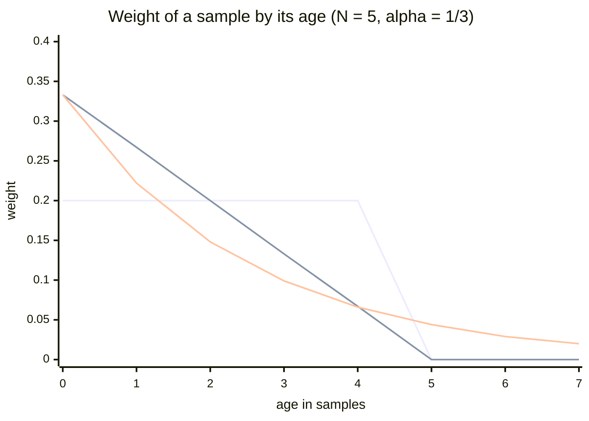
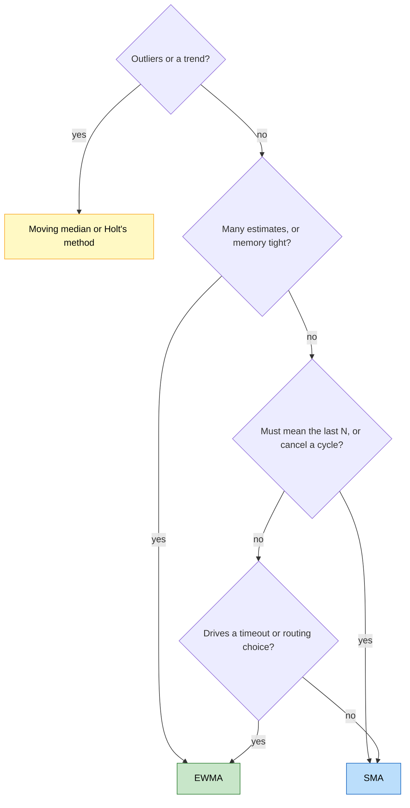

# When should software use an EWMA instead of other moving averages?

## 1. Abstract

Software that smooths a stream of measurements usually weighs three moving averages: the exponentially weighted moving average (EWMA), which keeps one number and lets each past sample's weight fade geometrically; the simple moving average (SMA), the plain mean of the last $N$ samples; and the weighted moving average (WMA), which favours recent samples inside a fixed window. Choose the EWMA when you keep many estimates and memory matters, when the estimate drives a control decision such as a timeout or a routing choice, or when there is no window to fill first: it stores a single value, updates in constant time, even with integer shifts alone, and has no edge where an old sample drops out and jolts the result. TCP's retransmission timer, the Linux load average and latency-aware load balancers use it. Choose the SMA when the number must mean exactly "the mean of the last $N$ samples", when a known cycle should be averaged out over one period, or when you want the least noise for the sharpest response to a step. The WMA sits between them, and the sources say little about it. The SMA separates frequency bands very poorly and the EWMA only fairly, and all three are pulled by outliers and lag behind trends: a moving median or a trend-aware method fits those cases. When samples arrive irregularly, derive the EWMA's $\alpha$ from the time between them.

## 2. Terminology

| Term | Definition |
|---|---|
| **EWMA** | Exponentially weighted moving average, keeping one value $s_t$. Also called EMA or simple exponential smoothing. |
| **$x_t$** | The sample arriving at step $t$. |
| **$s_t$** | The EWMA after the sample $x_t$. |
| **$\alpha$** | The EWMA's smoothing factor, between 0 and 1: the weight of the newest sample. |
| **SMA** | Simple moving average: the unweighted mean of the last $N$ samples. |
| **$m_t$** | The SMA after the sample $x_t$. |
| **WMA** | Weighted moving average, here with weights falling linearly from $N$ for the newest sample to 1 for the oldest in the window. |
| **$N$** | The window length: the number of most recent samples an SMA or WMA averages. |
| **Window** | The fixed set of most recent samples an SMA or WMA averages over. |
| **Lag** | How far a smoothed value trails behind changes in the data. |
| **Step response** | How a smoother's output moves when its input jumps to a new level: how sharp the edge stays. |
| **Frequency response** | How much of each frequency in the input a filter lets through; a low-pass filter keeps slow changes and removes fast ones. |
| **$H(f)$** | The SMA's frequency response at frequency $f$, as a fraction of the sampling rate (0 to 0.5). |
| **FIR, IIR** | Finite and infinite impulse response: whether one sample's influence on the output ends (an SMA) or only fades (an EWMA). |
| **Phase** | How a filter shifts the parts of a signal in time; a nonlinear phase makes a rising edge and a falling edge come out shaped differently. |
| **Circular buffer** | A fixed-size array reused in a ring, holding the window's samples. |
| **Fixed point** | Storing fractions as integers scaled by a power of two, so arithmetic needs only integer operations and shifts. |
| **$\tau$** | The EWMA's time constant: the time it takes to move about 63% of the way to a new level. |
| **$\Delta T$** | The time between two samples. |
| **[sllmwiki_reasoning]** | The narrative's own reasoning: a conclusion, comparison or reconstruction no cited source states. |
| **[sllmwiki_gap]** | Something the question needs that the sources don't answer. |

## 3. The choice

A load balancer keeps a latency estimate per replica, updated per response. In Linkerd's simulation, a moving average of each replica's round-trip time, weighted by its outstanding requests, held latency down to the 99.9th percentile when one replica slowed, where round robin degraded from the 95th. [\[1\]](../sources/ewma-linkerd-beyond-round-robin.md#results) [sllmwiki_reasoning] It compared balancers, not averages; the average sets per-replica memory and how fast slowdowns show.

Candidates:

- **EWMA:** each update moves a fraction $\alpha$ toward the new sample, so past samples' weights shrink exponentially. [\[2\]](../sources/moving-averages-wikipedia-moving-average.md#exponential-moving-average)
- **SMA:** the mean of the last $N$ samples, each with equal weight. [\[3\]](../sources/moving-averages-nist-single-moving-average.md#6421-single-moving-average)
- **WMA:** within the last $N$ samples, weights fall in arithmetic progression from $N$ for the newest to 1 for the oldest. [\[4\]](../sources/moving-averages-wikipedia-moving-average.md#weighted-moving-average)

$$
s_t = \alpha x_t + (1 - \alpha) s_{t-1}
$$

$$
m_t = \frac{x_t + x_{t-1} + \dots + x_{t-N+1}}{N}
$$

Rarer choices: a cumulative average weights all samples equally forever; [\[5\]](../sources/moving-averages-wikipedia-moving-average.md#cumulative-average) a moving median resists outliers better than any mean. [\[6\]](../sources/moving-averages-wikipedia-moving-average.md#moving-median)

[sllmwiki_reasoning] The chart, computed from the definitions for $N = 5$ and $\alpha = 1/3$, shows each candidate's weight by a sample's age: the SMA's end abruptly, the WMA's fall to zero, the EWMA's never reach zero.



## 4. At a glance

| Dimension | EWMA | SMA | WMA |
|---|---|---|---|
| State kept | The last average only [\[7\]](../sources/ewma-wikipedia-exponential-smoothing.md#comparison-with-moving-average) | The last $N$ samples [\[7\]](../sources/ewma-wikipedia-exponential-smoothing.md#comparison-with-moving-average) | The last $N$ samples, a total and a numerator [\[4\]](../sources/moving-averages-wikipedia-moving-average.md#weighted-moving-average) |
| Update cost | Constant; shifts and adds, in fixed point [\[8\]](../sources/ewma-linux-kernel-average-h-source.md#L66-L69) | Constant: one add, one subtract [\[9\]](../sources/moving-averages-smith-dspguide-moving-average-filters.md#page-8) | Constant [\[4\]](../sources/moving-averages-wikipedia-moving-average.md#weighted-moving-average) |
| Old samples | Fade, never zero [\[2\]](../sources/moving-averages-wikipedia-moving-average.md#exponential-moving-average) | Equal, then zero [\[3\]](../sources/moving-averages-nist-single-moving-average.md#6421-single-moving-average) | Fall linearly to zero [\[4\]](../sources/moving-averages-wikipedia-moving-average.md#weighted-moving-average) |
| Noise for a given step sharpness | No better than the SMA [\[10\]](../sources/moving-averages-smith-dspguide-moving-average-filters.md#page-3) | The least of any linear filter [\[10\]](../sources/moving-averages-smith-dspguide-moving-average-filters.md#page-3) | Not stated by the sources |
| Separating frequencies | Fair, like an RC circuit [\[11\]](../sources/ewma-smith-dspguide-recursive-filters.md#page-6) | Very poor [\[12\]](../sources/moving-averages-smith-dspguide-moving-average-filters.md#page-4) | Not stated by the sources |
| Phase | Nonlinear [\[13\]](../sources/ewma-smith-dspguide-recursive-filters.md#page-10) | Linear, if symmetric [\[13\]](../sources/ewma-smith-dspguide-recursive-filters.md#page-10) | Not stated by the sources |
| Jumps when old data leaves | No (reasoning, §5) | Yes [\[14\]](../sources/moving-averages-wikipedia-moving-average.md#simple-moving-average) | Not stated by the sources |
| Warm-up | None; about $3/\alpha$ samples to settle [\[15\]](../sources/ewma-wikipedia-exponential-smoothing.md#basic-simple-exponential-smoothing) | A cumulative average until full [\[14\]](../sources/moving-averages-wikipedia-moving-average.md#simple-moving-average) | Not stated by the sources |
| Skipped samples | Lose more [\[15\]](../sources/ewma-wikipedia-exponential-smoothing.md#basic-simple-exponential-smoothing) | Lose less [\[15\]](../sources/ewma-wikipedia-exponential-smoothing.md#basic-simple-exponential-smoothing) | Not stated by the sources |

## 5. Dimensions to think through

**Memory and update cost.** An EWMA keeps only its latest value; an $N$-point moving average keeps $N$ points. [\[7\]](../sources/ewma-wikipedia-exponential-smoothing.md#comparison-with-moving-average) Both update in constant time. The SMA adds the newest sample and subtracts the oldest whatever $N$ is, the fastest digital filter, [\[9\]](../sources/moving-averages-smith-dspguide-moving-average-filters.md#page-8) as sketched here:

```text
SMA, window N:  total = total + x - ring[i]; ring[i] = x; i = (i + 1) mod N; m = total / N
EWMA, factor a: s = s + a * (x - s)
```

With $\alpha = 1/2^n$, both TCP's estimator and the Linux kernel's EWMA replace the multiplication by shifts on scaled integers. [\[16\]](../sources/ewma-jacobson-congestion-avoidance.md#practice) [\[17\]](../sources/ewma-linux-kernel-average-h-source.md#L23-L26) The SMA works best in integers, since floating-point round-off makes its running total drift. [\[9\]](../sources/moving-averages-smith-dspguide-moving-average-filters.md#page-8)

**Edges.** An SMA "can also be disproportionately influenced by old data dropping out or new data coming in". [\[14\]](../sources/moving-averages-wikipedia-moving-average.md#simple-moving-average) [sllmwiki_reasoning] In an EWMA a spike's influence shrinks every update instead of vanishing $N$ samples later.

**Noise against responsiveness.** For random noise, the SMA gives the lowest noise for a given step sharpness of any linear filter, reducing noise by the square root of $N$. [\[10\]](../sources/moving-averages-smith-dspguide-moving-average-filters.md#page-3) An SMA lags the latest sample by half its window; [\[14\]](../sources/moving-averages-wikipedia-moving-average.md#simple-moving-average) with $\alpha = 2/(N+1)$, an EWMA and an $N$-point SMA have about the same forecast error, but no fixed shift corrects the EWMA's lag. [\[7\]](../sources/ewma-wikipedia-exponential-smoothing.md#comparison-with-moving-average)

**Frequencies and edges.** The SMA separates frequency bands very poorly: [\[12\]](../sources/moving-averages-smith-dspguide-moving-average-filters.md#page-4)

$$
H(f) = \frac{\sin(\pi f N)}{N \sin(\pi f)}
$$

Yet averaging over exactly one period removes that cycle. [\[14\]](../sources/moving-averages-wikipedia-moving-average.md#simple-moving-average) The EWMA is a single pole low-pass filter, like a resistor-capacitor circuit, separating signals "fairly well, but not perfectly". [\[11\]](../sources/ewma-smith-dspguide-recursive-filters.md#page-6) Its phase is nonlinear, shaping rising and falling edges differently, which a symmetric FIR filter avoids. [\[13\]](../sources/ewma-smith-dspguide-recursive-filters.md#page-10)

**What the number means.** An SMA is exactly the mean of the last $N$ samples. [\[3\]](../sources/moving-averages-nist-single-moving-average.md#6421-single-moving-average) Linux's "1, 5 and 15 minute" load averages are EWMAs that "reflect load well beyond 1, 5, and 15 minutes". [\[18\]](../sources/ewma-brendan-gregg-linux-load-averages.md#the-three-numbers)

**Start-up.** An EWMA gives a value once two samples are in, but takes about $3/\alpha$ samples to settle, [\[15\]](../sources/ewma-wikipedia-exponential-smoothing.md#basic-simple-exponential-smoothing) and its starting value can weigh unreasonably on early results. [\[19\]](../sources/ewma-wikipedia-exponential-smoothing.md#choosing-the-initial-smoothed-value) An SMA is a cumulative average until its window fills. [\[14\]](../sources/moving-averages-wikipedia-moving-average.md#simple-moving-average)

**Irregular samples.** An SMA loses less when samples are skipped. [\[15\]](../sources/ewma-wikipedia-exponential-smoothing.md#basic-simple-exponential-smoothing) A per-sample EWMA remembers samples, not time: with many samples per round trip, RFC 6298's constants "may keep an inadequate RTT history". [\[20\]](../sources/ewma-rfc6298-tcp-retransmission-timer.md#3-taking-rtt-samples) $\tau$ gives $\alpha$ from the sampling interval: [\[21\]](../sources/ewma-wikipedia-exponential-smoothing.md#time-constant)

$$
\alpha = 1 - e^{-\Delta T / \tau}
$$

[sllmwiki_reasoning] Recomputing it per gap ties the memory to $\tau$, not to a sample count.

[sllmwiki_gap] The sources don't compare the candidates on uneven data, or give the WMA's lag, warm-up or frequency response.

## 6. When to choose which

[sllmwiki_reasoning] This chart weighs the rules below: green marks the EWMA, blue the SMA, yellow alternatives outside the three.



**Choose an EWMA when** you keep many estimates and can afford one number each; [\[7\]](../sources/ewma-wikipedia-exponential-smoothing.md#comparison-with-moving-average) the estimate feeds a timeout or routing decision, as in TCP's retransmission timer and peak EWMA balancing; [\[22\]](../sources/ewma-rfc6298-tcp-retransmission-timer.md#2-the-basic-algorithm) [\[23\]](../sources/ewma-linkerd-beyond-round-robin.md#beyond-round-robin-load-balancing-for-latency) or the code must avoid multiplication and division. [\[17\]](../sources/ewma-linux-kernel-average-h-source.md#L23-L26)

**Choose an SMA when** the number must mean exactly the last $N$ samples; [\[3\]](../sources/moving-averages-nist-single-moving-average.md#6421-single-moving-average) a known cycle should be averaged out; [\[14\]](../sources/moving-averages-wikipedia-moving-average.md#simple-moving-average) or you want the least noise for the sharpest step. [\[10\]](../sources/moving-averages-smith-dspguide-moving-average-filters.md#page-3)

[sllmwiki_reasoning] **Choose a WMA when** recent samples should count more but nothing older than the window may count.

[sllmwiki_reasoning] **Switch** from an SMA to an EWMA when windows dominate memory or old spikes jolt the average as they leave, and back when people misread it as a window average. A moving median resists outliers better, [\[6\]](../sources/moving-averages-wikipedia-moving-average.md#moving-median) and Holt's method follows trends. [\[24\]](../sources/ewma-wikipedia-exponential-smoothing.md#double-exponential-smoothing-holt-linear)

## 7. Where to go next

- [What is an EWMA (exponentially weighted moving average), and how does it work?](what-is-an-ewma-exponentially-weighted-moving-average-and-how-does-it-work.md)
- How should an EWMA handle irregular samples? (not yet in the wiki)
- How does peak EWMA load balancing work? (not yet in the wiki)

## 8. References

### 8.1 Sources read

- [moving-averages-wikipedia-moving-average](../sources/moving-averages-wikipedia-moving-average.md): SMA, WMA, EMA, cumulative average and moving median, with their costs and artifacts.
- [moving-averages-nist-single-moving-average](../sources/moving-averages-nist-single-moving-average.md): the SMA's definition.
- [moving-averages-smith-dspguide-moving-average-filters](../sources/moving-averages-smith-dspguide-moving-average-filters.md): the SMA's noise, step and frequency response, and its O(1) recursion.
- [ewma-smith-dspguide-recursive-filters](../sources/ewma-smith-dspguide-recursive-filters.md): the EWMA as a single pole filter, and its phase.
- [ewma-wikipedia-exponential-smoothing](../sources/ewma-wikipedia-exponential-smoothing.md): the EWMA compared with the SMA; warm-up, skipped samples, time constant.
- [ewma-linux-kernel-average-h-source](../sources/ewma-linux-kernel-average-h-source.md): a fixed-point EWMA with shifts, seeded by the first sample.
- [ewma-jacobson-congestion-avoidance](../sources/ewma-jacobson-congestion-avoidance.md): choosing the gain; shifts in place of division.
- [ewma-rfc6298-tcp-retransmission-timer](../sources/ewma-rfc6298-tcp-retransmission-timer.md): an EWMA in a standard, and its sample-rate caveat.
- [ewma-brendan-gregg-linux-load-averages](../sources/ewma-brendan-gregg-linux-load-averages.md): what an EWMA's "window" really means.
- [ewma-linkerd-beyond-round-robin](../sources/ewma-linkerd-beyond-round-robin.md): an EWMA in a load balancer, with measurements.
- [ewma-fpp3-simple-exponential-smoothing](../sources/ewma-fpp3-simple-exponential-smoothing.md), [ewma-nist-single-exponential-smoothing](../sources/ewma-nist-single-exponential-smoothing.md) and [ewma-finch-incremental-weighted-mean-variance](../sources/ewma-finch-incremental-weighted-mean-variance.md): background on the EWMA itself.

### 8.2 Citations

1. [ewma-linkerd-beyond-round-robin: results](../sources/ewma-linkerd-beyond-round-robin.md#results)
2. [moving-averages-wikipedia-moving-average: exponential moving average](../sources/moving-averages-wikipedia-moving-average.md#exponential-moving-average)
3. [moving-averages-nist-single-moving-average: 6421 single moving average](../sources/moving-averages-nist-single-moving-average.md#6421-single-moving-average)
4. [moving-averages-wikipedia-moving-average: weighted moving average](../sources/moving-averages-wikipedia-moving-average.md#weighted-moving-average)
5. [moving-averages-wikipedia-moving-average: cumulative average](../sources/moving-averages-wikipedia-moving-average.md#cumulative-average)
6. [moving-averages-wikipedia-moving-average: moving median](../sources/moving-averages-wikipedia-moving-average.md#moving-median)
7. [ewma-wikipedia-exponential-smoothing: comparison with moving average](../sources/ewma-wikipedia-exponential-smoothing.md#comparison-with-moving-average)
8. [ewma-linux-kernel-average-h-source: L66 L69](../sources/ewma-linux-kernel-average-h-source.md#L66-L69)
9. [moving-averages-smith-dspguide-moving-average-filters: page 8](../sources/moving-averages-smith-dspguide-moving-average-filters.md#page-8)
10. [moving-averages-smith-dspguide-moving-average-filters: page 3](../sources/moving-averages-smith-dspguide-moving-average-filters.md#page-3)
11. [ewma-smith-dspguide-recursive-filters: page 6](../sources/ewma-smith-dspguide-recursive-filters.md#page-6)
12. [moving-averages-smith-dspguide-moving-average-filters: page 4](../sources/moving-averages-smith-dspguide-moving-average-filters.md#page-4)
13. [ewma-smith-dspguide-recursive-filters: page 10](../sources/ewma-smith-dspguide-recursive-filters.md#page-10)
14. [moving-averages-wikipedia-moving-average: simple moving average](../sources/moving-averages-wikipedia-moving-average.md#simple-moving-average)
15. [ewma-wikipedia-exponential-smoothing: basic simple exponential smoothing](../sources/ewma-wikipedia-exponential-smoothing.md#basic-simple-exponential-smoothing)
16. [ewma-jacobson-congestion-avoidance: practice](../sources/ewma-jacobson-congestion-avoidance.md#practice)
17. [ewma-linux-kernel-average-h-source: L23 L26](../sources/ewma-linux-kernel-average-h-source.md#L23-L26)
18. [ewma-brendan-gregg-linux-load-averages: the three numbers](../sources/ewma-brendan-gregg-linux-load-averages.md#the-three-numbers)
19. [ewma-wikipedia-exponential-smoothing: choosing the initial smoothed value](../sources/ewma-wikipedia-exponential-smoothing.md#choosing-the-initial-smoothed-value)
20. [ewma-rfc6298-tcp-retransmission-timer: 3 taking rtt samples](../sources/ewma-rfc6298-tcp-retransmission-timer.md#3-taking-rtt-samples)
21. [ewma-wikipedia-exponential-smoothing: time constant](../sources/ewma-wikipedia-exponential-smoothing.md#time-constant)
22. [ewma-rfc6298-tcp-retransmission-timer: 2 the basic algorithm](../sources/ewma-rfc6298-tcp-retransmission-timer.md#2-the-basic-algorithm)
23. [ewma-linkerd-beyond-round-robin: beyond round robin load balancing for latency](../sources/ewma-linkerd-beyond-round-robin.md#beyond-round-robin-load-balancing-for-latency)
24. [ewma-wikipedia-exponential-smoothing: double exponential smoothing holt linear](../sources/ewma-wikipedia-exponential-smoothing.md#double-exponential-smoothing-holt-linear)

## 9. Metadata

- **Version:** 1.3
- **Template:** comparison
- **Model:** claude-opus-5-5
- **Created:** 2026-10-20
- **Last modified:** 2026-10-21
- **History:**
  - 1.3 (2026-10-21): Lint: per-gap alpha for irregular samples marked as reasoning; the Abstract's frequency claim matches the table (the EWMA separates fairly); the window is written N throughout; the kernel's update is called shifts and adds; trimmed to the 1,200-word budget.
  - 1.2 (2026-10-21): Rework under the current comparison template and writing guide: new DSP, fixed-point and TCP sources fill the noise, frequency-response, phase and cost dimensions; weight-by-age chart, decision flowchart, update pseudocode and TeX; remaining WMA and irregular-sampling gaps marked.
  - 1.1 (2026-10-21): Lint: start-up claims match the source (a value once two samples are in); WMA skipped-samples and two unsupported EWMA cells now gaps; the sample-rate pitfall worded as RFC 6298 puts it; the Linkerd experiment's scope stated; WMA window written N throughout.
  - 1.0 (2026-10-20): First version.
- **Reading plan:**
  1. `what-is-an-ewma-exponentially-weighted-moving-average-and-how-does-it-work`, in full: existing narrative, background
  2. `ewma-nist-single-exponential-smoothing`, in full: medium relevance, authority B, undated
  3. `ewma-fpp3-simple-exponential-smoothing`, in full: medium relevance, authority B, undated
  4. `ewma-finch-incremental-weighted-mean-variance`, in full: medium relevance, authority B, 2009-02-01
  5. `ewma-jacobson-congestion-avoidance`, in full: medium relevance, authority A, 1988-11-01
  6. `moving-averages-wikipedia-moving-average`, in full: high relevance, authority C, undated
  7. `ewma-wikipedia-exponential-smoothing`, in full: high relevance, authority C, undated
  8. `ewma-linkerd-beyond-round-robin`, in full: high relevance, authority C, 2016-03-16
  9. `ewma-brendan-gregg-linux-load-averages`, in full: high relevance, authority C, 2017-08-08
  10. `moving-averages-nist-single-moving-average`, in full: high relevance, authority B, undated
  11. `ewma-smith-dspguide-recursive-filters`, in full: high relevance, authority B, 1997-01-01
  12. `moving-averages-smith-dspguide-moving-average-filters`, in full: high relevance, authority B, 1997-01-01
  13. `ewma-linux-kernel-average-h-source`, in full: high relevance, authority A, undated
  14. `ewma-rfc6298-tcp-retransmission-timer`, in full: high relevance, authority A, 2011-06-01
  15. `ewma-nist-ewma-control-charts`, abstract only: low relevance
