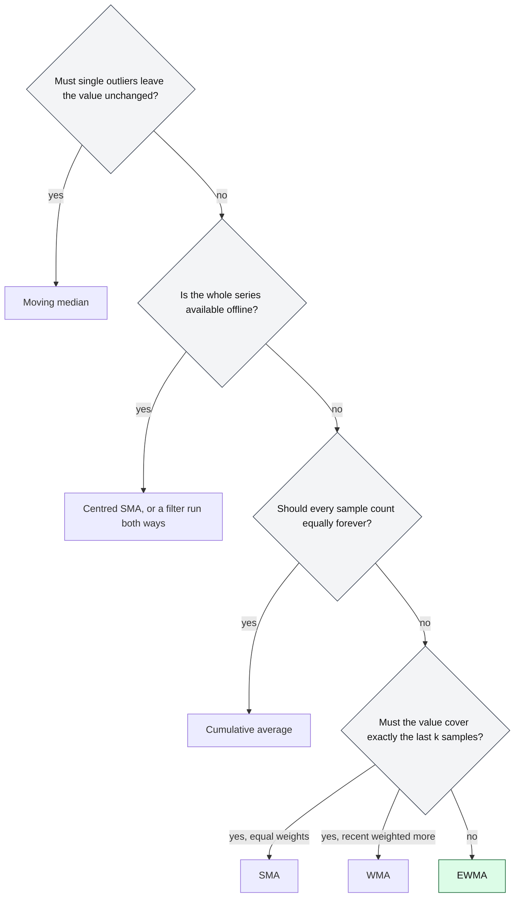

# When should software use an EWMA instead of other moving averages?

## 1. Abstract

Software that smooths a noisy measurement stream, such as latencies or round-trip times, must pick a moving average. Pick an EWMA when it runs online over many streams, should forget gradually, and may store one number per stream. Pick a simple moving average for an exact last-k window or offline smoothing, a moving median when outliers must not move the value, and a cumulative average when every sample counts forever.

**Key takeaways:**

- An EWMA stores one number per stream; a k-sample window stores k samples.
- An EWMA with α = 2/(k+1) forecasts about as well as a k-sample SMA.
- Neither mean resists outliers; a moving median does.
- An EWMA's lag can't be shifted away, and its "1-minute" label isn't a 1-minute window.

## 2. Terminology

| Term | Definition |
|---|---|
| **$x_t$** | The sample at step $t$. |
| **SMA** | Simple moving average: the unweighted mean of the last $k$ samples. |
| **WMA** | Weighted moving average with weights $k, k-1, \dots, 1$ over the last $k$ samples. |
| **EWMA** | Exponentially weighted moving average: $s_t = \alpha x_t + (1-\alpha) s_{t-1}$. |
| **CA** | Cumulative average: the mean of every sample so far. |
| **α** | The EWMA's smoothing factor, $0 < \alpha \le 1$; larger means less smoothing. |
| **$k$** | A window's length, in samples. |
| **FIR, IIR filter** | Finite or infinite impulse response: whether an input's effect on the output ends after a fixed number of steps or only decays. |
| **[→]** | Our own reasoning, after a statement or on a section's heading: a conclusion, comparison or example no cited source states. |
| **[?]** | A gap, after a statement or on a heading: something the question needs that the sources don't answer. |

## 3. The choices

Software that acts on a measurement smooths it first, and the rule decides how fast it notices change, how much one bad sample sways it, and what each stream costs [→]. The candidates sit between two extremes, trusting only the latest sample or weighting all samples equally, and the EWMA lies between them [→].

**Base scenario.** A client library tracks the latency of each of thousands of backends, to route requests and to show a smoothed latency on a dashboard. Samples arrive around 100 ms, with a few milliseconds of jitter and the occasional 300 ms outlier. The library wants a value after every sample, little memory per backend, and to follow a real slowdown within about 15 samples [→].

### 3.1 Simple moving average (SMA)

The SMA is the mean of the last $k$ samples, each weighted $1/k$ [\[1\]](../sources/moving-averages-wikipedia-moving-average.md#simple-moving-average). It updates in constant time from a buffer of the last $k$ samples: each new value comes in and the oldest drops out [\[1\]](../sources/moving-averages-wikipedia-moving-average.md#simple-moving-average). Its subtle difference from the EWMA is the hard edge: a sample counts fully for $k$ steps, then not at all, so the output also moves when old data drops out [\[1\]](../sources/moving-averages-wikipedia-moving-average.md#simple-moving-average).

**It wins when** the dashboard must show the mean of exactly the last $k$ requests, or the series is analysed offline: a centred SMA has no time shift [\[1\]](../sources/moving-averages-wikipedia-moving-average.md#simple-moving-average).

### 3.2 Weighted moving average (WMA)

The WMA tapers its weights linearly to zero across the window, and ignores everything outside the window [\[2\]](../sources/moving-averages-wikipedia-moving-average.md#weighted-moving-average). It updates incrementally but still needs a buffer of the window [\[2\]](../sources/moving-averages-wikipedia-moving-average.md#weighted-moving-average). Its difference from the EWMA: the weights reach zero at a finite age instead of shrinking forever [\[3\]](../sources/moving-averages-wikipedia-moving-average.md#exponential-moving-average).

**It wins when** recent samples should dominate and the reader expects a strict horizon, as in financial charts [\[2\]](../sources/moving-averages-wikipedia-moving-average.md#weighted-moving-average).

### 3.3 Exponentially weighted moving average (EWMA)

Each sample moves the estimate a fraction α of the way toward itself, so a sample $j$ steps old carries weight $\alpha(1-\alpha)^j$; see [What is an EWMA, and how does it work?](what-is-an-ewma-exponentially-weighted-moving-average-and-how-does-it-work.md). It is a first-order IIR filter whose weights decay exponentially and never reach zero, [\[3\]](../sources/moving-averages-wikipedia-moving-average.md#exponential-moving-average) and it keeps only its latest value [\[4\]](../sources/ewma-wikipedia-exponential-smoothing.md#comparison-with-moving-average). Its difference from the SMA it most resembles: with $\alpha = 2/(k+1)$ the two have roughly the same forecast error, yet the EWMA still weights all past data [\[4\]](../sources/ewma-wikipedia-exponential-smoothing.md#comparison-with-moving-average).

**It wins in the base scenario:** thousands of streams at one number each, a value from the first sample on, [\[5\]](../sources/ewma-wikipedia-exponential-smoothing.md#basic-simple-exponential-smoothing) and an outlier that fades rather than vanishing all at once [→]. A control chart built on an EWMA is sensitive to small shifts in the mean, though Shewhart charts catch larger shifts better [\[6\]](../sources/ewma-wikipedia-ewma-chart.md#ewma-chart---wikipedia). Finagle's load balancer ranks backends by a peak-sensitive EWMA of their round-trip times, [\[7\]](../sources/ewma-finagle-clients-docs.md#power-of-two-choices-p2c--peak-ewma-2) and Unix load averages are EWMAs of the number of runnable processes [\[8\]](../sources/ewma-wikipedia-load-computing.md#load-average).

### 3.4 Cumulative average (CA)

The CA is the mean of every sample so far, updated from the previous mean and a count; its difference from an EWMA is that its step size $1/(n+1)$ shrinks with each sample, while the EWMA's α stays fixed [\[9\]](../sources/moving-averages-wikipedia-moving-average.md#cumulative-average), [\[5\]](../sources/ewma-wikipedia-exponential-smoothing.md#basic-simple-exponential-smoothing).

**It wins when** the level doesn't drift and the long-run mean is wanted [→].

### 3.5 Moving median

The moving median takes the median of the last $k$ samples instead of their mean [\[10\]](../sources/moving-averages-wikipedia-moving-average.md#moving-median). Its difference: it is no average, so one huge sample barely drags it [\[10\]](../sources/moving-averages-wikipedia-moving-average.md#moving-median).

**It wins when** the base scenario's outliers are frequent and must not move the value [→]: a mean is sensitive to shocks, the median robust to them [\[10\]](../sources/moving-averages-wikipedia-moving-average.md#moving-median). It costs a window plus an ordered index [\[10\]](../sources/moving-averages-wikipedia-moving-average.md#moving-median).

Rarer averages are in the Appendix.

## 4. When to choose which

*Figure 4-1: The questions that decide the choice; green marks the base scenario's answer, the EWMA.*

The rules: [→]

- **Use an EWMA** online, over many streams, to follow a drifting level and forget gradually. Set α from the memory you want: about $1/\alpha$ samples to 63%, $3/\alpha$ to 95% [\[11\]](../sources/ewma-wikipedia-exponential-smoothing.md#time-constant), [\[5\]](../sources/ewma-wikipedia-exponential-smoothing.md#basic-simple-exponential-smoothing). Switch when readers expect a fixed window or outliers dominate.
- **Use an SMA** when the last $k$ samples are the contract, when samples may be skipped, [\[5\]](../sources/ewma-wikipedia-exponential-smoothing.md#basic-simple-exponential-smoothing) or offline, centred.
- **Use a WMA** only when a strict horizon and recency weighting are both required.
- **Use a cumulative average** when the level doesn't drift; once it drifts, switch to an EWMA, since the CA's weight on new samples keeps falling [\[9\]](../sources/moving-averages-wikipedia-moving-average.md#cumulative-average).
- **Use a moving median** when single bad samples must not move the answer.

## 5. At a glance

| Dimension | SMA | WMA | EWMA | CA | Moving median |
|---|---|---|---|---|---|
| Memory per stream | $k$ samples [\[1\]](../sources/moving-averages-wikipedia-moving-average.md#simple-moving-average) | $k$ samples [\[2\]](../sources/moving-averages-wikipedia-moving-average.md#weighted-moving-average) | one value [\[4\]](../sources/ewma-wikipedia-exponential-smoothing.md#comparison-with-moving-average) | mean and count [\[9\]](../sources/moving-averages-wikipedia-moving-average.md#cumulative-average) | $k$ samples and an index [\[10\]](../sources/moving-averages-wikipedia-moving-average.md#moving-median) |
| How old data leaves | all at once after $k$ steps [\[1\]](../sources/moving-averages-wikipedia-moving-average.md#simple-moving-average) | fades to zero at $k$ [\[2\]](../sources/moving-averages-wikipedia-moving-average.md#weighted-moving-average) | fades, never zero [\[3\]](../sources/moving-averages-wikipedia-moving-average.md#exponential-moving-average) | never [\[9\]](../sources/moving-averages-wikipedia-moving-average.md#cumulative-average) | after $k$ steps [\[10\]](../sources/moving-averages-wikipedia-moving-average.md#moving-median) |
| First output | after filling, or as a CA meanwhile [\[1\]](../sources/moving-averages-wikipedia-moving-average.md#simple-moving-average) | after filling [→] | first sample [\[5\]](../sources/ewma-wikipedia-exponential-smoothing.md#basic-simple-exponential-smoothing) | first sample [\[9\]](../sources/moving-averages-wikipedia-moving-average.md#cumulative-average) | after filling [→] |
| Lag and phase | about $k/2$ samples, removable by centring [\[1\]](../sources/moving-averages-wikipedia-moving-average.md#simple-moving-average) | not given in the sources [?] | frequency-dependent, not removable by a shift [\[4\]](../sources/ewma-wikipedia-exponential-smoothing.md#comparison-with-moving-average) | grows with $n$ [→] | not given in the sources [?] |
| Outliers | spread over $k$ samples [→] | spread, weighted by age [→] | spread with decaying weight [→] | diluted by $n$ [→] | resisted [\[10\]](../sources/moving-averages-wikipedia-moving-average.md#moving-median) |
| Integer arithmetic | sums and one division [→] | possible [→] | fixed point, as in Linux's load average [\[12\]](../sources/ewma-wikipedia-load-computing.md#linux-as-an-example) | divide per update [\[9\]](../sources/moving-averages-wikipedia-moving-average.md#cumulative-average) | comparisons only [→] |

## 6. Dimensions to think through

### 6.1 Memory and cost per update

The SMA updates by adding the new value and dropping the oldest, whatever $k$, [\[1\]](../sources/moving-averages-wikipedia-moving-average.md#simple-moving-average) but it needs the last $k$ samples; the EWMA needs only its last value [\[4\]](../sources/ewma-wikipedia-exponential-smoothing.md#comparison-with-moving-average). With $k = 15$, that is 15 stored samples per backend against one, at about the same forecast error with $\alpha = 2/16 = 1/8$ [\[4\]](../sources/ewma-wikipedia-exponential-smoothing.md#comparison-with-moving-average).

### 6.2 How old data leaves

Take one 300 ms outlier among 100 ms samples. A 15-sample SMA rises by $200/15 \approx 13.3$ ms, holds there for 15 samples, then drops 13.3 ms at once when the outlier leaves [\[1\]](../sources/moving-averages-wikipedia-moving-average.md#simple-moving-average). An EWMA with α = 1/8 rises by 25 ms and loses one eighth of the excess with every sample after, from its update rule [\[5\]](../sources/ewma-wikipedia-exponential-smoothing.md#basic-simple-exponential-smoothing).

### 6.3 Lag and phase

A trailing SMA lags by half its window, and centring removes that shift offline; [\[1\]](../sources/moving-averages-wikipedia-moving-average.md#simple-moving-average) the EWMA's kernel is asymmetric, so different frequencies are delayed differently and no shift corrects it [\[4\]](../sources/ewma-wikipedia-exponential-smoothing.md#comparison-with-moving-average). Online, both lag; the choice is how much [→].

### 6.4 Noise against responsiveness

A longer window or a smaller α averages away more noise but follows a real change more slowly [→]; with history, α can be fitted by minimizing squared forecast errors [\[13\]](../sources/ewma-wikipedia-exponential-smoothing.md#optimization). An SMA can also be swayed by data dropping out as much as by data coming in [\[1\]](../sources/moving-averages-wikipedia-moving-average.md#simple-moving-average). The EWMA suits series without trend; on trending data, Holt's double exponential smoothing adds a trend term [\[14\]](../sources/ewma-wikipedia-exponential-smoothing.md#double-exponential-smoothing-holt-linear).

### 6.5 Outliers

Every mean here is pulled by a shock; the moving median less so, and it is optimal when deviations are heavy-tailed (Laplace) rather than normal [\[10\]](../sources/moving-averages-wikipedia-moving-average.md#moving-median).

### 6.6 Arithmetic

An EWMA runs in fixed point: Linux updates its load averages every 5 seconds with 11 fractional bits and integer decay constants [\[12\]](../sources/ewma-wikipedia-load-computing.md#linux-as-an-example). An SMA's running sum stays exact in integers until the final division [→].

## 7. Pitfalls

- **Naming an EWMA by a window.** Linux's "one-minute" load average is about 63% load from the last minute and 37% from before it, because it is an EWMA that decays by $e$ in a minute, not a one-minute mean [\[8\]](../sources/ewma-wikipedia-load-computing.md#load-average). Label an EWMA by its time constant [→].
- **α per sample, not per second.** Sampling faster shortens an EWMA's memory in time [→]; Finagle derives each weight from the time since the last sample for this reason, since a backend's samples arrive unevenly [\[15\]](../sources/ewma-finagle-peak-ewma-source.md#L47-L53).

## 8. Where to go next

- [What is an EWMA, and how does it work?](what-is-an-ewma-exponentially-weighted-moving-average-and-how-does-it-work.md)
- How do Holt and Holt-Winters exponential smoothing handle trends and seasons? (not yet a narrative)

## 9. Appendix

### 9.1 Rarer averages

A power-law average keeps distant samples comparably weighted but takes $O(n \log n)$ where the EWMA updates in $O(1)$ [\[16\]](../sources/moving-averages-wikipedia-moving-average.md#power-law-moving-average).

## 10. References

### 10.1 Sources read

- [moving-averages-wikipedia-moving-average](../sources/moving-averages-wikipedia-moving-average.md): the SMA, WMA, cumulative average, moving median and power-law average.
- [ewma-wikipedia-exponential-smoothing](../sources/ewma-wikipedia-exponential-smoothing.md): the EWMA against the moving average, its time constant, warm-up, seed, fitting and trend methods.
- [ewma-wikipedia-ewma-chart](../sources/ewma-wikipedia-ewma-chart.md): EWMA control charts and small shifts.
- [ewma-wikipedia-load-computing](../sources/ewma-wikipedia-load-computing.md): load averages as EWMAs, and Linux's fixed-point update.
- [ewma-finagle-clients-docs](../sources/ewma-finagle-clients-docs.md), [ewma-finagle-peak-ewma-source](../sources/ewma-finagle-peak-ewma-source.md): a load balancer's peak EWMA with time-based weights.

### 10.2 Citations

1. [moving-averages-wikipedia-moving-average: Simple moving average](../sources/moving-averages-wikipedia-moving-average.md#simple-moving-average)
2. [moving-averages-wikipedia-moving-average: Weighted moving average](../sources/moving-averages-wikipedia-moving-average.md#weighted-moving-average)
3. [moving-averages-wikipedia-moving-average: Exponential moving average](../sources/moving-averages-wikipedia-moving-average.md#exponential-moving-average)
4. [ewma-wikipedia-exponential-smoothing: Comparison with moving average](../sources/ewma-wikipedia-exponential-smoothing.md#comparison-with-moving-average)
5. [ewma-wikipedia-exponential-smoothing: Basic (simple) exponential smoothing](../sources/ewma-wikipedia-exponential-smoothing.md#basic-simple-exponential-smoothing)
6. [ewma-wikipedia-ewma-chart: EWMA chart - Wikipedia](../sources/ewma-wikipedia-ewma-chart.md#ewma-chart---wikipedia)
7. [ewma-finagle-clients-docs: Power of Two Choices (P2C) + Peak EWMA 2¶](../sources/ewma-finagle-clients-docs.md#power-of-two-choices-p2c--peak-ewma-2)
8. [ewma-wikipedia-load-computing: Load average](../sources/ewma-wikipedia-load-computing.md#load-average)
9. [moving-averages-wikipedia-moving-average: Cumulative average](../sources/moving-averages-wikipedia-moving-average.md#cumulative-average)
10. [moving-averages-wikipedia-moving-average: Moving median](../sources/moving-averages-wikipedia-moving-average.md#moving-median)
11. [ewma-wikipedia-exponential-smoothing: Time constant](../sources/ewma-wikipedia-exponential-smoothing.md#time-constant)
12. [ewma-wikipedia-load-computing: Linux as an example](../sources/ewma-wikipedia-load-computing.md#linux-as-an-example)
13. [ewma-wikipedia-exponential-smoothing: Optimization](../sources/ewma-wikipedia-exponential-smoothing.md#optimization)
14. [ewma-wikipedia-exponential-smoothing: Double exponential smoothing (Holt linear)](../sources/ewma-wikipedia-exponential-smoothing.md#double-exponential-smoothing-holt-linear)
15. [ewma-finagle-peak-ewma-source: L47-L53](../sources/ewma-finagle-peak-ewma-source.md#L47-L53)
16. [moving-averages-wikipedia-moving-average: Power-law moving average](../sources/moving-averages-wikipedia-moving-average.md#power-law-moving-average)

## 11. Metadata

- **Version:** 1.1
- **Template:** comparison
- **Language:** en
- **Model:** claude-opus-5-5
- **Created:** 2026-10-23
- **Last modified:** 2026-10-25
- **Words:** 1,653 (about 7 min)
- **History:**
  - 1.1 (2026-10-25): Openly licensed sources only, for a public demo: the DSP Guide, NIST, FPP3, Jacobson, RFC 6298, the Linux kernel helper and Gregg (now links) replaced by Wikipedia and Finagle; the SMA's optimal-noise and recursive-phase claims, which no open source states, removed
  - 1.0 (2026-10-23): First version.
- **Reading plan:**
  1. `ewma-wikipedia-load-computing`, in full: medium relevance, authority B, undated
  2. `ewma-wikipedia-ewma-chart`, in full: medium relevance, authority B, undated
  3. `ewma-finagle-peak-ewma-source`, in full: medium relevance, authority A, undated
  4. `ewma-finagle-clients-docs`, in full: medium relevance, authority A, undated
  5. `moving-averages-wikipedia-moving-average`, in full: high relevance, authority B, undated
  6. `ewma-wikipedia-exponential-smoothing`, in full: high relevance, authority B, undated
  7. `what-is-an-ewma-exponentially-weighted-moving-average-and-how-does-it-work`, in full: existing narrative, high relevance: built on
  8. `ewma-finagle-ema-source`, abstract only: low relevance
  9. `ewma-wikipedia-low-pass-filter`, abstract only: low relevance
  10. `ewma-nist-ewma-control-charts`, not read: a link, no saved copy
  11. `ewma-nist-single-exponential-smoothing`, not read: a link, no saved copy
  12. `moving-averages-nist-single-moving-average`, not read: a link, no saved copy
  13. `ewma-rfc6298-tcp-retransmission-timer`, not read: a link, no saved copy
  14. `ewma-linkerd-beyond-round-robin`, not read: a link, no saved copy
  15. `ewma-brendan-gregg-linux-load-averages`, not read: a link, no saved copy
  16. `ewma-fpp3-simple-exponential-smoothing`, not read: a link, no saved copy
  17. `ewma-jacobson-congestion-avoidance`, not read: a link, no saved copy
  18. `ewma-finch-incremental-weighted-mean-variance`, not read: a link, no saved copy
  19. `ewma-smith-dspguide-recursive-filters`, not read: a link, no saved copy
  20. `ewma-linux-kernel-average-h-source`, not read: a link, no saved copy
  21. `moving-averages-smith-dspguide-moving-average-filters`, not read: a link, no saved copy
